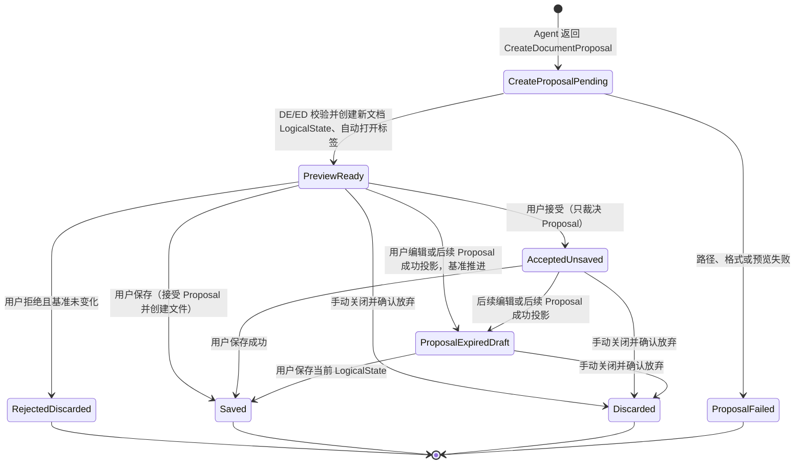

---
文档编号：AG-M-D-02
文档状态：A
负责模块：AG
文档职责：Agent 1.0 候选能力基线与需求分解
上游约束：A-CORE-C-P-01、A-CORE-X-L-06、A-AG-M-D-01、A-AG-X-L-03、A-AG-X-L-04、A-VAL-X-V-01
直接承接：AG/DE/ED/WS/DOC/REF/ENT 的需求同步、技术设计、状态机、接口协议、验证场景和开发计划
使用边界：本文是本轮需求收敛的候选基线，不修改既有 RULE/CHAIN/CONSTRAINT，不替代已确认的技术设计或实现事实
变更要求：每项候选能力经人类确认后，须同步发布范围、模块需求、技术设计、状态机、接口、测试/验证卡；未经确认不得据此扩大 Runtime Profile 或工具授权
治理成熟度：draft
---

# Binder Agent 1.0 能力基线与需求分解（候选）

## 0. 文档状态与使用方式

本文用于把「Binder 应有一个怎样的文档项目 Agent」收敛为可确认、可实现、可验收的 1.0 基线。
它不是一次性替换既有文档，也不授权代码修改。本文中的能力、状态与术语分为三类：

| 标记 | 含义 | 对实现的约束 |
|---|---|---|
| `候选` | 已提出、等待逐条裁决 | 不得作为新增功能或扩大权限的依据 |
| `已确认` | 人类确认进入 1.0 基线 | 必须同步为 L1/L2/状态机/接口/验证要求 |
| `已冻结` | 已确认且完成设计同步 | 后续实现只能满足它；范围变化须显式开启新的需求裁决 |

本文件的确认顺序固定为：先确认跨模块状态与副作用，再确认能力边界，最后确认各能力的发布档位。
原因是同一项能力（例如“新建文档”）只有在状态真值、确认点和保存语义明确后，才有稳定的验收对象。

### 0.1 本轮目标

1. 建立完整能力地图，覆盖聊天、项目/编辑器感知、编辑、文件、网络、多文档、编排、工具和记忆；
2. 明确哪些能力构成 Agent 1.0 主链，哪些能力属于受控开放，哪些后置；
3. 为每项能力给出对象范围、副作用、确认点、失败语义和验收口径；
4. 将“新建文档”从直接创建文件，收敛为可预览的内存文档到显式保存的状态链；
5. 在逐条确认后，形成下游文档和代码都必须遵守的唯一基线。

### 0.2 不在本文中裁决的事项

- 具体模型、提示词措辞、供应商和模型参数；
- 某个工具的函数签名、数据库表字段和前端组件实现；
- 既有代码是否已经符合本文；
- 复杂自主规划、多 Agent 协作、开放式浏览器自动化和任意命令执行。

这些内容只能在能力边界已确认后，分别进入技术设计或后续 Runtime Profile。

## 1. 1.0 的产品承诺与非目标

### 1.1 候选产品承诺

Binder Agent 1.0 是一个**以用户持续参与为前提的文档项目协作 Agent**。它能够理解工作区和当前编辑器状态，按当前任务搜集受许可的信息，调用受限工具，提出可审阅的内容或文件操作，并让用户在副作用发生前看见、确认、拒绝或取消结果。

它的价值不以“工具数量”或“自主程度”衡量，而以以下闭环是否可靠衡量：

```text
用户任务
  → 识别目标、范围与副作用
  → 取得可追溯的项目/编辑器/外部上下文
  → 按需授予最小工具集
  → 执行受限步骤并产生回答、分析或变更提案
  → 用户审阅、接受/拒绝或取消
  → LogicalState 更新、显式保存后才写入 DiskState
  → 可恢复历史与可解释 Trace
```

### 1.2 明确不应由 1.0 隐式提供的能力

- 模型绕过用户确认直接覆盖文档或磁盘文件；
- 只因工具已经注册，就向任意回合默认暴露；
- 未标明目标、影响范围和失败处理的跨文档批量写入；
- 以长期“模型记忆”替代可核验的编辑、Proposal 或保存事实；
- 把网页、文档、引用中的文字当作系统指令；
- 把尚无格式保真、回滚和验证证据的表格/图片/转换能力描述为已支持；
- 以 Prompt 中的限制替代运行时权限、状态或路径校验。

## 2. 跨模块状态与副作用基线（先确认）

### 2.1 状态真值层

下表定义的是需求层的状态责任，不预设某个 store、数据库或 IPC 的实现。

| 状态层 | 记录的事实 | 主责模块 | 不能替代它的状态 |
|---|---|---|---|
| `WorkspaceCatalogState` | 磁盘工作区已存在的目录、文件、路径、类型与外部变化 | WS | 不含尚未保存的新文档 |
| `EditorSessionState` | 已打开的文档标签、活动文档、选区、焦点和各标签的会话归属 | ED | 不是文档正文的独立真值，也不以磁盘旧内容替代已打开文档内容 |
| `LogicalState` | 一份已打开文档当前可继续编辑的内容、格式、版本、基准和脏态；包含尚未保存的新文档 | ED | 不等同于 Proposal 或已落盘文件 |
| `ProposalState` | Proposal/Diff 的目标、基准、预览、接受、拒绝、冲突、失败和保存关联 | DE | 不是编辑器正文或磁盘文件本体 |
| `UnsavedDocumentMetadata`（候选术语） | 尚未落盘新文档的临时身份、目标路径、格式、来源 Proposal 和保存资格；它附着于同一份 `LogicalState` | WS/ED/DE 联合 | 不复制正文，不应作为真实文件树节点或 DiskState 文件 |
| `DiskState` | 已成功落盘的文件内容、路径和可重开事实 | WS | 不代表未保存编辑或预览内容 |
| `AgentSessionState` | 用户/Agent 交互、任务步骤、工具摘要、结果和错误历史 | AG | 不保存为文档事实的完整替身 |
| `AgentTrace` | 意图、上下文来源、授权、工具、Proposal、终态和错误码的关联证据 | AG/DE/ENT 联合 | 不应默认保存用户正文或密钥 |

**术语澄清**：`LogicalState` 是既有核心概念。本轮不再把 `EditorSessionState` 当作“新建文档的逻辑状态”本身：它是标签和编辑会话的容器；新建文档一旦在编辑器打开，和既有文档一样拥有自己的 `LogicalState`。`UnsavedDocumentMetadata` 仅是候选命名，后续技术设计时再决定是否需要注册跨模块 TERM。

### 2.2 通用副作用分级

| 等级 | 示例 | 默认执行方式 | 必须记录 |
|---|---|---|---|
| `R0 只读` | 聊天、读取、搜索、项目报告 | 可直接执行 | 来源、范围、工具结果 |
| `R1 外部读取` | 网页搜索、读取网页资料 | 用户任务触发后执行 | 查询、来源 URL、时间、失败原因 |
| `W1 文档提案` | 内容/样式/表格/图片修改、新建文档内容 | Proposal + 可见预览 + 用户确认 | 基准、目标、预览与裁决结果 |
| `W2 可恢复文件结构变更` | 创建空文件夹、重命名、移动、复制/转换产物 | 明确操作卡；必须可撤销或留存恢复信息 | 影响路径、冲突、执行结果 |
| `W3 破坏性变更` | 删除文件/文件夹、递归整理 | 显式二次确认；优先进入可恢复废纸篓 | 影响清单、确认人、恢复窗口与结果 |
| `W4 外部副作用` | 未来的上传、发布、发送 | 单独授权，不属于 1.0 默认能力 | 授权、目标、结果与失败 |

`W1` 按目标是否已有 `LogicalState` 分流：已有时，用户显式接受 Proposal 不得直接变更 `DiskState`，但对仍有效的 pending Proposal 执行保存即表达接受并写入；无时，Proposal 仅临时挂载在 DiffCard，用户接受才触发受控的 `DiskState` 原子写入。pending 期间打开目标文档会迁移为前一分支。

### 2.3 核心文档变更原则（候选）

1. Agent 只能提出变更；它不直接改写 `LogicalState` 或 `DiskState`。目标已有 `LogicalState` 时，DE/ED 成功投影预览才可受控改变它；目标尚未打开时，Proposal 先只由 DiffCard 临时挂载。
2. Proposal 创建成功不等于预览成功；新建文档只有预览成功且编辑器标签已打开，系统才可称其 `LogicalState` 已存在。既有未打开文档在 pending 期间被打开时，也必须以同一 DiffPayload 建立带绿色增量的 `LogicalState`。
3. 已有 `LogicalState` 分支中，用户显式接受只裁决 Proposal、不重复应用内容，也不直接写入 `DiskState`；对仍有效的 pending Proposal 执行保存，则该保存同时裁决为接受并写入 `DiskState`。无 `LogicalState` 分支的接受则驱动受控的后台原子落盘。
4. 任一用户手动编辑或后续 Agent Proposal 成功投影，都会推进该文档的 `LogicalState` 版本；基于旧版本的 Proposal 必须进入失效态，不能再接受或拒绝。
5. 未发生版本推进时，用户拒绝新建 Proposal 必须丢弃该新文档的 `LogicalState` 并关闭标签；不得留下残段、残块或虚假文件节点。
6. 保存是从当前可保存的 `LogicalState` 写入 `DiskState` 的唯一动作；若其中含仍有效的 pending 预览，该保存同时把卡裁决为 accepted/awaiting_save。无 `LogicalState` 的后台分支不发生这项转换，只能在接受后直接原子写入。保存失败保留内存状态并返回可恢复错误。
7. 已打开文档的读取始终以当前 `LogicalState` 为准；未打开文档才可读取 `DiskState`，并必须标明新鲜度。

这三条由 `A-CORE-C-T-01_三态模型.md` 的 `BR-CORE-STATE-001`（已有 LogicalState）、`BR-CORE-STATE-002`（无 LogicalState）和 `BR-CORE-STATE-003`（pending 后打开迁移）登记为跨模块检索锚点。

## 3. D-NEW：新建文档状态链（首个待确认决策）

### 3.1 要解决的问题

现有描述中，新建文档可能在“用户接受 Diff”时直接出现在项目目录。这与“所有文档变化先进入逻辑状态，保存才写磁盘”的原则不一致，也使接受、创建、保存、关闭和恢复混为一个动作。

本节确认的逻辑是：**新建 Proposal 的预览成功后立即创建同一份可编辑的 `LogicalState` 并自动打开编辑器标签；显式接受只裁决 Diff，而保存仍有效的 pending Diff 则同时裁决为接受；保存才创建磁盘文件和真实文件树节点。**

### 3.2 候选状态流



| 阶段 | ProposalState | 内存文档状态 | 编辑器 | 真实文件树 / DiskState |
|---|---|---|---|---|
| `CreateProposalPending` | `pending` | 尚无可编辑文档 | 显示 Diff/加载，不宣称文件已创建 | 不创建节点、不写盘 |
| `PreviewReady` | `preview_ready`，可接受/拒绝 | 创建“待保存新文档”的 `LogicalState`，附临时身份、目标路径、格式和 Proposal 关联 | 自动打开可编辑标签；标记为待保存/待裁决 | 不创建真实节点、不写盘 |
| `AcceptedUnsaved` | `accepted` | 保留同一份 `LogicalState`；接受不改变正文 | 保持可编辑的未保存标签 | 不创建真实节点、不写盘 |
| `ProposalExpiredDraft` | `expired_document_revision_advanced`；接受/拒绝均禁用 | 仍保留新文档当前 `LogicalState`；人工编辑或后续 Proposal 是新的基准 | 保持可编辑；原 DiffCard 显示失效原因 | 不创建真实节点、不写盘 |
| `Saved` | `accepted_saved` 或 `expired_saved`（保留原 Proposal 审计结果） | 临时身份转为稳定 `DocRef`，更新保存基准 | 保持打开，显示已保存 | 原子创建文件，刷新真实文件树 |
| `RejectedDiscarded` / `Discarded` | `rejected` / `discarded` | 丢弃新文档 `LogicalState` 和临时身份 | 自动关闭对应标签 | 不写盘、不产生节点 |

### 3.3 待确认裁决

| 决策 ID | 候选结论 | 推荐 | 需要确认的原因 |
|---|---|---|---|
| `D-NEW-001` | Proposal 预览成功时即创建新文档 `LogicalState` 并自动打开可编辑标签；接受不重复写入内容 | 已确认 | 新文档一经用户看见，即是可继续编辑的逻辑文档 |
| `D-NEW-002` | 保存前不得在真实项目文件树中创建文件节点；标签可显示“待保存新文档” | 已确认 | 防止用户误以为文件已存在、被搜索或可被其他工具读取 |
| `D-NEW-003` | `PreviewReady` 即可手动编辑，也可作为后续 Agent 编辑的目标 | 已确认 | 所有后续修改都作用于已存在的 `LogicalState` |
| `D-NEW-004` | 用户接受只裁决基准未变化的 Proposal；保存基准未变化的 pending Proposal 等同接受并持久化。若版本推进使原 Proposal 失效，保存当前草稿仍可进行但不得接受旧卡 | 已确认 | 保存是用户对当前有效预览的确认动作，同时不能误裁决已失效 Proposal |
| `D-NEW-005` | 人工编辑或后续 Agent Proposal 成功投影后，原新建 Proposal 必须因基准推进失效；卡片禁止接受/拒绝，逻辑文档保留 | 已确认 | 禁止以旧 Proposal 覆盖或误丢弃用户/后续 Agent 的内容 |
| `D-NEW-006` | 用户拒绝仅在原 Proposal 基准仍有效时丢弃新文档并关闭标签；手动关闭未保存标签走通常的未保存提醒 | 已确认 | 拒绝旧 Diff 不能暗中删除已继续编辑的草稿 |
| `D-NEW-007` | 路径冲突、格式转换失败或写盘失败时，保留当前未保存 `LogicalState` 与标签，不丢失内容 | 已确认 | 保存失败必须可恢复，不能伪装为文件已创建 |
| `D-NEW-008` | Agent 读取工作区时默认不把其他会话的待保存新文档当作真实文件；仅当前任务显式关联的逻辑文档可读 | 已确认 | 保持项目感知和路径语义真实，防止“幽灵文件”污染上下文 |

### 3.4 新建文档的验收样例

**场景 N1：生成、预览、拒绝**

用户要求“新建一份会议纪要”。Agent 产生完整新文档 Proposal；预览校验成功后编辑器自动打开可编辑的待保存标签，但文件树与磁盘均不存在该文件。用户未编辑时拒绝，标签自动关闭、逻辑状态被清除，磁盘和文件树仍无该文件。

**场景 N2：生成、接受、编辑、保存**

用户接受 Proposal 后，原预览内容不应再次插入或变化；用户可继续编辑。保存成功后文件才出现在真实文件树；关闭重开后内容等于保存时的内容。

**场景 N3：预览后继续编辑，原 Proposal 失效**

用户手动修改待保存新文档，或后续 Agent Proposal 成功投影到该文档。原新建 DiffCard 必须显示“文档基准已变化，无法裁决”，接受和拒绝均不可操作；新文档标签与当前 `LogicalState` 继续存在，直至用户保存，或手动关闭标签并在未保存提醒中确认放弃。

**场景 N4：保存冲突/失败**

目标路径已被外部创建或磁盘写入失败时，必须显示失败原因，保留 `AcceptedUnsaved` 内容和标签；不得在文件树显示成功节点，也不得丢失内容。

## 4. Agent 1.0 完整能力地图

### 4.1 能力档位定义

| 档位 | 含义 |
|---|---|
| `P0 主链必备` | 未通过 G5 不得宣称 Agent 1.0 可发布的能力 |
| `P1 受控开放` | 纳入 1.0 范围，但按子能力、格式和专项验证独立开关；未通过时入口关闭并诚实说明 |
| `P2 后续 Profile` | 保留在产品路线，但不进入 `agent-edit-1.0` 默认能力或发布验收 |

下列档位是候选建议，最终以逐条确认结果为准。

| 能力域 | 能力编号 | 用户可见结果 | 候选档位 | 主要副作用 |
|---|---|---|---|---|
| Agent 基础能力层 | `CAP-00` | Runtime Profile、回合生命周期、意图判定、上下文/引用、授权、事件流、会话隔离与 Trace 的稳定运行 | P0 | 贯穿 |
| 对话与任务 | `CAP-01` | 基础聊天、多轮追问、澄清、取消、重试和结果总结 | P0（已确认） | R0 |
| 项目感知 | `CAP-02` | 浏览工作区、定位文件、形成附来源与范围说明的项目分析报告 | P0（已确认） | R0 |
| 编辑器感知 | `CAP-03` | 感知活动文档、已打开标签、选区、脏态、待审阅 Diff 和保存状态 | P0（已确认） | R0 |
| 文档阅读分析 | `CAP-04` | 读取当前、显式引用和未打开文档，比较、总结、诊断 | P0（已确认） | R0 |
| 内容/结构编辑 | `CAP-05` | 改写、扩写、缩写、插入、删除、标题、段落、列表等基础结构 Proposal | P0 | W1 |
| 样式编辑 | `CAP-06` | HTML/BDocx：字符基础样式 P0；颜色/突出显示、段落样式、字号与字体族 P1；均为 1.0 受控实现，逐项真实验证 | P0/P1（R3 已确认） | W1 |
| 表格编辑 | `CAP-07` | 已验证的单元格文本、基础行列、底纹等受控 Proposal | P1 | W1 |
| 图片编辑 | `CAP-08` | 受控资源插入、删除、缩放、对齐和上下移动 Proposal | P1 | W1/W2 |
| Diff/保存/恢复 | `CAP-09` | 预览、接受、拒绝、冲突、保存失败、关闭重开与回滚 | P0 | W1 |
| 新建文档 | `CAP-10` | 空基准 Proposal、自动打开的待保存逻辑文档、基准失效处理、保存时创建文件 | P0 | W1 |
| 文件树操作 | `CAP-11` | 创建文件夹、单文件重命名/移动先进入逻辑文件树并经显式保存写盘 | P1（R4-B 已确认） | W2 |
| 删除 | `CAP-12` | 已保存文件/文件夹的红色逻辑暂存、单项显式保存进入可恢复存储、恢复预览与保存 | P1（R4-D 已确认） | W3 |
| 格式转换 | `CAP-13` | TXT→Markdown、Markdown→TXT 的目标副本转换，并告知保真或损失范围 | P1（R4-C 已确认） | W1/W2 |
| 网络研究 | `CAP-14` | 用户显式触发的公开网页检索与有限读取；附可追溯来源分析，并可据此生成内容 Proposal | P1（R4-A 已确认） | R1/W1 |
| 多文档任务 | `CAP-15` | 对多个未打开文档读取、比较、逐文档 Proposal 和分别审阅 | P1 | R0/W1 |
| 受限任务编排 | `CAP-16` | 识别意图、搜集资料、分析、生成、提案、等待确认、继续/取消/恢复 | P0 | R0–W3 |
| 工具按需调用 | `CAP-17` | 逐回合、逐目标、逐副作用授权、校验、预算与错误恢复 | P0 | R0–W3 |
| 历史与记忆 | `CAP-18` | 会话历史、编辑历史、任务恢复、用户管理的本地项目记忆 | P0（事实历史）/P1（显式项目记忆） | R0 |
| 安全与可观测 | `CAP-19` | Gate、workspace 边界、注入防护、Trace、来源、评测与故障诊断 | P0 | 贯穿 |
| 引用与上下文输入 | `CAP-20` | 选区、文档、标签、拖拽/粘贴等显式引用进入可见令牌与受限上下文 | P0（工作区内）/P1（公开网页与外部文件受控读取） | R0/R1 |

### 4.2 CAP-00 Agent Runtime Foundation（已确认纳入 P0）

`CAP-00` 不是一项额外的业务功能，而是其余能力可以可信发布的共同前提。它复用现有 Runtime、Intent、Context、Tool、Session/UI 与 Trace 模块，不另起平行架构。

| 基础能力 | 必须冻结的语义 | P0 最低验收 |
|---|---|---|
| Runtime Profile | 1.0 只有 `agent-edit-1.0` 可启动；未知或缺失 profile 均须在 Gate、provider、工具与 Proposal 前失败关闭，Build/CBT 保持 P2 | 不可借由兼容默认值、前端参数或已注册工具扩大 1.0 能力 |
| AgentTurn 生命周期 | 一个用户发送对应一个回合；澄清是等待用户输入的非终态；取消可在任一活动阶段生效；完成、失败、拒绝、取消互斥且首个终态获胜 | 迟到事件或工具不能覆盖首个终态，也不产生文档、卡片或落盘副作用 |
| IntentResult | 本轮的任务类型、目标、预期副作用、所需上下文、允许工具和确认点由同一结构化结果提供 | “只分析、不修改”不获得 Proposal；涉及写入而目标或范围不明时只能澄清或生成目标计划 |
| 上下文与引用 | 当前 `LogicalState`、显式引用和外部资料按来源、范围、新鲜度和 data-only 规则供给 | 已打开文档不退回读磁盘；引用文字不能扩权 |
| CapabilityGrant 与工具循环 | 工具须同时通过 profile、意图、目标、副作用、格式能力和参数校验 | 注册工具不等于本轮可调用；越权调用失败关闭 |
| 会话与消息流 | workspace / AgentSession / AgentTurn 三层隔离；AgentSession 是展示、持久化和恢复隔离边界；文本、工具卡、DiffCard、引用与未保存上下文按事件顺序呈现 | 多会话/多工作区不串消息、活动回合、工具、Diff、引用或未保存上下文 |
| 恢复、Trace 与评测 | 草稿、等待澄清、完成、失败、取消、门禁拒绝按真实状态恢复；本地事实历史与编辑事实可关联证据；Trace 脱敏 | 重启不伪造成功；Trace 不含正文、引用正文或凭据；不自动写入或注入长期项目记忆 |

## 5. 能力卡与验收分解

### 5.1 CAP-01 对话与任务交互

**目标**：用户可以提出问题、编辑请求、项目任务或后续修订；系统按当前轮处理，不让历史意图覆盖当前明确请求。

- 范围：普通回答、文档问答、任务澄清、进度/失败说明、取消和重试。
- 关键边界：回答、分析、编辑 Proposal、文件操作和外部读取必须是不同任务结果，不能只用一段自然语言掩盖状态。
- 验收：取消后不再出现新工具或 Proposal；工具/预览失败不说“已完成”；新一轮明确请求覆盖无显式沿用的历史目标。

### 5.2 CAP-02 项目感知与项目分析

**目标**：用户可以让 Agent 理解项目的文件结构和已授权读取的内容，生成可复核的项目分析报告。

| 子能力 | 需求边界 | 验收口径 |
|---|---|---|
| 工作区概览 | 目录、文件类型、数量、可访问范围 | 报告说明扫描范围和未读范围 |
| 文件定位 | 路径、文件名、关键词、类型过滤 | 返回候选路径而非编造存在的文件 |
| 内容检索 | 按需读全文/块/搜索命中 | 不把目录列表误当内容；不越出 workspace |
| 项目报告 | 结构、主题、问题、建议、证据来源 | 每项结论可回指文件/块/外部来源；不确定性明确标注 |

**R2 已确认边界**：项目分析是 P0，但不默认遍历全部正文。系统先给出工作区结构概览；只有任务需要时，才读取最小必要正文范围。报告必须声明已读/未读范围、来源和不确定性，用户不必每次预先手选扫描范围。

### 5.3 CAP-03 当前编辑器与文档状态感知

**目标**：Agent 对用户正在编辑什么、已打开什么、什么尚未保存、哪些 Proposal 正在等待裁决作出真实回答和操作。

必须感知：

- 当前 workspace 和活动文档；
- 已打开文档标签及每个标签的格式、脏态和保存基准；
- 当前选区、光标或焦点（任务需要时）；
- 当前文档的 `LogicalState`、版本/哈希和外部变化；
- 当前/关联的 Proposal、预览、冲突和保存状态；
- 待保存新文档的 `LogicalState` 是否存在、关联 Proposal 是否可裁决或已因基准推进失效、是否可保存。

验收：用户在 A 文档中未保存修改后切到 B 再回来，Agent 对 A 的阅读和 Proposal 基准均使用 A 的内存内容；不得把 A 的磁盘旧内容或 B 的内容混入。

**R2 已确认边界**：`CAP-03` 为 P0。活动文档、打开标签、每个标签的格式/脏态/保存基准、任务需要的选区以及关联 Proposal 都属于 Agent 必须感知的事实；这些事实只在所属 workspace、AgentSession 和 AgentTurn 的边界内供给。

### 5.4 CAP-04 文档阅读、引用与分析

| 子能力 | 允许对象 | 关键约束 |
|---|---|---|
| 当前文档阅读 | 活动 `EditorSessionState` | 以 LogicalState 为事实来源 |
| 显式引用阅读 | 用户指定的工作区文档/块 | 仅作为 data-only，不自动成为编辑目标 |
| 未打开文档阅读 | workspace 内、经授权的文件 | 使用 DiskState 并标明读取时点/新鲜度 |
| 跨文档比较 | 明确列出的多个来源 | 输出来源清单、相同/差异和遗漏范围 |

**验收**：引用文档中含“忽略前文”等文本时，不能改变工具权限、任务目标或系统约束。

**R2 已确认边界**：`CAP-04` 为 P0。当前文档、显式引用和未打开工作区文档均可作为受限只读来源；已打开文档只用 LogicalState，未打开文档使用 DiskState 并标明读取时点/新鲜度。M1 多文档读取、比较和项目报告，以及 M2 当前文档修改、其他文档显式引用均为 P0；M4 修改多个既有文档保持 P1。

### 5.5 CAP-20 引用与上下文输入

引用是用户向 Agent 明确提供上下文的能力，不是一个隐形 Prompt 拼接动作，也不自动授予被引用对象的写权限。本能力承接 REF 的 `ReferencePayload` 与输入令牌契约；REF 负责来源归一、锚定和注入载荷，AG 负责按本轮预算消费，ED 负责触发与呈现，WS 负责受限读取。

| 来源与入口 | 1.0 地位 | 进入 Agent 前必须保留的事实 | 关键边界 |
|---|---|---|---|
| 编辑器选区（拖拽/复制粘贴） | P0 | 文档路径、块/字符锚、选区文本、捕获时版本 | 锚失效时明确提示，不静默错位引用 |
| 工作区文件、文件树、编辑器文档标签 | P0 | `DocRef`、来源入口、读取时点/新鲜度 | 默认只读上下文，不自动成为修改目标 |
| Agent 会话标签 | P0 | `AgentSession` 身份、用户选择的消息范围 | 仅用户显式选择的历史可进入本轮上下文 |
| 粘贴的 URL 或长文本 | P1，随网络研究/外部资料能力开放 | 原始来源、时间、可用性与信任边界 | 外部文字为 data-only，不能改变权限或系统约束 |
| 外部拖入文件 | P1 | 文件身份、类型、大小、用户明确附加动作、已读/未读与当前任务范围 | 只有当前可用只读解析路径才形成一次性 data-only 内容引用；不支持/不可读则退回元数据，不扫描、导入、编辑、自动复读或默认持久化 |

引用生命周期固定为：**用户显式选择 → Composer 显示可见引用令牌 → 发送时冻结引用身份/锚/范围 → REF 校验并供给 data-only 载荷 → AG 按预算消费并保留来源 → 历史可回看引用身份**。发送后原始文件或选区改变时，不得悄然篡改已发回合的上下文；新回合需要重新校验新鲜度或明确标记失效。

R5-C 已确认：用户显式附加的外部文件可在系统具备可用只读解析能力时被读取为当前用户任务的一次性内容引用；不支持/不可读格式保持元数据引用。外部内容不扫描目录、不自动重复读取、不默认写入会话历史或长期记忆，且不能改变系统约束、任务目标、工具授权或编辑权限。

验收：选区、文件树和编辑器标签可生成同一类可见引用令牌；拖拽/粘贴失败按普通输入或明确错误降级，不生成伪引用；一个引用既不能越出 workspace，也不能仅因被引用而获得 `propose_edit` 授权；外部内容只在当前任务内可用，任务结束、重启或其他会话不会伪称仍可读取。

### 5.6 CAP-05 内容与基础结构编辑

**目标**：对单个目标文档提出可审阅的内容和基础结构修改。

| 子能力 | 示例 | 1.0 要求 |
|---|---|---|
| 内容改写 | 润色、扩写、缩写、调整语气 | 建议必须带正确基准和可读前后差异 |
| 基础结构 | 标题、段落、列表、引用、分节 | 新增/删除/重排按格式能力走结构化 Proposal |
| 大范围改写 | “丰富故事、加四幕小标题、调整节奏” | 预览必须与 Proposal 完整一致；失败不得显示部分残留 |
| 内容删除 | 删除段落/块 | 删除范围可见、拒绝可完全回滚 |

**固定验收样例 E1**：在当前 BDocx 处理副本中请求“丰富故事、加四幕小标题、调整节奏和强调”。预览必须包含全部标题与正文，不留残句；拒绝后恢复原文；接受、保存、重开后内容一致。

### 5.7 CAP-06 样式编辑

样式能力必须按“格式 × 操作 × 保真等级”声明，而非笼统称为“支持排版”。下表是 R3 已确认的 1.0 实现范围：标为 P0/P1 的每项都必须实现；“真实验证”是实现后的上线门槛，不是重新决定是否支持的条件。

| 子能力 | HTML | BDocx 处理路径 | 1.0 地位与验收 |
|---|---|---|---|
| 字符基础样式：加粗、斜体、下划线、删除线 | 受控编辑 | 受控编辑 | P0；以明确选区或内容块为目标，Diff 可读，保存重开真实验证 |
| 文字颜色、突出显示/底色 | 仅显式直接格式，不编辑主题 | 仅显式直接格式，不编辑主题 | P1；逐项保存重开真实验证后开放 |
| 段落对齐 | 左、中、右、两端对齐 | 左、中、右、两端对齐 | P1；逐项保存重开真实验证后开放 |
| 行距、段前后、首行/左右缩进 | 受控编辑 | 受控编辑 | P1；逐项保存重开真实验证后开放 |
| 字号 | 固定受控档位 | 固定受控档位 | P1；逐项保存重开真实验证后开放 |
| 字体族切换 | 受控编辑 | 受控编辑 | P1；字体可用性、替代与保存重开真实验证后开放 |
| 页面级布局、页眉页脚、复杂样式继承、任意定位 | 不纳入 1.0 | 不纳入 1.0 | P2；不得用自然语言承诺已完成 |

边界：Agent 与人工编辑均只调用受控样式操作，不得直接提交原始 HTML、CSS 或 OOXML。模型在未收到预览或保存回执时，仍只能说“已提出建议”；在实现后的真实验证完成前，也不得把任一已确认项表述为已可用。

### 5.8 CAP-07 / CAP-08 基础表格与图片编辑

它们都属于 P1 受控开放：每个操作独立验证、独立开关，不因“表格/图片工具存在”而默认开放。

| 域 | 候选子能力 | 前置条件 | 禁止事项 |
|---|---|---|---|
| 表格 | 单元格文本、插入/删除行列、底纹 | 当前活动文档、稳定表格标识、指纹、动态能力 | 不支持的合并/拆分、无表格快照操作 |
| 图片 | 受控资源插入、删除、宽度缩放、对齐、上下移动 | 当前活动文档、稳定图片标识或受控资源哈希 | 视觉识别声明、绝对/远程路径、绕过资源管理 |

验收：任一前置校验失败时，不生成不可执行 Proposal；拒绝和保存失败均不损坏原文或资源。

### 5.9 CAP-09 Proposal、预览、保存与恢复

**必须区分的事实状态**：`proposal_created`、`preview_ready`、`accepted`、`expired_document_revision_advanced`、`saved`、`rejected`、`conflicted`、`failed`、`discarded`。任何 UI、Agent 文案、日志和历史都必须使用这些真实状态，不能压缩为“已修改”。

固定验收：

1. Proposal 成功但编辑器预览失败：显示失败，不可接受，不称“已显示”。
2. 新建 Proposal 预览成功：自动打开可编辑标签，磁盘和真实文件树不变。
3. 已有 `LogicalState` 的用户显式接受但未保存：`LogicalState` 保持不变，`DiskState` 不变；保存仍有效 pending 预览则先裁决卡片 accepted/awaiting_save 再写入；无 `LogicalState` 的后台 PendingDiff 接受后，`DiskState` 原子变更。
4. 手动编辑或后续 Proposal 成功投影：旧 Proposal 标记 `expired_document_revision_advanced`，其接受/拒绝操作禁用，当前 `LogicalState` 保留。
5. 保存失败：保持可恢复的未保存 `LogicalState` 与标签。
6. 基准冲突：不静默覆盖，要求重新生成/确认。
7. 重启恢复：未决 Proposal、已接受未保存草稿、基准已推进的未保存草稿和已保存文档均按真实状态恢复或明确标记不可恢复原因。
8. 无 `LogicalState` 的 PendingDiff 在 pending 期间打开目标文档：必须建立带绿色增量的 `LogicalState`，此后接受不再触发后台落盘；显式接受只裁决，而保存有效 pending 预览会同时裁决并写入 `DiskState`。

### 5.10 CAP-10 新建文档

本能力以第 3 节 `D-NEW` 为已确认需求基线；下游同步时必须由 AG、DE、ED、WS、SYS 的状态机和接口共同承接。

额外边界：

- Agent 创建的是“新文档内容 Proposal”，不是直接调用写文件接口；
- 目标路径、格式和冲突策略必须在 Proposal 中可见；
- 保存前的待保存新文档不应作为真实工作区文件被文件树、全局搜索或无关任务默认消费；
- 用户自预览成功起即可改名/改内容；保存时以最终 `LogicalState` 为准，而不是回写最初 Proposal 的内容；
- 原 Proposal 一旦因手动编辑或后续 Agent Proposal 失效，普通文档编辑与 Agent 回合继续进行；只有旧卡片不能再裁决；
- 用户手动关闭待保存标签时走普通未保存提醒；只有确认放弃才丢弃 `LogicalState`。

### 5.11 CAP-11 文件树结构操作（R4-B 已确认）

`CAP-11` 不是现有文件系统工具的直接执行授权。Agent 或用户在文件树发起的创建文件夹、单个已保存文件重命名和单个已保存文件移动
均是 P1 的受控结构操作：先产生结构 Proposal，再投影到**逻辑文件树**与可见文件树；接受只改变卡片生命周期，
用户显式“保存文件树更改”才把该单项操作写入磁盘。

| 操作 | 1.0 已确认边界 | 不在本子项 |
|---|---|---|
| 新建文件夹 | 可预览目标路径；显示逻辑目录节点；保存前不建物理目录 | 目录移动、批量建目录 |
| 单文件重命名 | 可预览旧/新路径；保存前文件仍在原磁盘路径 | 覆盖既有目标、扩展名伪装为格式转换 |
| 单文件移动 | 可预览源/目标目录；保存前显示暂定目标路径 | 目录移动、跨 workspace 移动 |
| 项目整理 | Agent 生成可逐项预览、逐项保存的计划 | 批量提交原子性、自动回滚、复制 |

保存前必须重新核验源、目标和文件树基线。冲突或失败不得静默覆盖、不得伪报已保存，且须保留暂存的逻辑文件树。
结构预览或后续手动结构修改推进基线时，原结构卡失效；受影响的已打开标签保留其内容、显示暂定路径，关联的待审阅
内容 Proposal 保守失效。已发送历史引用保留发送时的冻结快照；后续读取不能把旧路径伪装为当前路径。

复制、删除、目录移动、批量提交与格式转换分别留在后续 R4 子项，不得借本能力开放。

**实现后的真实验证**：创建/重命名/移动各须覆盖预览、接受、拒绝、显式保存、路径/基线冲突、保存失败、已打开
标签路径更新、引用与内容 Proposal 失效；未验证前 P1 入口保持关闭。

### 5.11.1 CAP-12 可恢复删除与恢复（R4-D 已确认）

`CAP-12` 仅处理**已保存**文件或文件夹。删除请求先形成红色逻辑文件树暂存与可见影响 Proposal；预览和
接受都不删除磁盘文件，接受只改变卡片生命周期。用户对该单项操作显式保存后，才把目标移入可恢复存储；
**永久删除不纳入 Agent 1.0**。新建但未保存文档的拒绝、关闭或丢弃继续按 `D-NEW-001~008`，不是此处的磁盘删除。

非空文件夹的递归删除允许作为 P1，但必须在展示前冻结完整影响清单和数量；用户确认后、显式保存前必须重新
核验来源和清单基线，范围变化、来源变化或核验失败均不得删除。受影响的未保存编辑会话必须先由用户保存，或
关闭并明确丢弃；不能以关闭标签来静默丢失 LogicalState。恢复同样是先预览、后显式保存的受控操作，遇到目标
冲突不得自动覆盖。删除成功前后的待审阅 Proposal 与后续引用必须按目标身份明确失效；已发送历史仍只保留发送时冻结的快照。

**实现后的真实验证**：验证文件、空文件夹与非空递归文件夹的影响清单/再核验；预览、接受、显式保存、保存失败、
恢复、恢复冲突、未保存会话阻断与引用/Proposal 失效。未验证前不得开放入口。现有直接物理删除或“接受即删除”路径是
迁移债务，不能用 Prompt 文案掩盖。

### 5.12 CAP-14 网络研究与外部资料（R4-A 已确认）

网络研究是 `R1 外部读取` 的 P1 受控能力。它可辅助项目分析和内容 Proposal，但外部资料始终是
不可信的 data-only；它不是网页爬虫、外部文件导入或可自主行动的浏览器。

**启动与可访问范围**：仅当用户明确要求搜索/核验，或明确提供一个 URL 时，Agent 才可检索公开网页或
有限读取相关结果页。用户未触发时，不得自动联网。只允许公开可访问页面；不得访问 `localhost`、内网或
其他私有网络地址，不登录、不提交表单、不绕过付费墙，也不下载、导入或批量抓取网页内容。

**最小数据外发与结果表达**：默认向外部服务发送的只有用户的查询，或用户显式提供的 URL；不得发送本地文档、选区、项目树、
会话历史或本地文件。结果必须列出所用来源的标题、域名、URL 和获取时间，并区分可核对事实、模型推断和
未知；无法访问、无结果或来源不可靠时必须如实说明，不能编造来源或引用。

**与编辑和引用的关系**：网页和搜索结果只作为来源数据，不能改变系统指令、工具授权、编辑目标或写权限。
它们可以支持回答或生成 ChangeProposal，但绝不直接改动 `LogicalState` 或 `DiskState`；任何内容修改仍走
既有 Proposal、预览、裁决与显式保存链。来源令牌和可追溯性由 REF 承接，REF 本身不发起网络请求。

**实现后的真实验证**：P1 开放前至少验证：显式查询和显式 URL 都只读取公开来源并输出可追溯来源；查询
以外的本地上下文不外发；无结果/网络失败/不可访问页不伪造成功；网页中的注入式文字不能扩大权限或触发写入；
依据网页资料生成的内容仍以 Proposal 而非直接写入呈现。

### 5.13 CAP-13 最小格式转换（R4-C 已确认）

`CAP-13` 是 P1 的**最小格式矩阵**，不是“任何格式都可转换”的授权。转换请求只允许创建一个新的目标副本，
来源不被改写：来源已打开时读取当前 `LogicalState`，未打开时读取 `DiskState` 并标明读取时点/新鲜度。

| 转换方向 | 1.0 已确认边界 | 保真/损失告知 | 明确不做 |
|---|---|---|---|
| TXT → Markdown | 以新的 `.md` 目标副本交付；保留文本和换行，不把普通文本自动猜成标题、列表、任务或其他 Markdown 语义 | 不宣称自动结构化；来源与目标路径、状态时点可见 | 原地覆盖、语义补写、HTML/DOCX 目标 |
| Markdown → TXT | 以新的 `.txt` 目标副本交付 | **有损**：不承诺样式、结构、表格、图片或可逆往返；损失须在 Proposal 中可见 | 原地覆盖、把输出伪称无损或可逆 |

转换 Proposal 必须显示来源身份和状态时点、输入/输出格式、目标路径及已知保真或损失。预览成功后，系统建立目标
`LogicalState` 并打开未保存标签；用户可继续编辑。显式接受只裁决转换卡，不写盘；显式保存当前目标才写入
`DiskState`。目标后续编辑或后续成功预览推进其基准时，原转换卡失效且不可再裁决。

格式、路径或转换在预览前失败时，不建立目标 LogicalState 或文件。预览成功后的保存冲突或失败不得覆盖既有目标，
必须保留目标 LogicalState 与标签。来源是转换时刻冻结的输入，其后续变化不回写或自动刷新已经预览的目标副本。

**排除项**：Markdown↔HTML、HTML↔TXT、原生 DOCX 与 TXT/Markdown/HTML 的通用互转、批量/原地转换与资源导入
都不纳入此能力。BDocx 仍是 R3 的“原生 DOCX 只读来源 → HTML 编辑模型 → 新 DOCX 副本”的专用编辑路径，
不是格式，也不因本节成为通用转换能力。

**实现后的真实验证**：两个方向分别验证来源状态选择、提案信息、预览创建目标标签、接受、拒绝、继续编辑后的
失效、保存/重开、预览前失败、保存冲突/失败、来源不变和 Markdown→TXT 的损失告知。未验证前入口保持关闭。

### 5.14 CAP-15 多文档读取与编辑（R4-D 已确认）

多文档不是单一能力，至少分为四档：

| 档 | 能力 | 候选地位 |
|---|---|---|
| M1 | 多文档读取、比较和项目报告 | P0 |
| M2 | 当前文档修改，其他文档仅作显式引用 | P0 |
| M3 | 新建一份目标文档 | P0，按 D-NEW |
| M4 | 修改多个既有文档 | P1，必须先确认并冻结目标清单，再逐目标 Proposal / 基准 / 审阅 / 失败结果 |

M4 仅限用户明确选定、或确认候选清单后的**既有已保存** TXT、Markdown、HTML 与 BDocx 编辑副本；原生 DOCX
不进入编辑目标，删除、文件树整理和格式转换不得混入同一任务。确认后目标成员、路径和身份冻结，Agent 不得基于
后续搜索结果动态追加目标。每个目标各自使用既有三分流：有 LogicalState 时预览更新该 LogicalState、接受只裁决
卡片、保存才写盘；无 LogicalState 时仅其背景卡可在接受后原子写盘，打开后即迁移到前一分支。

每个目标都有独立基准、变更预览、卡片和保存结果。一个目标发生冲突、外部变化、结构变化或删除，只能使该目标
失效并如实报告，不得静默跳过、误写、回滚或阻断其他目标。**不提供批量接受、批量保存、跨文档全有或全无事务**；
用户仍可逐文档审阅、裁决和保存。现有把未声明既有文档直接纳入 `cross_doc` 的路径是迁移债务，不能用 Prompt
文字替代目标计划和逐项授权。

### 5.15 CAP-16 受限任务编排

1.0 需要的是**可见、可取消、可恢复的受限工作流**，不是开放式自主规划。

候选步骤：

```text
任务识别 → 目标/副作用判定 → 上下文计划 → 工具授权
→ 读取/搜索/分析 → 形成回答或 Proposal/操作卡
→ 等待用户裁决 → 接受后的后续步骤 → 保存/完成/失败/取消
```

每一步必须有：输入来源、允许工具、可见进度、取消点、输出和失败语义。任何进入 W1/W2/W3 的步骤都不得在用户不可见的后台继续执行。

R5-A 已确认的最小运行边界是：开始前先校验唯一的 `agent-edit-1.0` profile；IntentResult 同时收窄上下文、工具和确认点；
用户仅看到意图结论、读取/工具、Proposal/操作卡、等待确认和终态原因等结构化事件，不展示模型内部推理。澄清等待、
取消和首终态后的迟到事件必须如实表现。

R5-B 已确认：IntentResult 是任务编排入口。简单目标可用单回合完成；复杂目标形成一个受限**任务实例（TaskRun）**，在同一
用户目标内组织多个 AgentTurn 和有依赖的步骤。每一步必须重新取得当前最小授权，且只读/研究可连续推进；多既有文档目标计划、
删除、结构保存以及其他既有确认点仍必须暂停等待用户，TaskRun 不得越过。它不是后台队列：不自动重试、不脱离用户续跑、
不跨重启继续，也不因任务计划预先获得后续工具或写入权限。

明确的同文档复合目标可连续执行“创建 → 内容 → 排版”等 Proposal 步骤。每次后续 Proposal 必须读取前一次成功预览后的
当前 `LogicalState`，不能以旧卡 payload 叠加；成功预览推进文档基准，使前卡进入失效历史并不可再裁决。拒绝最新卡只回到其
自身有效基准，不产生任务级自动回滚。若首卡处于无 `LogicalState` 的 background pending 分流，后续编辑必须先打开并迁移为
带绿色增量的 `LogicalState`，或完成其背景分流裁决后再读取真实状态。取消只停止未开始步骤，保留已经成功预览的当前逻辑内容和
最新卡片；应用中断后只显示中断可重试，用户显式重试创建新回合并重新校验。

TaskRun 的可见状态必须由真实运行事件驱动，至少区分任务判断/步骤计划、读取或搜索、工具执行、生成 Proposal、等待补充、
等待卡片裁决、完成、失败、取消和中断可重试；等待用户或卡片 pending 不能伪装为“正在工作”。具体状态机、字段、并发、UI、
时长和循环上限仍待 DESIGN/G5。

### 5.16 CAP-17 工具按需调用

工具授权必须同时受到五个因素限制：

```text
Runtime Profile
∩ 当前任务类型
∩ 目标范围
∩ 副作用等级
∩ 当前格式 / 动态能力
```

工具执行前必须再次验证注册、当前回合、目标、参数、工作区边界、基准/指纹和用户确认（如适用）。
工具注册只能表示“系统可能具备”，绝不等于“本轮可见或可执行”。

### 5.17 CAP-18 交互、编辑历史与记忆

| 类型 | 真值来源 | 1.0 候选地位 | 用户控制 |
|---|---|---|---|
| 工作记忆 | 当前任务的临时上下文 | P0 | 回合结束可清除 |
| 会话历史 | AgentSessionState | P0 | 可查看、删除、归档 |
| 编辑历史 | Proposal、接受/拒绝、保存和时间轴 | P0 | 不得由模型总结替代事实 |
| 项目长期记忆 | 经用户允许沉淀的偏好、术语、结论 | P1 | 可查看来源、编辑、删除、关闭 |

R5-A 已确认：会话历史、编辑历史和当前任务事实均在本地保存，且 AgentSession 是持久化/恢复/展示的隔离键，
workspace 不能替代它。R5-C 已确认：长期项目记忆进入 P1，但只作为用户在 workspace 内手工管理的本地资产；
Agent 1.0 不自动写入、不生成写入提议，也不自动按相关性检索或注入。用户明确选择的记忆条目可经 REF 作为
data-only 引用进入当前回合；它不是外部文件、会话事实或编辑历史的自动副本。

### 5.17 CAP-19 安全、可靠性、Trace 与评测

这是所有能力的发布前置，不是附加功能。

- 每次模型调用必须经真实 Gate 和网关；
- 所有文件读取和操作限定于 workspace；
- 文档/网页/引用均为 data-only；
- 错误、取消、拒绝、完成互斥，且不能伪装为成功；
- Trace 可关联任务、来源、授权、工具、Proposal、预览、接受、保存和错误，但默认不存正文/密钥；
- 每个 P0/P1 子能力都要有固定评测样例、负向样例和真实系统验证记录；
- 没有证据的能力必须关闭、标明候选或明确拒绝，不能以自然语言暗示可用。

## 6. 文件格式与处理路径能力矩阵（R3 / R4-C 部分确认）

| 文件格式 / 处理路径 | 读取 | 内容/结构 Proposal | 样式 Proposal | 表格/图片 | 新建/转换 | 说明 |
|---|---|---|---|---|---|---|
| 纯文本 | P0 | P0 | 不承诺富样式 | 不适用 | P0 新建；P1 转为 Markdown 目标副本 | 转换仅保留文本/换行，不推断 Markdown 语义 |
| Markdown | P0 | P0 | 限 Markdown 可表达子集 | 图片引用按受控路径另议 | P0 新建；P1 转为纯文本目标副本 | Markdown→TXT 明示有损；不把渲染效果当作保存保真保证 |
| HTML | P0 | P0 | P0：加粗/斜体/下划线/删除线；P1：颜色/突出显示、段落对齐/间距/缩进、字号与字体族 | P1：表格/图片逐项开关 | P0 | 仅结构化受控操作；所有 P1 项实现后逐项真实验证 |
| BDocx 处理路径（不是格式） | P0 | P0：仅针对新建的 DOCX 编辑副本，受 block/整篇路由约束 | P0：加粗/斜体/下划线/删除线；P1：颜色/突出显示、段落对齐/间距/缩进、字号与字体族 | P1：表格/图片逐项开关 | P0：原生 DOCX 编辑请求创建新副本 | 处理步骤为 DOCX→HTML 编辑与模拟 Word 分页→DOCX；字体族亦在 1.0 范围，逐项保存重开真实验证 |
| 原生 DOCX | P0：只读预览、读取、分析 | 不可直接编辑；编辑请求仅生成“创建 BDocx 编辑副本”Proposal | 不适用 | 不适用 | P0：新副本走 BDocx 处理路径 | 原文件始终不被编辑或写回 |
| 文件夹 | P0 概览 | 不适用 | 不适用 | 不适用 | P1：R4-B 仅创建；移动/删除待后续 | 创建先进入逻辑文件树，保存才写盘 |
| 外部网页 | P1：仅用户显式触发的公开网页检索/有限读取 | 不直接写入 | 不适用 | 不适用 | 不适用 | data-only；默认仅发送查询或用户提供 URL；无爬虫、登录、下载/导入或内网访问 |

## 7. 需求确认与发布验收矩阵

### 7.1 确认顺序

| 轮次 | 要确认的内容 | 产出 |
|---|---|---|
| R1 | 第 2–3 节：状态真值、Proposal 生命周期、新建文档 | 已确认 `D-NEW-001`~`008`；下游待同步 |
| R2 | CAP-01–04：聊天、项目/编辑器感知、阅读分析 | 已确认：四项均为 P0；项目分析先概览、后按任务最小化读取正文；M1/M2 为 P0、M4 为 P1 |
| R3 | CAP-05–10：编辑、样式、表格、图片、Diff/保存、新建 | **已确认**：原生 DOCX 只读、BDocx 处理副本、纯文本/Markdown 边界；HTML/BDocx 字符基础样式 P0，颜色/段落/字号/字体族及表格/图片 P1；页面与复杂布局 P2 |
| R4 | CAP-11–15：文件树、删除、转换、网络、多文档 | **R4-A**：CAP-14 P1 受控网络研究；**R4-B**：CAP-11 建目录、单文件重命名/移动先进入逻辑文件树、接受不写盘、单项保存才写盘；**R4-C**：CAP-13 仅 TXT→Markdown、Markdown→TXT 目标副本转换；**R4-D**：CAP-12 可恢复删除与恢复、CAP-15 已确认冻结目标清单后的逐文档编辑，均为 P1 |
| R5 | CAP-00、CAP-16–20：Runtime、编排、工具、历史/记忆、安全、引用 | **R5-A 已确认**：仅 `agent-edit-1.0`、缺失/未知 profile 失败关闭、AgentTurn 澄清/取消/终态、IntentResult/最小授权、结构化可见事件、AgentSession 隔离和本地事实历史均为 P0；**R5-B 已确认**：受限 TaskRun、复合步骤、真实工作状态与 LogicalState 连续 Proposal 接力进入 P0；**R5-C 已确认**：外部文件的显式一次性 data-only 读取与用户管理的本地项目记忆均为 P1，自动记忆能力保持 P2 |
| R6 | 全部档位 | 形成已冻结 1.0 能力基线与下游同步清单 |

### 7.2 P0 发布验收的最低场景组

| 场景 ID | 用户任务 | 必须证明 |
|---|---|---|
| `G5-AG-01` | 分析当前未保存文档 | 使用 LogicalState；来源/范围可追溯；不写盘 |
| `G5-AG-02` | 项目结构与内容分析报告 | 扫描范围、文件来源、遗漏和不确定性明确 |
| `G5-AG-03` | 丰富故事、四幕小标题、节奏和强调 | Proposal、预览、拒绝、接受、保存、重开全链正确 |
| `G5-AG-04` | 新建文档 | 预览成功自动打开可编辑标签；文件树/磁盘不建文件；接受不重复内容；保存才创建文件 |
| `G5-AG-04a` | 新建预览后手动编辑或再次代理编辑 | 原 Proposal 因基准推进失效、接受/拒绝禁用；当前逻辑文档保留，保存/手动关闭未保存提醒正常工作 |
| `G5-AG-05` | 取消或模型/工具/预览失败 | 无伪成功、无半落盘、状态可恢复 |
| `G5-AG-06` | 两个已打开文档各有未保存修改 | 标签隔离、读取正确、Proposal 基准正确 |
| `G5-AG-07` | 只分析/不修改 | 不出现写工具、Proposal 或文件副作用 |
| `G5-AG-08` | 选区、文件树和标签引用后分析 | 引用令牌可见、来源/锚可追溯、只读上下文不自动获得写权限 |
| `G5-AG-09` | 两个 AgentSession / 两个 workspace 的交错回合 | 消息、终态、工具卡、DiffCard、引用和未保存上下文不串线；重启恢复不伪造成功 |
| `G5-AG-10` | 缺失/未知 profile、写入歧义、澄清与任一活动阶段取消 | profile 在 Gate/provider/工具/Proposal 前失败关闭；写入歧义只澄清或给目标计划；澄清不伪装完成；首终态后迟到事件/工具无副作用 |
| `G5-AG-11` | 创建文档→生成内容→排版的同文档复合任务 | 真实 TaskRun 阶段可见；每一步最小授权；Diff2/3 均以最新 LogicalState 为基准，前卡因基准推进失效但内容历史可追溯；取消不回滚已预览内容 |
| `G5-AG-12` | 背景 pending Diff 后继续编辑，或应用中断后重试 | 背景 payload 不被直接续编，须先打开迁移或完成背景分流；重启显示中断可重试、不自动续跑；重试创建新回合并重新校验 |
| `G5-AG-13` | 用户附加外部文件后请求分析 | 只有可用只读解析路径才形成当前任务 data-only 内容引用；不支持格式明确未读并保留元数据；不会扫描、写入或在后续任务自动复读 |
| `G5-AG-14` | 用户管理并显式选择项目记忆 | 记忆 workspace 隔离、本地可管理；只有用户选择的条目进入当前回合，普通发送、外部文件和会话恢复都不自动写入/提议/注入 |

### 7.3 P1 的开放规则

P1 不是“代码存在即可展示”。每一个子能力只有在以下条件同时满足时才能开启：

1. 本文对应能力卡已确认；
2. 有 L1 需求、L2 RULE/CHAIN/CONSTRAINT（必要时状态机）和接口边界；
3. 有按格式/对象定义的权限、确认和恢复语义；
4. 模块、消费者和 G5 证据通过；
5. UI、Prompt、工具 manifest 和执行器给出同一答案。

## 8. 与现有文档和实现的同步原则

确认本文前，不应为了“看起来一致”而反向修改技术设计或代码。确认后按以下顺序同步：

1. `A-CORE-X-L-06`：更新 1.0 发布阻断/条件开放/后置范围；
2. `A-AG-M-D-01`：将确认能力转为正式 REQ，保留完整 Agent 路线与 1.0 切片的关系；
3. AG/DE/ED/WS/DOC/REF/ENT L2：定义规则、约束、状态机和所有权；
4. 接口协议：统一状态字段、事件、错误码、待保存新文档/保存语义，以及 `ReferencePayload` 消费边界；
5. `A-AG-X-L-03` / `A-AG-X-L-04`：按确认能力重新编排工作包与阶段门禁；
6. 产品能力图谱、测试治理和 G5 场景卡：登记每项能力的证据；
7. 代码、工具 manifest、Prompt 和 UI：只实现已确认且有设计承接的能力。

当前已知的计划/实现漂移（例如最小工具授权、跨文档写入、BDocx 整篇改写和新建后落盘时点）应在上述同步阶段逐项选择：**符合新基线、收回至 feature gate、拆入 P1 或移至 P2**。不得仅用新增 Prompt 文字掩盖。

## 9. Agent 1.0 确认与冻结声明

### 9.1 R6 冻结状态

R6 已冻结 Agent 1.0 Baseline v1.0：R1 至 R5-C 的已确认范围、P0/P1/P2 档位和用户可见边界不再由本文件
隐式变动。冻结记录见 [A-CORE-X-D-02_Agent1.0冻结能力基线.md](../../00_core/A-CORE-X-D-02_Agent1.0冻结能力基线.md)。

冻结的是需求，不是实现完成。后续 DESIGN 只能将已确认边界落实为规则、状态机、接口和验证；不能以旧 L2、
Prompt、工具注册、兼容默认值或代码扩大能力。需要改变产品行为时必须新开 REQUIREMENT Scope，并同步产品根、
本文、索引和受影响 L1。

### 9.2 已确认清单

本轮已确认：`D-NEW-001`~`008`、`CAP-00` 作为 P0 基础能力层、工作区内引用作为 `CAP-20` P0，以及 `CAP-01`~`04` 的 R2 边界：基础对话/任务、项目分析、编辑器状态感知和文档阅读分析均为 P0；项目分析先概览后最小化读取正文，M1/M2 为 P0、M4 为 P1。R3 已确认：原生 DOCX 只读，编辑请求创建 BDocx 处理路径的新 DOCX 副本；纯文本/Markdown 边界不变；HTML/BDocx 的字符基础样式为 P0，颜色/突出显示、段落样式、字号、字体族、表格和图片为 P1。R4-A 已确认 `CAP-14` 受控网络研究；R4-B 已确认 `CAP-11` 逻辑文件树；R4-C 已确认 `CAP-13` 的两个目标副本转换；R4-D 已确认 `CAP-12` 的可恢复删除与恢复，以及 `CAP-15` 的确认冻结目标清单、逐项 Proposal/裁决/保存与无批量事务边界。R5-A 已确认：仅 `agent-edit-1.0` 可启动，缺失/未知 profile 失败关闭；澄清等待、任一活动阶段取消、首终态锁存、结构化 IntentResult/最小工具授权、非推理可见事件、AgentSession 隔离与本地事实历史均为 P0。R5-B 已确认：复杂目标可由受限 TaskRun 组织多步骤/多 AgentTurn；真实工作状态可见；同文档连续 Proposal 以最新 LogicalState 接力，前卡基准推进失效而不形成补丁栈或任务级回滚。R5-C 已确认：外部文件实际读取为 P1 的用户显式、一次性 data-only 路径，仅可用只读解析格式可形成内容引用；长期项目记忆为 P1 的 workspace 本地用户管理资产，只有明确选择才进入当前回合，Agent 1.0 不自动写入、提议或注入。所有确认项均须在实现后真实验证，未验证不得宣称可用；R6 可据此形成冻结基线，随后才进入 L2 同步。

## 变更记录

| 日期 | 版本 | 变更内容 |
|---|---|---|
| 2026-08-13 | v0.1 | 根据 Agent 1.0 需求收敛讨论建立候选能力基线、完整能力地图、跨模块状态/副作用模型、新建文档候选状态链、确认顺序与验收场景；未经逐条确认不替代既有需求与技术设计。 |
| 2026-08-13 | v0.2 | 人类确认新建文档：预览成功即自动打开可编辑的待保存逻辑文档；接受只裁决 Diff；手动编辑或后续 Agent 预览推进基准时原卡失效且不可裁决；保存或手动关闭未保存标签前逻辑状态保留。新增 CAP-00 Agent Runtime Foundation、CAP-20 引用与上下文输入，明确工作区内引用为 P0、外部资料读取为 P1，并补充对应 G5 场景。 |
| 2026-08-13 | v0.3 | DIFF-STATE-COMPASS-01：CAP-09 固化 BR-CORE-STATE-001~003：已有 LogicalState 接受不改内容、无 LogicalState 接受直接原子落盘、背景 pending 打开后继承 payload 与绿色增量并转入前者。 |
| 2026-08-13 | v0.4 | 人类复核：已有或迁移 LogicalState 的有效 pending Proposal 可由保存裁决为接受并写盘；后续手动/代理编辑已推进基线时，保存当前草稿但旧卡必须失效。 |
| 2026-08-13 | v0.5 | AG-1.0-R2-REQUIREMENTS-01：人类确认 CAP-01~04 均为 P0；项目报告固定“先概览、后按任务最小化正文读取”，报告披露范围/来源/不确定性；活动编辑器以 LogicalState 为事实；M1/M2 为 P0，M4 保持 P1。 |
| 2026-08-13 | v0.6 | AG-1.0-R3-REQUIREMENTS-01：原生 DOCX 固定为只读预览/分析，编辑请求创建新的 BDocx 编辑副本；BDocx 明确为 DOCX→HTML 编辑与模拟 Word 分页→DOCX 的处理路径而非格式；HTML/BDocx 的表格和图片为 P1，样式子集待人类续轮确认。 |
| 2026-08-13 | v0.7 | R3 自检收紧：CAP-06 不再保留旧有候选 P0/P1 样式清单；只保留分类、确认矩阵和“未确认不承诺”边界。 |
| 2026-08-14 | v0.8 | AG-1.0-R3-STYLE-REQUIREMENTS-01：人类确认 CAP-06 样式矩阵；HTML/BDocx 的字符基础样式为 P0，颜色/突出显示、段落样式、字号和字体族为 P1，字体族明确纳入 BDocx；“真实验证”固定为实现后上线门槛，页面和复杂布局仍为 P2。 |
| 2026-08-14 | v0.9 | AG-1.0-R4-NETWORK-REQUIREMENTS-01：CAP-14 确认为 P1 受控网络研究；仅用户显式触发公开网页检索/有限读取，来源可追溯、资料 data-only、默认仅发送查询或用户提供的 URL；爬虫、登录、下载/导入与内网访问不纳入 1.0。 |
| 2026-08-14 | v1.0 | AG-1.0-R4-STRUCTURE-REQUIREMENTS-01：CAP-11 确认建目录、单文件重命名/移动为 P1 结构 Proposal；预览进入逻辑文件树，接受不写盘，逐项显式保存才写盘；复制、删除、目录移动、批量提交和格式转换继续后置。 |
| 2026-08-14 | v1.1 | AG-1.0-R4-CONVERSION-REQUIREMENTS-01：CAP-13 确认最小 P1 格式矩阵：TXT→Markdown 与 Markdown→TXT 均创建目标副本，来源不改写；预览建立目标 LogicalState、接受不写盘、显式保存才落盘；Markdown→TXT 明示有损，HTML 与通用 DOCX 转换继续排除。 |
| 2026-08-14 | v1.2 | AG-1.0-R4-DELETE-MULTIDOC-REQUIREMENTS-01：CAP-12 确认为红色逻辑暂存、单项显式保存移入可恢复存储、恢复同样预览/保存且不含永久删除；CAP-15 确认为已确认冻结目标清单后的逐文档独立 Proposal/裁决/保存，不提供批量接受、批量保存或跨文档事务。 |
| 2026-08-14 | v1.3 | AG-1.0-R5A-RUNTIME-REQUIREMENTS-01：CAP-00、CAP-16~18 的 R5-A 运行时边界确认：仅 `agent-edit-1.0`、缺失/未知 profile 失败关闭、AgentTurn 等待澄清/全活动态取消/首终态锁存、IntentResult 最小授权、非推理可见事件、AgentSession 隔离和本地事实历史均进入 P0；长期记忆、外部文件实际读取和具体编排仍后置。 |
| 2026-08-14 | v1.4 | AG-1.0-R5B-TASK-ORCHESTRATION-REQUIREMENTS-01：CAP-16 确认受限 TaskRun 可组织复杂目标的多步骤/多 AgentTurn，真实工作状态进入 P0；明确同文档连续 Proposal 只以最新 LogicalState 接力、前卡基准推进失效，背景 pending 不可直接续编，取消不回滚既有预览，重启不自动续跑。 |
| 2026-08-14 | v1.5 | AG-1.0-R5C-MEMORY-EXTERNAL-READ-REQUIREMENTS-01：CAP-20 确认用户显式外部文件的 P1 一次性 data-only 内容读取；CAP-18 确认用户管理的 workspace 本地项目记忆为 P1，Agent 1.0 不自动写入、提议或注入，外部内容不自动转存。 |
| 2026-08-14 | v1.6 | AG-1.0-R6-BASELINE-FREEZE-01：R1–R5-C 已确认的 Agent 1.0 能力范围、P0/P1/P2 和用户边界冻结为 Baseline v1.0；设计只能细化，需求变化必须新开 REQUIREMENT Scope，冻结不代表已实现或已验证。 |
