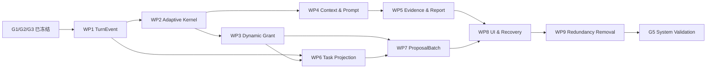

---
文档编号：AG-X-L-04
文档状态：A
负责模块：AG
文档职责：Binder Agent 1.0 唯一实施计划——把已冻结需求和设计拆为可独立治理、实现、删除旧逻辑和验证的工作包
上游约束：A-CORE-X-D-02、A-AG-M-D-01、A-AG-M-T-01、A-AG-M-T-02、A-AG-M-S-01、A-AG-I-P-01、A-SYS-I-P-01、A-DE-M-T-01/A-DE-M-S-01/A-DE-I-P-01、A-ED-M-T-01/A-ED-M-S-01/A-ED-I-P-01、A-WS-M-T-02/A-WS-M-S-02/A-WS-I-P-01、A-VAL-X-V-04
直接承接：WP-AG10-01～09 的 CODE_CHANGE Scope、A-VAL-X-V-04 验证卡、G5 系统验证与发布裁决
使用边界：本文只规定实施顺序、范围和证据门禁，不定义需求、运行时授权或完成事实；实际状态只来自对应 Scope 的 Runtime Report 和验证卡；旧实现存在不等于当前工作包已完成
变更要求：工作包边界、依赖或退出条件变化时，先核对上游需求/设计；不得用改计划掩盖实现偏差
治理成熟度：draft
---

# Binder Agent 1.0 开发与验证计划

## §1 目标与唯一事实来源

本计划只服务一个结果：将已冻结的 `agent-edit-1.0` 从当前“代码存在但语义分叉”的状态收敛为可靠、
可泛化、可审计的专业 Agent。唯一事实顺序为：

1. L1 需求决定做什么和不做什么；
2. Active L2 设计、协议和状态机决定运行契约；
3. 本文决定实施顺序与交付粒度；
4. A-VAL-X-V-04 决定验证场景和证据状态；
5. ADUS、测试治理注册表和实际 Runtime Report 证明映射与执行结果。

本文不得把历史提交、旧自动化数量、类名存在或 UI 展示推断为完成。工作包基线从 `PLANNED`
起步；只有新 Scope 按当前契约实施并产生证据后才能进入 `READY`。当前通用核心进度以 §14.52 为准，
基线 WP 表和早期切片记录不是当前完成结论；资源计划准备锁已修复，M2 仍有裁决执行链锁/等待阻断，非等待人类跑固定卡。

2026-09-15 P00：下一阶段按 §14 的 P00～P24 修复顺序推进，映射既有 WP，不另立实施计划。
§12/§13 的 READY 及测试数量仅为 v1 历史证据，不能证明按需上下文 v2 或 M1/M2/M3 已完成。
P00/P01 已分项交付；P02 完整入口集成证据见 §14.10，P03 按需上下文自动化交付见 §14.12，P04 预算计数/诊断自动化交付见 §14.14。后续代码工作包仍逐项 Issue Trace 和精确 Scope，原 G5 仍 BLOCKED。

## §2 冻结基线与非目标

### §2.1 必须保持的 1.0 基线

- 模型负责理解用户目标、选择当前动作，并根据真实 ToolResult 修订 IntentResult 与路线；关键词分类只能提供
  非权威提示，不能决定授权或完成。
- 运行时负责 RuntimeProfile、Gate、CapabilityGrant、目标范围、格式动态能力、预算、取消、终态锁存和
  副作用边界；每次 provider 调用重新 Gate，每次工具执行重新计算当前 grant。
- TurnEvent 是 append-only 回合事实源；UI 状态、TaskRun/TaskPlan/TaskStep、EvidenceLedger 和 ProjectReport
  都是可重建投影，不得反向驱动执行。
- 简单目标只使用 AgentTurn；复杂或跨执行片段目标才有 TaskRun。TaskPlan 只显示模型当前路线和已发生事实，
  不是调度器、后台队列、执行游标或未来授权。
- 文档内容修改只能形成 ChangeProposal；ProposalBatch 可包含一个或多个独立 DiffProjection。当前 1.0 的
  同文档多卡只支持 `current_editor` 下的 `block_ops` 与稳定 blockId `replace_block`。
- 同一 ProposalBatch 的多卡共享生成基线、目标互不重叠、一次受控预览、逐卡局部裁决；批内兄弟卡不得因
  整篇 revision 推进互相失效。后续批次仍以最新 LogicalState 为基准并可使旧批次失效。
- 项目报告只从实际读取结果形成 EvidenceLedger 后派生；不存在模型可调用的 `report_project` 完成工具。
- WorkspaceOperation 只由模型提出计划；DecisionRequest 裁决后由运行时在同一 AgentTurn 内重验并调用 WS，
  TaskRun/TaskPlan 不执行资源操作。

### §2.2 不进入本计划

- Build/CBT 接管或回落、多 Agent、后台任务队列、自动重试或重启后自动续跑。
- 自动 AST/KB/TPL 检索或写入、开放式长期记忆、未明确授权的外部网络读取。
- 未进入 ExplicitEditTargetSet 的跨文档写入、跨文档事务、批量接受/保存。
- 参考风格生成、通用排版代理，以及没有稳定目标局部逆操作的多卡 `replace_document/style_ops/table_ops/image_ops`。

## §3 完成等级与统一门禁

| 等级 | 含义 | 必须证据 |
|---|---|---|
| PLANNED | 工作包已在本文定义，尚未按当前设计实施 | 工作包范围、依赖、验证卡已明确 |
| IMPLEMENTED | 当前 Scope 内生产实现和必要迁移完成 | 代码审阅；旧路径删除清单；主/负/恢复测试 |
| INTEGRATED | 直接生产者与消费者使用同一契约 | 契约测试、前后端/跨模块测试、失败传播 |
| G5_VALIDATED | 真实 Tauri/WKWebView/provider/workspace 场景通过 | A-VAL-X-V-04 的可复核系统证据 |
| RELEASE_READY | 发布阻断场景全部闭合 | G5、治理、完整回归、打包和边界说明 |

每个工作包退出前必须同时满足：

1. 显式 ADP Scope 已确认，实际 changed_files 全部在范围内；
2. 当前实现与其承接的 REQ→RULE/STATE_MACHINE→@GOV→TEST 链逐项一致；
3. 旧语义的生产入口、类型字段、分支和测试期望已删除或被明确的只读迁移替代；
4. `test:plan` 与同输入 `test:related` 实际通过，不能手选更小测试集；
5. 自动化与系统验证结论分开，Runtime Report 无伪完成；
6. 无未处置 Stop Condition，工作包才可标记 READY 并形成独立提交。

## §4 工作包总表

| 顺序 | 工作包 | 唯一结果 | 主要验证卡 | 初始状态 |
|---|---|---|---|---|
| 1 | WP-AG10-01 · TurnEvent Foundation | append-only 事件、顺序、持久化与安全投影成为事实源 | V-S6、V-S9、V-S12 | PLANNED |
| 2 | WP-AG10-02 · Adaptive Turn Kernel | 模型—工具—证据自适应循环；逐次 Gate；真实等待/终态 | V-S6、V-S11、V-S12 | PLANNED |
| 3 | WP-AG10-03 · Dynamic Capability | 每次动作按硬事实计算 grant；移除语义授权和越权入口 | V-S10、V-S11、V-C1～C3、V-R1/R2 | PLANNED |
| 4 | WP-AG10-04 · Context & Prompt | 当前事实、data-only 内容和每次调用重装配 | V-S8～S12 | PLANNED |
| 5 | WP-AG10-05 · Evidence & Report | 成功读取生成 EvidenceLedger；最终报告由运行时派生 | V-S13 | PLANNED |
| 6 | WP-AG10-06 · Task Projection & Decisions | 简单回合零 TaskRun；复杂任务投影；同回合裁决恢复 | V-S7、V-C1～C3、V-R1/R2 | PLANNED |
| 7 | WP-AG10-07 · ProposalBatch & DiffCard | 同批连续块组拆卡、一次预览、逐卡独立裁决 | V-S1～S5、V-S14 | PLANNED |
| 8 | WP-AG10-08 · UI, Recovery & Migration | UI 只消费事件/业务事实；恢复与兼容读取不造第二真源 | V-S6、V-S7、V-S9、V-S14 | PLANNED |
| 9 | WP-AG10-09 · Redundancy Removal | 删除旧 resolver、report tool、静态 scheduler 和过期兼容写入 | 全部受影响卡 | PLANNED |

## §5 依赖与执行顺序



WP3 与 WP4 在契约上可并行，但当前仓库共享 `runtime/context/prompt/tool` 文件较多，默认串行执行以减少
混合 Scope。任何调整顺序都不能绕过上游退出条件。

## §6 工作包实施规格

### §6.1 WP-AG10-01 · TurnEvent Foundation

**目标**：唯一化回合事实；相同持久化事件序列必须重建相同安全投影。

**候选生产范围**：`src-tauri/src/ag/turn_events.rs`、`turn.rs`、`runtime.rs`、持久化迁移、
`src/services/agService.ts`、`src/store/agStore.ts` 及事件监听直接消费者。实际 Scope 以代码审计为准。

**必须实现**：

- `seq` 单调且 `(workspace_id, agent_session_id, turn_id, seq)` 唯一；事件只追加，不原位改历史；
- Intent revision、route observation、provider activity、ToolCall/ToolResult、等待、Proposal/Decision 和终态均有
  可恢复事件；正文、密钥和隐藏推理不进入安全投影；
- terminal_latch 后迟到 provider/tool/event 不产生业务副作用；
- 前端从事件 reducer 得到活动状态，不从 Promise 完成或卡片 pending 猜测执行中。

**必须删除/替代**：并列的可变回合状态真源、前后端各自发明的完成事件、终态后补发执行状态路径。

**退出证据**：顺序/重复/乱序/重放/终态后迟到/多 session 隔离测试；V-S6/S9/S12 自动化部分；完整影响回归。

### §6.2 WP-AG10-02 · Adaptive Turn Kernel

**目标**：建立模型选择动作、工具提供新事实、模型据此调整路线的单一回合循环。

**候选生产范围**：`turn_runtime.rs`、`turn_prompt.rs`、`turn_tool_loop.rs`、`prompts.rs`、provider 调用适配与取消传播。

**必须实现**：

- 首次 IntentResult 可为 unresolved；模型结构化输出产生 Intent revision、route observation、ToolCall、
  DecisionRequest、ProposalBatch 或 final answer；
- ToolResult 回注后重新组装 PromptPackage，并在每次 provider 调用前重新 Gate；
- AwaitingClarification/AwaitingDecision 暂停 provider 和工具；合法补充/裁决恢复原 AgentTurn；
- 循环预算、取消、provider/tool 错误和首终态真实生效，无自动重试或后台续跑。

**必须删除/替代**：关键词 resolver 作为最终语义、预先固定整轮工具路线、一次 Gate 覆盖后续调用、
`streamEnd`/handoff 伪装最终完成。

**退出证据**：模型输出结构解析、工具回注后改线、逐次 Gate、澄清/裁决恢复、取消竞态、循环上限与错误传播测试；V-S6/S11/S12。

### §6.3 WP-AG10-03 · Dynamic Capability

**目标**：工具注册与当前执行授权彻底分离，每次 ToolCall 都获得短生命周期 CapabilityGrant。

**候选生产范围**：`tool_registry.rs`、`tool.rs`、`tool_exec.rs`、`target_set.rs`、相关类型和 WorkspaceOperation 内部入口。

**必须实现**：

- grant 只由当前 profile、注册表、ExplicitEditTargetSet、允许副作用、格式/动态能力、确认事实、Gate、预算、
  取消和终态收窄；动作或事实变化即失效；
- IntentResult、TaskPlan、Prompt 文本、历史路径、工具发现和“注册存在”均不授权；
- `propose_edit` 在持久化前由 AG 与 DE 双重校验目标；WorkspaceOperation 仅允许 plan 工具，确认后的执行是
  运行时内部调用；
- tool manifest 只投影当前 grant，未知/过期/越界/参数不合法稳定失败关闭。

**必须删除/替代**：`IntentResult.allowed_tools` 写入与消费、静态 intent×tool 授权表作为最终真源、
模型可见 WS 执行工具和因重复失败而扩权的分支。

**退出证据**：硬事实组合表、grant 失效、AG/DE 双守、资源操作确认前后、格式动态能力、workspace 越界和参数边界测试；V-S10/S11 及 V-C/V-R 相关部分。

### §6.4 WP-AG10-04 · Context & Prompt

**目标**：每次模型调用只看到当前有效、带来源、受预算控制的事实，且内容层永远不能提升权限。

**候选生产范围**：`context.rs`、`history.rs`、`reference_runtime.rs`、`turn_reference.rs`、`prompt_runtime.rs`、
`turn_prompt.rs`、`prompts.rs` 及前端 AgentContextFacts 装配。

**必须实现**：

- 已打开文档读取 LogicalState，未打开文档读取带时点的新鲜 DiskState；Selection/DocRef/外部内容逐项校验；
- 工具结果、文档、引用、历史和显式记忆均为 data-only；来源、freshness、hash、trust 与裁剪原因可追踪；
- ToolResult 或用户补充后重新组装动态层；Prompt 当前工具层只来自本次 CapabilityGrant；
- 当前轮明确输入优先于历史，跨 workspace/session 不注入，1.0 自动 AST/KB/TPL 调用为零。

**必须删除/替代**：Context/Prompt/Intent 三处重复目标判断、全量注册表暴露、跨轮缓存动态 grant、旧 DiskState 覆盖 LogicalState。

**退出证据**：未保存内容、引用/选区失效、注入文本、预算裁剪、循环重装配、跨会话隔离测试；V-S8/S9/S10/S12。

### §6.5 WP-AG10-05 · Evidence & Report

**目标**：项目级结论只能由真实读取证据支持，报告范围和不确定性可复核。

**候选生产范围**：`tool_exec.rs`、`context.rs`、`turn_events.rs`、报告投影类型、前端报告展示直接消费者。

**必须实现**：

- 只有成功读取事件进入 EvidenceLedger；目录、搜索摘要、结构读取和全文读取保留不同 coverage；
- evidence 与 workspace/turn/source/version/hash/seq 绑定；失败或跨 workspace 结果不可伪装已读；
- final answer 到达时，运行时关联 evidence through seq 派生 ProjectReport；报告声明已读、未读、来源与不确定性；
- 新读取只扩展账本，不要求模型重提“报告完成”工具。

**必须删除/替代**：`report_project` 工具、强制报告完成门、自报 readItems 覆盖和报告失败导致本可完成回合伪失败的逻辑。

**退出证据**：证据类型/范围/顺序/跨 workspace/失败读取/最终派生测试；V-S13 自动化与真实环境前置证据。

### §6.6 WP-AG10-06 · Task Projection & Decisions

**目标**：复杂任务对用户可观察，但不建立第二个执行引擎。

**候选生产范围**：`task.rs`、`task_runtime.rs`、`turn_control.rs`、DecisionRequest/WorkspaceOperation 适配、`PlanCard.tsx`。

**必须实现**：

- 简单目标不创建 TaskRun/TaskPlan；复杂或跨执行片段目标才从 TurnEvent 派生 TaskRun；
- TaskPlan/TaskStep 只含当前路线 revision、已发生事实、候选动作、等待点和结果，不含执行游标、required_grant
  或“执行下一步”命令；
- DecisionRequest 与原 AgentTurn 绑定，confirm/cancel 后在同一回合恢复并重新校验；DiffCard 裁决不改变 TaskRun；
- 中断只投影 Interrupted，重试创建新 AgentTurn；删除 TaskRun 投影不影响 Proposal、Decision 或实际副作用事实。

**必须删除/替代**：静态 plan scheduler、TaskStep 自动执行、计划预授权、确认后由 TaskRun 调用 WS、
重启/定时后台续跑和简单请求空 TaskRun。

**退出证据**：简单/复杂判定、投影重建、路线修订、等待无活动、同回合裁决恢复、中断重试和删除投影无副作用测试；V-S7 与 A-VAL-X-V-05。

### §6.7 WP-AG10-07 · ProposalBatch & DiffCard

**目标**：将一次模型修改按人工可独立裁决的连续块组拆卡，同时保持编辑器事务一致。

**候选生产范围**：AG `edit_projection.rs/edit_runtime.rs/edit_types.rs/block_ops.rs`；DE `generate.rs/store.rs/lifecycle.rs/expiry.rs/routes.rs`；
前端 `agService.ts/deService.ts/deStore.ts/edStore.ts/edBlockOps.ts` 与 DiffCard 直接消费者。

**必须实现**：

- ProposalBatch 输出 `proposal_batch_id/group_index/group_count`；前端等齐完整批次、校验序号和目标不重叠；
- 同文档同批 `block_ops`/稳定 `replace_block` 聚合为一次 ED 前向事务；任一组预检失败时整批不预览；
- 每张卡持有自身目标 before/after fingerprint 与局部 inverse；接受只裁决，拒绝只反转该组，兄弟卡保持 pending；
- 批内预览/裁决不触发兄弟卡 `document_revision_advanced`；跨批后续修改仍按最新 LogicalState 和既有失效规则；
- 不具备目标局部逆操作的 proposal kind 保持单卡；不以文本行距或 UI 偶然分段伪造块边界。

**必须删除/替代**：单 Proposal 强制单 DiffProjection、逐卡前向预览、整篇 hash 守卫批内裁决、
`batch:{id,index,total}` 新写入和全局 accept/reject 作为批次裁决。

**退出证据**：单组、多组连续/不连续、重叠拒绝、缺组/乱序、原子预检失败、逐卡 accept/reject、兄弟卡保持、跨批失效、保存/恢复测试；V-S1～S5 与 V-S14。

### §6.8 WP-AG10-08 · UI, Recovery & Migration

**目标**：用户看到的消息、工具、等待、任务、报告和 Diff 状态完全来自当前事实，重启恢复不制造新语义。

**候选生产范围**：`agService.ts`、`agStore.ts`、AgentPanel/MessageFlow/PlanCard/ToolCallCard、DiffCard/deStore/edStore、
Rust/前端持久化迁移与事件补流。

**必须实现**：

- 信息流按 seq 消费安全事件；等待态无“工作中”动画；Error/Cancelled/Interrupted/Rejected/Conflicted 不显示完成；
- Intent/route 只显示用户可理解摘要，不显示隐藏推理；ProjectReport 展示已读/未读与不确定性；
- 同批卡可分别裁决并显示批内位置；批次缺失/损坏失败关闭；
- V1 兼容只读一次转换为 V2 当前投影，不继续写旧字段，不让历史恢复重启执行。

**必须删除/替代**：Promise/UI 本地猜终态、卡片 pending=Agent 执行中、旧 batch 嵌套字段新写入、恢复时自动续跑。

**退出证据**：事件乱序/补流、等待/终态、批内卡片、报告、重启/迁移和多 session/workspace UI 测试；V-S6/S7/S9/S14。

### §6.9 WP-AG10-09 · Redundancy Removal

**目标**：在所有当前消费者完成迁移后，删除会重新形成第二真源的旧实现与过期测试夹具。

**删除候选**：旧关键词授权 resolver、IntentResultV1 授权字段、`report_project` 注册/执行/Prompt、静态 TaskPlan
执行器、模型可见 WS 副作用工具、旧事件别名、旧 batch 写入、仅服务旧路径的适配器和测试 helper。

**执行约束**：

- 删除前用引用搜索和测试注册表证明无当前生产消费者；
- 测试只在其断言对象已被当前契约替代时更新或删除，必须同时存在新契约的等价或更强断言；
- 不借机重构无关模块、重命名公共 API 或升级依赖；
- 删除后做全库禁用标识扫描，兼容读取白名单必须逐项注明删除条件。

**退出证据**：零旧生产入口、零旧字段写入、零重复状态/授权真源；前端/Rust/TypeScript/治理完整回归；所有受影响验证卡仍满足。

## §7 每个工作包的 Scope 模板

每个 CODE_CHANGE Scope 必须在开始前填实以下内容，不能复制占位文本直接开工：

```text
scope_id:
work_package:
upstream_requirements:
upstream_rules_and_state_machines:
validation_cards:
production_owners_read:
direct_consumers_read:
allowed_files:
explicit_deletions:
migration_boundary:
test_plan_changed_files:
system_validation_required:
stop_conditions:
```

同一个文件跨多个工作包时，只修改当前工作包所需块；若无法切分且会同时改变两个冻结契约，应暂停并把两者
合并为一个经确认的新 Scope，不能隐式扩张。

## §8 进度自检与完整度自检

每次继续执行时先报告：当前工作包、阶段内完成比例、整体 10 阶段完成数；比例只辅助沟通，不替代证据。

每个工作包至少在“开始、关键实现完成、验证结束”三点执行以下自检：

| 维度 | 自检问题 | 完整标准 |
|---|---|---|
| 需求 | 是否只实现已注册 Active REQ，且没有新增能力？ | 目标 REQ 全列出，无范围外行为 |
| 设计 | 类型、事件、状态和副作用是否只有一个定义？ | 无相反生产路径或兼容写入 |
| 映射 | RULE/CHAIN/@GOV/测试 owner 是否闭合？ | governance:audit 无新增 finding |
| 实现 | 生产者、直接消费者、失败和恢复是否一起迁移？ | 无半接线、TODO、伪成功 |
| 删除 | 被替代实现和测试是否有证据地清理？ | 禁用标识扫描只剩文档历史/迁移读取 |
| 验证 | 自动化与系统行为是否分别有结论？ | Runtime Report 可复核，不用单测冒充 G5 |

若任一维度为 partial，工作包不得进入 READY；非阻断项写入 unresolved_items，影响正确性的进入 BLOCKED。

## §9 G5 系统验证

WP1～09 全部 READY 后，按 A-VAL-X-V-04 在目标 macOS release build 或等价真实 Tauri/WKWebView 环境执行：

1. 只读回答/检索/分析：能主动选择必要读取工具，零写工具、零 Diff；报告范围与真实读取一致；
2. 自适应编辑：模型读取→修改路线→再次读取/修正→Proposal，工具失败可解释调整且不扩权；
3. 同批多卡：跨两个以上不连续块，一次出现多张可独立裁决卡，分别接受/拒绝后内容正确；
4. 后续批次：以最新 LogicalState 生成，旧批按规则失效，不使用旧 payload 叠加；
5. 澄清与 Decision：均恢复原 AgentTurn，等待期间无模型/工具活动，确认后重新 Gate/授权；
6. WorkspaceOperation/CreateDocumentBundle：确认前零副作用，确认后运行时重验和真实执行；
7. 取消、错误、限额、网络中断和重启：唯一真实终态，无自动续跑、无旁路写入、无原文破坏；
8. 多 session/workspace：事件、目标、证据、TaskRun、卡片和未保存内容不串线。

真实 provider 输出有随机性时，契约/故障路径使用确定性 provider harness；另以至少一个真实 provider 验证模型实际
工具选择与交互体验。两类证据都必须保留，不能互相替代。

## §10 停止、回退与重新规划

出现以下任一条件立即停止当前工作包：

- 当前需求/设计不能唯一回答实现问题；
- 需要新增 RULE/CHAIN/TERM、产品功能或超出 1.0 的工具；
- changed_files 超出 Scope，或发现用户/其他任务未提交改动与本工作包重叠；
- 只能通过吞错、放宽授权、跳过/删除有效测试或保留双路径才能继续；
- 迁移无法保证历史数据安全，或删除候选仍有当前消费者；
- `test:plan` 无法映射修改、治理 audit 出现 error、真实系统结果与自动化结论冲突。

回退只回到产生根因的最近工作包。若冻结契约变化，先重新进入 REQUIREMENT/DESIGN/PLAN；不得修改文档去适配
错误代码。已验证且契约未受影响的工作包不重复改写，但须按选择器重跑受影响测试。

## §11 计划完成定义

只有以下事实同时成立，Agent 1.0 优化才算完成：

- WP1～09 各有 READY Runtime Report 和独立提交；
- IntentResult、CapabilityGrant、TurnEvent、EvidenceLedger、TaskRun 投影和 ProposalBatch 生产/消费只有一套；
- 旧 resolver、报告工具、静态 scheduler、批内整篇失效和旧字段新写入已从生产路径删除；
- 所有当前验证卡获得与当前提交对应的自动化证据，发布阻断卡获得真实系统证据；
- 完整前端、TypeScript、Rust、治理与产品能力审计通过；
- 用户可持续对话、主动读取、基于证据调整、提出安全编辑，并对不连续修改逐卡裁决；等待、失败、取消和恢复真实；
- 未验证能力关闭，发布说明如实列出边界。

## §12 v1 历史阶段状态（P00 不据此提升 v2）

| 阶段 | 状态 | 证据 |
|---|---|---|
| G1 需求唯一化 | READY | AG-ADAPTIVE-RUNTIME-REQ-01 Runtime Report |
| G2 设计/协议/状态机唯一化 | READY | AG-ADAPTIVE-RUNTIME-DESIGN-01 Runtime Report |
| G3 实施与验证计划 | READY | AG-ADAPTIVE-RUNTIME-PLAN-01 Runtime Report |
| WP1～09 | READY（当前修复自动化已重验） | 原 WP 提交：`f5596e5` / `107c06e` / `b0e9391` / `b046451` / `48a0a59` / `6838610` / `ad41fca` / `ec96ff2` / `e86f492`；AG-CLOSURE-REPAIR-01 对 WP1/WP2/WP8 回退缺陷完成实现与同输入完整回归，尚未以系统证据提升 G5 |
| G5 系统验证 | BLOCKED | 当前协议真实 DeepSeek 闭环、真实库 v20 迁移与 `empty.txt` 的 WKWebView 问候已通过；但长时间打开的 PPT 在建回合前以 `AG_ACTIVE_SESSION_LOADING` 失败，普通问候还附带 8 项 session_metadata 不确定性报告，DiffCard、等待/重启与隔离场景未执行，详见 A-VAL-X-V-04 §12 |

## §13 AG-CLOSURE-REPAIR-01 · 闭合审计修复

2026-09-08 人类授权按需求及审计结果逐项修复。WP1/WP2/WP8 重新进入实现验证；G5 保持 BLOCKED，
原因包含实际迁移和 provider 协议缺陷。已有 db/mod.rs 与 agService.ts 修改纳入修复基线。

### Issue Trace

1. 用户可见症状：问候持续显示未完成；修补迁移后，真实项目读取与资源整理请求仍因控制封套缺失终止。
2. 入口：`src/services/agService.ts::startTurn`、`src-tauri/src/ag/turn_runtime.rs::ag_start_turn`、`src-tauri/src/db/mod.rs::open_and_migrate`。
3. 规则：BR-SYS-PERSIST-001、BR-AG-PERSIST-001、BR-AG-STATE-001/002、BR-AG-DATA-004、BR-AG-OBS-001、BR-SYS-STATE-007/008、X-SEQ-001、X-FORBID-006；承接 REQ-AG-001/002/003/004。
4. 链路：DATA-MIGRATE → AG-TURN → AG-TOOL；每次模型调用保持真实 Gate。
5. 生产者：`BR-SYS-PERSIST-001-EFFECT-SYS-DATA-MIGRATE-001` 位于 src-tauri/src/db/mod.rs；`BR-AG-DATA-004-GUARD-AG-AG-TURN-047` 位于 src-tauri/src/ag/model_output.rs；`BR-AG-OBS-001-API-AG-AG-TURN-018` 位于 src-tauri/src/ag/turn_runtime.rs。
6. 消费者：`BR-AG-STATE-002-RB-AG-AG-TOOL-018` 位于 src-tauri/src/ag/turn_tool_loop.rs；`BR-AG-OBS-001-EFFECT-AG-AG-TURN-035` 位于 src/services/agService.ts；TurnEvent/history 为迁移结果消费者。
7. 空规则块：上述核心块均有规则，内部解析/迁移 helper 沿用既有 owner；不新增游离业务规则。
8. boundary 假设：修改核心块未声明 lifecycle_assumption/document_snapshot 字段；保持事件身份、seq 与真实持久化态。
9. 运行时假设：未声明 caller_context/runtime_guard 字段；保留真实 Gate、terminal latch、取消与 CapabilityGrant 守卫。
10. 不变量风险：旧七列事件跳过仍推进版本；附加控制字段成为单点；失败原因丢失。不得伪造 IntentResult、自动扩权、自动执行历史请求或将 Promise 异常当后端终态。
11. 验证：现有 db 内联、model_output/tool-loop、agRuntime 资产增加现场缺陷回归；实际 changed_files 运行 test:plan/test:related；核验 Gate→provider→ToolResult→续调→唯一终态；自动化与真实系统分证据。VALIDATING 语义复核 migrate/model_output/tool-loop/startTurn 的 boundary；无新增 rules:[] triage。

### 修复顺序与自检

| 项 | 修复与退出证据 | 状态 |
|---|---|---|
| R1 · WP1/WP8 | 旧七列/同构漂移/v19 已升级库；历史行、身份缺失、冲突、回滚与重启幂等 | READY（自动化） |
| R2 · WP2 | 模型语义传输；保留 Gate/授权/预算/取消/首终态，验证真实失败样本 | READY（自动化 + 真实 provider） |
| R3 · WP8 | 错误可诊断、持久化、恢复一致，不污染后续模型历史 | READY（自动化） |
| R4 · WP9/G5 | 完整关联回归与状态回填，G5 未验证项如实保留 | 自动化 READY；G5 BLOCKED |

Scope 文件范围见 `.governance/active_scope.json`。本节为 2026-09-08 v2.2 执行增补记录。

## §14 P00 · 独立验证修复基线（2026-09-15）

### §14.1 目标、权威与闭合边界

人类已确认先实施 P00～P08，并确认 P00 的五份设计文件、本文、验证卡、Scope 与生成 ADUS 的范围。
运行语义归 M-T-01 §2.2，按需激活/预算归 M-T-02 §5，wire 与状态归 I-P-01 §2.3 / M-S-01 §2，
AgentContextFacts v2 字段只由 SYS I-P-01 §3.1.1 持有。P00 是设计落地，不代表任一生产修复完成。

| 里程碑 | 闭合声明 | 不包含 |
|---|---|---|
| M1 独立验证 | 固定初始状态与模型响应，不启动复杂编辑器/DOCX/LibreOffice，真实核心完成纯对话、真实 workspace_glob、失败、取消、连续裁决，并验证异步回执、版本变化、效果分层；预算及交接故障可归类、重放和回归 | 不证明真实模型稳定或完整文档业务成功 |
| M2 核心运行 | 请求身份、逐调用授权、唯一终态/明确等待、期限、取消、会话隔离、历史恢复和副作用重试边界均由自动化及对应手动卡证明 | 不自动长期记忆、不后台并发、不跨进程自动续跑、不承诺普遍 exactly-once |
| M3 集成 | 声明支持的真实模型、专业操作和 UI 通过实际应用验收；Agent 结束、操作成功、接受、保存分证据 | 不替代 G6，不包含未承诺格式或能力 |

**M2 可验收声明**：当 P09～P15 的自动化及 H01～H09 对应核心断言均有当前构建证据，
每次请求都按身份准入、上下文装配、Gate、逐调用授权进入执行，并收敛为唯一成功/失败/取消/超时终结，
或能查询原因与下一步的用户等待；能力不可用不冒充成功，所有生产等待点有已公布期限与取消行为，
UI/最终陈述与真实效果一致，会话切换/新任务/异常结束不残留错误门控，历史恢复不重新执行，
显式重试对未知效果先核对且不复用旧授权，才可宣布“本阶段 Agent 通用运行核心闭合”。
这里的成功仅指声明范围内运行终结；专业操作、接受与保存独立裁决。有限历史与用户显式选择记忆纳入，
自动长期记忆、后台编排、跨进程自动续跑不纳入；复杂 DOCX/表格/图片尚未完成不妨碍 M2，
但仍阻断其自身产品验收及需要这些能力的 G5。

五条验证线为模型、核心、专业能力、UI、真实集成。前四条固定局部变量，第五条验证交接；不得互相替代。
新增测试入口只在开发/测试构建启用，默认关闭；沿用现有事件追踪，不建设大型平台。
不修改编辑器/转换路线、不扩大权限、不新增自动重试。每次失败记录首个失败边界、根因确认状态、
identity、阶段、输入版本、效果与下一步；“重试成功”不作为缺陷关闭证据。

### §14.2 完整修复顺序（P01～P08 历史切片见后文；P09～P15 当前实现与阻断见 §14.52；P16～P24 未由通用核心交付而关闭）

表中路径相对于仓库；为候选修改范围，不等于文件授权。每项实施前读生产者/消费者，补全 Issue Trace
并锁定精确 allowed_files。测试复用 `src/services/agRuntime.test.ts`、`src/components/ag/AgentUI.test.tsx`、
对应 Rust 内联与 `src-tauri/tests/core_chain.rs`；新增物理测试文件须先核对注册表预算。
规则沿用既有 REQ_MAP，WP 是 §4 的既有工作包，不建立第二套功能分解。

| P | 里程碑 / WP | 结果及主要规则 | 候选修改范围 | 依赖 | 退出证据 / 卡 |
|---|---|---|---|---|---|
| P00 | 设计 / WP2/4/6/8 | 冻结八项运行边界、v2 兼容与分层验证；BR-AG-DATA-001/002/005/008、BR-SYS-DATA-008、BR-AG-STATE-001 | 已确认五份设计、本文、V04、Scope、生成 ADUS | 人类确认 | 文档一致性、test:governance、governance:audit；不提升 G5 |
| P01 | M1 / WP1/5 | 失败分类与关联证据；BR-AG-OBS-001、BR-SYS-STATE-007 | ag/turn_events.rs、turn_runtime.rs、agService.ts | P00 | 首个失败边界和根因分开；V-M1-01 |
| P02 | M1 / WP2 | 固定响应经过生产解析/授权；BR-AG-DATA-004、BR-AG-STATE-001/002 | ent/gateway.rs、ag/model_output.rs、运行入口及内联测试 | P01 | 合法、非法、截断响应可复现；V-M1-02 |
| P03 | M1 / WP2/4 | v2 无编辑器准入、真实枚举；BR-AG-DATA-001/008、BR-SYS-DATA-008 | agService.ts、ag/turn_runtime.rs、types、上下文读取层 | P02 | 问候零工具、真实 workspace_glob；V-M1-01/02（原表误指预算卡 V-M1-03） |
| P04 | M1 / WP4 | 四种装配阶段预算明细；BR-AG-DATA-002/005 | ag/context.rs、prompt_runtime.rs、turn_prompt.rs、预算检查点 | P01/P02 | 分项对账、同输入同结果；V-M1-03（原表误指 V-M1-04） |
| P05 | M1 / WP4 | 修复重复/无关注入与结果规模；BR-AG-DATA-001/005 | Prompt 装配及专业读取结果 | P04 | 不截坏参数/证据、不提高上限掩盖；V-M1-03；记录见 §14.16 |
| P06 | M1 / WP6/8 | 连续裁决按身份清理；BR-SYS-STATE-007/008、BR-AG-UI-001 | agService.ts、agStore.ts、DecisionBar.tsx | P02 | A→B、重复/迟到/切会话；V-M1-05 |
| P07 | M1 / WP6/7 | 预览回执、版本及续片段；BR-AG-DATA-001、BR-SYS-STATE-008 | agService.ts、ag/task.rs、turn_control.rs、专业适配 | P01/P02 | ack/预览/接受分离、过期/重复不续跑；V-M1-06 |
| P08 | M1 / WP8 | 最小观察入口与 M1 验收；BR-AG-UI-001、BR-AG-OBS-001 | AgentPanel、运行服务、开发测试注册入口、必要脚本 | P03～P07 | V-M1-01～07；核心可独立运行但不取代相关回归 |
| P09 | M2 / WP2 | 模型协议与流完整性；BR-AG-STATE-001/002 | model_output.rs、ent/gateway.rs | P02 | 非法/断流/跨块字节不误执行完成；H02 |
| P10 | M2 / WP3 | 能力声明与结果/效果契约；BR-AG-STATE-002、BR-AG-DATA-003 | tool_registry、tool_exec、专业适配、SYS 共享契约 | P03/P07 | 权限不放宽、效果有回执；H06/H08 |
| P11 | M2 / WP4 | Prompt 与专业上下文隔离；BR-AG-DATA-001/002/005 | turn_prompt、prompt_runtime、文档投影 | P05/P10 | 按需注入，无全局专业污染；H01/H03 |
| P12 | M2 / WP2 | 期限、取消、终态；BR-AG-STATE-001、BR-SYS-STATE-007 | turn_control、网关、工具循环 | P09/P10 | 有界等待、唯一终态、无后续工具；H06 |
| P13 | M2 / WP6/8 | 操作身份与重试保护；BR-SYS-STATE-007/008 | 继续入口、回执、MessageList 重试 | P10/P12 | 未知效果先核对、不盲目重放；H09 |
| P14 | M2 / WP8 | 会话/历史/显式记忆恢复；BR-AG-PERSIST-001、BR-SYS-DATA-007 | agStore、历史恢复、引用核验 | P06/P12 | 不串会话、重启不续跑；H07/H09 |
| P15 | M2 / WP2/8 | M2 验收 | 核心/契约测试与验证卡 | P09～P14 | M2 条件全有证据；不靠 DOCX 成功 |
| P16 | M3，提前 / WP7 | 真实 txt 专业链；BR-CORE-STATE-001~003、BR-DE-STATE-001 | read_doc、DE/ED 回执与保存交接 | P07/P10 | 读取/提案/接受/保存分事实；H08 |
| P17 | M3 / WP8 | UI 交互与投影；BR-AG-UI-001、BR-SYS-STATE-007 | MessageList、DecisionBar、ToolCallCard | P06/P07/P10 | 固定事件下归属/按钮/清理正确；H04/H07 |
| P18 | M3，提前抽样 / WP2 | 真实模型协议与行为评测；BR-AG-DATA-004、BR-AG-STATE-002 | 固定样本、真实网关调用及记录 | P09 | 每次原始结果留存，首次/重试分统计；不替代系统 |
| P19 | M3 / WP6 | WorkspaceOperation；BR-WS-STATE-003、BR-SYS-STATE-008 | 计划/裁决/WS 回执与补偿投影 | P13/P17 | 确认后重验、效果一致；V-R1/R2 |
| P20 | M3 / WP7 | 已承诺 BDocx 回归；BR-DE-DATA-001~003 | Block、ProposalBatch、现有表格/图片交接 | P16/P17 | 当前支持范围通过；V-S1～S5/V-S14 |
| P21 | M3 / WP5/8 | 最终陈述与证据；BR-AG-OBS-001、BR-SYS-DATA-008 | 报告、专业摘要、UI | P15～P20 | 失败不称成功，提案不称保存；H08 |
| P22 | M3 / WP8 | 真实应用及异常验收 | Tauri/Provider/Workspace 验证卡 | P16～P21 | H01～H09 与原发布阻断卡系统证据 |
| P23 | 收尾 / WP9 | 已替代路径清理与兼容；BR-SYS-STATE-007、BR-AG-PERSIST-001 | 对应旧入口、历史只读迁移 | 对应替代已验证 | 无双写、历史可读；完整相关回归 |
| P24 | 收尾 / WP9/G5 | G5/发布裁决；X-SHARED-002 与 APC 门禁 | Runtime Report、验证记录 | P22/P23 | 不以 M1/M2 代替 G5/G6；人类裁决 |

P16 不等 P15 完成才首次接专业能力；P18 可以提前抽样，但模型随机性不能阻止确定性核心建设。
P23 随迁移逐步进行；未验证替代不得删除旧逻辑。预算/期限阈值在对应实施与真实 Provider 标定中冻结，
P00 不硬编码新数字。协议纠正若需引入，单独批准，不从有限工具循环推导自动重试权限。

### §14.3 P00 Issue Trace 与差异台账

1. 症状：Prompt 预算错误、间歇 ToolCall/Diff 失败、DecisionRequest 操作后继续不稳定；尚不能将每次现场失败归到同一根因。
2. 入口：`src/services/agService.ts::startTurn/acknowledgePreviewAndContinue/resolveDecisionAndContinue`；Rust `ag_start_turn/prepare_turn_prompt`。P00 不编辑这些入口。
3. 规则：BR-AG-STATE-001/002、BR-AG-DATA-001/002/003/004/005/008、BR-AG-UI-001、BR-AG-OBS-001、BR-SYS-STATE-007/008、BR-SYS-DATA-008、X-SHARED-002、X-FORBID-004/006/007、X-SEQ-001；REQ_MAP 沿用既有 AG/SYS 需求，不新增业务能力。
4. 链路：IPC-CALL → AG-TURN → AG-TOOL；专业交接涉及 ED-EDIT / DE-DIFF；网关依然先 Gate。
5. 生产者：`BR-AG-DATA-008-DATA-AG-AG-TURN-041` 位于 `src/services/agService.ts`；`BR-AG-DATA-002-DATA-AG-AG-TURN-031` 位于 `src-tauri/src/ag/turn_prompt.rs`；本次仅审查 v1 假设，不伪改代码。
6. 消费者：`BR-AG-DATA-005-DATA-AG-AG-TURN-011` 位于 `src-tauri/src/ag/prompt_runtime.rs`；`BR-SYS-STATE-007-EFFECT-AG-AG-TURN-042` 位于 `src/store/agStore.ts`；`BR-SYS-STATE-008-API-AG-AG-TURN-003` 位于 `src-tauri/src/ag/turn_control.rs`。
7. 空规则块：上述引用块均有规则；P00 不新增代码或 rules:[]，不声称已完成 P01-P08 全部调用链 triage；各实现包重做完整路径审查。
8. boundary 假设：上述块未显式声明 lifecycle_assumption/document_snapshot；当前快照前置与 v2 按需语义不同，代码仍为 v1，登记为待接入而非已符合。
9. 运行时假设：快照生产者 `caller_context=agentTurnSnapshotAssembly`、输出 `AgentContextFactsV1`；其他上述块未显式声明 runtime_guard。P03 必须解除无关文档依赖，同时保留 opened 判断、版本和 LogicalState 来源约束。
10. 不变量风险：仅按快照未命中退回磁盘会破坏 X-FORBID-004/BR-AG-DATA-001；旧回调清理新请求破坏事件归属；success 混淆保存破坏三态。v2 分版本、按身份消费与分层证据防止这些退化；不改 APC。
11. 验证：P00 文档头/引用/静态映射/版本兼容/语义差异复核，运行 generate、test:governance、按本轮文档 changed_files 的 test:plan/test:related 与 audit；不声称跑过模型/UI。P01-P08 验证 UserInputReceived→ContextFrozen→Gate→provider→ToolResult→继续→唯一终态与拒绝路径，详见 V04 §14。

**已知设计—实现差异（不得用 audit passed 隐藏）**：当前生产仅有 v1 完整快照路径；v2、独立模型传输入口、
分层预算诊断和开发观察入口未实现。M1/M2/M3 均未通过；原 G5 SC-04 保留。P00 只关闭设计准备工作，
不把现有 1006 项历史发现数或历史测试通过作为新协议证据。

### §14.4 Task Runtime Report — P00（2026-09-15）

| 字段 | 本轮结果 |
|---|---|
| task_type / governance_phase | GOVERNANCE_CHANGE / DESIGN |
| final_state | 父 Scope `BLOCKED`；已单独授权的 P00 设计工作包 `READY`，不解除 G5 SC-04 |
| issue_trace | 本文 §14.3；v2 尚未实施的差异已显式登记 |
| scope | explicit / confirmed：人类确认五份设计文件、原计划与验证卡、Scope 和脚本生成 ADUS；生产源码/测试只读，保留会话开始已有修改 |
| phase_gate | passed（仅 P00）：沿用既有需求与授权/裁决/保存边界，确认按需上下文设计；P01～P24 不在本轮代码 PATCHING 范围 |
| mapping_chain | P00 设计映射 complete：§14.2 WP/规则/候选代码及 V04 §14 卡；v2 代码与新测试尚缺，不冒充实现链闭合 |
| test_impact.direct_modules | AG、AST、CBT、CORE、DE、ED、KB、SYS、TPL、WS |
| test_impact.affected_modules | ACCT、AG、AST、CBT、CORE、DE、DOC、ED、ENT、KB、PRV、REF、SYS、TPL、WS |
| test_impact.selection | exact 9 files；frontend-full、rust-full、governance:audit；未手工缩减；此次选择器未另选 TypeScript，不挪用历史 TypeScript 结果 |
| validation.generate | PASS：刷新 ADUS；最终再次生成无内容变化；110 测试资产 / 1006 发现数是当前工作树清单，不是新增能力通过数 |
| validation.test_governance | PASS：21/21，未映射源码/无 owner/focused/skipped 均为零 |
| validation.test_plan | PASS：使用下列 9 个本轮文件，未将其他既有源码修改声称为本轮产出 |
| validation.test_related 初次 | FAIL：沙箱内前端 611/611；Rust lib 401/402，LibreOffice `DOC_PREVIEW_WORKER_CRASH` signal 6；未把局部通过当整体通过 |
| validation.test_related 重跑 | PASS：经权限批准，以完全相同文件输入在正常系统权限下完整重跑，前端全量、Rust lib 402/402、core_chain 5/5、sm_broadcast 4/4 及治理审计通过；未 skip、改测试或换输入 |
| validation.semantic | 对 §14.3 相关边界复核：AgentContextFactsV1 为保留兼容路径；LogicalState 不回退磁盘；IntentResult/Prompt 不授权；预览 ack 不代表裁决/保存；事件投影不驱动执行。v2 按需装配与 budget tracing 未接代码，是设计—实现缺口，不是语义实现通过 |
| validation.system | NOT_RUN：本轮没有真实模型、UI、文档操作验收；V-M1-01～07 / H01～H09 均 DESIGNED；M1/M2/M3 未通过 |
| stop_conditions | 父 G5 SC-04 保持：PPT loading、报告噪声及 Diff/等待/重启/隔离系统证据未闭合；此项不阻断已单独授权的 P00 文档交付 |
| recovery | 从 P01/P02 的具体调用链与文件清单进入各自 Scope；分层证据建立后再定位修复，不直接宣告恢复 G5 |
| unresolved_items | 当前治理审计 PASS 但保留 23 项 TERM_ORPHAN warning；未新增 TERM，不顺手消除范围外警告。未改生产代码，不承诺症状已经消失 |

本轮 `changed_files`（均为修改；相对于仓库根，也是 test:plan / test:related 的完整输入）：

```text
.governance/active_scope.json
docs/01_modules/AG/A-AG-M-T-01_代理技术设计.md
docs/01_modules/AG/A-AG-M-T-02_提示词架构设计.md
docs/01_modules/AG/A-AG-I-P-01_代理接口协议.md
docs/01_modules/AG/A-AG-M-S-01_代理状态机设计.md
docs/01_modules/SYS/A-SYS-I-P-01_数据结构定义.md
docs/01_modules/AG/A-AG-X-L-04_代理1.0开发与验证计划.md
docs/40_validation/A-VAL-X-V-04_Agent1.0验证卡.md
docs/00_core/A-CORE-C-R-01_ADUS.md
```

### §14.5 P01 Issue Trace（2026-09-18）

1. 症状：模型、运行核心、专业适配和 UI 失败缺少统一关联诊断，不能从重试成功推断根因。
2. 入口：agService.startTurn / interruptStart；turn_runtime.ag_start_turn；turn_tool_loop 的 ToolResult；turn_events.emit_ag_turn_error_from。
3. 规则：BR-AG-OBS-001、BR-AG-STATE-001/002、BR-AG-PERSIST-001、BR-SYS-STATE-007、BR-SYS-DATA-008、X-SHARED-002；不修改统一 IpcError 或授权。
4. 链路：IPC-CALL → AG-TURN → AG-TOOL → 事件持久化/安全投影 → 历史恢复。
5. 生产者：turn_events.rs 的 EFFECT-AG-AG-TURN-044；agService.ts 的 EFFECT-AG-AG-TURN-035；生产诊断由实际失败边界产生，不从模型文案判定。
6. 消费者：turn_events.rs QUERY-AG-AG-TURN-045；ipc/mod.rs 安全 AgTurnEventPayload；history.rs AgentTurnPayload；agStore.ts EFFECT-AG-AG-TURN-042；MessageList.tsx RB-AG-AG-TURN-014。
7. 空规则块：上述核心边界均有规则；诊断数据结构为既有安全事件的 additive 字段，不新增独立业务执行链。
8. boundary 假设：上述路径未声明 lifecycle_assumption/document_snapshot；保持 append-only、先持久化再投影、首终态和不外露内部内容。
9. 运行时假设：MessageList caller_context=agentPanelMessageListRender；诊断只展示，不驱动运行；既有事件身份/seq 校验先于消费，不凭错误信息跨会话关联。
10. 风险：历史缺新字段必须可读；失败边界不等于根因；诊断不得包含正文、参数、密钥或改变失败/重试语义。预算拒绝只证实 core_context，不推断是哪份文档导致。
11. 验证：真实序列化/事件存储/历史恢复及前端服务路径测试；覆盖旧载荷、首终态、隔离、诊断不进入模型历史；按实际文件执行 test:plan/test:related、test:governance、generate/audit。固定模型完整运行入口留在 P02。

P01 字段契约归 SYS I-P-01，生产边界按该契约接线；这是实现工作包，不提升 M1 或 G5。

### §14.6 Task Runtime Report — P01（2026-09-18）

| 字段 | 结果 |
|---|---|
| task_type / governance_phase | CODE_CHANGE / IMPLEMENTATION |
| final_state | 父 Scope BLOCKED；P01 诊断基线 READY（仅本工作包），不提升 M1/G5 |
| issue_trace / scope | §14.5 / explicit confirmed；人类确认三个新增文件及原 Scope 内消费者/测试/契约；本轮 14 个 changed_files 详见 active_scope.active_work_package.changed_files |
| phase_gate / mapping_chain | P00 已确认设计基线；P01 的安全事件加法字段由 SYS 共享契约定义，沿用 BR-AG-OBS-001/STATE-001/STATE-002/PERSIST-001 与 BR-SYS-STATE-007/DATA-008；技术诊断 DTO 不是新业务 TERM |
| 实现 | Error、失败 ToolResult、history.failure 增可选 diagnostic；旧载荷缺字段合法；错误阶段/有限分类/未知根因分开。前端白名单读取并展示；身份复用既有 event/turn/session/workspace/tool，不建第二套执行真值 |
| 边界 | IpcError 四字段、终态判定、工具执行、权限、重试策略均未改变；诊断不是成功证据；当前预算错误仅定位 core_context，不解释具体占用。runtime/调用异常未定位时保持 unknown；不声称覆盖全部现场根因 |
| test_impact | exact 14 files；direct AG/AST/CBT/CORE/DE/ED/KB/PCG/REF/SYS/TPL/WS；affected 再含 ACCT/DOC/ENT/PRV；选择 frontend-full、TypeScript、rust-full、governance:audit |
| validation 初次 | 定向前端新测试错误地要求 error 回合用户历史也为空；实际契约保留用户原文，只排除诊断/错误回复。按原契约修正为保留该原文的精确断言并断言诊断缺席；未弱化被测生产逻辑。修正新增测试中的 Array.at，使之匹配现行 TS 目标，不修改编译配置 |
| validation 已通过 | 前端全量 612/612、TypeScript、测试治理 21/21；前端诊断相关 102/102 复测；治理审计 PASS，保留 23 项既有 TERM_ORPHAN warning；generate 发现 1009 项测试，无新增物理测试文件 |
| validation Rust | PASS：正常系统权限下完整 test:related 的 Rust lib 404/404、core_chain 5/5、sm_broadcast 4/4；新增诊断定向测试 2/2。现有 cargo run 曾占锁，未终止该进程，释放后正常执行；最终关联治理审计 PASS |
| semantic_review | Error/ToolResult/TurnFailure 只增加安全元数据；TurnEventEmitter 仍先持久化再投影且首终态不变，历史仅恢复事实；诊断不授予 CapabilityGrant，不进入 EvidenceLedger 或后续模型正文；旧字段兼容不等于 v2 ContextFacts 实现 |
| system_validation | NOT_RUN：未调用真实模型或手动操作应用，本次组件测试不替代真实 UI；V-M1 与 H 卡不提升 |
| stop_conditions / recovery | 原 G5 SC-04 保留；P01 关联回归已通过；P02 固定模型传输/生产解析闭环仍待自己的 Scope |
| unresolved_items | P04 预算分项、P06/P07 DecisionRequest/预览诊断细分、真实模型与系统验收未完成；不声称原症状已修复；无自动重试、无编辑器/DOCX 改造 |

### §14.7 P02 Issue Trace（2026-09-18，首个实施切片）

1. 症状：真实模型响应不稳定与核心失败混在一起；缺少可将同一字节输入送入生产解析器的入口。代码确认文本 SSE 无完成事件时 EOF 被默认解释为 stop，尚不能由此断言用户所有偶发失败均来自此处。
2. 入口：`ent/gateway.rs::stream_round`，消费者 `ag/turn_tool_loop.rs::run_turn_tool_loop`；前者目前把 HTTP 传输和解析放在同一函数。
3. 规则：BR-ENT-STATE-001、BR-ENT-VERIFY-001、BR-SYS-OBS-001、BR-AG-DATA-004、BR-AG-STATE-001/002；X-SEQ-001、X-FORBID-001/002。沿用技术设计与 SM-SYS-01/SM-AG-01/02，不新增授权来源或自动重试。
4. 链路：CLOUD-GATE → CLOUD-INVOKE → AG-TURN / AG-TOOL。
5. 生产者：gateway.rs 的 BR-ENT-VERIFY-001-GUARD-ENT-CLOUD-GATE-002、BR-ENT-STATE-001-RB-ENT-CLOUD-INVOKE-001；实际 SSE 来源经只读核对为 cloud/dev-gateway/providers.mjs，不修改云端。
6. 消费者：model_output.rs 的 BR-AG-DATA-004-GUARD-AG-AG-TURN-047，以及 turn_tool_loop.rs 的 BR-AG-STATE-002-RB-AG-AG-TOOL-018；本切片不改变其控制封套与授权语义。
7. 空规则块：此次抽取路径不新增 rules:[] 块；测试辅助代码仅复用生产字节解析与 ModelOutputDecoder，不承担新规则。
8. boundary 假设：该解析路径不依赖 document_snapshot/lifecycle_assumption，不启动编辑器、DOCX 或 LibreOffice。仅输出 RoundOutcome，不自行发 AgentTurn 终态。
9. 运行假设：生产 HTTP 鉴权与服务端 Gate 保留原位；测试只向解析边界传入局部 Stream，无全局环境变量开关、无生产固定响应分支。测试不代表真实服务端授权证据。
10. 风险：网关 `tool_calls` 本身是工具响应完成事件，不能错误要求其后再有 done；文本无 done、尾部半帧不能默认成功。跨字节 UTF-8、非法 SSE、重复结束的完整硬化仍归 P09，不用本切片宣告全部协议风险消失。
11. 验证：固定合法文本/工具响应、非法控制 JSON、截断、传输错误、回调失败及取消，走同一生产解析函数；按实际 changed_files 运行 test:plan/test:related 和 generate/audit。授权、真实 workspace_glob、回注再装配及全 AgentTurn 终结属于 P02 后续集成证据；V-M1-02 不因本切片通过而提升。

范围：本切片仅 gateway.rs、model_output.rs 既有内联测试、本文、active_scope 与生成 ADUS；人类已明确确认新增 gateway.rs。P02 不标记整体 READY，P03 不在此次启动。

### §14.8 Task Runtime Report — P02 首个切片（2026-09-18，历史，后续见 §14.10）

| 字段 | 结果 |
|---|---|
| task_type / governance_phase | CODE_CHANGE / IMPLEMENTATION |
| final_state | BLOCKED（P02 完整运行入口集成等待 SC-01 Scope 扩展）；本切片实现与关联回归已验证，父 G5 BLOCKED 不变 |
| issue_trace / scope | §14.7；explicit confirmed，gateway.rs 经人类明确确认；本次 exact 5 changed_files 见 active_scope.active_work_package.changed_files |
| phase_gate / mapping_chain | P00 基线及 P01 诊断已交付；沿用 ENT 网关流式三终态与 AG 模型语义规则，新解析块 BR-ENT-STATE-001-RB-ENT-CLOUD-INVOKE-002 承接既有技术规则；技术测试辅助函数不新增业务 TERM |
| 实现 | 生产 stream_round 在原 HTTP/令牌路径之后调用 consume_round_stream；cfg(test) fixed_round_stream 仅替换字节来源。文本无 done、尾部半帧返回 AG_GW_STREAM_INCOMPLETE；保留真实网关以 tool_calls 结束工具响应的契约。无自动重试，无固定响应发布入口 |
| test_impact | direct AG/CORE/DE/ENT/SYS/WS；affected ACCT/AG/AST/CBT/CORE/DE/DOC/ED/ENT/KB/PRV/REF/SYS/TPL/WS；选择 frontend-full、rust-full、governance:audit（本次选择器不要求 TypeScript；未改前端） |
| validation 初次 | 新测试使用项目未直接依赖的 tokio 测试宏，编译失败；改用现有 tauri::async_runtime::block_on 和标准 test 属性，无新增依赖或测试跳过 |
| validation 定向 | PASS：fixed_ 过滤执行 7 项，其中新增 6 项及既有 1 项；合法文本/原生工具、缺完成/尾帧截断、传输/提供方/回调错误、等待取消、真实控制封套及参数解析。测试不依赖模型服务、编辑器或 LibreOffice |
| validation 治理及关联回归 | PASS：exact 5-file test:related 完整退出 0；前端 612/612、Rust lib 410/410、core_chain 5/5、sm_broadcast 4/4、doc-tests、关联治理审计均通过。test:governance 21/21；动态发现 1015 项、110 资产，物理测试文件不增加；审计保留 23 项 TERM_ORPHAN 提示。完整回归按既有 LibreOffice 环境约束以批准的正常系统权限运行；这不使独立 fixed_ 测试依赖 LibreOffice |
| semantic_review | 网关只产出 RoundOutcome；工具参数与控制封套继续由生产 AG 解析器校验，固定输入不授予权限。Gate、CapabilityGrant、终态发射和专业效果未被替换。传输 future 取消不等同 AgentTurn/UI 已取消 |
| system_validation | NOT_RUN：无真实模型/真实 UI；V-M1-02、H02 不提升；本切片没有实跑生产授权、workspace_glob 或 ToolResult 再装配 |
| stop_conditions / recovery | P02 后续集成需要扩展 edit_runtime.rs、doc/image_media.rs 的 AppHandle 运行时泛型签名；两者当前未修改，等待人类确认。原 Scope 内 turn_runtime/turn_tool_loop/turn_events 与 gateway 测试接线沿用。不能用绕过专业分支或伪造运行成功代替 |
| unresolved_items | P09：跨包 UTF-8、非法 SSE 被忽略、结束标记字段校验/重复事件等仍需完整硬化；assist_complete 独立解析器仍有类似完整性风险，未纳入此次 AgentTurn 修复。下一步建立完整入口测试，随后才评定 P02，而非跳到 P03 |

### §14.9 P02 完整入口集成续作（2026-09-19）

承接 §14.7 Issue Trace，用户确认 edit_runtime.rs、doc/image_media.rs 两个文件仅作 Runtime 泛型签名扩展。
生产者/消费者新增 `ag_propose_edit → authorize_media_files` 的 AppHandle 类型传递；既有图片资源授权和
文档算法保持原样。turn_runtime、turn_tool_loop、turn_events 同步接受现有 tauri::Runtime，不另建核心。

测试通过局部 HTTP 服务返回固定网关响应，真实 check_gate、HTTP/SSE、ModelOutputDecoder、
CapabilityGrant、工具、事件持久化、再装配和终态均不替换。测试目标只在 future poll 期间绑定，
测试登录不读写生产 SESSION_TOKEN，无全局环境变量开关。MockRuntime 仅替换桌面宿主，不伪造专业效果。
验收入口放入现有 turn_runtime.rs 内联测试，使用隔离临时 workspace 与真实 SQLite 迁移；不修改用户库。
本轮仍不声明真实模型稳定、真实 UI 或 M1/M2/G5 已闭合。

### §14.10 Task Runtime Report — P02 完整入口集成（2026-09-19）

| 字段 | 结果 |
|---|---|
| task_type / governance_phase | CODE_CHANGE / IMPLEMENTATION |
| final_state | P02 READY（固定响应经完整生产入口的自动化工作包）；父 Scope BLOCKED，不提升 M1/M2/G5 |
| issue_trace / scope | §14.7 + §14.9；explicit confirmed；两个专业文件仅各两行 Runtime/AppHandle 泛型签名变更；P02 累计 exact 10 changed_files 见 active_scope.active_work_package.changed_files |
| phase_gate / mapping_chain | P00 已确认基线；原 SC-01 由用户 2026-09-19 确认扩展解除；沿用 SM-AG-01/02 与 CLOUD-GATE/INVOKE 规则；未改文档处理、权限、保存或重试语义 |
| 实现 | ag_start_turn、工具循环及终态广播接现有 Runtime 泛型，生产仍使用 Wry。测试用 MockRuntime 承载真实入口，通过仅监听 127.0.0.1 的固定 HTTP 网关进入真实客户端 Gate、SSE、模型封套、CapabilityGrant、workspace_glob/read_doc、回注再装配与终态持久化 |
| 测试隔离 | HTTP 目标仅在测试 future 单次 poll 内绑定，嵌套/挂起后恢复；不改环境变量，不读取/清除/写入生产会话令牌缓存。局部网关模拟外部响应，不证明真实云端订阅或模型正确；核心判断不替换。临时 workspace 和内存 SQLite 隔离，结束清理测试文件 |
| 自动化范围 | 纯对话零工具；真实 glob 只匹配 unique-result.txt、不匹配 excluded.md；两次 Gate/两次模型顺序与第二次请求中的实际 ToolResult；新 CapabilityGrant 先于 ToolResult；门禁拒绝零模型调用；权限拒绝 vs 缺文件读取失败；非法封套/截断零工具且 error；实时 Channel 与 DB 安全回放完全相同、唯一终态、活动租约释放、零 PendingDiff/文件改写 |
| test_impact | direct AG/CORE/DE/DOC/ED/ENT/SYS/WS；affected ACCT/AG/AST/CBT/CORE/DE/DOC/ED/ENT/KB/PRV/REF/SYS/TPL/WS；选择 frontend-full、rust-full、governance:audit；本次无前端代码改动 |
| validation 初次 | 沙箱本地监听 PermissionDenied，未进入核心，不能作通过证据；批准正常系统权限后发现测试 socket 继承非阻塞导致 WouldBlock，改为带 5 秒读写期限的阻塞连接，未改 Agent 逻辑或放宽断言 |
| validation 定向 | PASS：fixed_ 13/13，包括本轮完整入口 5 项、HTTP 作用域隔离 1 项、上轮解析 6 项及既有 1 项；正常权限下 0.19 秒执行（不含构建/进程启动）；cargo check --tests 曾通过，后续最终编译由关联测试覆盖 |
| validation 关联 | PASS：P02 累计 exact 10-file test:related 完整退出 0；前端 612/612、Rust lib 416/416、core_chain 5/5、sm_broadcast 4/4、doc-tests 与最终关联 audit 全通过。按批准的正常系统权限运行本地 HTTP 及既有 LibreOffice 回归；generate 发现 1021 项、110 资产且复生无变化；最终 test:governance 21/21；diff check 通过；审计保留 23 项既有 TERM_ORPHAN 提示 |
| semantic_review | Runtime 泛型只改变宿主类型参数；ag_propose_edit 仍返回 PendingDiff/DiffProjection，不直接保存。解析器不承担授权，客户端按真实 HTTP verdict 分支计算 Gate；只在 Gate 后重新计算 CapabilityGrant。失败 ToolResult 回注后 completed 只表示运行结束，不表示专业操作成功 |
| system_validation | NOT_RUN：未操作真实 UI、未调用真实模型、未验证实际云端订阅服务；V-M1-02/H02 尚需其余场景及手动证据，状态不提升；v1 无活动文档夹具通过不等于 v2 按需准入实现 |
| stop_conditions / recovery | P02 SC-01 已解除；原 G5 SC-04 保持。若关联回归出现不可在已确认范围内解决的问题，按治理停止 |
| unresolved_items | P03 v2 准入；P04 预算分项；P06/P07 裁决/预览；P08 手动入口；P09 UTF-8/畸形 SSE/重复完成字段与 assist_complete 完整性；P12 全运行取消/超时；不以本次解析 future 取消测试替代运行取消验收 |

独立自动化入口：`cargo test --manifest-path src-tauri/Cargo.toml fixed_runtime --lib`。
前置为可监听 loopback 的本地开发环境；不用启动模型服务、编辑器或 LibreOffice，不使用真实用户 workspace。
预期为五项测试通过；失败保留具体首个断言，不靠重复运行作验收。该入口是测试设施，不是 P08 用户可操作的应用 UI。

### §14.11 P03 Issue Trace（2026-09-20）

1. **用户可见症状**：活动富文档尚未绑定时，纯问候也在提交前因 `AG_ACTIVE_SESSION_LOADING` 失败；直接省略快照会使工具错误回退 DiskState。P03 尚未完成，不提升 G5。
2. **入口**：`src/services/agService.ts::startTurn/collectOpenDocSnapshotsReady` → `src-tauri/src/ag/turn_runtime.rs::ag_start_turn`。
3. **规则**：BR-AG-DATA-001/002/008、BR-AG-STATE-001/002、BR-AG-PERSIST-001、BR-AG-OBS-001、BR-ED-DATA-008、BR-SYS-DATA-002/008、BR-SYS-STATE-007、X-FORBID-004/006、X-SHARED-001。来源为 M-T-01 §2/§5、M-T-02 §5.0、I-P-01 §2.3、SYS I-P-01 §3.1.1；既有 G1–G3/P00 设计已确认。
4. **链路**：AG-TURN → AG-TOOL；跨层输入走 IPC，文档读取仍受 WS 工作区边界约束。
5. **生产者**：`BR-AG-DATA-008-DATA-AG-AG-TURN-041`（agService）；`BR-AG-DATA-001-EFFECT-AG-AG-TURN-005`（同文件快照投影）；`BR-SYS-DATA-008-DATA-SYS-DATA-MIGRATE-001`（types/mod.rs）。
6. **消费者**：`BR-AG-DATA-008-GUARD-AG-AG-TURN-042`（turn_runtime）；`BR-AG-DATA-008-DATA-AG-AG-TURN-031`（turn_prompt）；`BR-AG-DATA-008-DATA-AG-AG-TOOL-043`（tool_exec）；`AgentReadContext`（blocks）；`run_turn_tool_loop`（turn_tool_loop）。lib.rs 只注册上下文回传 command，不改变应用启动。
7. **空规则块**：本次目标生产者/消费者无 `rules: []`；不增空规则业务块。协议辅助类型为已注册 AgentContextFacts 的技术版本，不新增业务术语。
8. **boundary 假设**：目标块未声明独立 lifecycle_assumption/document_snapshot 字段；原完整 OpenDocSnapshot 集合假设只能继续用于 v1，v2 必须保留完整打开资源身份，缺快照不能推断允许磁盘读取。
9. **运行时假设**：快照投影 caller_context=agentTurnSnapshotAssembly；v2 不再要求全部正文准入。冻结 activeTarget 不因标签切换改指向；需要内容时核验宿主事实、版本与请求身份。超时/取消后不接受迟到响应。
10. **不变量风险**：跨会话回传、旧选区成为编辑锚、关闭资源回退磁盘、元数据提高读取覆盖、事实更新后复用旧 grant。不得靠放宽权限、伪造 ready、静默 v2→v1 或自动重试消除失败。
11. **验证计划**：版本/身份/快照一致性、完整资源集与磁盘保护、纯对话/真实 workspace_glob、按需读取、失败/超时/取消/迟到响应、目标与会话隔离；复用 agRuntime.test.ts 与 Rust 内联测试。事件核验 context_frozen revision、工具授权/结果及唯一终态。实际 changed_files 经 test:plan/test:related、generate、audit；自动化与真实 UI 分开记录，未执行卡保持未验收。

Scope：原已授权调用链、测试和文档，加 types/mod.rs、ag/blocks.rs、ag/tool_exec.rs 及仅注册入口的 lib.rs；保留现有未提交修改。当前阶段为 CODE_CHANGE / IMPLEMENTATION；P03 SCOPED，父 G5 BLOCKED。

### §14.12 P03 Task Runtime Report（2026-09-20）

task_type: CODE_CHANGE；governance_phase: VALIDATION；final_state: P03 READY（仅按需上下文自动化工作包）；M1/G5 不提升。
issue_trace: §14.11；scope: explicit / confirmed；phase_gate: passed（P00 已确认设计，P02 固定生产入口可复用）；父 G5 BLOCKED 不变。

修改范围：`.governance/active_scope.json`；`src-tauri/src/{types/mod.rs,lib.rs,ag/blocks.rs,ag/tool_exec.rs,ag/turn_runtime.rs,ag/turn_tool_loop.rs,ag/turn_prompt.rs}`；`src/services/{agService.ts,agRuntime.test.ts}`；`scripts/test_governance.test.mjs`；本计划、AG I-P-01、SYS I-P-01、验证卡、脚本生成 ADUS。lib.rs 仅一行注册 command；无新增依赖/测试文件/数据库迁移。

实现：v1/v2 显式分派；v2 准入冻结身份而不强制正文；按需宿主回传并在工具执行前重新核验；打开身份独立于快照与已关闭 ED 缓存；无快照/关闭/过期拒绝磁盘回退；回复身份及 revision 一次消费、取消/5 秒超时清理。内容需求不能替代授权；安全工具失败提示不等于业务完成。

验证过程：首轮 Rust 编译发现项目无直接 tokio 依赖、Option<Channel> 不支持 command 反序列化及跨 await 锁守卫；改为既有 Tauri blocking pool/std 通道、自定义可选 Channel 参数解析并缩小锁作用域，无新增依赖。旧前端 8 项发送前强制快照断言按 P00 已确认契约迁移到按需回传断言，不删除原逻辑态保护。一次测试夹具误把上下文响应当作 start 回调，虽然断言通过仍有异常，已修正并重跑。TypeScript 发现测试使用不受当前目标支持的 Array.at，改为索引访问。

首轮完整回归的前端 614/615：新增 3 项服务测试后，测试治理清单的 AG 用例精确计数仍为 122，实际为 125。按真实清单更新断言至 125（35 UI + 70 agRuntime + 20 assistRuntime），未删除或弱化断言、未改变物理文件预算；随后重跑完整选择器。测试治理专项 21/21，动态资产 110 个、发现用例 1028 个，无未归属/聚焦/跳过测试。发现数量不等于执行数量。

定向证据：前端服务 70/70；TypeScript 通过；Rust v2 版本/读取保护 2/2、响应身份/重复/取消/真实超时 1/1；固定 HTTP→完整生产 AgentTurn 的 v2 集成 1/1（问候、glob、真实逻辑态读取与 loading 失败）。

最终影响验证：按 active_work_package.changed_files 的实际 16 文件运行 test:plan/test:related，第二轮完整选择器退出 0：前端全量、TypeScript、Rust 420 单元 + 5 core_chain + 4 sm_broadcast 全部通过，governance:audit passed。未压缩选择器命令；既有 LibreOffice 集成和固定回环 HTTP 在已批准环境执行，不使用外部模型。ADUS 经脚本生成；diff whitespace 检查通过。治理无阻断，保留 23 项已有 TERM_ORPHAN 警告；既有 Rust dead_code 警告未越界处理。

语义复核：准入身份、专业正文、工具授权是三个不同边界。上下文获取先权限预检，回传经身份/版本/快照核验，执行再取真实一次性 grant；ToolResult 后才重新装配 Prompt 并过下一次 Gate，未增设模型规划调用。原打开资源身份保留，关闭后的缓存不可冒充打开；读取允许取得新版本，提案要求与已读快照一致。正文不进入安全事件，ready 元数据不冒充已读证据；不改变接受/保存授权。当前同回合继续的版本递增有前端回归与服务端保护代码，尚无真实 UI 裁决继续的端到端证据，归入 P06/P08 待验收，不能据此宣称恢复稳定。

unresolved_items：未执行真实 provider 或真实 UI 卡；P04 预算分项、P05 注入去重、P06 裁决清理、P07 预览回执、P08 手动入口不在本次闭合范围。无自动重试/重启执行恢复，不更换 DOCX/编辑器。P03 只能证明运行准入与资源读取边界，不能宣称文档修改已接受或保存。

### §14.13 P04 Issue Trace（2026-09-21）

1. 症状：AG_PROMPT_BUDGET_EXCEEDED 无分项，无法定位具体占用；尚无原现场输入重放，不断言全部故障同根因。
2. 入口：turn_runtime.rs::ag_start_turn → turn_prompt.rs::prepare_turn_prompt；工具后 turn_tool_loop.rs::run_turn_tool_loop 重装配，裁决/预览继续回原入口。
3. 规则：BR-AG-DATA-001/002/005、BR-AG-STATE-001/002、BR-AG-OBS-001、X-FORBID-006；M-T-02 §5.0 的分项/序列化/安全记录约束。
4. 链路：AG-TURN → AG-TOOL → AG-TURN；模型调用前预算失败关闭，不改变 CLOUD-GATE/CLOUD-INVOKE。
5. 生产者：DATA-AG-AG-TURN-031（turn_prompt.rs，BR-AG-DATA-002/008、BR-SYS-DATA-008）委托 prompt_runtime.rs 装配；context.rs::estimate_serialized_input_tokens/build_prompt_package_v2 计算总量。
6. 消费者：turn_runtime.rs 准入预算点、turn_tool_loop.rs 续轮预算点与 provider_messages_for_model；turn_events.rs::record_internal 持久化内部证据，既有 Error 通道展示安全失败说明。
7. 空规则块：所查预算函数未独立标 @GOV，由既有装配块承接；未发现路径上 rules:[] 待分类块。新增核心预算职责补规则标注，不伪装 UTIL。
8. boundary 假设：装配块未声明 lifecycle_assumption/document_snapshot；当前 LogicalState 来源和版本约束继续成立，预算不得改变事实来源。
9. 运行时假设：预算点在 Assembling、Gate/下一次模型调用前；发送前剥离 layer，而现有预算点未剥离，是已确认口径偏差；不能由此估算现场偏差大小。上述预算函数无显式 caller_context/runtime_guard 字段。
10. 不变量风险：分项总和不等于发送总量、把字符近似当精确 tokenizer、诊断泄露正文、失败抹掉既有效果、继续阶段误标。使用同一投影、字符级对账后统一取整、安全字段和原终态路径；不调整预算上限。
11. 验证：既有内联测试加入 Unicode/转义/工具参数、四类原因、总量对账、阈值边界、安全字段、固定完整生产入口超限后零次下一模型调用；真实 UI/provider 单列未验证。按实际 changed_files 运行 test:plan/test:related、generate/audit，并复核 prompt_budget_checked→Gate/调用或唯一 error 的顺序；无 triage 条目变更。

Scope：新增获批 context.rs、prompt_runtime.rs；原范围 turn_prompt.rs、turn_runtime.rs、turn_tool_loop.rs、必要 turn_events.rs；本计划、M-T-02、验证卡、active_scope、生成 ADUS。沿用内联测试、不增依赖/物理测试文件；预算诊断是技术实现结构，不新增业务 TERM。CODE_CHANGE / IMPLEMENTATION，P04 SCOPED；父 G5 BLOCKED。

### §14.14 P04 Task Runtime Report（2026-09-21）

task_type: CODE_CHANGE；governance_phase: VALIDATION；final_state: P04 READY（仅预算计数/诊断工作包，非 V-M1-03 全卡或系统验收）；父 G5 BLOCKED 不变。
scope: explicit / confirmed（2026-09-21 两文件扩展）；issue_trace: §14.13；phase_gate: passed（P00 设计与 P01/P02/P03 基础已具备）；mapping_chain: BR-AG-DATA-002/005、BR-AG-OBS-001 → AG-TURN → DATA-055/IO-056 及既有装配块/内联测试。

changed_files：active_scope；ag/context.rs、prompt_runtime.rs、turn_prompt.rs、turn_runtime.rs、turn_tool_loop.rs、turn_events.rs；本计划、M-T-02、V04 与脚本生成 ADUS（共 11 文件）。不修改模型响应协议、专业执行器、编辑器或文件保存路径。

实现边界：安全预算证据不是工具结果/业务完成证据。只修复内部 layer 多算与缺少分项；未提高 24000 上限，不削减必需输入，不添加自动重试。装配序号与下一模型调用序号独立，跨同回合恢复从持久化事件计数。来源 ID/版本文本仅存哈希，正文不入默认预算事件；字符近似不等于实际 token 用量。

test_impact：实际 11 文件；直接模块 AG/CORE/DE/ED/ENT/SYS/WS；风险扩展至 ACCT/AG/AST/CBT/CORE/DE/DOC/ED/ENT/KB/PRV/REF/SYS/TPL/WS。选择器选择前端全量、Rust 全量及治理审计，未自行缩减。

validation：cargo check --tests 通过；首轮预算定向 9/9 通过，随后新增持久化序号回归纳入全量。相同 11 文件 test:related 完整执行退出 0：前端 615/615、Rust 单元 425/425、core_chain 5/5、sm_broadcast 4/4、最终治理审计通过；另 test:governance 21/21 通过。ADUS 稳定在 110 个测试资产、1033 个发现用例，无新增物理测试文件。独立 audit passed（0 治理发现，23 项已有 TERM_ORPHAN 警告）。没有使用真实 Provider 或真实 UI。既有 DOC dead_code 警告未越界修改；diff whitespace 检查通过。

语义复核：DATA-055 对照 BR-AG-DATA-002/005，完整消息 JSON 与工具 JSON 同一投影；IO-056 及原事件/装配块对照 BR-AG-DATA-005、BR-AG-OBS-001，预算元数据不成为 EvidenceLedger 的业务完成证据。source metadata 是非加和视图，原 Assembling→错误/门禁分支与先前成功读取证据保留。四类阶段标记和重建 emitter 后序号有纯函数/真实数据库测试；初始/工具后另有固定 HTTP→完整生产入口证据，裁决/预览未新增完整跨层场景，不能混写为四类完整系统验证。

unresolved_items：P05 才处理重复注入、巨大结果和明确继续空间预留；本次剩余容量字段不是预留保证。裁决/预览继续的真实 UI 和专业效果验收仍归 P06/P07/P08，不能由阶段标签单测宣称整体恢复稳定。未取得原现场请求，不断言全部历史预算错误根因已修复；M1/G5 不提升。

### §14.15 P05 Issue Trace（2026-09-21）

1. 症状：已具预算明细但仍可能被重复显式引用、完整读取的双重正文投影和多轮结果撑满；read_doc 说明仍误称活动文档已注入。
2. 入口：ag_start_turn → build_turn_reference_runtime/prepare_turn_prompt → run_turn_tool_loop → exec_read_only → 结果回注/重装配。
3. 规则：BR-AG-DATA-001/002/005/008、BR-AG-STATE-002、BR-AG-OBS-001；X-FORBID-004/006。
4. 链路：AG-TURN → AG-TOOL → AG-TURN；专业读取不扩张编辑授权。
5. 生产者：DATA-AG-AG-TURN-030（turn_reference.rs，BR-AG-DATA-001）、DATA-031（turn_prompt.rs）、DATA-011（prompt_runtime.rs）；tool_registry.rs 工具 schema 与 tool_exec.rs 实际读取共同生产模型契约。
6. 消费者：turn_tool_loop.rs 实际 ToolCall/ToolResult；tool_exec.rs DATA-AG-AG-TOOL-043 派生读取证据；P04 DATA-055/IO-056 核算与记录。
7. 空规则块：上述路径无 rules:[] 待 triage 块；新增有界读取职责补核心规则标注，不以 UTIL 规避。
8. boundary 假设：相关块未声明 lifecycle_assumption/document_snapshot；分页仍必须使用本次有效 LogicalState，不能将多个版本拼成同一阅读事实。
9. 运行时假设：只读结果不能事后字符串截断；原块选择允许请求不存在块而成功，须失败关闭。工具目录和运行时参数一致；所查相关块无额外 caller_context/runtime_guard 声明。
10. 风险：文本相同但来源不同被误合并、部分读取伪装全文、失效页游标、破坏 node_json 与 ToolCall/result 配对、预留变成偷偷抬高总预算。仅去重完全相同且有稳定身份的引用；分页版本绑定；结构对象整体保留或明确拒绝；原总预算不变。
11. 验证：引用相同/不同身份及用途、读取上下限/无效块/分页版本变化、结构结果不截断、原预算负向和完整入口回归。test:plan/test:related 用本次真实 changed_files，generate/audit 与语义复核；真实模型/UI 分开，不提升 G5。

Scope：已批准 tool_registry.rs、turn_reference.rs；既有 tool_exec.rs、prompt_runtime.rs、turn_prompt.rs、turn_runtime.rs、turn_tool_loop.rs、turn_events.rs、context.rs、相关原文档与内联测试；不增依赖、物理测试文件或编辑器实现。P05 SCOPED，父 G5 BLOCKED。

### §14.16 P05 Task Runtime Report（2026-09-21）

task_type: CODE_CHANGE；governance_phase: VALIDATION；final_state: P05 READY（仅注入与读取规模治理工作包，不等于全部预算问题或系统验收闭合）；父 G5 BLOCKED。
scope: explicit / confirmed；issue_trace: §14.15；phase_gate: passed（P00/P03/P04 和两文件扩展）；mapping_chain: BR-AG-DATA-001/005、BR-AG-OBS-001 → AG-TURN/AG-TOOL → DATA-030/011、GUARD-057、IO-056 与内联测试。

changed_files：active_scope；ag/prompt_runtime.rs、tool_exec.rs、tool_registry.rs、turn_reference.rs、turn_runtime.rs、turn_tool_loop.rs、turn_events.rs；本计划、M-T-02、I-P-01、V04 与脚本生成 ADUS（13 文件）。其余已有未提交修改保留，不归为 P05 新改动。

实现：相同身份且完整 payload 相同的引用仅在同次装配去重；单份全文/完整选块返回，20 项默认目录和版本绑定分页；只读结果超限明确失败，证据绑定实际返回版本；长文档默认目录整体条目有界；总预算 24,000 不变、可用输入 19,904、预留 4,096。预留不重复挤占旧历史字符预算，不截断 ToolCall/ToolResult 或结构化节点，不改变授权/终态/保存语义。

test_impact：精确 13 文件 test:plan 已通过；直接模块 AG/CORE/DE/ED/ENT/SYS/WS，选择前端全量、Rust 全量及治理审计，未缩减。初始新增测试夹具误用 Selection 字段类型，编译失败后按实际类型修正；未绕过断言。工具专项 13/13、test:governance 21/21、TypeScript 通过。最终同一 13 文件 test:related 完整退出 0：前端 615/615、Rust 单元 429/429、core_chain 5/5、sm_broadcast 4/4 和治理审计通过；ADUS 110 个测试资产、1037 个发现用例，无新增物理测试文件。真实模型、真实编辑器/UI 未验；既有 DOC dead_code 警告未越界修改。

语义复核：DATA-030 保留不同来源/用途及匿名文本；GUARD-057 只覆盖只读执行器，不限制副作用回执；目录与 selected_blocks 不升级全文证据。旧“巨量成功 read_doc 后预算拒绝”测试因新边界改为合法工具成功但巨量原始 ToolCall 参数保留后预算拒绝；另加完整生产入口巨量 read_doc 明确失败、无全文证据、可回注结束的反向测试，不删除旧预算失败路径。首轮完整回归前端 615/615、Rust 428/429：旧报告测试以空 `{}` 代替读取结果，与新证据绑定契约冲突。修正为实际执行六种只读工具生成结果，保留原 coverage/非空断言，并增加空结果不能产生 read_doc/list_blocks 证据的负向断言后完整重跑，不回退生产校验。执行重试、任意大单块、跨层同文重复消除均不在本包承诺内。

unresolved_items：真实 Provider/UI 和目录分页模型遵循率未验；目录/选块不是全文阅读；多结果累计或必需参数仍可能超限，保持失败关闭。底层文件读取不是流式内存限额；既有显式引用裁剪策略未重写，当前文档与工具结果不同用途投影未盲目合并。P06/P07/P08 及 M1/G5 未关闭。无自动重试、无编辑器/DOCX 替换。

### §14.17 P06 Issue Trace（2026-09-22）

1. 症状：连续 DecisionRequest 与继续执行时旧异步回调可能清掉新请求/动作；切会话后资源回执可能写入新会话。属于代码已确认竞态路径，尚非真实 UI 复现结论。
2. 入口：DecisionBar.tsx `act` → agService.ts `resolveDecisionAndContinue/resolveDecision/startTurn` → `decision_request_resolved/proposed` → agStore。
3. 规则：BR-SYS-STATE-007/008、BR-AG-STATE-001、BR-AG-UI-001，保持 X-FORBID-006 修改/保存边界；本包不新增授权判断或业务规则。
4. 链路：AG-TURN → IPC-CALL → AG-TURN；WS 资源回执仍归原生产能力，不修改 WS 执行器。
5. 生产者：agService.ts EFFECT-AG-TURN-035（startTurn）产生请求与动作，后端既有 DecisionRequest 契约产生裁决结果。原组件无 @GOV；此次为跨异步身份守卫补标注。
6. 消费者：agStore.ts 现有请求/动作 setter、DecisionBar.tsx act 和 agService.ts resolved 事件处理；组件消费结果后无条件清空是本次直接根因。
7. 空规则块：所查直接路径无 rules:[]；新增身份操作按核心规则标注，不以 UTIL 规避。
8. boundary 假设：本次直接修改块未声明 lifecycle_assumption/document_snapshot。请求可连续 A→B，异步期间活动会话可变，不能把后来的全局当前值视作旧请求所有物。
9. 运行时假设：未声明 caller_context/runtime_guard；服务已按 requestId 保存原 AgentTurn，但并发 resolve 可重复进入，组件 busy/error 无请求身份，动作清理只靠全局 setter。必须保持后端 Gate 与确认唯一职责，不伪造新 AgentTurn。
10. 风险：旧 A 清除 B，同一 AgentTurn 的不同动作互相覆盖；迟到回执串会话；重复提交重复继续；失败后锁不释放。以精确身份/对象所有权清理、来源会话回执、同请求在途锁与 finally 释放收敛。
11. 验证：组件真实 UI/store 路径验证 A→B、旧失败、回执归属与重复点击；服务仅替换 IPC 边界，验证单次提交/继续、失败重试、迟到 resolved 不清异身份、会话切换原回合归属。沿用 AgentUI.test.tsx/agRuntime.test.ts，不 mock 被测组件/store/服务逻辑；精确 changed_files 运行 test:plan/test:related、generate/audit 与语义复核。无新增 triage；真实 WKWebView 单列未验证。

Scope：人类批准新增 DecisionBar.tsx；原范围 agService.ts、agStore.ts、AgentUI.test.tsx、agRuntime.test.ts、scripts/test_governance.test.mjs（用例数实际变化）、本计划/验证卡/必要既有接口设计、active_scope 与脚本生成 ADUS。CODE_CHANGE / IMPLEMENTATION，P06 SCOPED；P05 READY 与父 G5 BLOCKED 保持。

### §14.18 P06 Task Runtime Report（2026-09-22）

task_type: CODE_CHANGE；governance_phase: VALIDATION；final_state: READY（仅 P06 当前进程决策隔离工作包）；父 G5 BLOCKED。
scope: explicit / confirmed（DecisionBar.tsx 扩展已确认）；issue_trace: §14.17；phase_gate: passed（既有设计 §2.3 确认/回执边界与 P02）；mapping_chain: BR-SYS-STATE-007/008、BR-AG-UI-001 → AG-TURN/IPC-CALL → EFFECT-058/059/060 及原 EFFECT-035 → 组件/服务测试。

changed_files（11）：active_scope；DecisionBar.tsx、agStore.ts、agService.ts；AgentUI.test.tsx、agRuntime.test.ts；scripts/test_governance.test.mjs（实际测试用例数 125→134，非放宽断言）；本计划、I-P-01、V04；脚本生成 ADUS。保留所有前序未提交修改，不新增物理测试文件或依赖。

实现：请求三项身份比较清理；组件按身份重建本地 busy/error，即时点击锁；旧 finally 按动作对象所有权清理；终态按 session/turn 清理；回执写发起会话。服务同 requestId 在途互斥、失败释放，裁决成功先清理对应请求再恢复原 AgentTurn；跨工作区前置/迟到结果拒绝错误继续，不新增后端授权或更改资源操作执行语义。legacy 无 sessionId 请求仅在 store 入站时固定，不随之后切换漂移。

validation：精确 11 文件 test:plan/test:related 最终完整执行退出码 0：前端 624/624、TypeScript、Rust 单元 429/429、core_chain 5/5、sm_broadcast 4/4、doc-tests 和 governance:audit 通过。最终专项组件 39/39、服务 75/75、治理自测 21/21 通过（包含审查补充的已提交裁决后处理失败用例）；生成索引为 335 个 GOV 块、110 个测试资产、1046 项测试，diff 检查通过。组件测试仅模拟服务边界，服务测试执行真实 resolve/startTurn/store 并仅模拟 IPC，不声称真实后端链或真实 UI 验证。首次完整运行亦退出 0，但其前端 623 项不作为最终版本计数。

语义复核：EFFECT-058/059 保证原 DecisionRequest 所有权，EFFECT-060 在途锁仅防并发，不产生 CapabilityGrant、不把 TaskRun 当调度器。原等待身份丢失不创建新回合；工作区变化的已提交错误携带 decisionResolved，不能把资源操作说成未执行。组件仍位于原固定区域，没有布局重构。

本包闭合条件：在受支持的当前进程内 Agent 决策路径上，A 的提交/成功/失败/终态不能清除身份不同的 B；同 requestId 并发只接受一个提交，失败释放锁；继续复用原 session/turn，历史请求不伪造新 AgentTurn；回执和已提交后的失败消息归原会话。上述行为须有组件与服务断言和完整关联回归，不以模型选对工具或 DOCX 编辑成功作为前提。不包含跨重启执行恢复、RPC 不确定结果自动重试、TimelinePanel 入站前来源捕获、真实布局验收；不能由本包推导专业修改已接受或文件已保存。

unresolved_items：真实 provider/WKWebView 与 V-M1-05 未验；后端已提交但 RPC 响应丢失的幂等恢复、预览 ack 链仍需后续阶段，不承诺自动重启续跑。只读检查发现 TimelinePanel.tsx 恢复操作在 await 前传出会话 ID、await 后却未将该 ID 带回 store；入站前的切会话可能使历史 WS 请求归属错误，属于 WS 恢复入口待单独 Scope，本次未修改或宣称修复。本包仅关闭 Agent 生产请求及已入站请求的异步清理路径，M1/G5 不提升。

### §14.19 P07 Issue Trace（2026-09-22）

1. 症状：代码核查发现预览 ack 后可能取切换后的会话继续；失败仅控制台记录并清空其他动作；尚非真实 UI 复现。
2. 入口：agService.ts acknowledgePreviewAndContinue → turn_control.rs ag_ack_preview → task.rs acknowledge_preview_checkpoint → startTurn/turn_runtime.rs → begin_preview_continuation。
3. 规则：BR-SYS-STATE-007/008、BR-AG-DATA-001，保持 X-FORBID-006 接受与保存边界。
4. 链路：ED-EDIT/DE-DIFF → AG-TURN；不得产生额外文件副作用。
5. 生产者：agService.ts EFFECT-AG-AG-TURN-006；task.rs EFFECT-AG-AG-TURN-032、GUARD-AG-AG-TURN-005。
6. 消费者：turn_control.rs API-AG-AG-TURN-003；task.rs GUARD-AG-AG-TURN-006；turn_runtime.rs 预览继续入口。
7. 空规则块：上述直接治理块无 rules:[]；不新增 triage。
8. boundary 假设：上述块无 lifecycle_assumption/document_snapshot 字段；真实 ED 版本必须在 ack 后再次匹配，不能用旧 payload 代替。
9. 运行时假设：上述块未声明 caller_context/runtime_guard；当前活动会话可能变化，检查点已 acknowledged 不保证 Diff 仍 pending；新建文档保护更新可能失败。
10. 不变量风险：错会话续跑、迟到失败清新动作、终态 Diff 续跑、检查点与新建文档保护部分提交。按身份绑定、最新状态守卫及数据库事务修复。
11. 验证：已有服务测试覆盖切会话/工作区、重复、拒绝、版本变化；Rust 原文件内验证终态与重复消费及事务回滚。检查 ack→一次继续或可见失败，不产生接受/保存。精确 changed_files 执行 test:plan/test:related 与治理审计；真实 UI 另列未验。

Scope：人类确认 task.rs、turn_control.rs 扩展；agService.ts、agRuntime.test.ts、既有治理测试、计划/验证卡/接口记录、active_scope 和脚本生成 ADUS 沿用授权。CODE_CHANGE；G1/G2/G3 既有设计与 P01/P02 满足本包前置条件。父 G5 保持 BLOCKED。

### §14.20 P07 Task Runtime Report（2026-09-22）

task_type: CODE_CHANGE；governance_phase: VALIDATION；final_state: READY（仅当前进程预览守卫与事务工作包）；scope: confirmed；issue_trace: §14.19；phase_gate: passed（既有 G1/G2/G3、P01/P02）；父 G5 BLOCKED。

changed_files（9）：active_scope；agService.ts、agRuntime.test.ts；task.rs、turn_control.rs；scripts/test_governance.test.mjs；本计划、V04、脚本生成 ADUS。保留前序修改，无新增物理测试文件或依赖。测试计数随实际新增用例更新，不放宽断言。

mapping_chain：BR-SYS-STATE-008、BR-AG-DATA-001 → AG-TURN/DE-DIFF/ED-EDIT → EFFECT-006/032、GUARD-005/006、API-003 → 服务与数据库断言。语义复核：回执只记录预览；继续显式启动同 TaskRun 的新片段（不同于 DecisionRequest 恢复原 AgentTurn），不接受 Diff、不保存、不授予权限。检查点与新建文档保护同事务，消费时仍需 pending Diff 和版本匹配。

test_impact：精确 9 文件选择器通过；直接模块 AG/CORE/DE/ED/ENT/PCG/REF/SYS/WS；按风险扩展后选择前端全量、TypeScript、Rust 全量及治理审计。validation：服务 79 项与治理自测通过；Rust preview_ 专项 5/5（含本包检查点与事务用例）通过；独立治理审计通过。首轮新测试使用 Array.at 导致类型检查失败，已改为当前目标支持的 slice，未改编译目标。受限环境完整回归前端 628/628 与 TypeScript 通过，Rust 421/430：8 项本地 TCP 夹具绑定被拒绝，1 项 LibreOffice signal=6，退出 1，不作为通过证据；获批相同范围复验结果见下段。

最终复验：获批正常系统权限下相同 9 文件 test:related 退出 0，前端 628/628、TypeScript、Rust 单元 430/430、core_chain 5/5、sm_broadcast 4/4、doc-tests 与最终治理审计通过；上述受限环境失败保留，不计入通过。generate 为 335 个 GOV 块、110 个测试资产、1051 项测试；diff 检查通过。无未解除的本包 Stop Condition，父 G5 不提升。

闭合边界：当前进程的有效预览回执只能在原会话、原工作区，以未变化的版本和仍 pending 的修改进入同 TaskRun 的下一片段；并发不重复提交、数据库检查点仅消费一次；失败消息不串会话、旧动作不清新动作。自动化不代替真实专业效果或系统验收。

unresolved_items：真实 provider/WKWebView、V-M1-06 全卡与父 G5 未验；跨工作区迟到失败只阻止新工作区污染，不保证离开后原工作区历史新增错误持久化；不承诺 RPC 未知结果自动重试、跨重启执行恢复。P06 记录的 TimelinePanel 上游来源缺口保持范围外。

### §14.21 P08 首批入口 Issue Trace（2026-09-25）

1. 症状：固定响应仅在测试中可用，实际应用不能独立触发或观察核心异常，不是已复现新业务错误。
2. 入口：AgentPanel 开发入口 → verification command → 独立 AppState → 生产 AgentTurn → 固定本地 HTTP 传输。
3. 规则：BR-AG-UI-001、BR-AG-OBS-001、BR-AG-STATE-001/002、BR-SYS-STATE-007/008；保持 X-SEQ-001、X-FORBID-001/002/006。
4. 链路：AG-TURN → CLOUD-GATE/CLOUD-INVOKE → AG-TOOL/WS-FS；UI 显示生产安全事件和隔离请求实际收到的工具回注，不显示令牌或完整提示词。
5. 生产者：gateway.rs 既有生产 HTTP/SSE 与 poll-local 测试端点；turn_runtime.rs 既有 AgentTurn 入口；固定响应只生产模型字节。
6. 消费者：生产解析、授权、工具循环、TurnEventEmitter；新增开发面板展示实际安全事件，不制造 ToolResult。
7. 空规则块：开发入口新增核心标注，沿用既有运行路径，不新增未分类 rules:[] 块。
8. boundary 假设：隔离数据库与随机临时工作区不可替换为用户 AppState；只允许预定义场景，无自定义 URL、正文或脚本参数。
9. 运行时假设：状态参数需允许独立 AppState，不能将生产全局状态临时替换；传输目标必须 poll-local，发布构建没有开发命令。
10. 不变量风险：测试授权污染生产、UI 虚报通过、取消作用错任务、临时资源泄漏；以编译隔离、独立身份、真实 Gate 检查和清理收敛。
11. 验证：组件交互、隔离运行入口生产测试、实际文件枚举证据和错误终态；完整 test:plan/test:related；无真实订阅通过声明、不提升 M1/G5；确认/预览等后续场景明确未覆盖。

Scope：四文件扩展已确认；lib.rs/gateway.rs/turn_runtime.rs/turn_tool_loop.rs、既有测试与计划/验证卡/active_scope/生成索引沿用授权。G1/G2/G3 与 P03～P07 是本包前置；仅首批入口切片。

### §14.22 P08 首批入口 Task Runtime Report（2026-09-25；2026-09-27 手动发现后撤回 READY）

task_type: CODE_CHANGE；governance_phase: VALIDATION；final_state: VALIDATING（首批手动发现三个场景未覆盖目标路径，原自动化 READY 撤回）；scope: confirmed；phase_gate: passed（§14.21）；父 G5 BLOCKED。P08 是多切片工作包，本次不关闭全部 P08 或 M1。

changed_files（14）：active_scope；AgentPanel、AgentVerificationPanel、AgentUI.test；ag/mod.rs、verification.rs、turn_runtime.rs、turn_tool_loop.rs；ent/gateway.rs、lib.rs；治理测试；本计划、V04、脚本生成 ADUS。

实现：提取原 ag_start_turn 的共享 run_agent_turn，仅将 State 包装解引用为 AppState 借用；生产和验证调用同一实现，工具循环不替换。开发命令使用单独内存数据库、随机临时目录与单运行锁；只允许七个预定义场景，不接受路径/正文/端点/脚本参数。固定 HTTP 响应通过真实 Gate/SSE/模型控制解析/授权/工具执行；验证端点 poll-local，不更改环境变量或生产令牌缓存。开发 UI 不写用户业务 store，显示真实安全事件及隔离请求实际收到的工具回注；取消按运行身份调用原取消控制，迟到取消回执不覆盖已结束或新运行的状态。发布配置编译排除模块与命令，前端 DEV 条件裁剪。

mapping_chain：BR-AG-STATE-001/002、BR-AG-OBS-001、BR-AG-UI-001 → AG-TURN → 原运行链/API-061/IO-062 → 原组件测试与新模块内联测试。无新增物理前端测试文件；新 Rust 模块内联测试按注册表自动发现。语义复核保持权限/接受/保存边界；固定外部门禁不是实际订阅通过证据。

validation：组件 41/41、类型检查、治理自测 21/21、首版七场景生产入口专项通过；首轮编译错误（数据库错误显式映射与 Tauri handler 类型）已修复，未降级检查。前端生产构建通过，dist 未检出验证入口；Rust 库禁用 debug_assertions 编译通过（不是完整签名发布包验收）。2026-09-27 完整 14 文件关联回归首次结果：前端 630/630、TypeScript 通过，Rust 430/431；新增文件名断言错误地从生产安全摘要取完整工具结果，失败保留、不计通过。生产摘要保持原协议；隔离 HTTP 入口新增实际模型请求中 role=tool 的回注投影，核验真实文件名、排除文件、toolCallId 与 evidenceIds 一致；不捕获令牌或完整提示词。最终复验见下段。

前次自动化复验（2026-09-27）：相同 14 文件 test:plan/test:related 退出 0，前端 630/630、TypeScript、Rust 单元 431/431、core_chain 5/5、sm_broadcast 4/4、doc-tests 及最终治理审计通过；治理自测 21/21、前端生产构建和 diff 检查通过，dist 未检出验证命令及标签。生成索引 337 个 GOV 块、111 个测试资产、1054 项测试。七场景专项先前仅以“非 completed”或 success=false 作宽泛断言，手动测试揭示三个目标路径均未到达；先前 READY 撤回，此通过不计为三项准确路径的证据。

闭合边界：首批场景可通过开发入口执行同一核心；有来源身份、实际事件/终态和真实工具证据；不因模型随机性而改变固定输入。未覆盖的场景不显示通过，也不以本切片替代生产真实能力/UI 验收。

unresolved_items：P08 后续预算、连续 DecisionRequest、预览/版本、会话多轮与显式记忆入口，以及真实 WKWebView 手动卡未完成；不承诺跨重启恢复，强杀后的临时目录清理未实现；常规清理失败记录控制台。父 G5 与前序范围外事项保持。

### §14.23 P08 首批手动反馈修正（2026-09-27）

沿用 §14.21 已确认的 P08 Scope 与 14 文件清单，本轮继续属于 CODE_CHANGE / VALIDATION。用户在开发版实际操作：纯对话、真实 `workspace_glob`、Gate 拒绝、等待响应取消均达到卡片目标；其余三项虽结束，但未到目标阶段。非法 JSON 被网关记录后跳过，最终误归 `AG_GW_STREAM_INCOMPLETE`；截断样本先发送无控制封套文本，提前报 `AG_MODEL_CONTROL_MISSING`；读取失败样本没有宿主上下文回传，停在 `tool_validation`，没有执行 `read_doc`。这是对前次宽泛断言的反例，原首批 READY 已撤回。

修正：`gateway.rs` 对畸形 SSE JSON 直接失败关闭并保留独立错误码 `AG_GW_STREAM_INVALID_JSON`，追加“后续合法 done 不能掩盖畸形事件”单元测试；`verification.rs` 的截断样本先给合法控制封套，再结束流而不发送 done；读取失败样本使用真实 `ag_supply_context` 响应当前请求的身份与版本，保留生产上下文校验和 `read_doc` 执行。七场景测试逐项断言错误码、状态、无错误工具执行、`tool_execution` 阶段与工具回注身份。固定上下文回传不替代专业工具或生产校验。

自动化结果与真实应用复验分别记录：修正后七场景定向测试及 Rust 432 项单元测试通过；精确 14 文件 `test:plan` 与 `test:related` 退出 0，前端 630/630、TypeScript、Rust 432/432、core_chain 5/5、sm_broadcast 4/4、doc-tests、最终治理审计全部通过；`test:governance` 21/21、diff 检查通过。生成索引 337 个 GOV 块、111 个测试资产、1055 项测试。2026-09-28 真实开发版三项重验：非法 JSON 为唯一 `AG_GW_STREAM_INVALID_JSON` error；合法封套后无完成事件时先出现 `unfinished` chunk，再以 `AG_GW_STREAM_INCOMPLETE` error 结束；`read_doc(missing.txt)` 到达 `tool_execution`，ToolResult `success=false`、`evidenceIds=[]`，回注为文件不存在，同一 `toolCallId`，Agent 以 `completed` 结束且 ProjectReport 未声称读取成功。七场景目标路径均取得手动样本，P08 首批七场景入口切片 READY；完整 P08、M1、父 G5 保持未闭合。

当时的残余观察：两个网关错误的 `diagnostic.category` 仍为 `unknown`，但错误码明确区分非法 JSON 与缺少完成事件；`rootCauseStatus=unknown` 没有被误报为已确定模型根因。分类元数据精度需单独审查，不作为本首切片七场景目标路径通过的替代证据；布局位置、连续裁决、预览和生产模型仍需后续验证。

### §14.24 P08 网关流错误诊断分类修正（2026-09-28）

沿用已确认的 AG-CLOSURE-REPAIR-01 / P08 CODE_CHANGE、VALIDATION 及 §14.21 Issue Trace；`ipc/mod.rs` 已在父 Scope 的 `allowed_files` 内，本次将其纳入 P08 实际 `changed_files`，共 15 文件。未新增规则、导出能力或 DOCX 路线。依据 SYS I-P-01 §3.1.1，`category` 只表示可观察的协议失败类型，不判断提供方、网络或客户端根因。

根因定位：网关已分别产生 `AG_GW_STREAM_INVALID_JSON` 和 `AG_GW_STREAM_INCOMPLETE`，AgentTurn 也以唯一 error 终止；但 `AgentFailureDiagnostic::observed` 没有识别这两个精确错误码，`observedAt=runtime` 因而落到默认 `unknown`。修正将两者映射到既有 `model_protocol` 类别，保留 `rootCauseStatus=unknown`，不改错误码、终态、重试标记、工具执行或模型回注。IPC 分类测试与 P08 固定字节经生产运行入口的错误事件测试均补充精确断言；旧版真实手动样本保持历史事实，新版界面分类须另行重验。完整 P08、M1 与父 G5 仍不因该元数据修正而闭合。

validation：单项 IPC 分类测试 1/1；精确 15 文件 `test:plan` 通过，`test:related` 在允许本地回环端口和隔离 LibreOffice 进程的环境中退出 0：前端 630/630、TypeScript、Rust 432/432（包括七场景真实运行入口）、core_chain 5/5、sm_broadcast 4/4、doc-tests 和治理审计通过；改动文件 rustfmt、`git diff --check` 通过。首次受沙箱限制的同一选择器运行 Rust 422/432，9 项本地端口权限错误、1 项 LibreOffice 进程退出，此失败不计通过。仓库整体 rustfmt 检查仍提示其他既有文件的排版差异，本次未扩展范围处理。新版开发版实际 UI 分类值尚未由人手复验；该缺口不提升完整 P08、M1 或父 G5 状态。

### §14.25 P08 预算边界隔离入口 Issue Trace（2026-09-28）

1. 症状：P04/P05 已有生产核心的预算超限自动化，但 P08 开发入口只覆盖首批七场景；真实应用手动无法固定触发首次或工具后超限、查看分项及调用次数。不是本次新复现的生产预算错误。
2. 入口：开发版 AgentVerificationPanel → `ag_verify_run` 的两个固定预算场景 → 原 `run_agent_turn` 装配与工具循环 → 临时库中 `prompt_budget_checked` 内部事件。
3. 规则：BR-AG-DATA-005、BR-AG-OBS-001、BR-AG-STATE-001、BR-AG-UI-001、BR-SYS-STATE-007；无新增静态规则或术语。
4. 链路：AG-TURN → 首次预算检查/工具后预算检查 → Gate/Provider 或预算错误终态；仅真实 `workspace_glob` 可产生工具结果。
5. 生产者：`turn_runtime` / `turn_tool_loop` 已有预算检查点与终态，`turn_events` 已有不含正文的内部计数记录；开发网关只替换固定模型字节及固定 Gate 响应。
6. 消费者：开发回执显式区分安全 TurnEvent 与预算内部元数据；前端只显示该隔离运行的状态、分项计数和固定端点请求次数，不把内部事件发布成生产 TurnEvent。
7. 空规则块：沿用现有 P08 开发入口 @GOV；测试断言承接已注册规则，不新增游离导出符号或未分类 rules:[]。
8. boundary 假设：随机临时 workspace/内存库继续隔离；固定场景不接受任意正文、文件路径或 URL；预算信息只含分项字符数、限额、阶段、序号，不展示 Prompt、令牌或工具原始参数。
9. 运行时假设：首次超限在 Gate 与模型请求前终结；工具后超限保留第一次真实工具结果，但没有第二次模型请求。测试必须计实际固定 HTTP 路径，不能只凭内部 `provider_started` 推断已送达。
10. 不变量风险：调试回执泄露内容、把内部元数据冒充可见证据、测试场景本身在工具验证前失败、超限后继续调用模型；逐层断言和非预算场景回归覆盖。
11. 验证：同入口 Rust 生产链测试断言阶段/分项/请求次数/唯一终态/零内容泄漏；组件测试断言可选择与显示；精确 changed_files 的 `test:plan`/`test:related` 和开发版手动卡分开记录。自动化不替代真实 provider 标定、UI 手动复验或完整 M1/G5。

Scope：继续已获人类确认的 P08（P00～P08）与父 `allowed_files`，本切片只修改 `ag/verification.rs`、`AgentVerificationPanel.tsx`、`AgentUI.test.tsx`、治理测试数量断言、本文、V04 与 active_scope；生成索引仅由脚本刷新 ADUS。治理断言因本切片新增一项真实组件用例由 140 更新为 141，未放宽发现、归属或跳过检查。阶段门禁：G1/G2/G3、P03～P07 和 P08 首批入口均已有当前产物；父 G5 BLOCKED 不推进。本切片独立退出条件为两种预算场景经真实核心到准确失败阶段，安全回执能说明原因且不泄露内容，用户可在开发版重复操作。

### §14.26 P08 预算边界隔离入口 Task Runtime Report（2026-09-28）

task_type: CODE_CHANGE；governance_phase: VALIDATION；final_state: READY（仅预算隔离入口切片，经 2026-09-29 人类明确收束验收）；scope: confirmed；issue_trace: §14.25；phase_gate: passed（仅此切片前置）；父 G5 BLOCKED，完整 P08/M1 未闭合。

changed_files（8）：active_scope、`verification.rs`、`AgentVerificationPanel.tsx`、`AgentUI.test.tsx`、`scripts/test_governance.test.mjs`、本计划、V04、脚本生成 ADUS。未修改生产预算阈值、DOCX 路线、权限或发布版命令；未新增物理测试文件。

实现与数据边界：两个白名单固定场景分别以超长用户输入触发首次预算检查，以及由固定模型字节发起真实只读 `workspace_glob` 后以大工具参数触发后续预算检查。复用独立 AppState、临时工作区与生产 `run_agent_turn`。隔离回执从同一内存库读取内部 `prompt_budget_checked`，仅投影阶段、序号、限额、分项计数及是否超限；固定 HTTP 入口只计 Gate/模型路径实际收到的请求。内部预算检查不冒充公开 TurnEvent，也不将原始 Prompt、工具参数或来源列表返回界面。组件把这些计数与安全事件、真实工具回注分开展示；`completed` 仍不等于业务成功。

mapping_chain：BR-AG-DATA-005、BR-AG-OBS-001、BR-AG-STATE-001、BR-AG-UI-001 → AG-TURN 的首次/工具后预算检查与终态 → `verification.rs` 九场景生产入口测试、AgentUI 组件测试及 P08-E 手动卡。风险断言分别验证首次超限时 Gate/模型均 0 次且无工具结果，工具后先有成功 ToolResult、Gate/模型各 1 次且没有第二次模型请求；两者均以唯一预算错误结束，回执不含固定巨量文本。固定字节模型只消除测试输入随机性，不验证真实提供方行为。

test_impact：精确 8 文件 `test:plan` 通过，选出前端全量、TypeScript、Rust 全量、治理审计。首轮 `test:related` 前端 630/631：新增组件测试使动态 AG 前端用例数为 141，治理自测仍断言旧值 140；失败保留、不计通过。按真实资产数更新断言后，治理自测 21/21 和发现审计通过。最终相同 8 文件 `test:related` 退出 0：前端 631/631、TypeScript、Rust 单元 432/432（含九场景生产入口测试）、core_chain 5/5、sm_broadcast 4/4、doc-tests、治理审计均通过。生产前端 `npm run build` 通过，`dist` 未检出预算夹具或开发验证命令标识；改动文件 rustfmt 检查通过。生成索引为 337 个 GOV 块、111 个测试资产、1056 项测试。

当时的 validation 边界：自动化证明固定场景经现有生产核心到达预定预算阶段，并证明隔离回执未带出固定巨量正文；截至自动化交付时，P08-E 尚未在新版实际应用中操作，也未标定真实 provider 的 token 使用。当时要求按 V04 记录两次可见状态、事件、预算分项和请求数，再重跑纯对话检查无残留；后续人工证据与明确收束决定见下段。P08 后续 DecisionRequest/预览/多轮/记忆入口、真实专业效果、完整 M1/G5 继续未闭合。无本切片新增 Stop Condition，不把运行正确失败称为业务完成。

2026-09-29 人类手动回执与收束裁决：新版开发版首次超限出现唯一 `AG_PROMPT_BUDGET_EXCEEDED`，`initial` 估算 89877 > 19904，实际 Gate/模型 0/0；工具后先有成功 `workspace_glob` ToolResult，再由 `tool_result` 阶段估算 126240 > 19904 拒绝第二次模型请求，实际 Gate/模型 1/1。两条路径各重复一次，终态和计数一致；巨量内容未出现在安全回执。两项网关流错误的新版 UI `category=model_protocol`、`rootCauseStatus=unknown` 亦获手动样本。工具后超限主要来自 `model_continuation=480480` 字符，`tool_result=178` 字符；这不是巨量工具返回正文的手动证明。预算错误后再跑纯对话的手动回执未提供，人类明确要求闭合本切片并继续；自动化九场景顺序运行可证明隔离入口释放状态，但不冒称该 UI 操作已观察。完整 P08/M1/G5、真实 provider token 标定及工具返回正文规模边界保持未闭合。

### §14.27 P08 DecisionRequest 核心继续隔离入口 Issue Trace（2026-09-29）

1. 用户可见症状：P06 已有身份/前端组件测试，但开发版固定入口无法让真实 AgentTurn 依次提出 A、确认 A 后提出 B、再按原身份继续；真实模型是否生成连续裁决不稳定。本次不是已复现新的生产故障。
2. 入口点：`AgentVerificationPanel.run` → `ag_verify_run` 固定场景 → 生产 `run_agent_turn` / `propose_decision` → `route_resolve_decision` → 同 AgentTurn 的 `decision_resume`。只在开发版隔离入口自动裁决固定 `manual_confirm`，不模拟用户点击。
3. 相关规则：BR-AG-STATE-001/002、BR-AG-OBS-001、BR-AG-UI-001、BR-SYS-STATE-007/008；保持 X-FORBID-006 和既有授权边界。无新静态规则或 TERM。
4. 相关链路：AG-TURN → AG-TOOL → AG-TURN；固定 HTTP 响应经原解析、授权、预算、TaskRun/DecisionRequest 存储及同回合恢复。
5. 生产者块：BR-AG-OBS-001-API-AG-AG-TURN-061 位于 `ag/verification.rs`；BR-AG-STATE-002-RB-AG-AG-TOOL-018 位于 `ag/turn_tool_loop.rs`；BR-SYS-STATE-008-EFFECT-AG-AG-DECISION-001/002 位于 `ag/task.rs`。
6. 消费者块：BR-SYS-STATE-008-API-AG-WS-OPERATION-005 位于 `ag/task_runtime.rs`；BR-AG-OBS-001-API-AG-AG-TURN-018 位于 `ag/turn_runtime.rs`；BR-AG-UI-001-IO-AG-AG-TURN-062 位于 `AgentVerificationPanel.tsx`。固定入口仅安全投影真实裁决身份与事件，不替代生产 DecisionBar。
7. 路径上的空规则块：所涉生产入口与被修改的开发入口均有已注册规则映射；未发现新增 `rules: []` 或需 triage 的块。
8. boundary 假设：隔离 AppState、内存库、随机临时工作区及固定本地 HTTP 保持成立；只用 `manual_confirm`，不执行 WorkspaceOperation、文档修改、接受或保存；原 AgentTurn、TaskRun、DecisionRequest 身份须一致。
9. 运行时假设：固定场景按真实事件返回等待后，在同一隔离运行内使用生产裁决路由；每次恢复重新装配预算并通过 Gate，拒绝错误身份、重复裁决或越过未决请求；不把自动裁决伪装成用户点击。
10. 疑似不变量破坏：提前发送 Done、绕过确认、生成第二 AgentTurn、A/B 身份混淆、重复恢复、把内部裁决投影当真实 UI 布局证据，或清理隔离资源过早。须分别断言等待、回执、续片段、终态和请求次数。
11. 验证计划：原九场景回归；新场景的真实核心生产入口测试断言 A→B 先后身份、每请求单次裁决、同 turn、每续片段重预算/Gate、唯一最终终态及零专业副作用；组件测试仅验证场景可选与证据分层；精确 changed_files 运行 `test:plan`/`test:related`、生成 ADUS。开发版手动观察可验证固定场景事件顺序，但不能据此签收 H04 的 DecisionBar 位置或真实点击防重。

Scope：沿用人类确认的 P08 父 `allowed_files` 与已通过 G1/G2/G3、P03～P07；本切片允许改 `verification.rs`、`AgentVerificationPanel.tsx`、`AgentUI.test.tsx`、治理测试精确数量、本计划、V04、active_scope，ADUS 仅由脚本生成。禁止改生产裁决/权限/编辑器逻辑以迁就夹具；若真实核心当前无法完成固定路径，先定位并报告，不伪造通过。父 G5 BLOCKED 保持。

2026-09-29 Scope 扩展裁决：人类已明确确认将 `ag/task.rs` 与 `ag/turn_tool_loop.rs` 纳入本切片，解除 §14.28 的 SC-01；仅修复已复现的 A 确认后真实活动与 B 裁决门禁不一致。先以 `task.rs` 中现有 TurnEvent 投影作为执行守卫的活动依据；只有若真实调用链证明需要时才修改 `turn_tool_loop.rs`。不得把 `waitResolved` 直接改为 Active，也不得放松权限或在夹具中预写状态。

### §14.28 P08 DecisionRequest 核心继续隔离入口 Runtime Report（2026-09-29，BLOCKED）

- `task_type`: CODE_CHANGE；`scope`: §14.27 的固定 A→B 核心场景及开发版证据面；`changed_files`: `.governance/active_scope.json`、`src-tauri/src/ag/verification.rs`、`src/components/ag/AgentVerificationPanel.tsx`、`src/components/ag/AgentUI.test.tsx`、`scripts/test_governance.test.mjs`、本计划、V04。未改生产 `task.rs` / `turn_tool_loop.rs`。
- 已做：固定响应依次提出 `manual_confirm` A、B，在隔离入口通过真实 `route_resolve_decision` 确认 A，携同一个 TaskRun/AgentTurn 与 A 的 requestId 恢复；前端只显示安全裁决轨迹并明确自动确认不代表 DecisionBar 点击。
- 自动化：前端定向组件测试 43/43 通过，TypeScript 类型检查通过。Rust 定向 `development_scenarios_execute_real_core_and_release_isolated_state` 失败两次（exit 101）；首次 A `propose_decision` 成功、产生 `DecisionRequestProposed`，真实确认 A 后出现 `DecisionRequestResolved`；第二续片段经过模型调用并发出 B `tool_request`，但 B `tool_result.success=false`，无 B `DecisionRequestProposed`，因此场景不能继续至预期终态。失败不是通过证据；尚未运行最终 changed-files 全套 `test:related` 或 `governance:audit`。
- 根因定位：`task.rs::resolve_decision_with_scope_targets` 对 confirm 持久化 `waiting`，这是正确的“不伪造 activityObserved”语义；恢复片段的 `provider_started`/`tool_request` 使事件投影为 Active，但没有同步 `task_runs.status`。`task.rs::propose_decision` 又只接受持久状态 Active，于是第二个确认请求被拒。事件投影与执行门禁采用不同状态源，形成真实核心继续缺口；不是模型 JSON、编辑器或 UI 布局问题。
- `validation`: P08-F 手动卡未执行，H04 真实 DecisionBar 位置/点击未验证，P08/M1 与父 G5 均未闭合。先前 P08-E 预算切片按人类明确收束，预算错误后纯对话 UI 隔离未观察，仍为残余。
- `stop_condition`: 本切片 Scope 明确禁止修改生产裁决/状态逻辑；正确修复至少需扩展 `src-tauri/src/ag/task.rs` 和真实 provider/tool 活动边界（候选 `src-tauri/src/ag/turn_tool_loop.rs`），并补持久态与事件投影一致性的回归。按 ADP §3.3 进入 SC-01 `SCOPE_VIOLATION`，等待人类确认扩展，不通过夹具预置 Active 或直接改 confirm 为 Active 制造通过。
- `unresolved_items`: 当前开发隔离入口的 `decision-chain` 仍是失败中的测试场景，不能用于签收；真实提供方故障根因、H04 点击位置、P08 其余入口、完整手动卡与父 G5 继续未闭合。

### §14.29 P08 DecisionRequest A→B 核心继续修复 Runtime Report（2026-09-29，VALIDATING）

- `task_type`: CODE_CHANGE；`governance_phase`: VALIDATION；`issue_trace`: §14.27，沿用父 G1/G2/G3 已映射 BR-SYS-STATE-008、BR-AG-STATE-002 与 SM-AG-04。`phase_gate`: passed；无新静态规则、TERM 或设计标注块。人类明确确认 `ag/task.rs` 与 `ag/turn_tool_loop.rs` 范围扩展，§14.28 的 SC-01 已解除；实际只改 `task.rs`，未改 `turn_tool_loop.rs`。
- `changed_files`: `.governance/active_scope.json`、`src-tauri/src/ag/task.rs`、`src-tauri/src/ag/verification.rs`、`src/components/ag/AgentVerificationPanel.tsx`、`src/components/ag/AgentUI.test.tsx`、`scripts/test_governance.test.mjs`、本计划、V04、脚本生成的 ADUS。前期其他脏文件属既有任务状态，不在本切片声称修改。
- 根因与实现：confirm 后持久控制缓存故意保留 Waiting，不能提前改为 Active；但 `propose_decision` 只读缓存，忽略恢复后的真实 TurnEvent 活动。现在 Waiting 情况以同 TaskRun 的现有事件投影为准，仅活动投影 Active 时允许 B，未活动时仍拒绝；既有 pending、终态与身份门禁不放松。首次定向回归随后揭出第二缺口：旧 requestId 的 `now_millis - seq%1000` 可撞号；改用现有 UUID 依赖生成每次不同的 DecisionRequest 身份，保留数据库唯一约束。
- `test_impact`: 以本切片上述九个实际文件运行 `test:plan`，直属 AG/CORE/DE/ED/ENT/PCG/REF/SYS/WS，critical 扩展至全模块；选择前端全量、TypeScript、Rust 全量及 governance:audit。没有手选缩减。
- `validation`: 新单元测试先证实 confirm 后无活动必须拒绝；第二次请求初次失败于真实 UNIQUE 约束，修复 ID 后通过。固定 HTTP A→B 生产入口定向测试曾在沙箱本地端口权限处失败，正常测试权限重跑通过（含同 turn、两个不同 requestId、A/B 顺序、三次预算/Gate/模型调用与唯一终态）。最终精确九文件 `test:plan` 与 `test:related` exit 0：前端 632/632、TypeScript、Rust unit 433/433、core_chain 5/5、sm_broadcast 4/4、doc-tests 及 governance:audit 全部通过。`test:governance` 21/21、`npm run build`、两份 Rust 文件 rustfmt check 与生产构建排除开发验证字符串均通过；脚本生成 ADUS：337 GOV 块、111 测试资产、1058 用例。
- `final_state`: 本切片代码与自动化回归完成，但 P08-F 开发版手动观察尚未执行，保持 VALIDATING；不宣称 P08/M1 或父 G5 READY。`stop_conditions`: 本切片 SC-01 已解除，当前无新增未解除条件；父 G5 原 BLOCKED 独立保持。
- `unresolved_items`: P08-F 需在实际开发应用执行并回传安全事件与裁决轨迹；H04 生产 DecisionBar 位置、真实点击/防重、真实 provider 与编辑器/文档集成不由固定入口证明。预算错误后纯对话 UI 隔离仍未观察，其他网关流错误的真实提供方/网络根因仍为 unknown。

### §14.30 P08-F 手动回执与下一阶段边界（2026-09-29）

- 用户在实际开发版隔离入口执行两次 A→B 场景。两份安全事件分别对应 AgentTurn `5a16650e-1aa7-4165-a460-1d978ccf474f` 与 `69dee4a4-65d6-4411-a97f-357d85a479c4`：各有 A proposed→resolved(confirm)、B proposed→resolved(confirm)、唯一 done；同一轮内两个 requestId 不同且指向同一 TaskRun。用户另提供第一次运行的隔离请求计数 Gate/模型各 3 次，预算检查依次 `initial`、`decision_resume`、`decision_resume`，估算 5881、6473、7044，均低于输入上限 19904。第二次运行只收到安全事件，不据此声称其 Gate/预算计数已复验。
- `validation`: P08-F 的真实开发版**核心连续裁决路径**获得人工运行证据；它证明隔离入口的 A/B 确认与同轮继续，不能证明生产 DecisionBar 按钮位置、真实用户点击、防重或文档副作用。用户提供的页面输出只有安全事件与预算计数，未观察到开发面板的 `decisionTrace` 可见投影；该显示项单独记为待观察，不倒推核心失败，也不伪记 UI 通过。§14.29 的“手动未执行”是执行前快照，以本节最新记录为准。
- `final_state`: P08-F 核心手动切片通过；P08 其他手动入口、H04 真实确认卡、预算错误后的纯对话隔离、M1 和父 G5 仍未闭合。人类确认记录并进入下一开发阶段；按 §14.2 可启动依赖 P02 的 P09 溯源与精确 Scope，但 P09 的候选文件不自动成为已确认的代码修改授权。
- `unresolved_items`: `decisionTrace` 在实际开发面板中的显示/滚动位置待观察；H04 独立验收、P08 其余卡及真实 provider/编辑器集成待执行。若 P09 需扩大代码范围，按 ADP 先完成 Issue Trace 与 Scope Lock，不以 P08-F 签收替代。

### §14.31 P09 模型协议与流完整性 Issue Trace（2026-09-29，Scope 已确认）

1. **用户可见症状**：先前隔离运行出现非法 JSON、断流与缺控制封套错误；当前 `consume_round_stream` 对每个网络块独立使用有损 UTF-8 解码，`assist_complete` 另行解析并在坏 JSON、缺完成事件时可能返回已累积文本。P02 仅覆盖文本 EOF、半帧和 ASCII 逐字节边界，不证明 UTF-8 跨网络块完整性。
2. **入口点**：`src-tauri/src/ag/turn_tool_loop.rs::run_turn_tool_loop` → `src-tauri/src/ent/gateway.rs::stream_round/consume_round_stream` → `src-tauri/src/ag/model_output.rs::ModelOutputDecoder`；辅助路径 `src-tauri/src/ag/assist_runtime.rs::ag_request_assist` → `src-tauri/src/ent/gateway.rs::assist_complete`。`cloud/dev-gateway/providers.mjs` 只读核对其 `chunk`、`tool_calls`、`done` 发射契约，不在客户端 Scope 内修改。
3. **相关规则**：BR-AG-STATE-001/002/003、BR-AG-DATA-004、BR-AG-VERIFY-001、BR-ENT-STATE-001、BR-SYS-STATE-002，及 X-SEQ-001、X-FORBID-001/002。无 RULE_MISSING；模型协议错误不得转换为授权或执行成功。
4. **相关链路**：AG-TURN → CLOUD-INVOKE → AG-TOOL（工具结果续调）；AG-ASSIST → CLOUD-INVOKE（辅助产出）。门禁前置仍为 CLOUD-GATE → CLOUD-INVOKE。
5. **生产者块**：`BR-ENT-STATE-001-RB-ENT-CLOUD-INVOKE-002` 位于 `src-tauri/src/ent/gateway.rs`（网关字节流到 RoundOutcome）；`BR-AG-DATA-004-GUARD-AG-AG-TURN-047` 与 `BR-AG-STATE-001-GUARD-AG-AG-TURN-047` 位于 `src-tauri/src/ag/model_output.rs`（可见控制封套）。
6. **消费者块**：`BR-AG-STATE-002-RB-AG-AG-TOOL-018` 位于 `src-tauri/src/ag/turn_tool_loop.rs`（只在合法 RoundOutcome 后进入工具/终态）；`BR-AG-STATE-003-EFFECT-AG-AG-ASSIST-001` 与 `BR-AG-VERIFY-001-EFFECT-AG-AG-ASSIST-001` 位于 `src-tauri/src/ag/assist_runtime.rs`（辅助候选消费）。
7. **路径上的空规则块**：上述四份生产/消费文件中的该调用路径未检出 `rules: []` 块；无需以新增空规则块绕过现有规则，triage 暂无新增项。
8. **boundary 假设**：上述块未声明 `lifecycle_assumption=` 或 `document_snapshot=` 字段；现有边界是网关只返回结果/回调错误、不授予 CapabilityGrant 或发射 AgentTurn 终态，模型封套只提供已校验语义、不接受授权。P09 应保持这两个假设，不涉及文档快照。
9. **运行时假设**：上述块未声明 `caller_context=` 或 `runtime_guard=` 字段；实际调用由每轮 Gate、当前 AgentTurn 终态闩锁和辅助请求 latest-wins 守卫包围。解析失败须维持错误/辅助空结果，不能触发后续工具或用局部文本作为有效完成；不改门禁、权限与用户取消语义。
10. **疑似不变量破坏**：跨块 UTF-8 被替换字符污染；未知/缺字段 SSE 事件被忽略；空 `tool_calls`、无效工具项、重复或互相冲突的结束事件被当作有效完成；辅助产出对畸形或截断流返回部分文本。修复不能错误要求合法 `tool_calls` 后再有 `done`，也不能把不完整流转为 completed。
11. **验证计划**：先用现有生产字节解析测试入口增加真实多字节逐字节切分、非法 UTF-8/JSON、未知或缺字段事件、空/损坏工具列表、重复/冲突完成、尾部半帧与传输错误矩阵；辅助路径对同类完整性做定向测试，控制封套/工具参数失败仍由 `model_output.rs` 的现有生产解析测试覆盖。核查 Gate→provider→错误或唯一终态、零误工具、合法工具结果续调和 H02 固定输入手动卡；以实际 changed_files 执行 `test:plan`/`test:related`、`test:governance`、`governance:audit`，自动化与真实系统分证据。无新增 triage 分类预设，若实际发现 `rules: []` 先分类再推进。

**P09 精确 Scope（人类已确认）**：允许 `src-tauri/src/ent/gateway.rs`（统一/硬化 AgentTurn 与辅助字节流解析及原文件内测试）、`src-tauri/src/ag/model_output.rs`（仅必要的响应控制/工具参数契约与原文件内测试）、本计划、V04、`.governance/active_scope.json`，以及由脚本生成的 ADUS；若测试计数变化需同步现有 `scripts/test_governance.test.mjs` 断言。`turn_tool_loop.rs` 和 `assist_runtime.rs` 仅作消费者回归，不预授权修改；`cloud/**`、编辑器、DOCX、权限、自动重试均禁止。2026-09-29 人类明确回复“确认”，本切片 `confirmation=YES`；P08/M1/G5 状态不因 P09 开始而提升。当前实现仅落在 `gateway.rs`，无需改 `model_output.rs` 或消费者。

### §14.32 P09 模型协议与流完整性 Runtime Report（2026-09-29，自动化切片 READY）

- `task_type` / `governance_phase` / `phase_gate`: CODE_CHANGE / VALIDATION / passed。`issue_trace`: §14.31；沿用 BR-ENT-STATE-001、BR-AG-DATA-004、BR-AG-STATE-001/002/003 与 CLOUD-INVOKE、AG-TURN、AG-ASSIST 已登记边界。无新增规则、术语或 `rules: []`；P09 的确认只覆盖 §14.31 文件与语义。
- `changed_files`: `src-tauri/src/ent/gateway.rs`、本计划、V04、`.governance/active_scope.json`、脚本生成的 `docs/00_core/A-CORE-C-R-01_ADUS.md`。`model_output.rs`、`turn_tool_loop.rs`、`assist_runtime.rs` 与 `cloud/**` 只读；既有工作树其他脏文件不归入本切片。
- 根因与实现：旧轮次按每个网络块有损解码 UTF-8，跨块中文/表情会变成替换字符；未知/缺字段与混合损坏工具项可能被忽略，辅助产出在畸形/截断流时可能使用局部文本。现在两条生产路径共用按原始字节缓存、按完整 SSE 帧校验的解码器；严格检查事件名、JSON 字段、非空且逐项合法的工具调用、重复/冲突完成、截断结束原因与尾部半帧。合法 `tool_calls` 本身完成单轮，不额外要求 `done`；失败只返回错误，不产生新的工具授权或 AgentTurn 终态。既有控制封套和工具参数校验仍由 `model_output.rs` 承担。
- `test_impact`: 对上述五个实际文件运行 `test:plan`，直属 AG/CORE/DE/ED/ENT/SYS/WS，风险扩展至全部 15 个模块；选择前端全量、TypeScript、Rust 全量与 `governance:audit`，未手选缩减。
- `validation.automated`: 新增逐字节中文/表情用例首先在旧解析器上失败（得到替换字符），修复后通过；网关定向 14/14 覆盖 UTF-8/CRLF、非法 UTF-8/JSON、缺字段/未知事件、空或混合损坏工具列表、重复/冲突完成、尾部半帧、截断原因、provider/传输错误和辅助路径完整性。精确五文件 `test:related` 在允许本地测试端口和 LibreOffice 的权限下 exit 0：前端 632/632、TypeScript、Rust unit 436/436、core_chain 5/5、sm_broadcast 4/4、doc-tests 与 `governance:audit` 通过；`test:governance` 21/21，生成 ADUS 为 337 GOV 块、111 测试资产、1061 用例。Rust 格式检查与 diff 空白检查通过。首次受限沙箱运行虽前端 632/632 通过，但 Rust 9 项本地端口 PermissionDenied、1 项 LibreOffice worker signal 6，不能作为通过证据；上述完整通过来自按同一选择计划的权限重跑。
- `validation.system`: NOT_RUN。未在真实应用操作 H02，也未抽样真实 provider 的原始坏流/恢复、验证用户可见归因或显式重试；固定字节与现有消费者回归不能证明真实网络故障根因已知、UI 无误报或业务成功。
- `final_state` / `stop_conditions`: 仅 P09 已确认范围内的协议解析与辅助完整性**自动化切片 READY**，当前无本切片未解除 Stop Condition；H02 系统卡、P08/M1 与父 G5 继续保持原状态，不由本切片提升。
- `unresolved_items`: H02 真实应用与 provider 样本、错误后的显式重试及工具零误执行仍需独立手动证据；未增加隐式重试、网关端修复、跨重启恢复、DOCX/编辑器集成。现有 `AG_GW_STREAM_INVALID_JSON` 同时标识非法 JSON 和其他 SSE 结构错误，消息与 `model_protocol` 分类已分辨，若需细粒度错误码应单独定范围；未对无界长单帧另设流量上限。

### §14.33 P08-G M1 隔离入口补证 Issue Trace（2026-09-29，Scope 已确认）

1. **用户可见症状**：P08-E 已证明预算超限会失败关闭，但“同一隔离会话随后发短问候”未被一次可复现运行观察；P08-F 已证明 A→B 连续裁决，但尚无同请求重复裁决的核心入口证据。两者不能由各自独立、每次重建数据库的场景推断。
2. **入口点**：开发构建 `AgentVerificationPanel::run` → `ag_verify_run` → 生产 `run_agent_turn`；裁决经 `route_resolve_decision`，预算经生产装配与 Gate。仅隔离临时 workspace 和内存数据库。
3. **相关规则**：BR-AG-UI-001、BR-AG-OBS-001、BR-AG-STATE-001/002、BR-AG-DATA-005、BR-SYS-STATE-007/008；现有 AG-TURN 规则均为 registered，无 RULE_MISSING。
4. **相关链路**：AG-TURN → CLOUD-GATE → CLOUD-INVOKE；裁决为 AG-TURN → DecisionRequest → 同轮 AG-TURN 恢复。不进入 DE/ED 或 DOC-CONVERT。
5. **生产者块**：`BR-AG-OBS-001-API-AG-AG-TURN-061` 位于 `src-tauri/src/ag/verification.rs`，`BR-AG-DATA-005` 对应预算生产边界位于 `src-tauri/src/ag/prompt_runtime.rs`，`BR-SYS-STATE-008` 对应裁决生产边界位于 `src-tauri/src/ag/task_runtime.rs`。
6. **消费者块**：`BR-AG-UI-001-IO-AG-AG-TURN-062` 位于 `src/components/ag/AgentVerificationPanel.tsx`；`BR-AG-OBS-001-API-AG-AG-TURN-018` 位于 `src-tauri/src/ag/turn_runtime.rs`；`BR-SYS-STATE-007-EFFECT-AG-AG-TURN-042` 位于 `src/store/agStore.ts`（只读消费者核对）。
7. **路径上的空规则块**：本切片修改的入口和展示块均有已登记规则；无新增 `rules: []`，triage 无新增项。
8. **boundary 假设**：入口仅控制固定模型传输和隔离状态，不伪造工具/授权/终态；展示层只显示安全事件和内部计数，不把 completed 当业务成功。涉及块未声明 `lifecycle_assumption=`/`document_snapshot=`；本切片不使用活动文档快照。
9. **运行时假设**：第二次请求必须为新 AgentTurn、同 AgentSession，且第一轮错误保持可查；重复裁决必须沿用真实 requestId 与 TaskRun 身份。涉及块未声明 `caller_context=`/`runtime_guard=` 字段；实际守卫为隔离 RUN 租约、真实 Gate 和后端裁决单次消费。
10. **疑似不变量破坏**：若重用已终结 turnId、重新创建数据库、仅在前端拼接“恢复成功”或把重复裁决当新确认，都会制造虚假闭合；不得让第二次请求抹掉首轮错误或额外触发模型/工具。当前未发现需要修改静态规则的冲突。
11. **验证计划**：既有 Rust 隔离入口测试加入同会话错误→新回合、两次独立终态、预算阶段与 Gate/模型计数、第二轮延迟取消及重复裁决 `already_resolved` 断言；现有 AgentUI 组件测试检查场景选择、首轮错误与后续状态分层显示。执行精确 changed-files `test:plan`/`test:related`、`test:governance`、治理审计和生成索引；开发版按 V04 实际点选新场景复验。此证据不签收 H04 生产按钮、H05 预览、H07 记忆/会话切换或完整 M1。

**精确 Scope**：人类在上一轮看到并确认 P08 最小入口补齐范围后要求“进行下一步的 m1 补齐”。允许 `src-tauri/src/ag/verification.rs`、`src/components/ag/AgentVerificationPanel.tsx`、`src/components/ag/AgentUI.test.tsx`、本计划、V04、`.governance/active_scope.json` 以及脚本生成的 ADUS；若现有治理计数断言变化，允许同步 `scripts/test_governance.test.mjs`。禁止修改生产 `AgentPanel`、`agService`、`task`/`turn_control`、文档引擎、编辑器、云端网关与权限。本次只补上述两个可重复核心场景；若 H04/H05/H07 要求改变被禁止文件，先按 ADP §3.3 单独扩 Scope，不能把本入口称为这些卡的系统通过。

### §14.34 P08-G M1 隔离入口补证 Runtime Report（2026-09-29，VALIDATING）

- `task_type` / `governance_phase` / `issue_trace`: CODE_CHANGE / VALIDATION / §14.33。`scope`: 人类确认的 P08 最小验证入口；只修改 `verification.rs`、`AgentVerificationPanel.tsx`、`AgentUI.test.tsx`、本计划、V04、`.governance/active_scope.json`。脚本生成 ADUS 无变化，治理计数断言未改；既有其他脏文件不归入本切片。
- `phase_gate` / `mapping_chain`: passed；沿用已登记 AG-TURN、BR-AG-UI-001、BR-AG-OBS-001、BR-AG-STATE-001/002、BR-AG-DATA-005、BR-SYS-STATE-007/008 与现有测试 covers；没有新增规则、TERM、@GOV 块或 `rules: []`。
- **实现**：`budget-recovery` 在同一个临时 workspace/内存数据库和 AgentSession 中，先让真实装配拒绝超长输入，再用新 turnId 运行短问候；返回两轮安全事件、各自终态、后续 sessionId、每次预算和实际 Gate/模型计数，首轮错误不被抹去。`budget-recovery-delay` 在相同第二轮等待模型响应时允许按隔离 runId 取消当前新 turnId，避免错误地取消已终结首轮。既有 `decision-chain` 对 A/B 各重送一次同 requestId 的确认，要求真实裁决入口返回 `already_resolved=true`，仍只有一次裁决事件与一次继续。开发面板明确显示后续回合，同时保留“非用户点击、非业务成功”的标记。
- `test_impact`: 对本切片六个实际变更文件运行 `test:plan`，直属 AG/CORE/DE/ED/ENT/REF/SYS/WS，critical 风险扩展至全部 15 个模块；选择前端全量、TypeScript、Rust 全量与治理审计，无手选缩减。
- `validation.automated`: 首次隔离真实核心定向测试 1/1、AgentUI 组件 43/43；首次 `test:related` 退出 0。随后发现第二轮取消路由需同步当前 turnId，补充 `budget-recovery-delay`；扩展后的隔离核心定向测试再通过 1/1，AgentUI 43/43。对最终语义代码重新执行同一精确六文件 `test:plan` 与 `test:related`，退出 0：前端 632/632、TypeScript、Rust 单元 436/436、core_chain 5/5、sm_broadcast 4/4、doc-tests 和 `governance:audit` 均通过。`test:governance` 21/21；`governance:generate` 内容无变化，仍为 337 @GOV 块、111 测试资产、1061 用例。`npm run build` 通过，生产 dist 无开发场景字符串；本切片 Rust 文件 rustfmt 与 `git diff --check` 通过。预算恢复场景断言首轮 error/次轮 completed、同 session 不同 turnId、两次各唯一终态、首次超限与次轮未超限、合计 Gate/模型 1/1 且无工具；延迟变体断言次轮 cancelled 且首轮错误保留；裁决场景断言 A/B 重复裁决无二次事件/模型继续。
- `validation.system`: NOT_RUN。未在真实开发版点选新场景；H04 真实 DecisionBar 位置/双击/拒绝、H05 预览回执和 H07 会话/记忆切换均无本切片系统证据。
- `final_state`: 仅本代码与自动化切片 READY；P08-G 整体保持 VALIDATING，M1 与父 G5 不闭合。`stop_conditions`: 本切片无新增未解除条件，父 G5 原 BLOCKED 独立保持。
- `unresolved_items`: 需按 V04 运行 `budget-recovery`、`budget-recovery-delay` 并导出两轮安全事件、预算、取消后状态与 Gate/模型计数；重跑 `decision-chain` 并确认 `duplicateAlreadyResolved` 实际可见。完整 M1 仍需 H04/H05/H07 等独立入口与真实界面证据，不能用此固定响应替代；相关生产 UI/服务文件不在本次 Scope。

**后续人工证据与本轮补充（2026-09-29）**：人类在开发版提供 `budget-recovery` 安全事件与分项：首轮 `AG_PROMPT_BUDGET_EXCEEDED`（89877 > 19904，未发送模型调用），同会话不同 turnId 的短问候回合 `completed`（5874 < 19904），合计 Gate/模型 1/1；首轮错误仍保留。`budget-recovery-delay` 的实际取消样本保留首轮同类错误，第二轮以唯一 `done(cancelled)` 结束，合计 Gate/模型 1/1；早先约 20 秒后 `completed` 的延迟样本没有取消操作证据，不计取消通过。`decision-chain` 的安全事件显示 A/B 各一次 proposed/resolved、一次最终 done、Gate/模型 3/3；另提供两项内部裁决轨迹，均为 `duplicateAlreadyResolved=true`，两次工具回注各为 `waiting_confirm`。这些分别证明固定核心入口的状态释放、取消和重复裁决，不证明业务修改、生产 DecisionBar 布局或真实 provider。取消后开发面板按钮是否实际恢复可点尚无人类直接回执；新增同 Scope 组件断言覆盖取消回执后按钮解锁和再次运行。精确五文件 `test:plan`/`test:related` 首次全量前端因测试治理固定计数 142→143 未同步失败，修正已授权的 `scripts/test_governance.test.mjs` 后，同一精确选择计划在受限沙箱因 9 项本地端口 PermissionDenied 和 1 项 LibreOffice Worker signal 6 失败；获准权限下原样重跑退出 0。生成 ADUS 后，以最终六个变更文件重新执行精确 `test:plan`/`test:related`，退出 0：前端 633/633、Rust 436/436、core_chain 5/5、sm_broadcast 4/4、doc-tests 与治理审计通过。TypeScript、`test:governance` 21/21、`git diff --check` 通过；ADUS 为 337 @GOV 块、111 测试资产、1062 用例。前两次失败均保留为历史事实，不计通过。P08-G 仍为 VALIDATING；完整 M1 继续缺 H04 真实点击/位置、H05 回执/版本、H07 多轮/记忆等七卡逐项系统证据，父 G5 不变。

### §14.35 H05 预览异步回执 Issue Trace（2026-10-01，Scope 已确认）

1. **用户可见症状**：预览确认 RPC 无期限时，确认卡可能一直显示等待；仅凭超时也无法判定服务端是否已经提交。
2. **入口点**：`src/services/agService.ts::acknowledgePreviewAndContinue` 从已应用 LogicalState 的 Diff 发起 `src-tauri/src/ag/turn_control.rs::ag_ack_preview`；开发隔离入口为 `AgentVerificationPanel::run` → `ag_verify_run`。
3. **相关规则**：BR-SYS-STATE-008、BR-AG-DATA-001、BR-AG-UI-001、BR-AG-OBS-001；均沿用已登记规则，无 RULE_MISSING。
4. **相关链路**：ED-EDIT → DE-DIFF → AG-TURN；隔离核验仅 AG-TURN 检查点，不进入 ED 实际编辑或 DOC-CONVERT。
5. **生产者块**：`BR-SYS-STATE-008-EFFECT-AG-AG-TURN-006` 位于 `agService.ts`，`BR-SYS-STATE-008-API-AG-AG-TURN-003` 位于 `turn_control.rs`，`BR-SYS-STATE-008-EFFECT-AG-AG-TURN-032` 位于 `task.rs`，`BR-AG-OBS-001-API-AG-AG-TURN-061` 位于 `verification.rs`。
6. **消费者块**：`BR-SYS-STATE-008-GUARD-AG-AG-TURN-006` 位于 `task.rs`；`BR-AG-UI-001-IO-AG-AG-TURN-062` 位于 `AgentVerificationPanel.tsx`。
7. **路径上的空规则块**：本切片涉及块没有 `rules: []`；triage 无新增项。
8. **boundary 假设**：`draftApplied` 与版本/哈希只表示 LogicalState 预览基线，不表示 Diff accepted 或文件 saved；相关块没有声明 `lifecycle_assumption=`、`document_snapshot=`，本切片不改变其数据所有权。
9. **运行时假设**：同一 diff 仅首个 ack 可提交，续片段只在新快照匹配时消费一次；RPC 超时不证明服务端未提交。相关块没有声明 `caller_context=`、`runtime_guard=` 字段；当前进程前端守卫与后端数据库守卫分别生效。
10. **疑似不变量破坏**：超时后盲目重发可能重复执行；迟到回执可能误触发继续；将隔离检查点场景称为真实编辑器通过会制造假证据。须保留效果未知与 H05 系统验收缺口。
11. **验证计划**：服务测试覆盖到期、迟到回执零继续、本进程重复请求零重发；Rust 隔离库走真实事务与检查点，覆盖错误身份、旧版本、重复 ack/续片段；组件测试核对“非 Agent 回合/非编辑器验收”展示。执行精确 changed-files `test:plan`/`test:related`、`test:governance`、生成索引及治理审计；开发版手动点击隔离场景，生产 UI/编辑器仍按 V04 H05 另验。

**Scope Lock**：人类在看到 H05 精确文件列表后回复“确认”。本包仅允许 `verification.rs`、`AgentVerificationPanel.tsx`、`AgentUI.test.tsx`、`agService.ts`、`agRuntime.test.ts`、`task.rs`、`turn_control.rs`、本计划、V04、`.governance/active_scope.json`、计数变化时的 `scripts/test_governance.test.mjs` 和脚本生成的 ADUS。其他生产文件只读；父 G5 不解除。

### §14.36 H05 预览异步回执进度（2026-10-01，待完整验证）

前端确认 RPC 设 15 秒期限；到期以 `AG_PREVIEW_ACK_TIMEOUT_EFFECT_UNKNOWN` 在原会话说明服务端可能已提交，停止自动继续、清除等待动作，并阻止当前进程对同 Diff 盲目重发。迟到 Promise 不能进入续片段。隔离 `preview-guard` 只走真实后端事务和检查点，返回错误身份、版本、重复 ack/消费证据；不运行 AgentTurn、模型、编辑器，也不证明超时的服务端最终状态。

- `validation.automated`：定向服务/组件 125/125、新增 Rust 隔离检查点 1/1；最终精确 11 文件 `test:plan` 选择前端全量、TypeScript、Rust 全量和治理审计，获准权限下 `test:related` 退出 0：前端 635/635、Rust 单元 437/437、core_chain 5/5、sm_broadcast 4/4、doc-tests、TypeScript 与治理审计通过。`test:governance` 21/21；生成 ADUS 为 337 个 @GOV 块、111 测试资产、1065 用例。首次受限沙箱 427/437 Rust（9 项本地端口权限、1 项 LibreOffice signal 6）不是通过；首次获准复验 436/437，新增与旧隔离测试并行争用全局租约，修正测试序列化后完整复验通过。未弱化生产租约或跳过测试。
- `validation.system`：隔离开发面板的 `preview-guard` 已收到人类实际运行回执：状态明确为“非 Agent 回合、非编辑器验收”，Gate/模型 0/0，六项身份、待确认、重复 ack、旧版本、匹配 V1 单次消费及重复消费字段均为 `true`。这只签收隔离后端检查点观察，不签收完整 H05。真实编辑器、受控迟到 RPC 的桌面显示、卡片位置、服务端最终状态和接受/保存仍未验证。
- `validation.additional_automated`：收到上述回执后由 AI 独立重跑现有生产逻辑的定向模拟，前端预览相关 7/7、Rust 名称筛选 8/8（其中直接相关的检查点、隔离入口和回执事务 3 项）通过；前端使用可控假时钟和 IPC 边界替身，但实际执行 `acknowledgePreviewAndContinue`，覆盖到期、迟到结果不续跑、本进程内不重发、版本/工作区/终态拒绝及有效回执单次续片段。此定向重跑不替代上一项完整关联回归，也不证明真实编辑器视觉效果。
- `final_state`：本切片代码和自动化已验证，H05 仍为 VALIDATING；完整 M1 与父 G5 不关闭。`unresolved_items`：跨重启效果未知查询/恢复未实现；当前进程超时后禁止重复确认，但需要人工核对服务端检查点才能决定下一步，不能假定未执行。

### §14.37 H07 会话与显式记忆隔离验证 Issue Trace（2026-10-01，Scope 已确认）

1. **用户可见症状**：H07 仅有分散的会话 Store、引用发送和后端历史校验测试，尚无同一隔离运行中“多轮更正→显式选择记忆→不选择记忆→切至另一会话→返回等待会话”的生产入口证据；不能由各测试绿灯推断整条链闭合。
2. **入口点**：`AgentVerificationPanel::run` → `ag_verify_run` → 生产 `run_agent_turn`；正常前端入口 `agService::startTurn` 按 AgentSession 装配历史与显式 `references`。
3. **相关规则**：BR-AG-PERSIST-001、BR-AG-DATA-001/005、BR-AG-STATE-001、BR-AG-OBS-001、BR-AG-UI-001、BR-SYS-DATA-007/008、BR-SYS-STATE-007/008；均已 registered，无 RULE_MISSING。
4. **相关链路**：REF-INJECT / AST-MEMORY → AG-TURN → CLOUD-GATE → CLOUD-INVOKE；DecisionRequest 等待只走 AG-TURN，不进入专业编辑或 DOC-CONVERT。
5. **生产者块**：`BR-AG-OBS-001-API-AG-AG-TURN-061` 位于 `src-tauri/src/ag/verification.rs`；`BR-AG-OBS-001-EFFECT-AG-AG-TURN-018` 位于 `src/services/agService.ts`（只读）；历史校验和引用装配生产者位于 `src-tauri/src/ag/turn_runtime.rs`、`turn_reference.rs`（只读）。
6. **消费者块**：`BR-AG-UI-001-IO-AG-AG-TURN-062` 位于 `AgentVerificationPanel.tsx`；模型请求由现有 `ent/gateway.rs` 消费（只读）；安全事件与数据库状态由隔离测试读取。
7. **路径上的空规则块**：本切片不新增 `rules: []`；现有路径未发现需要新增 triage 的空规则块。
8. **boundary 假设**：MemorySelectionRef 只在用户显式提供时作为本轮 data-only 引用，不成为历史授权或自动记忆；会话历史只归其 workspace/session，不随标签切换更改身份。验证入口无活动文档快照，涉及块不声明 `document_snapshot=`；不改现有生命周期假设。
9. **运行时假设**：隔离网关捕获的是实际模型请求，但仅输出固定夹具标记的布尔观察，不回传完整 Prompt；每个新 AgentTurn 使用新身份，等待中的 A 不阻断独立 B。现有入口的隔离 RUN 租约、真实 Gate 与终态守卫保留。
10. **疑似不变量破坏**：把测试引用误当自动 AST 读取、将 A 的历史注入 B、旧等待被新回合抹去、把固定响应称真实模型答对，均会制造虚假闭合；不得引入隐式授权或跨会话续跑。
11. **验证计划**：现有 Rust 隔离入口测试增加 H07 场景，断言实际模型请求的历史/引用标记、未选择不注入、跨会话历史 Gate 前拒绝、A 等待在 B 完成后保持、唯一终态与 Gate/模型次数；现有 `agRuntime.test.ts` 核对服务发送的历史与显式引用只属于发起会话，现有 `AgentUI.test.tsx` 核对证据显示边界。执行精确变更文件 `test:plan`/`test:related`、治理审计和差异检查；H07 真实 MemoryPanel 点击、会话标签视觉状态仍单列系统验证。

**Scope Lock**：人类对上一轮明确列出的 H07 验证范围回复“按照建议进入下一步”。本切片仅修改 `src-tauri/src/ag/verification.rs`、`src/components/ag/AgentVerificationPanel.tsx`、`src/components/ag/AgentUI.test.tsx`、`src/services/agRuntime.test.ts`、本计划、V04、`.governance/active_scope.json`；`src/services/referencePayload.test.ts` 虽在获准候选中，若现有断言足够则不改。其他生产文件只读；父 G5 与完整 M1 阻断不自动解除。

### §14.38 H07 会话与显式记忆隔离验证 Runtime Report（2026-10-01）

- `task_type` / `governance_phase` / `issue_trace`：CODE_CHANGE / VALIDATION / §14.37。`scope`：人类确认的七文件 H07 范围；实际修改 `verification.rs`、`AgentVerificationPanel.tsx`、`AgentUI.test.tsx`、`agRuntime.test.ts`、本计划、V04 和 Scope 记录；原有其他脏文件未纳入本切片。没有新增导出符号、规则、TERM、@GOV 块或测试用例数量。
- `phase_gate` / `mapping_chain`：passed；沿用 AG-TURN、REF-INJECT、AST-MEMORY 与 BR-AG-PERSIST-001、BR-AG-DATA-001/005、BR-SYS-DATA-007/008、BR-AG-OBS-001、BR-AG-UI-001 和已有测试资产。语义复核：隔离入口只观测固定夹具对应的生产请求和状态，未改 Gate、授权、历史校验、引用规则或状态机；`MemorySelectionRef` 仍为本轮 data-only，不表示 AST 自动供给。
- **实现与自动化证据**：新增 `session-memory` 开发隔离场景；同一临时 workspace/内存数据库中生产 `run_agent_turn` 连续处理 A 多轮更正、一次显式 MemorySelectionRef、下一轮未选择、A 进入 DecisionRequest 等待及 B 独立完成。隔离网关仅记录实际模型请求的分层标记布尔值，不返回完整 Prompt；跨会话历史注入收到 `AG_HISTORY_SCOPE_MISMATCH` 且没有额外 Gate/模型调用。场景要求六次合法 Gate/模型请求、五个终态、A 的 TaskRun 保持 waiting，B 已完成，隔离 `memory_entries` 保持零条。`agRuntime.test.ts` 现有测试补充生产前端历史/引用发送归属断言；`AgentUI.test.tsx` 现有测试补充隔离面板分层显示断言。原有单测数未增加，未改治理计数或手工编辑 ADUS。
- `test_impact`：以实际七文件运行 `test:plan`，直属 AG/CORE/DE/ED/ENT/REF/SYS/WS，critical 扩展至全部 15 模块，选择前端全量、TypeScript、Rust 全量与治理审计；随后同一输入 `test:related` 退出 0：前端 635/635、Rust 单元 437/437、core_chain 5/5、sm_broadcast 4/4、doc-tests、TypeScript 与治理审计均通过。定向 AgentUI/agRuntime 125/125 与隔离核心测试 1/1 通过；`test:governance` 21/21（111 资产、1065 用例、零未归属/skip/only）；`npm run build` 通过，生产 dist 无 `session-memory`/H07 固定标记。Rust 文件格式检查、Scope JSON 解析和 `git diff --check` 均通过。
- `validation.system`：NOT_RUN。隔离固定模型/临时数据库不证明真实 provider 理解更正，也不证明 MemoryPanel 实际引用点击、桌面标签位置/切换、等待条或重启恢复。当前桌面控制工具因外部沙箱 `TIOCSTI` 启动错误不可用，不记为 Binder 产品失败或通过。
- `final_state`：H07 自动化切片 READY，H07 全卡保持 VALIDATING；M1 和父 G5 仍 BLOCKED。`unresolved_items`：真实应用 H07 系统操作、H04 DecisionBar 位置/点击、H05 编辑器预览迟到/超时和 V-M1 七卡其他未签收项仍需独立证据；不新增自动长期记忆或跨进程自动续跑承诺。

### §14.39 AG-CORE-M2-01 通用运行核心独立工作包 Issue Trace（2026-10-02，Scope 已确认）

1. **用户可见症状**：通用 AgentTurn 的模型、能力执行、文档上下文和 UI 交接相互牵连，手动失败难以定位；当前固定路径可分别证明部分错误处理，但不能宣称通用核心完整闭合。纯问候仍可能显示与请求无关的 ProjectReport 不确定性。
2. **入口点**：`src/services/agService.ts::startTurn` → `src-tauri/src/ag/turn_runtime.rs::run_agent_turn` → `src-tauri/src/ag/turn_tool_loop.rs::run_turn_tool_loop`；用户裁决/预览继续分别经 `resolveDecisionAndContinue`、`acknowledgePreviewAndContinue`。
3. **相关规则**：BR-AG-STATE-001/002/004、BR-AG-DATA-001/002/003/004/005/008、BR-AG-OBS-001、BR-AG-PERSIST-001、BR-AG-UI-001、BR-SYS-STATE-007/008、BR-SYS-DATA-007/008、BR-ENT-STATE-001、BR-ENT-VERIFY-001、X-FORBID-006；均在 ADUS 已登记。P09 已有自动化切片，本包先复核而不重复改写。
4. **相关链路**：AG-TURN → CLOUD-GATE → CLOUD-INVOKE → AG-TOOL → AG-TURN；显式记忆为 AST-MEMORY/REF-INJECT → AG-TURN；专业能力按需交接 ED-EDIT/DE-DIFF/WS-OPERATION，但不改 DOC-CONVERT 或编辑器算法。
5. **生产者块**：`BR-AG-OBS-001-EFFECT-AG-AG-TURN-035`（`agService.ts::startTurn`）、`BR-AG-OBS-001-API-AG-AG-TURN-018`（`turn_runtime.rs::run_agent_turn`）、`BR-AG-STATE-002-DATA-AG-AG-TOOL-039`（`tool_registry.rs::resolve_capability_grant_v2`）、`BR-ENT-STATE-001-RB-ENT-CLOUD-INVOKE-002`（`gateway.rs::consume_round_stream`）。
6. **消费者块**：`BR-AG-STATE-002-RB-AG-AG-TOOL-018`（`turn_tool_loop.rs::run_turn_tool_loop`）、`BR-AG-DATA-005-GUARD-AG-AG-TOOL-057`（`tool_exec.rs::exec_read_only`）、`BR-AG-OBS-001-EFFECT-AG-AG-TURN-042`（`agStore.ts::acceptTurnEvent`）；DecisionBar/MessageList 仅消费安全投影。
7. **路径上的空规则块**：本次已核对列入 Scope 的运行核心与 UI 文件，未发现 `rules: []` 标注块；实施时若新增则按 ADU triage，不隐式豁免。
8. **boundary 假设**：`agService.ts` 的打开文档快照块声明 `caller_context=agentTurnSnapshotAssembly`，不得在纯对话中擅自替代为 DiskState；`MessageList.tsx` 声明 `caller_context=agentPanelMessageListRender`，不能从显示卡片推导执行效果。所涉块未声明 `lifecycle_assumption=` 或 `document_snapshot=`；现有版本/身份与 LogicalState 所有权保持。
9. **运行时假设**：当前单活动 AgentTurn、逐 ToolCall 新 CapabilityGrant、每次模型调用 Gate、append-only TurnEvent 和一次消费回执均保持；模型语义、注册目录、历史或 ProjectReport 不扩大授权。专业效果未知时不自动重放。
10. **疑似不变量破坏**：抽离能力时若让注册即授权、遗漏工具前 Gate/取消、错误地把读操作记为修改成功、让等待回执跨身份继续、或把预览/接受/保存合为一个状态，会破坏现有约束。若共享 wire 必须新增 SYS 契约或新物理文件，先按 ADP 扩展 Scope，不在本包擅改。
11. **验证计划**：固定模型经完整生产入口验证纯对话、真实 `workspace_glob`、至少一个真实只读专业能力、模型协议错误、能力不可用、授权拒绝、工具失败、取消/超时、连续 DecisionRequest、预算和同会话/跨会话隔离；事件、EvidenceLedger、TaskRun、最终文案分层断言。前端组件验证当前身份/位置/按钮；可运行时再做真实窗口操作，不用隔离自动裁决替代。每次实施切片按实际 changed_files 运行 `test:plan`/`test:related`、治理审计；检查 AG-TURN/AG-TOOL/CLOUD-GATE/CLOUD-INVOKE 入口、出口及错误日志，现无 triage 更新。未能执行的实际窗口项保留为系统验证缺口，不伪称通过。

**Scope Lock**：人类在本会话对精确列出的现有 AG 核心、网关、前端、现有测试及本计划/V04/Scope 文件一次确认；机器可读镜像在 `.governance/active_scope.json::core_m2_work_package`。原 `AG-CLOSURE-REPAIR-01` 父 Scope 仍 `BLOCKED`，本独立工作包只证明通用核心，不解除 G5 或专业编辑器验收。新物理适配文件或 SYS/其他模块修改必须单独确认必要性。

### §14.40 AG-CORE-M2-01 实施中记录（2026-10-02）

本工作包仍为 `PATCHING`，以下证据只对应已实施切片，不把 P10～P15 或 M2 整体标为 READY。

| 切片 | 当前实现与已核验证据 | 尚未证明 |
|---|---|---|
| P10 部分：能力声明/按需宿主上下文 | `ToolDef` 声明能力归属与是否要求新鲜宿主上下文；只读 Prompt Manifest 不构建/暴露 BDocx 修改 schema；工具执行前在已获权后按声明刷新上下文。注册清单/授权范围/纯对话零工具和零 ProjectReport 的定向 Rust 用例已通过。 | 尚无完整版本化参数/结果/效果/期限/回执查询契约，`import_image_asset` 接线与专业写入效果需独立检查；不宣称 P10 完成。 |
| P12 部分：网关等待期限 | dev 网关登录及 Gate HTTP 请求暂设每次 15 秒，模型单轮请求（含完整 SSE 响应体）暂设 180 秒；响应头停顿返回 `AG_GW_TIMEOUT`，流中停顿返回 `AG_GW_STREAM_TIMEOUT`，均不自动重试。真实本地 HTTP fixture 的两种停顿用例已通过。数值是实施期临时上限，G5 须据真实 Provider 标定。 | 工具执行、用户等待、预览/裁决、整个 AgentTurn 的期限矩阵及真实窗口观察尚未完成；错误诊断类别需与共享 IPC 映射核对，不宣称 P12 完成。 |
| 回归 | 首次精确关联回归前端 635/635，通过；Rust 439/440，唯一失败为本次拆分 schema 时把原约束“既有段落”误改成“现有段落”。恢复原字句后，精确六文件 `test:plan` / `test:related` 完整复验 exit 0：前端 635/635、Rust 440/440、core_chain 5/5、sm_broadcast 4/4、doc-tests 和治理审计通过；`test:governance` 21/21、`npm run build`、本轮主要修改文件 rustfmt 检查与 diff check 通过。首次失败不计通过。 | 自动化通过不替代真实窗口交互、真实 Provider 标定、专业效果或 P10～P15 整体闭合。 |

实际窗口观察：当前 `tauri dev` 的 Binder 窗口已显示隔离开发验证入口，且当前用户文档仍在原位；尚未在当前构建中完成该入口点击与事件/UI 终态观察。桌面控制工具启动报宿主 `sandbox-exec: unbound variable: TIOCSTI`；一次坐标点击未命中目标，后续未经目标核实的点击被运行环境拒绝，已停止坐标尝试，不把截图当作 H01～H09 验收。

### §14.41 P11 专业提示词隔离实施记录（2026-10-02，独立工作包继续 PATCHING）

本次沿用 §14.39 已确认 Scope，不解除父 G5。生产装配现在分为通用 `SYSTEM_PROMPT_CHAT` 与按当前 `CapabilityGrant` 注入 Runtime Control 的文档读取、资源操作、任务裁决和文档修改指令。专业编辑指令不再常驻通用核心；冻结工具清单时不注入专业指令。选择依据是已验证能力，不用用户关键词预判意图，也不由模型指令扩大授权。

`CurrentDocPromptContext` 分离 `text` 与 `edit_instructions`：路径、正文、块投影和来源事实留在 DATA-ONLY；BDocx 内置 manifest、结构保护及格式编辑策略进入可信专业指令。正文和路径不得插入可信专业指令。长文档仍保留读取前置布尔守卫，读取前置指令移入专业层，不取消执行保护。历史选择扣除专业指令大小；最终 wire 预算仍统一测量完整消息与工具定义，PromptPackage 哈希包含实际注入指令。

注意：打开文档会形成显式编辑目标，即使本轮只是问候，当前硬授权清单也可能包含修改工具。此时可见专业修改指令与授权一致，但纯对话仍不得调用工具。不能用问候关键词剪裁授权，亦不宣称“所有问候请求都完全不含专业指令”。只读授权不注入块修改规则；内容与专业规则分层不等于已经消除模型行为随机性。

定向验证：Prompt Runtime 11/11、提示词 5/5、真实 HTTP 生产入口纯对话 1/1 通过。新增断言覆盖只读/可编辑/冻结授权对应的专业指令、恶意正文和路径不提升为可信指令、完整/索引文档视图与真实 BDocx manifest，以及实际网关请求中的核心层和授权同步。首次完整关联回归前端 635/635、Rust 440/441；失败是新增断言把有显式编辑目标的问候误当无修改授权。修正为核验专业指令与实际工具授权一致，保留零工具、零报告断言；完整关联复验结果随后记录，不将首次失败计通过。

验证限制：开发窗口已重新显示，但桌面可访问性接口只暴露顶层分组/系统窗口按钮；截图坐标点击被权限审查拒绝，停止点击并申请限定隔离面板的明确操作授权。当前未取得实际隔离面板点击/终态清理证据。新增网关超时诊断映射及 ADUS 生成范围确认仍待回复，未越界修改。P10 完整结果/效果契约、P12 剩余等待点、P13 重试与 P14 恢复继续实施；M2 尚未闭合。

完整复验：同一九文件 `test:plan` / `test:related` 最终 exit 0；前端 635/635、Rust 441/441、core_chain 5/5、sm_broadcast 4/4、doc-tests 与治理审计通过。`test:governance` 21/21，动态发现 111 个资产、1069 个测试；三份 Prompt 文件 rustfmt 与 diff check 通过。ADUS 尚未刷新，不将旧索引数当最新测试数。通用核心工作包仍 PATCHING，不据此关闭 P12～P15。

### §14.42 P12 门禁取消与 P13 显式重试守卫（2026-10-06，PATCHING）

沿用 §14.39 独立工作包已确认范围，父 G5 仍 BLOCKED。本轮不修改 DOCX、专业编辑器、真实用户文档或云端。追加修改为 `turn_control.rs`、`turn_runtime.rs`、`turn_tool_loop.rs`、`agService.ts`、`MessageList.tsx` 及原服务/组件测试；既有 Prompt/能力/网关修改继续纳入关联回归。没有新增物理适配文件或依赖。

**P12 实际根因和修复**：首次与续轮 Gate 等待以前不受活动回合 AbortHandle 控制；取消不能立即结束该等待。现在使用相同身份绑定的 `await_turn_operation`，取消前/等待中都终止只读网络等待，不重发请求。真实本机 HTTP 生产入口测试进一步发现：续轮 Gate 期间，上一嵌套工具循环已经 LoopCompleted；再次向其发送 Cancel 导致 `AG_TOOL_LOOP_STATE_INVALID`。修复保留嵌套终态冻结，仅取消当前外层 AgentTurn；首轮/续轮取消各产生唯一 cancelled，后续模型调用停止，已有真实只读工具证据保留。测试夹具只延迟外部 HTTP 响应，未 mock 核心、Gate、状态机或事件持久化。

**P13 有界实现**：draft 重试传递原 sessionId/turnId，先读取真实安全事件。只有原身份仍为当前会话的未完成记录、工作区未变化、没有活动回合/待裁决/澄清、证据序号不落后，且存在唯一可重试 error 或 cancelled 终态、没有潜在效果工具/修改/裁决时，才允许创建新 AgentTurn。空证据、查询失败、错身份、乱序、非可重试错误、已完成、未知工具或任何潜在效果均失败关闭。核验期间切换会话阻断；同原身份在途重试去重；原历史保留。UI 保留引用、禁止重复点击并展示真实阻断原因。只读工具集合按当前后端注册清单核对，未来新增工具默认不允许重试，不能将模型声明作为只读依据。

本守卫**不支持**未知效果自动恢复、不证明操作 exactly-once、不替代操作回执查询；潜在效果请求即使后来失败也保守阻断。没有后端持久终态的 draft 必须先核对，不能凭“界面停止”重新执行。用户重新输入另一请求不等于受控重试；当前按钮仍仅覆盖 draft，不能宣称全部错误 UI/跨进程恢复已完成。

**验证进度**：取消控制器 pending future 的取消前/等待中与租约释放用例已通过；真实 HTTP 首轮及续轮 Gate 取消用例修复后 1/1 通过。前端服务/组件定向 125/125 通过（其后添加的在途去重及完整关联复验结果另行追加）。首次夹具编译因引用不存在的 tokio 失败，改为现有 Tauri 运行时；首次真实续轮取消测试失败证明上述状态衔接缺陷，修复后通过；首次 UI 断言使用项目未安装 matcher 失败，改为实际 DOM 文本/disabled 属性断言。失败记录不计通过，未删减原断言或终态冻结测试。

**剩余缺口与授权边界**：P10 完整参数/效果/回执契约、P12 工具/整回合期限及 P14 恢复仍未完成。门禁网络/超时失败当前沿旧 Denied 出口，需补 Gate 失败转移、区分权限拒绝，涉及本工作包未授权的 `ag/turn.rs` 与状态机设计；网关新增超时诊断映射涉及 `ipc/mod.rs`，索引生成亦需范围确认，已提出一次合并补充请求，未越界修改。真实窗口坐标点击仍未获限定授权，实际 UI 系统验收未完成。M2 不闭合。

**最终累计复验（2026-10-06）**：按实际 14 文件执行 `test:plan` / `test:related`，完整选择前端全量、TypeScript、Rust 全量与治理审计，最终 exit 0：前端 635/635、Rust 单元 443/443、core_chain 5/5、sm_broadcast 4/4、doc-tests 及治理审计通过。期间完成在途重试去重和当前文档身份守卫后，重新执行同一完整计划，不将之前已运行的前端阶段当最终代码证据。`test:governance` 21/21，动态发现 111 个资产、1071 个测试；最终生产 build、工具循环 rustfmt 与 diff check 通过。UI 定向测试真实验证组件/store 和阻断反馈，服务测试只替换 IPC 传输，不 mock 重试核验逻辑；真实 HTTP 取消测试包含真实工具续轮和持久事件。实际 WKWebView 点击、真实 Provider 期限标定和未知效果回执恢复仍 NOT_RUN/未实现，不能由以上数字推出系统闭合。

### §14.43 门禁调用失败与裁决拒绝分离（2026-10-06）

承接 §14.39 Issue Trace：生产者为初次/续次 `check_gate` 的 Err；消费者为 `turn_events` 首终态广播、历史持久化与前端错误投影。用户在精确补充提案后回复继续，扩展 turn.rs、ipc/mod.rs、现有状态机设计、必要计数同步、脚本 ADUS 与限定隔离面板窗口验证。未解除父 G5；不修改用户文档。

原实现把 Gate 调用 Err 送入 Denied，错误地投影 gate_rejected。本次增加 AwaitingGate + GateFailed → TurnError，首轮/续轮保留错误码和可重试属性，不执行下一模型调用、不重放之前工具；真实 Deny 仍进入 Denied。诊断 observedAt=gate；ENT_GATE_BAD_RESPONSE 与模型传输超时分类 unknown，不把传输/响应形状失败误指为授权或模型内容故障，rootCauseStatus 保持 unknown。验证使用真实本地 HTTP 畸形 Gate JSON，按两个 Gate 序位分别运行生产入口，核对单一终态、持久/实时事件一致、租约释放、既有只读证据和文件未变。

首次真实 HTTP 测试与首次完整回归（前端 635/635、Rust 443/444）均失败，定位第二处实际缺陷：IPC terminal_status 与前端三处投影按错误码包含 GATE/401 判为 gate_rejected。已改为明确 AG_GATE_DENIED/既有 AG_GATE_OFFLINE 码，其他错误不按子串猜测；原历史只读状态不迁移。新增前端断言首次错误假设 ag.save_turn 会发送 status，实际 status 由后端事件拥有；修正为验证前端 user/error 投影及保存原 failure、不发送 status，原状态断言保留。定向前端复验 80/80，完整最终回归另记。

进一步发现：ENT `submit_for_verdict`、调用机和 BR-ENT-VERIFY-001 明确把 Unreachable 当 Deny，HTTP 非成功也整体当 Deny。因此本次 GateFailed 只修复实际 Err，不能宣称网络/超时全部分离。完整修复需要另行确认 ENT 规则/调用机设计范围，不能仅修改 AG 或反向放宽断网门禁。P10 完整契约、P12 其他等待点、P14 恢复与 P15 总验收仍未完成。窗口控制服务本轮启动即失败；原生窗口定位一次取得 Binder 几何信息，但重编译期间进程消失，未取得可操作隔离面板的实际截图，不盲点坐标、不计窗口通过。

最终验证：同一精确 19 文件 `test:plan/test:related` 最终 exit 0：前端 635/635、Rust lib 444/444、core_chain 5/5、sm_broadcast 4/4、doc-tests、TypeScript 与治理审计通过；test:governance 21/21，ADUS 脚本刷新 111 资产/1072 用例；build 和 diff check 通过。中间一轮前端 635/635 后类型检查发现新增测试使用 Array.at 超出既有目标库，改为现有数组索引而非升级配置，完整重跑通过；该次失败及先前保存契约断言失败均不计通过。语义复核：Streaming 仍仅由实际 GatePassed 可达；错误持久化/实时事件同源；真实 Deny 不转成可重试通过；既有终态冻结、取消和历史原记录保持。

真实 WKWebView 窗口证据（非真实 Provider/专业能力验收）：原生接口恢复后实际展开隔离面板、运行纯对话，turn=eaff0f19-0208-4f0a-9043-ccff525d2426，completed、Gate/model=1/1、无工具事件。随后实际回执为门禁拒绝，turn=7a438cb4-feeb-453a-b608-c95ab1f1d933，AG_GATE_DENIED、gate_rejected、Gate/model=1/0，运行按钮重新可用、取消按钮禁用。尝试选择延迟场景的即时值与后续实际读回不一致，未确认执行中取消生效，停止该测试并不计取消通过；只证明上述两条窗口入口路径，不证明生产聊天/DecisionBar/记忆面板。已收起隔离面板。截图为当前桌面观察，未操作或保存左侧真实文档。

### §14.44 P12 认证/门禁传输边界收敛（2026-10-06）

人类已确认 ENT 技术设计、SYS 云接口契约、AG 技术设计三份文件扩展；沿用 §14.39 Issue Trace 与原代码范围。
问题与根因：网络不可达被转换为 Deny，认证失败丢失为 None，非授权 HTTP 错误/未知 verdict 也被认作拒绝；重复 reauth_required 与 passed 并存可能错误放行。入口为首轮/续轮 check_gate，生产者 ENT，消费者 AG 运行时/工具循环、辅助调用及 IPC/前端终态投影；边界仍为 X-SEQ-001/X-FORBID-002 与 BR-ENT-VERIFY-001，不修改云服务。
技术方案：认证返回 Result 保留失败；仅明确 denied/401/403 拒绝，传输/期限/协议错误失败关闭；凭据刷新最多一次，重复重认证绝不放行；新请求重新过门禁。执行证据和已完成只读工具保留，不自动重试任务。无新 TERM/CHAIN/RULE；静态契约先行同步，不反向放宽授权。
验证范围：真实本机 HTTP 经完整 AgentTurn 首轮与工具续轮，覆盖 HTTP 分类、未知裁决、断连、响应头/体超时、非法认证令牌与矛盾重认证；核对调用次数、单终态、持久/实时一致、租约释放、无工具重放/无文件修改。固定外部响应不替代核心逻辑，不证明真实 Provider、生产窗口或专业能力。当前实施/验证中，结果另记；M2/G5 不提升。

首次定向测试及首次 22 文件完整回归失败（后者前端 635/635、Rust 444/445），断连样本实际投影 HTTP 错误而非不可达，不计通过。传输客户端显式关闭 reqwest 的默认协议重试；隔离端点不经过系统代理，确保实际本机夹具收到请求（生产端点代理策略不改）。不凭单一错误码断言代理或服务器的最终根因。认证夹具按实际登录序位区分 Gate 与模型请求的令牌读取，避免把模型前认证失败当作续轮门禁样本。随后定向矩阵 1/1 通过，覆盖首轮/续轮各 14 种外部故障；前端现有测试增加新错误码投影。新调用初始化失败保留 ENT_CLIENT_SETUP，不自动继续。SYS session 参考状态机仍缺 gateFail（未被实际 AG 门禁调用链使用），此范围不修改该源码、也不声称整个 SYS 会话系统已闭合。

最终完整验证：精确 22 文件 test:plan/test:related exit 0，前端 635/635、Rust lib 445/445、core_chain 5/5、sm_broadcast 4/4、doc-tests、TypeScript、治理审计通过；test:governance 21/21、build、diff check 通过；脚本索引 111 资产/1073 用例。语义复核：仅合法通过进入模型调用；明确拒绝与传输失败两者都失败关闭；凭据刷新最多一次；生产代理策略不变；新错误诊断不猜远端根因；兼容历史 AG_GATE_OFFLINE 分类不迁移。此 P12 门禁切片自动化已收束，不代表完整 P12/M2/G5，也无新增真实 Provider/窗口证据。

### §14.45 P10 能力执行结果契约准备（2026-10-07，已获准，实施见 §14.46）

承接 §14.39，已沿实际 `turn_tool_loop` 分派→专业执行器→ToolResult→模型回注读取调用链。
现状缺口：结果汇总为 `(String,bool)`；执行失败的 IpcError 被转换成文本，错误码/重试属性易丢失；
`edit_blocked` 的 true 仅表示阻断报告有效，不代表业务成功；DecisionRequest/WorkspaceOperationPlan 的 true
只证明创建等待对象；PendingDiff true 仅证明提案已生成，不证明预览、接受或保存。普通工具安全摘要及读取证据已有，不重写。
拟定责任：专业执行器返回既有事实和错误；核心统一封装身份、执行状态、效果状态和下一步；模型回注与安全事件来自同一结果，
UI 不从模型文字或工具 success 推断已接受/已保存。现有 Diff/DecisionRequest/WorkspaceOperation 状态仍为专业真值，
通用结果只是引用和观察回执，不增加第二套可变状态，不授予权限，不自动重放。
拟定修改范围：已授权 tool_registry/tool_exec/turn_tool_loop、IPC/服务/UI 消费者与现有测试；另必须由 SYS
数据结构契约统一共享字段，并在 types 定义序列化类型。已向人类一次提出精确两文件扩展：
`docs/01_modules/SYS/A-SYS-I-P-01_数据结构定义.md`、`src-tauri/src/types/mod.rs`；批准前不写这两文件或启动新共享 DTO 实现。
验证计划：纯读取真实工具成功、参数拒绝、真实执行失败保留码、明确能力不可用、等待裁决与提案边界，
核对事件/模型回注同源和回执身份；核心用真实 workspace_glob/read_doc，不依赖编辑器或 DOCX 成功。
对模型伪造 saved 字段须不改变专业状态；对迟到/重复回执和未知效果须失败关闭。完整关联回归仍由实际 changed_files 选择。
退出条件：有限现有能力接入统一结果，成功/失败/等待可确定区分，错误不丢失、无暗含保存或重试承诺，
独立核心/适配/消费者测试实际通过。此准备不是 P10 已完成，也不改变原 G5 或 M2 闭合状态。

### §14.46 P10 执行回执切片（2026-10-07）

**范围**：人类确认追加两份 SYS 共享契约文件，沿用 §14.39 的 CODE_CHANGE Issue Trace。
先登记 SYS §3.1.0，再定义 Rust `types::ToolCallReceiptV1` 唯一后端序列化形状。这是
ToolCall 的不可变技术 DTO，不增加业务状态机、业务术语、数据库迁移或执行授权。

**调用链与责任**：ToolDef/CapabilityGrant → 原授权及宿主检查 → 原执行器 → 核心回执 →
同源安全 ToolResult 与模型 JSON 回注 `{toolResult,evidenceIds,executionReceipt}`。
分派器不重写；执行边界保留 IpcError 属性，公开回执不含原始错误正文；原文仅在 toolResult。
没有细分 IpcError 的旧拒绝分支使用通用 AG_TOOL_REJECTED，不从文本猜根因。
DecisionRequest/PendingDiff 引用取自本次实际产物；edit_blocked 成功只表示阻断报告有效。
waiting、proposal_created、resource_prepared 都不代表接受或保存；潜在写失败为 unknown，
下一步 inspect_effect，不自动重放。原 Diff、裁决、保存记录仍是真值。

**前端兼容**：旧事件缺回执继续原投影；存在回执时核对版本、枚举、证据、成功关系、
工作区/会话/回合/调用身份和原 tool_request 工具名。非法回执显示 AG_TOOL_RECEIPT_INVALID，
不回退为成功、不改后端终态、不触发重试；只增加安全说明，不另造裁决按钮。
历史工具摘要保存安全说明；完整回执仍以 append-only TurnEvent 为源，不新增 ToolSummary
字段或独立查询 API。

**验证分层**：适配单测覆盖只读失败、前置拒绝、写失败效果未知、真实对象引用的等待、
缺引用不报完成、有效阻断报告、未知版本/伪造 saved 枚举拒绝及安全序列化。
真实本机 HTTP + 完整核心覆盖 workspace_glob/read_doc 成功、拒绝和失败，核对安全事件回执
与下一次模型请求回注逐字段相等；隔离入口核对连续裁决真实对象与 waiting/not_started 回执。
前端以真实消费/投影逻辑及固定 Channel 输入验证身份/工具名/版本/证据/状态反例和无重试。
不 mock 被验证核心；固定网关不等于生产 Provider，前端测试不等于实际窗口验收。

**过程证据**：定向 Rust 回执 1/1、核心 11/11、前端服务 81/81 已通过。
首次完整关联回归前端 636/636 通过，但新测试把 startTurn 第二参数误传数组，导致类型检查
和 build 失败；修正为实际签名后复验，首次失败不计通过。最终精确 28 文件 test:plan /
test:related exit 0：前端 636/636、Rust lib 446/446、core_chain 5/5、sm_broadcast 4/4、
doc-tests、类型检查及 governance:audit 通过；test:governance 21/21、build、主要修改文件
rustfmt 检查和 git diff --check 通过。索引由脚本生成：338 个 GOV 块、111 个测试资产、1075 用例。
此处仅记录执行回执切片自动化通过，不提升完整 P10/M2/G5。

**剩余边界**：P10 参数 schema、能力期限和完整可用性声明仍待统一；P12 工具/整回合期限、
P13 独立效果查询、P14 中断恢复、P15 总验收未完成。Unknown 不承诺 exactly-once 或安全重放。
提案单测不代替编辑器/接受/保存验收，没有新增真实窗口或 Provider 证据。
`attempt=1` 是当前回执构造值，不证明重复 ToolCall ID 或跨中断请求只执行一次；SYS 契约中的
单次执行目标尚需 P13 的真实重复输入与效果核对验证。本切片不以字段存在关闭幂等目标。
独立 M2 保持 PATCHING，父 G5 保持 BLOCKED。下一步沿原授权优先核对重复调用，再补参数校验及执行期限，不改 DOCX 底座。

### §14.47 通用核心连续实施与总验收（2026-10-07，进行中）

沿用 §14.39 已批准 P09–P15 独立 Scope，不把切片交付当作 M2 闭合。父 G5 仍 BLOCKED。

本轮补齐：common 参数从实际工具 schema 校验类型、必需字段、枚举、数组及数值边界；
全部参数限制 1 MiB 与 32 层。专业组合 schema 仍由专业适配验证，不宣称实现通用 JSON Schema 引擎。
真实只读能力通过取消信号和 30 秒期限等待；迟到结果不进入证据或模型，不自动重试。
同步写效果不进入可丢弃结果的只读执行器，底层读线程可能继续收尾，不承诺强制杀线程。
原有 grant tracker 已防止同执行段重复；新增整批/跨检查点 ToolCall ID 核验和恢复累计额度核验，
不会因为用户确认重置模型轮次/工具次数。额度耗尽须在下一 Gate/模型之前结束。
P13 通过现有 append-only 事件查询已验证 ToolCallReceipt 与未决调用；接入原 draft 显式重试守卫，
不恢复执行、不复活权限、不把专业引用解释为保存事实。

验证过程保留：首次重复测试错误期待所有批次由核心而非网关拒绝，修正负责边界后通过；
首次只读异步编译暴露 MutexGuard 跨 await，已将写锁严格留在同步效果范围；
首次前端重试错误分类改变，修复证据完整性与传输失败的区分后 81/81 通过。
首次累计额度隔离测试发现第七次 Gate 多发，检查前移后待复验；该次失败使串行测试锁中毒，
关联检查点测试失败同样不计通过。没有删除断言、跳过测试或弱化被测逻辑。

当前已运行：参数/执行器定向 30/30、真实 HTTP 固定运行路径 12/12；新增恢复场景与最终全量
关联回归、构建及原生窗口证据仍在收集。P14 维持有限历史、显式选择记忆、重启只恢复事实且不自动续跑；
不新增长期记忆、后台任务或跨进程自动操作恢复。最终验收前不声明完整 M2 READY。

### §14.48 总验收结果与剩余实现边界（2026-10-07）

精确 31 文件 test:plan/test:related 最终 exit 0：前端全量、类型检查、Rust lib 451/451、
core_chain 5/5、sm_broadcast 4/4、doc-tests、治理审计通过；build、rustfmt、diff check 通过。
新真实文件数据库关闭/重开测试经过生产迁移、TaskRun 启动清理与单活注册：历史保留、跨会话不读、
旧 TaskRun Interrupted、重复清理零新增、旧等待不能恢复执行权限、新回合不复活旧任务。
首次总回归前端通过但新增查询夹具类型不兼容，类型检查与 build 失败；修正显式 Record 数组后
完整重跑通过，首次失败不计通过。脚本索引 340 块、111 资产、1081 用例。

**实际窗口**：原生 Binder 开发窗口点击「批量运行核心验收」，16 场景逐项终态匹配并核对真实回执。
这不是真实 Provider 或 DecisionBar 手工裁决，也不是编辑器业务验收。

| 场景 | 实际终态 | Gate/模型 | 关键事实 |
|---|---|---|---|
| chat | completed | 1/1 | 零工具 |
| glob | completed | 2/2 | workspace_glob 成功，效果 not_applicable |
| invalid-json / truncated | error | 各 1/1 | INVALID_JSON / INCOMPLETE，零工具 |
| tool-failure | completed | 2/2 | read_doc success=false，没有成功读取证据 |
| gate-denied | gate_rejected | 1/0 | 无模型调用 |
| delay | cancelled | 1/1 | 自动取消，非用户取消按钮点击验收 |
| budget-initial | error | 0/0 | 装配超限未发送 |
| budget-after-tool | error | 1/1 | 已执行 glob 保留，续调未发 |
| budget-recovery | 首轮 error，次轮 completed | 1/1 | 同会话不同回合，旧错误保留 |
| budget-recovery-delay | 首轮 error，次轮 cancelled | 1/1 | 自动取消新回合 |
| decision-chain | completed | 3/3 | 两次独立裁决 |
| decision-duplicate | error | 2/2 | TOOL_ID_INVALID，一次工具/裁决 |
| decision-limit | error | 6/6 | LOOP_LIMIT，六次裁决，无第七次 Gate |
| preview-guard | preview_guard_checked | 0/0 | 六项真实检查点守卫成立；非 Agent 回合 |
| session-memory | session_memory_checked | 6/6 | 显式引用、跨会话历史拒绝、原等待保留；未自动创建记忆 |

**闭合阻断不是“还要人类跑遍”**：目前 P10/P12 仍有实际执行架构缺口。
`turn_tool_loop` 仍内嵌写能力同步执行，`lock_agent_turn_effect` 持有单活注册锁覆盖同步效果；
`cancel_active_agent_turn` 需要同一注册锁。慢专业操作因此可阻塞核心取消，不能从只读/网关期限通过
推出任意能力调度均有界。当前只读包装明确拒绝写能力，不能把写操作线程超时后直接丢弃并重放。
这属于通用执行端口和状态所有权问题，不是更换 DOCX 或要求复杂编辑成功。

下一实现应提供拥有安全生命周期的能力执行端口，保留慢写的迟到效果证据与未决身份，
取消/超时及时结束核心等待，但未核对前禁止重复操作；不得提前释放身份并让旧线程写入新任务。
需要追加 capability_runtime.rs（新）、edit_runtime.rs（仅桥接）、lib.rs（仅共享句柄所有权），
以及 task_runtime.rs / ipc/system_tests.rs / reference/routes.rs / workspace/routes.rs / de/routes.rs
的相应初始化和必要测试。范围确认前不修改这些文件，也不解除父 G5。

P09 协议、P11 按需隔离、P13 已声明重试保护、P14 有限历史/显式记忆已有证据；
P10/P12 完整执行端口及 P15 总闭合尚未完成。不把“16 个固定入口匹配”改名为完整核心闭合。
残余真实 Provider、生产 DecisionBar 布局、真实编辑器及专业接受/保存仍归 M3/G5 独立验证。

### §14.49 P10/P12 执行端口扩展实施与 Issue Trace（2026-10-07）

1. **问题与定位**：§14.48 的同步写持有活动回合注册锁，取消需等待同一把锁；并非模型不稳定或编辑器算法问题。仅只读线程超时无法修复写效果所有权。
2. **调用链**：`turn_tool_loop` 校验参数/当前 CapabilityGrant → `capability_runtime::execute` → 已有实际能力；`propose_edit` 经 `edit_runtime::execute_proposal` 桥接。任务确认、资源计划与图片资产导入同样经过拥有生命周期的执行端口。
3. **静态依据**：沿用 BR-AG-STATE-001/002、BR-SYS-STATE-007、BR-AG-PERSIST-001 与 AG-TURN/AG-TOOL；效果契约唯一来源 SYS I-P-01；不新增规则、授权来源或数据库迁移。
4. **根因修复**：AppState 共享原数据库/注册表；EffectLease 只在短临界区登记计数，不把注册 Mutex 持有至专业操作结束。取消可及时发信号，原执行身份保留至工作线程结算。
5. **执行语义**：生产写能力等待期限 30 秒；取消/超时只结束核心等待，不声称杀死同步操作或回滚。排队期间已经超时的能力不启动。迟到回执持久化，但不追加原回合终态后事件、不回注模型、不自动继续。
6. **事实与重试**：`CapabilityExecutionFactV1` 的 started/settled 追加记录复用 `agent_turn_payloads` 保留命名空间。未知/未结算效果阻止工作区再次写能力执行和会话删除；同一操作身份禁止重放。已知结算仍不能复用旧授权。新界面只读“核对执行效果”通过 `ag.list_turns` 查询，明确提案不等于接受/保存。
7. **最小范围**：人类本轮明确确认 §14.48 的八文件扩展；路由及测试初始化仅适配共享句柄，编辑桥接只增加执行所有权与冻结根目录检查。不改专业编辑算法、DOCX 引擎、云权限或用户文档。
8. **独立验证**：真实 SQLite 文件、关闭重开、真实 txt 提案、受控延迟及显式测试 panic；被测调度、效果记录、历史和提案不 mock。覆盖取消/超时、未知效果阻止新写、迟到提案、终态不变、无原文落盘及预取消。外部模型固定不证明真实模型行为质量。
9. **前端与窗口**：组件测试验证查询不启动回合、忙态、切会话迟到反馈隔离；隔离面板新增执行端口场景，批量总数 17。该场景不调用模型、不接受/保存，不冒充完整模型回合或生产确认卡布局验收。
10. **失败留痕**：首次编译的时间库假设、共享句柄遗漏、MutexGuard 参数类型问题及验证面板 effectTrace 类型遗漏均实际失败；修正后按同一影响计划复验，失败不计通过。原生窗口重编译时进程暂时消失，不能计为窗口通过。
11. **退出边界**：总闭合必须等精确影响回归、构建、当前窗口回执和记录一致性全部通过；不要求人类重复跑固定核心卡。跨进程自动续跑、未知写自动调解、普遍 exactly-once、强杀/任意回滚、长期自动记忆、后台并发及 M3 专业系统验收不纳入本阶段；父 G5 BLOCKED 不变。

### §14.50 最终 Task Runtime Report 与进度复核（2026-10-07）

- task_type / governance_phase / final_state：CODE_CHANGE / VALIDATION / BLOCKED。不是因缺少用户手动点击，而是最后调用链复核发现生产资源计划仍在共享数据库锁内做文件 I/O。
- issue_trace / scope / phase_gate：§14.39、§14.49；显式确认的 P09–P15 及八文件执行端口扩展均实施。当前无越界修改；新的 WS 锁边界扩展尚待人类确认，触发 SC-01，停止范围外修改。
- changed_files（本工作包累计精确 40 文件，非整个 dirty worktree）：

  - `.governance/active_scope.json`
  - `docs/01_modules/AG/A-AG-X-L-04_代理1.0开发与验证计划.md`
  - `src-tauri/src/ag/tool_registry.rs`
  - `src-tauri/src/ag/turn_tool_loop.rs`
  - `src-tauri/src/ag/turn_runtime.rs`
  - `src-tauri/src/ag/turn_control.rs`
  - `src-tauri/src/ent/gateway.rs`
  - `src-tauri/src/ag/prompts.rs`
  - `src-tauri/src/ag/prompt_runtime.rs`
  - `src-tauri/src/ag/turn_prompt.rs`
  - `src/services/agService.ts`
  - `src/services/agRuntime.test.ts`
  - `src/components/ag/MessageList.tsx`
  - `src/components/ag/AgentUI.test.tsx`
  - `src-tauri/src/ag/turn.rs`
  - `src-tauri/src/ipc/mod.rs`
  - `src-tauri/src/ag/turn_events.rs`
  - `docs/01_modules/AG/A-AG-M-S-01_代理状态机设计.md`
  - `docs/00_core/A-CORE-C-R-01_ADUS.md`
  - `docs/01_modules/ENT/A-ENT-M-T-01_订阅门控技术设计.md`
  - `docs/01_modules/SYS/A-SYS-I-P-03_云接口契约.md`
  - `docs/01_modules/AG/A-AG-M-T-01_代理技术设计.md`
  - `src-tauri/src/types/mod.rs`
  - `docs/01_modules/SYS/A-SYS-I-P-01_数据结构定义.md`
  - `src-tauri/src/ag/tool_exec.rs`
  - `src/store/agStore.ts`
  - `src-tauri/src/ag/verification.rs`
  - `scripts/test_governance.test.mjs`
  - `src/components/ag/AgentVerificationPanel.tsx`
  - `docs/40_validation/A-VAL-X-V-04_Agent1.0验证卡.md`
  - `src-tauri/src/ag/history.rs`
  - `src-tauri/src/ag/capability_runtime.rs`
  - `src-tauri/src/ag/edit_runtime.rs`
  - `src-tauri/src/lib.rs`
  - `src-tauri/src/ag/task_runtime.rs`
  - `src-tauri/src/ipc/system_tests.rs`
  - `src-tauri/src/reference/routes.rs`
  - `src-tauri/src/workspace/routes.rs`
  - `src-tauri/src/de/routes.rs`
  - `src-tauri/src/ag/mod.rs`

- mapping_chain：AG-TURN / AG-TOOL / CLOUD-INVOKE；效果事实依 SYS I-P-01、历史依 BR-AG-PERSIST-001，既有专业业务对象依各模块原契约。无新规则或术语、无权限放宽。
- test_impact：对上述实际文件运行 test:plan / test:related；选择器要求前端全量、TypeScript、Rust 全量、governance:audit，均实际运行，不缩减计划。最终两轮精确 40 文件关联回归 exit 0；最后一轮包含排队期限及未知效果删除保护断言。
- validation.automated：前端 638/638、Rust lib 453/453、core_chain 5/5、sm_broadcast 4/4、doc-tests、TypeScript 与治理审计通过；test:governance 21/21；build、cargo fmt --check、git diff --check 通过。动态索引 344 GOV、112 测试资产、1084 用例，未手写生成区。
- validation.system：AI 实际操作原生 Binder 开发窗口，17/17 隔离场景终态匹配，并逐项读取详细回执：纯对话无工具；glob 一份读取证据；非法 JSON/断流准确协议错误；read_doc 失败零读取证据；门禁拒绝无模型；首轮/工具后预算阻止下一次调用；预算后新回合 completed/cancelled 保留首轮错误；两次裁决独立身份、重复裁决幂等；重复工具 ID 拒绝；累计六轮无第七次 Gate；预览六守卫；显式引用和跨会话历史拒绝；慢能力取消与超时的迟到真实提案均原终态不变、原文件未变、在途接管拒绝。固定传输、自动裁决不是生产 DecisionBar 点击/布局或真实模型语义验收。
- failures：首次共享句柄初始化/时间库假设/MutexGuard 参数编译失败、effectTrace 类型检查失败均保留；最终按同一完整计划修正复验。窗口重编译进程短暂消失后原进程自行恢复，未杀进程，重跑并读取实际回执。均不将失败或未运行项计通过。

| 工作项 | 当前状态 | 实现与证据边界 |
|---|---|---|
| P09 协议 | 已实现并回归 | 严格生产解析、畸形/不完整响应拒绝；不保证真实模型语义正确 |
| P10 能力契约 | 已实现，锁边界仍阻断总闭合 | 声明/参数/权限、同源执行回执、独立 owned 执行端口；资源计划共享 DB 临界区待拆 |
| P11 提示与上下文 | 已实现并回归 | 通用/专业分层、按需数据上下文、逐次预算；不是任意长度输入自动摘要 |
| P12 有界运行 | 部分闭合 | 网关/只读/写等待期限和取消已验；生产资源计划占 DB 时终态持久化仍可能等待 |
| P13 重试与效果 | 已声明范围内实现并回归 | 新身份/新授权，未知效果阻止重放，迟到效果独立查询；无普遍 exactly-once/自动调解 |
| P14 会话与记忆 | 已声明范围内实现并回归 | 有限历史与显式引用、真实库重开不复活授权；无自动长期记忆/跨进程续跑 |
| P15 总验收 | BLOCKED | 不因 17 项固定入口或全测试通过而宣称所有生产等待点有界 |

**剩余阻断的代码依据**：workspace/routes.rs 的 route_plan_workspace_operation 先 lock_db，再调用
workspace/operation.rs 的 plan_operation；其 validate_intent / capture_baseline / collect_directory_members
在该锁内执行文件读取、递归扫描和哈希。turn_events.rs 的 emit_terminal 与 settle_and_emit_ag_turn_error_from
亦需同一 AppState.db。取消信号已不受活动注册锁阻塞，但完整终态落库仍可能被资源扫描挡住。
现有受控慢提案测试是在未持有共享 DB 时等待，因此不能证明这个分支已经修好。

所需最小下一步：仅把 WS 计划文件事实准备移出共享 DB 临界区，在提交事务中重验工作区/TaskRun/源回合
身份及实际数据库后果，不改资源种类、执行/补偿策略或编辑器；增加持锁慢扫描反例和终态及时可见验证。
operation.rs 未在当前确认范围，routes.rs 此前仅获共享句柄初始化范围；已提出一次必要扩展，未提前修改。

stop_conditions / recovery：SC-01 待范围确认；确认后恢复同一工作包而非另起大型框架。
unresolved_items：上述实际锁耦合为 M2 阻断；真实 Provider、专业编辑/预览/接受/保存、生产确认卡布局仍归 M3/G5，
父 G5 BLOCKED 保持。未知效果人工核对和不重放是明确支持边界，不等于自动业务恢复或成功。
不得把 M2 目标缩小为“等待函数返回即可”来关闭这项缺口。

### §14.51 资源计划锁边界 Issue Trace（2026-10-08）

1. 症状：慢资源计划占共享 DB 锁，取消信号已到但终态持久化可能等待。
2. 入口：turn_tool_loop → capability_runtime::execute → workspace/routes.rs::route_plan_workspace_operation。
3. 规则：BR-WS-STATE-003、BR-WS-DATA-003、BR-WS-OBS-002、BR-AG-STATE-001/002、BR-SYS-STATE-007、BR-AG-PERSIST-001；不新增静态定义。
4. 链路：AG-TURN → AG-TOOL → WS-OPERATION，SM-WS-04 原转移不变。
5. 生产者：BR-WS-STATE-003-API-WS-WS-OPERATION-001（operation.rs），准备冻结资源基线并提交计划。
6. 消费者：BR-WS-STATE-003-API-WS-WS-OPERATION-002（routes.rs）绑定 DecisionRequest；AG-TOOL-046 和 AG-TURN-044 使用共享数据库。
7. 空规则块：该路径入口无 rules:[]，原 helper 归入口，不新增游离块。
8. boundary 假设：无特殊 lifecycle_assumption/document_snapshot 字段；准备仅读 DiskState，提交仅短 DB 事务；确认后执行仍核对基线，不在提交内重复慢扫描。
9. 运行时假设：无额外 caller_context/runtime_guard 字段；提交期复核活动 workspace/根目录、TaskRun，sourceTurnId 存在时核验 workspace/session/非终态，变动拒绝。
10. 风险：拆锁导致新工作区错误提交、旧回合已结束仍生成请求、后果来自旧 DB 快照；以提交复核和原事务保持原子性，不改资源操作种类、执行或补偿。
11. 验证：真实准备/提交代码与受控延迟期间终态及时落库；身份变化拒绝、实时 DB 后果、扫描失败零计划/确认；完整影响回归和实际窗口核验，保留首失败。

人类 2026-10-08 已确认 operation.rs 与 routes.rs 锁边界扩展；沿用原核心测试入口、计划/验证卡与生成 ADUS。CODE_CHANGE，Phase Gate 承接 §14.39 设计/计划，SC-01 解除，父 G5 BLOCKED 不变。

### §14.52 Task Runtime Report — 资源计划锁边界（2026-10-08）

- task_type：CODE_CHANGE；governance_phase：VALIDATION；issue_trace：§14.51，沿用 §14.39。人类明确确认 operation.rs 与 routes.rs 计划准备/提交边界，不改真实资源执行/补偿语义。
- final_state：本次资源计划准备/提交修复及验证 READY；完整 P09–P15 / M2 仍 BLOCKED，原因是下述裁决执行链的实际耦合，不是等人类重复跑固定卡。父 G5 BLOCKED 不变。
- implementation：prepare_operation 不接收数据库连接，真实路径验证、基线/递归扫描只在 DB 临界区外执行；PreparedOperationPlan 的内部字段私有，不接受前端伪造。提交事务重验活动 workspace/根目录、TaskRun 的 workspace/session/状态及真实源 AgentTurn 的归属/非终态，并重新读取当前数据库受影响会话和 Diff 后果。源回合仅为手动 Timeline 审计相关值且无 AgentTurn 记录时，沿用 TaskRun 校验；不通过字符串前缀推断授权。计划、初始载荷、Bundle、DecisionRequest 保持原事务，确认时原基线重验不变。旧 plan_operation 包装仅留给现有测试兼容，当前生产路由走拆分接口。
- changed_files：本通用核心工作包累计 41 个实际文件如下；保留其他历史/人类改动，不把整个脏工作区当作本次范围。
  - `.governance/active_scope.json`
  - `docs/01_modules/AG/A-AG-X-L-04_代理1.0开发与验证计划.md`
  - `src-tauri/src/ag/tool_registry.rs`
  - `src-tauri/src/ag/turn_tool_loop.rs`
  - `src-tauri/src/ag/turn_runtime.rs`
  - `src-tauri/src/ag/turn_control.rs`
  - `src-tauri/src/ent/gateway.rs`
  - `src-tauri/src/ag/prompts.rs`
  - `src-tauri/src/ag/prompt_runtime.rs`
  - `src-tauri/src/ag/turn_prompt.rs`
  - `src/services/agService.ts`
  - `src/services/agRuntime.test.ts`
  - `src/components/ag/MessageList.tsx`
  - `src/components/ag/AgentUI.test.tsx`
  - `src-tauri/src/ag/turn.rs`
  - `src-tauri/src/ipc/mod.rs`
  - `src-tauri/src/ag/turn_events.rs`
  - `docs/01_modules/AG/A-AG-M-S-01_代理状态机设计.md`
  - `docs/00_core/A-CORE-C-R-01_ADUS.md`
  - `docs/01_modules/ENT/A-ENT-M-T-01_订阅门控技术设计.md`
  - `docs/01_modules/SYS/A-SYS-I-P-03_云接口契约.md`
  - `docs/01_modules/AG/A-AG-M-T-01_代理技术设计.md`
  - `src-tauri/src/types/mod.rs`
  - `docs/01_modules/SYS/A-SYS-I-P-01_数据结构定义.md`
  - `src-tauri/src/ag/tool_exec.rs`
  - `src/store/agStore.ts`
  - `src-tauri/src/ag/verification.rs`
  - `scripts/test_governance.test.mjs`
  - `src/components/ag/AgentVerificationPanel.tsx`
  - `docs/40_validation/A-VAL-X-V-04_Agent1.0验证卡.md`
  - `src-tauri/src/ag/history.rs`
  - `src-tauri/src/ag/capability_runtime.rs`
  - `src-tauri/src/ag/edit_runtime.rs`
  - `src-tauri/src/lib.rs`
  - `src-tauri/src/ag/task_runtime.rs`
  - `src-tauri/src/ipc/system_tests.rs`
  - `src-tauri/src/reference/routes.rs`
  - `src-tauri/src/workspace/routes.rs`
  - `src-tauri/src/de/routes.rs`
  - `src-tauri/src/ag/mod.rs`
  - `src-tauri/src/workspace/operation.rs`
- mapping_chain：AG-TURN / AG-TOOL → WS-OPERATION；沿用 BR-WS-STATE-003、BR-WS-DATA-003、BR-WS-OBS-002 与已注册 TERM。PreparedOperationPlan 是私有技术承载，不另造业务术语、规则或权限。
- test_impact：精确上述 41 文件运行 test:plan，选择前端全量、TypeScript、Rust 全量、governance:audit；不缩减选择。最终同一计划 test:related exit 0：前端 638/638、Rust lib 455/455、core_chain 5/5、sm_broadcast 4/4、doc-tests、TypeScript 和治理审计通过。test:governance 21/21、build、cargo fmt --check、git diff --check 通过。动态生成索引 346 GOV、112 测试资产、1086 用例，无人工改生成区。
- validation.automated：新增生产 owned 执行端口 + 真实准备/提交回归，在受控慢扫描期间取消或期限返回，真实唯一终态在释放扫描前落库；恢复扫描后无计划、无 DecisionRequest、无文件修改。提交身份矩阵覆盖工作区关闭/根目录变化、任务取消/会话变化、源回合取消/会话变化、扫描失败、正常提交、手动审计兼容；正常提交的后果取提交时 DB，而非旧快照。延迟设施只包裹真实准备过程，不 mock 核心或替代性能基准。
- failures：首轮隔离入口与完整回归失败（Rust 454/455），资源拒绝后的 unknown 效果触发了下一独立场景的 AG_EFFECT_PENDING；增强诊断后复现同一根因。各场景改用独立临时 migrated DB/活动注册，不删除执行事实、不放宽防重放；最终原断言完整通过。保留首次失败，不称首次通过。
- validation.system：AI 在原生 Binder 窗口点击现有批量核心验收，当前构建 17/17 状态匹配，并读取详细事件/工具证据/调用次数/裁决/会话及四个执行端口回执。effect-port runId=d63ac046-f869-45ad-8492-9b49cf8e77a9，Gate/模型 0/0；文本取消/期限迟到真实提案均 proposal_created、PendingDiff 可查、终态及原文件不变；资源取消/期限两例 terminalPersistedWhileScanPending、resourceRejectedAfterTerminal、noResourceCommit、terminalUnchanged、fileUnchanged、takeoverRejected 均 true。通用写失败回执仍保守 unknown/inspect_effect，不用夹具外的 DB 检查把生产回执改成确定无效果，也不自动解除工作区写保护。
- semantic_review：独立扫描不再阻塞共享 DB；终态不被迟到结果覆盖；没有扩大读取证据、权限、操作类型、模型调用次数或接受/保存含义。逐次预算超限仍明确拒绝，不保证任意长输入可完成。运行结束、提案生成、专业执行成功、接受和保存仍分别判定。

**总闭合复核发现的剩余功能阻断（不是额外人工验收门槛）**

1. task_runtime.rs::route_resolve_decision 在约 198 行持 lock_db，并在约 420 行同步调用 execute_operation_plan；operation.rs::execute_operation_plan（约 2594 行）继续在该连接下基线重验、文件操作/快照及补偿。此共享锁可阻塞其他 AgentTurn 的终态持久化。效果租约已不锁活动注册表，但不能消除 DB 等待。
2. task_runtime.rs 的 scope 提案/裁决仍在 DB 锁内调用 validated_scope_candidates 的文件路径校验；应与资源执行一起排查隔离，避免下一轮逐个发现同类锁问题。
3. agService.ts::resolveDecision 直接等待裁决 IPC 与前置快照同步；本次 17 项自动裁决是通用请求，不覆盖受控慢真实资源裁决，因此不能用它证明这条生产等待已闭合。

必要下一步：扩展现有 operation.rs、task_runtime.rs 的职责范围到裁决与真实资源执行锁隔离，并在现有 agService.ts/原测试中补裁决期限、取消、迟到效果查询和不重放；保持原资源种类、确认授权、逐项回执、快照和补偿业务语义，不改 DOCX/编辑器。不能仅给前端 Promise 加期限、把卡片清掉，或停用资源能力来关闭。已确认的本次范围明确排除执行/补偿调整，尚不越界实施；SC-01 等待这次必要边界确认。

unresolved_items：上述三处为同一“裁决执行仍占核心共享锁/等待链”的功能阻断；现阶段必须保持 M2/P15 BLOCKED。真实 Provider、生产 DecisionBar 布局、专业编辑/预览/接受/保存仍归 M3/G5；未知写效果禁止重放且无自动调解/跨进程自动恢复是已声明边界，不假装业务恢复完成。


### §14.53 裁决执行隔离 Issue Trace（2026-10-08）

1. 症状：资源确认与 scope 路径校验持共享 DB 做文件 I/O，通用终态可能被阻塞；前端裁决直接等待，不存在完整期限。
2. 入口：DecisionBar → agService.resolveDecisionAndContinue/resolveDecision → task_runtime.route_resolve_decision → operation.execute_operation_plan；scope 提案另经 route_propose_decision。
3. 规则：BR-SYS-STATE-007/008、BR-AG-STATE-001/002、BR-AG-DATA-003、BR-AG-PERSIST-001、BR-WS-STATE-003、BR-WS-DATA-003、BR-WS-PERSIST-003、BR-WS-OBS-002，均已注册。
4. 链路：IPC-CALL → AG-TURN/AG-TOOL → WS-OPERATION；不改 DOC-CONVERT/ED-EDIT 专业算法。
5. 生产者：API-AG-WS-OPERATION-005（task_runtime.rs）、EFFECT-WS-WS-OPERATION-003（operation.rs）与 EFFECT-AG-AG-TURN-026 的冻结 scope。
6. 消费者：agService.ts 裁决与继续、原 DecisionBar；已有执行回执/历史/效果查询，原核心、组件与服务测试。
7. 空规则块：上述生产路径无新增 rules:[]；使用原规则，不用 UTIL 绕过。
8. boundary：无额外 document_snapshot/lifecycle_assumption 字段；原确认、计划基线、逐项进度、快照/补偿及终态事务保持，文件 I/O 不占核心共享 DB。
9. 运行时：冻结 workspace/root、任务、请求/计划和源回合；DB 提交重验，不复用旧授权；迟到效果不续模型或覆写 AgentTurn 终态。未知效果不自动重放。
10. 风险：拆锁引发重复执行、确认后身份漂移、缺进度与补偿；以同一生产算法、短临界区领取状态、在途身份及真实回执约束；不通过放宽守卫或停用能力关闭。
11. 验证：受控迟到真实资源执行期间取消/期限和终态落库、单次领取、防重复裁决、scope 变化拒绝、快照/补偿原回归、前端期限/迟到不继续；精确累计文件影响回归与现有窗口入口自主验证，保留首失败。

人类已确认 operation.rs、task_runtime.rs、agService.ts 执行边界扩展和已授权原核心/测试/记录；CODE_CHANGE，Phase Gate 承接 §14.39 与 §14.52，父 G5 BLOCKED 保持。连接访问器为私有技术实现，不新增业务 TERM、规则或产品能力。

### §14.54 Task Runtime Report — 裁决执行隔离与通用核心总验收（2026-10-08）

- task_type：CODE_CHANGE；Issue Trace：§14.53，Phase Gate 沿用 §14.39。累计 changed_files 与 §14.52 的 41 文件清单相同；新增改动仅在既有授权文件内。父 AG-CLOSURE-REPAIR-01 / G5 保持 BLOCKED。
- implementation：资源执行采用同一真实算法，Shared Connection 访问器只覆盖数据库读写；基线扫描、快照文件读取、逐项磁盘操作、恢复/补偿及执行后清单均在共享 DB 临界区外。领取执行状态、逐项进度及终态/历史/回执原子事务保留。AG 裁决与兼容 ws.execute_operation 均走此路径；dispatch 使用 Tauri 的异步执行上下文，避免同步文件操作阻塞窗口命令线程。
- scope 处理：提案/确认的真实路径验证移到锁外；重入 DB 时复核活动 workspace/root、原 TaskRun 身份/状态、冻结请求和当前目标集，漂移拒绝。新文档执行后路径核验也在锁外；已取消或切换工作区时不新增目标授权或内容投影 Bundle。
- effects：裁决执行记录独立 started/settled CapabilityExecutionFact，Completed WorkspaceOperationReceipt 才可产生 resource_executed + workspace_operation_plan 引用。已开始写操作不承诺取消回滚；迟到结算不能覆写 AgentTurn/TaskRun 终态。已提交且无回执的重复确认返回 AG_EFFECT_PENDING，不执行、也不把原任务改为失败；已结算重复确认只读同一回执。
- frontend：裁决准备/提交/后处理共享 30 秒等待期限；提交后超时保留待核对身份、禁止重发与自动续跑。后处理每个后续边界复核期限和工作区，内容投影使用原决策会话，不按当前活动会话猜测。期限不等于终止系统调用，不保证撤销已提交效果。
- targeted validation：agRuntime 82/82；实际资源执行算法暂停期间共享 DB 可写取消 TaskRun，重复执行拒绝、原删除真实完成、仅一条历史；实际裁决入口分别验证正常确认及取消后迟到资源执行，真实取消 TurnEvent 持久化、AgentTurn/TaskRun 保持 cancelled、独立 resource_executed 结算、重复确认同回执。快照/补偿原有用例未删除或弱化。
- window validation：AI 自行操作当前 Binder 隔离面板，17/17 终态匹配，并读取完整窗口 JSON；模型/门禁次数、两次独立裁决、重复调用与六轮限额、会话引用隔离，以及四个独立执行端口的原终态保持/在途接管拒绝/资源计划零提交均核对。这里不把固定传输当真实模型语义，不把资源计划案例当确认后执行验收；确认后执行证据来自上述真实后端集成测试。
- failures：首次定向命令过滤名称不匹配，实际 0 个测试，不计通过，随后正确运行 6 项；测试访问私有取消字段编译失败后改用已知 AwaitingDecision 的真实取消持久化入口；首轮治理自测/关联回归因新增测试 inventory 149≠148 失败，按实际 47+82+20 同步基线；治理硬门发现新 EFFECT 编码与既有编辑端口冲突，改用未占用 048 并重新生成 ADUS。所有失败保留，不禁用检查。
- final validation：最终同一 41 文件 test:plan / test:related exit 0，前端 639/639、Rust 456/456、core_chain 5/5、sm_broadcast 4/4、tsc、doc-tests、governance:audit 通过；build、test:governance 21/21、rustfmt 与 git diff --check 通过。治理审计无阻断 findings；既有未使用函数、locale 与前端打包体积警告未改动或隐藏。
- final_state：本阶段通用运行核心 P09–P15 / M2 在下列已声明边界内 READY、闭合；当前没有需要人类补跑固定卡才能关闭的核心阻断。专业能力、真实 Provider 语义、生产确认卡布局及 G5 不随此结论提升，父 G5 保持 BLOCKED。

**通用核心闭合声明（本次完整回归已通过，生效）**：在 AgentEdit1.0 已声明工具/权限、有限历史与显式引用、单进程顺序 ToolCall、六轮模型累计限额和当前版本化协议内，每次请求具有独立身份和确定的成功/失败/取消/超时或等待状态；确认绑定原回合且只能恢复一次；每次模型调用先检预算和 Gate；每项执行可核对同源回执、证据与独立效果记录；异常结束与会话切换不继承执行授权；未知写效果阻止重放，迟到结果不改原终态或自动续模型，界面不将提案、执行、接受或保存混为业务成功。

| 工作项 | 已实现责任与验证范围 |
|---|---|
| P09 | 严格流帧/JSON/控制封套，损坏或不完整不执行、不伪完成；真实解析路径反例 |
| P10 | 能力声明、参数/可用性/权限与执行回执；通用等待不持专业文件 I/O 的共享 DB 锁 |
| P11 | 通用/专业提示词与 DATA-ONLY 引用隔离，逐次装配和预算，超限在下一次 Gate/模型调用前停止 |
| P12 | 网关、工具等待与裁决前后有界；取消终态可独立持久化，已开始效果另行结算 |
| P13 | 新回合/新授权与同身份防重放、查询原事实；不支持任意副作用自动重试或跨进程续跑 |
| P14 | 有限会话历史/显式引用隔离、真实 SQLite 重开与持久恢复查询；不支持自动长期记忆与自主后台调度 |
| P15 | 完整关联回归、实际窗口隔离入口与真实能力执行反例联合验收，不以测试计数代替业务成功 |

unresolved_items / 非本阶段承诺：生产 Provider 的语义成功率、真实 DecisionBar 布局及专业编辑/预览/接受/保存继续归 M3/G5；系统调用无法强制回滚、未知效果无自动调解、并行外部编辑的文件级事务隔离不承诺。专业操作未完成不撤销有边界的通用运行闭合；但任何当前核心路径的新反例须重新打开对应工作项，不能扩大“完成”的含义。

### §14.55 AG-MODEL-BINDING-01 Issue Trace（2026-10-13）

1. 用户可见症状：同一 AgentTurn 在确认前使用 `deepseek-v4-flash`，确认后续行改用 `deepseek-chat`；用户未切换模型。
2. 入口点：`src/components/ag/Composer.tsx` 的 `send`，`src/services/agService.ts` 的 `startTurnWithOptions`、`resolveDecisionAndContinue` 与预览/澄清续行，`src-tauri/src/ag/turn_runtime.rs` 的 `run_agent_turn`。
3. 相关规则：BR-AG-DATA-006、BR-AG-DATA-007、BR-AG-STATE-001、BR-SYS-STATE-007、X-FORBID-001、X-FORBID-002。
4. 相关链路：AG-MODEL-CATALOG → AG-TURN → AG-TOOL；裁决/澄清/预览返回 AG-TURN。
5. 生产者块：BR-AG-DATA-007-QUERY-AG-AG-MODEL-CATALOG-013 位于 `src/store/modelStore.ts`；AG-TURN 注册与恢复块位于 `src-tauri/src/ag/turn_control.rs`。
6. 消费者块：`src/services/agService.ts` 的 `ag_start_turn` 请求；`src-tauri/src/ag/turn_runtime.rs` 的模型参数解析和 `src-tauri/src/ag/turn_tool_loop.rs` 的网关调用。
7. 路径上的空规则块：本次上述模型解析/回合身份路径未发现 `rules: []`；无新增 triage 条目。
8. boundary 假设：模型目录只持标识符不持密钥仍成立；原回合的等待身份必须保留，不能将续行当新回合重新解析默认模型。相关块无额外 `lifecycle_assumption` / `document_snapshot` 声明。
9. 运行时假设：首次请求的 provider/model 可冻结为回合身份；恢复必须从原回合绑定读取，不能依赖 UI 当前选择。相关块无额外 `caller_context` / `runtime_guard` 字段声明。
10. 疑似不变量破坏：静默回退使已选模型在同一回合变化，违反模型偏好与回合身份一致性；删除/同步模型目录后的偏好回退也可能改写用户显式选择。修复不得放宽 Gate、密钥或工具授权。
11. 验证计划：增加偏好删除/目录同步失败关闭、Agent UI 显示与发送一致、同回合澄清/裁决/预览复用模型及错误入口测试；核对 provider_started 与网关请求的逐次模型一致；按实际文件执行 `test:plan`、`test:related` 和治理审计。真实 Provider 质量与编辑器业务成功不属于本切片。

文件范围：见 `.governance/active_scope.json` 的 `model_binding_work_package.allowed_files`；父任务保持 BLOCKED。

### §14.56 AG-MODEL-BINDING-01 Task Runtime Report（2026-10-13）

- task_type：CODE_CHANGE；Scope Lock：§14.55 和 `model_binding_work_package`；父 `AG-CLOSURE-REPAIR-01` 仍为 BLOCKED。
- implementation：AgentEdit Composer 以能力偏好而非全局偏好显示模型；新回合在前端解析一次并显式传参，后端缺 provider/model 即拒绝，不再有后端默认回退；后端将 provider/model 绑定于活动 AgentTurn；澄清、裁决、预览续行复用原绑定，显式传入不同模型时在注册恢复前拒绝。目录删除、预设清单刷新与添加模型不再静默改写已保存选择；失效时前端提示并在新回合调用前阻断。仅首次尚未配置时由前端选用初始默认。
- validation：定向前端 152/152、Rust 绑定测试 1/1 通过。首次 `test:related` 前端与类型检查通过，Rust 442/458；16 项仅因沙箱禁止本地端口启动失败，不计通过。获准本地测试端口后，最终同一 15 文件 `test:related` exit 0：前端 642/642、Rust 458/458、core_chain 5/5、sm_broadcast 4/4、TypeScript、doc-tests、治理审计均通过。未跳过用例。`npm run build`、`test:governance` 21/21、`rustfmt` 和 `git diff --check` 通过。
- validation_boundary：以上是自动化代码/契约验证；本切片未在真实 Binder 窗口以用户点击确认卡重演同一 Provider 的多次真实模型请求，也未验证真实供应商当前可用性。M2 既有闭合结论不因本记录自动扩大；父 G5 继续 BLOCKED。
- unresolved_items：需在真实窗口用同一回合 `turnId` 核对确认前后 `provider_started` / 网关请求模型均为用户所选；失效模型需观察可见阻断。专业编辑结果、确认卡布局、模型回答质量不属于本切片。

### §14.57 AG-STREAM-RELIABILITY-01 Issue Trace 与修复方案（2026-10-14）

本工作包独立于仍为 BLOCKED 的父 G5；只处理模型控制冲突造成的执行前拒绝误报，以及真实流式响应超过整轮期限造成的交互中断。先保留 2026-10-13 原失败，再以隔离模型抽样和固定传输验证；不能把外部供应商的每次响应成功率写成核心保证。

1. 用户可见症状：同一回合的 `list_docs`/`workspace_glob` 显示“执行失败”，随后真实 `workspace_glob` 成功，但第三次模型调用以 `AG_GW_STREAM_TIMEOUT` 结束，没有完整澄清或最终答复。
2. 入口点：`turn_runtime.rs::run_agent_turn` → `turn_tool_loop.rs::run_tool_loop` → `ent/gateway.rs::stream_round` → `cloud/dev-gateway/server.mjs` 的 `/invoke/stream` → `providers.mjs::streamOpenAiCompat`；ToolCall 经 `model_output.rs::parse_tool_batch` 校验后才可执行。
3. 规则：BR-AG-STATE-001/002、BR-AG-DATA-004、BR-AG-OBS-001、BR-ENT-STATE-001、BR-SYS-OBS-001、BR-SYS-STATE-008、X-SEQ-001、X-FORBID-001/002；均沿用已注册规则。
4. 链路：CLOUD-GATE → CLOUD-INVOKE → AG-TURN → AG-TOOL → AG-TURN；不进入 DOC-CONVERT、ED-EDIT 或真实文件写入。
5. 生产者块：`gateway.rs` 的 CLOUD-INVOKE 请求/流解析块、`model_output.rs` 的 AG-TURN 控制校验块、`turn_tool_loop.rs` 的 AG-TOOL 运行块；临时云网关依既有 EXEMPTION-GW-DEV-01，不作为客户端 @GOV 块。
6. 消费者块：`turn_tool_loop.rs` 的工具执行与回注、`ipc/mod.rs` 的事件/诊断契约、`agService.ts` 的安全回执投影、`ToolCallCard.tsx` 的可见状态。后两者只消费事实，不替后端裁决。
7. 路径上的空规则块：本次涉及的已注册生产路径未发现新 `rules: []`；云网关豁免沿用既有记录，不新增空规则块。
8. boundary 假设：AgentTurn/ToolCall 身份与唯一终态、模型输出作为不可信输入、执行前整批校验均保持；网关只透传脱敏进度，不保存或展示 `reasoning_content`、Prompt、工具参数、令牌或密钥。相关块无新增 `document_snapshot`/`lifecycle_assumption` 假设。
9. 运行时假设：每次模型调用先过 Gate；已执行工具结果必须保留；外部流可长时间仅输出隐藏推理，整轮总时限不能等价于“无进度”。取消/超时后不得隐式重放有副作用调用；相关块无新增 `caller_context`/`runtime_guard` 字段。
10. 不变量风险：接受冲突封套会导致错误授权，忽略超时会导致无限等待，原样转发推理会泄漏非用户正文，自动重试会重复副作用，伪操作按钮会误导用户。修复必须保留失败关闭、有限期限、同一身份、证据与终态一致性。
11. 验证计划：固定多工具封套同值/冲突/缺失与真实零执行回执；网关非正文进度、拆包/非法帧、完成与取消；客户端无响应头、仅响应头、隐藏推理连续进度、进度后停滞、整轮上限；冲突后独立纠错额度和错误展示；原 A/B 生产路径、真实隔离供应商抽样、精确 changed_files 的 `test:plan`/`test:related`、治理审计。记录首次失败和未覆盖边界。

定位证据：历史 `t-1791904349674-5` 的两条冲突工具回执为 `rejected/not_started`，第二轮真实 glob 成功。第三轮网关约 586 ms 已收到上游首字节，约 194446 ms 才结束；桌面端在约 180013 ms 报流超时，历史日志无 `client_disconnected`。隔离 DeepSeek 同模型直连 25 秒收到 2995 个 `reasoning_content` 事件、0 个正文事件；当前适配器仅转发正文。该抽样证明“隐藏推理持续生成但下游无可见流”的结构性路径，不能反推历史第三轮每个字节的具体类型。另五次简化双工具真实抽样均只携一份控制封套；历史冲突的具体不同字段因安全日志不含原文而不可恢复。

结构影响审计（按实际调用与数据所有权）：

| 边界 | 本次核实的现状与风险 | 本切片处理 / 保持不变 |
|---|---|---|
| `turn_runtime` / `turn_control` | AgentTurn 身份、唯一终态与取消由运行核心拥有；把供应商进度当 `done` 会破坏终态 | 不修改状态机和回合恢复；进度只在网关内部计数，既不产生正文 TurnEvent 也不结算回合 |
| `turn_tool_loop` / `model_output` | 模型响应可带多个 ToolCall，但响应级 `_binderTurn` 副本冲突会整批拒绝；拒绝发生在专业执行前 | 保留失败关闭与有限纠错轮次，只补安全的冲突字段路径、模型协议诊断和“未执行”摘要；不选择一份冲突封套替代另一份，不增加隐式重放 |
| `ent/gateway.rs` | 桌面端负责把 SSE 解析成 `RoundOutcome`；旧固定 180 秒将有活动但长的流与停滞混为同一超时 | 新增无正文进度帧的严格解析、有限总期限/无进度期限；合法 `tool_calls` 仍可结束单轮，截断/非法帧仍失败；辅助请求保留原 180 秒期限 |
| `server.mjs` / `providers.mjs` | 开发网关拥有上游请求与 SSE 翻译；原 OpenAI 兼容适配器丢弃隐藏推理，Anthropic 的 ping/工具参数流同样可能不形成正文 | 只转发节流的无内容进度：隐藏推理 `phase=reasoning`，Anthropic 保活/工具参数 `phase=upstream`；记录关联身份/时长/计数，客户端断连时撤销上游；不传递私有推理内容 |
| `ipc` / `agService` / `agStore` / `ToolCallCard` | 回执已有 `rejected`、`failed` 和 `effectStatus`，服务层按同一回执投影；旧卡片统一写“失败”且有无处理按钮 | 不更改回执 schema、持久化或服务投影；诊断类别标明 `model_protocol`，卡片基于回执显示“受阻，未执行”，去掉无动作按钮；真实裁决仍由 DecisionBar |
| `tool_exec` / `task_runtime` / 编辑器 | 专业能力、效果记录和确认/保存不应因模型流修补改变 | 只读审计并做关联回归，不修改执行算法、权限、确认或 DOCX 链路 |

实施顺序：

1. 网关仅对非空隐藏推理按节流频率产生**无正文**进度帧，并记录事件数、首次/最近活动时间；客户端把进度帧作为非终态处理，不把它当回答、工具成功或完成。保持非法/未知帧失败关闭。
2. 将“整个响应固定 180 秒”改为可验证的总上限与无进度上限组合；总上限必须覆盖本次约 194 秒有效上游流并仍有限，无进度及时失败，显式取消传播到上游。不给供应商无限运行空间，期限数值由固定测试和真实样本核定，不仅延长旧常数。
3. 保持冲突批次零执行；记录不含内容的冲突来源与字段路径，使下次能区分模型重复封套与适配损坏。校验拒绝单独标记“未执行/请求受阻”，不冒充工具执行失败；保留有上限的模型纠错轮次，不新增自动副作用重试。
4. 前端按执行回执展示“受阻未执行”或“执行失败”；无处理逻辑的“重试/跳过”按钮不得出现。后端唯一终态、历史失败和已成功的只读证据均保留。

退出条件：固定与真实抽样均能区分隐藏推理长流、真实空闲、用户取消和终态；冲突批次始终零执行，工具卡与回执一致；原关联回归与治理审计通过。真实 Provider 未来仍可能超时，此时必须准确指出阶段、保留既有证据并安全结束，不以“永不超时”为承诺。

2026-10-14 实施及分层验证记录（不抹去原失败）：

- 近因确定：历史两条“工具失败”均在 `parse_tool_batch` 控制封套冲突后得到 `rejected/not_started`，专业工具从未运行；原先 `ToolResult` 安全摘要和工具卡的“执行失败/重试/跳过”是事实投影错误。修正只改摘要、诊断字段和卡片，不放宽冲突校验。为何该模型在历史首轮生成不同副本，原始字段值已不可恢复；现仅记录来源与差异字段名，不能假称已消灭模型端冲突概率。
- 超时近因确定：历史第三轮上游首字节约 586 ms、完整流约 194446 ms；桌面旧总期限约 180013 ms，预算未超限、先前只读 glob 已成功。隔离同模型曾在 25 秒内持续输出 2995 个隐藏推理增量、零正文；这证明旧适配器丢弃活动信号的结构性缺口，但不是历史第三轮的逐帧复原。
- 代码方案落点：OpenAI 兼容隐藏推理产生节流的 `progress/reasoning`；Anthropic ping、thinking 与工具参数产生节流的 `progress/upstream`；两种均无正文、不结算。桌面严格验帧并将模型单轮设为 300 秒总上限、45 秒网络空闲上限；辅助产出仍 180 秒。客户端断连撤销上游；状态机、Gate、工具授权、专业执行与持久回执 schema 未改。
- 自动化：`providers.test.mjs` 4 项覆盖隐藏推理、无终态、分片原生工具和 Anthropic 保活；`gateway.rs` 固定字节与真实本机 HTTP 夹具覆盖合法进度、非法阶段、进度后 EOF、活跃/停滞的空闲期限；`model_output` 9 项覆盖冲突批次失败关闭和只含字段名的诊断；`AgentUI` 50 项与服务回执定向断言覆盖执行前拒绝、恢复后中性状态及无处理按钮。首次完整回归因新 Node 测试未接入 Vitest 与组件用例计数滞后而失败，已把测试接入既有工具链并同步治理计数；保留该失败，不删断言。
- 最终关联回归：按实际变更文件运行 `test:plan` / `test:related`，最终 exit 0；前端 648/648、Rust lib 460/460、core_chain 5/5、sm_broadcast 4/4，TypeScript、doc-tests、治理审计均通过。测试治理 21/21、Rust 格式与差异空白检查通过；这些结果只证明固定契约与代码回归，不代替真实随机供应商场景的闭合证据。
- 真实抽样：独立 8788 网关对 DeepSeek `deepseek-v4-flash` 的无用户数据单句请求，约 3352 ms 首个 `progress`，约 3683 ms 收到 `chunk` 与 `done`；网关记录隐藏推理增量 13、正文增量 1，未输出推理内容。另一次限时抽样仅见 progress，客户端显式断连后网关记录 `client_disconnected/upstream_cancelled`，并非完成证据。原 8787 服务未重启。
- 实际窗口：定位 Binder 开发窗口的可访问控件，点击“开发验证（隔离环境）”并运行“批量运行核心验收”，界面显示 17/17 终态匹配；这是固定模型/临时数据的核心回归，不代表真实供应商 194 秒样本、模型冲突卡片或专业编辑器验收。真实冲突卡片在生产交互中的复现仍依赖下一次供应商输出，不能以随机未出现作为通过。
- 当前残余：旧历史流无逐帧类型与冲突值，无法进一步归因供应商内部生成机制；300/45 秒为有界开发阈值，未来真实长任务仍可能超时并需显式重试；直接网关 README 对新增进度事件的说明待 Scope 确认，未擅自编辑。父 G5 继续 BLOCKED；本工作包完成关联回归后最多进入 VALIDATING，不替其他 Agent/专业能力签收。

### §14.58 AG-TOOL-RELIABILITY-01：工具调用失败收敛 Issue Trace 与实施方案（2026-10-22）

本工作包独立于父 `AG-CLOSURE-REPAIR-01`；父状态继续 `BLOCKED`。目标是让“模型给出的工具请求不能安全执行”与“工具本身执行失败”有界、可诊断、可独立验证，而不是把无效请求伪装成执行失败或扩大重试次数。

1. **症状与证据**：近期实际回合出现 `AG_TOOL_RESULT_TOO_LARGE` 后工具循环耗尽；`AG_MODEL_CONTROL_MISSING/INVALID/CONFLICT`、`AG_MODEL_TOOL_ID_INVALID` 和 `AG_TOOL_ARG` 也曾中断回合。日志证明部分工具请求未执行或只读结果未能返回，但历史日志缺少足以还原所有原始参数的安全证据，不能把每条症状归成同一根因。当前代码中 `continuation_execution_budget` 将消息历史里的全部 `assistant.tool_calls` 都计入工具预算；模型控制/参数被拒的调用同样消耗预算。`AG_TOOL_RESULT_TOO_LARGE` 保持不截断且不登记成功证据，这是正确安全行为；但运行时没有同一只读调用重复失败后的终止规则。
2. **调用链**：`run_agent_turn` → `run_tool_loop` → `parse_tool_batch` / `validate_requested_tool_for_grant` → `exec_read_only` → `ToolResult` 回注及上下文预算 → 下一轮 Gateway。修复不得绕开真实解析、Gate、授权、执行回执或终态状态机。
3. **规则与链路**：沿用 `BR-AG-STATE-002`、`BR-AG-DATA-005`、`BR-AG-OBS-001`、`X-SEQ-001`；链路 `AG-TURN → AG-TOOL → AG-TURN`。不新增规则、能力权限或副作用语义。
4. **生产/消费边界**：生产者为 `model_output.rs::parse_tool_batch`、`tool_registry.rs` 的参数契约和 `tool_exec.rs::exec_read_only`；消费者为 `turn_tool_loop.rs` 的纠错预算、回执和回注。`verification.rs` 只作为固定传输/隔离工作区入口，必须穿过同一生产回合代码。
5. **根因范围**：可由当前代码直接确认的实现缺口是“无效/被拒绝的 tool call 消耗执行预算”和“同一只读调用失败后没有重复失败收敛”；历史供应商为何生成错误 envelope、为何某次工具参数缺字段、真实文档为何超限，需要逐回合的安全参数键/错误码/调用次数证据，当前材料不足以进一步归因。方案只修确定性核心缺口，不宣称消灭模型输出错误。
6. **实现方案**：
   - 将“模型控制/参数协议纠错尝试”与“获准执行的工具调用预算”分开计量；保留总模型轮次硬上限，纠错回合设独立且小于总上限的固定上限。拒绝批次整批零执行，Gate 与权限仍按现有顺序执行；无效调用不占真实执行次数，但会消耗纠错次数，超过上限以专属协议错误结束。
   - 对纯只读工具记录本回合内失败签名（工具名 + 规范化参数摘要 + 错误码；不持久化、不出日志、不含参数原文）。第一次失败允许模型依据明确错误继续；同签名同错误再次发生时，在记录第二次真实失败回执后立即以 `AG_TOOL_REPEATED_FAILURE` 结束，不再请求第三次模型调用。仅应用于读操作和明确的执行前拒绝；任何有副作用/效果未知能力不通过该机制自动重放或提前宣称无效果。
   - 让只读失败回注保持可操作且不含正文/参数：协议错误明确要求修正 envelope/字段；分页参数错误提示 `offset>0` 需提供上页 `version_hash`；超大结果继续明确“不截断、不登记已读”，建议先 `list_blocks` 后按较小块集合 `read_doc(blocks)`，如果单块仍超限则停止并请求缩小范围。更新工具 schema 的条件说明，减少 schema 与运行时约束错位。
   - 保持 `tool_request` 安全投影（只含工具名、参数键、必要安全相对路径）；执行失败证据区分 `tool_validation` 与 `tool_execution`，仅暴露错误码/阶段/次数，不记录完整参数、正文、Prompt 或密钥。成功工具结果与既有 evidence IDs 原样保留。
7. **兼容与禁止事项**：不更改 ToolCallReceipt 公共 schema、CapabilityGrant 权限、读取结果格式、12,000 字符安全限值、文件/编辑器/DOCX 操作；不自动改写工具参数、不自动重放写操作、不把 oversized 当作部分读取成功、不静默删掉工具定义或降低上下文预算。
8. **自动验证**：固定 provider 经真实生产 `run_agent_turn` 测试：一份非法控制/参数后纠正成功；连续同类协议错误达到上限后以唯一 error 终态结束且未授权工具执行；只读大结果第一次失败后模型改用块目录/窄读取成功；相同 oversized 请求第二次失败后立即终态、无第三次模型/Gate 调用、无 `full_document` evidence；不同参数或不同错误码不误判重复；含副作用能力不进入重复只读短路。另有 `model_output` 单元测试覆盖非法 JSON、缺失/冲突 envelope 和错误字段；工具 registry/exec 测试验证 schema 与 runtime 的分页/结果上限一致。
9. **退出条件**：独立执行计划对 8 个精确 Scope 文件完整通过；上述失败/纠错路径均有实际生产回合事件、Gate/模型调用计数和工具回执；重放风险、状态终态、证据完整性与预算边界断言通过；治理审计、构建、Rust 格式与 diff 检查通过。真实供应商偶发错误率和实际编辑器/文件保存不属于本包闭合声明。
10. **保留的未知项**：历史错误样本不包含所有原始调用参数/上游控制字段，无法回溯每个失败的模型侧触发字段；真实供应商仍可产生超限或非法请求，预期行为是安全拒绝/有限纠错，而不是保证业务请求必成功。

实施状态：用户于 2026-10-22 明确确认独立 Scope。自动/真实入口的验证结果仅在实施后补记；父 G5 状态不因该工作包改变。

实施与验证记录（2026-10-22）：
- 实现：执行预算现在只扣除通过控制协议、schema/授权校验并进入执行的调用；协议/参数拒绝不消耗真实工具执行额度，但消耗独立纠错轮次，达到上限后以 `AG_MODEL_CORRECTION_LIMIT` 结束。读工具相同工具名、规范化参数摘要与错误码连续失败两次后，以 `AG_TOOL_REPEATED_FAILURE` 结束，不发第三次模型请求；摘要仅在回合内存使用，不落日志。读结果仍失败关闭、不截断；`read_doc`/`list_blocks` schema 描述与既有结果限制及分页约束对齐。
- 定向验证：真实生产回合固定 transport 覆盖协议纠正、参数纠正、纠错耗尽、重复超大读取，以及“首次全文超限→块目录→选定块读取”的成功恢复；断言 Gate/模型调用次数、失败回执、无全文 evidence、精确覆盖范围、终态及不发生第三次重试。测试穿过生产解析、Gate、授权、工具执行和回合状态机。参数摘要/错误码判等单测也由完整 Rust 测试集执行。
- 完整关联验证：精确八文件 `test:plan` 通过；受限沙箱首次 `test:related` 的前端 651/651 通过，但 Rust 本地环回端口权限导致部分集成失败且 LibreOffice 子进程 signal 6，均不计通过。获准本机测试服务后按同一计划重跑，`test:related` exit 0：前端 651/651、Rust 单元 464/464、`core_chain` 5/5、`sm_broadcast` 4/4、doc-tests、TypeScript 与 `governance:audit` 均通过。新增读取恢复场景的首次专项断言过度禁止了被选中块的正文回注，依据实际执行证据改为断言未选中的文档尾部不泄漏；随后获准 loopback 的定向生产回合通过，最终完整关联回归再次通过。`test:governance` 21/21、`npm run build`、本工作包 Rust 文件 `rustfmt --check`、`git diff --check` 均通过；构建仅有既有大 chunk 警告。
- 证据边界：这证明确定性协议/参数拒绝、有限纠错、同一只读失败收敛及超限后缩小读取范围恢复，不保证真实模型永不生成无效请求。未做真实供应商随机错误复现或桌面窗口手动交互；T06 副作用/效果未知边界未由本次新增专项生产回合完整覆盖，面板中 T01–T07 是否逐场可点选也未验证。该工作包进入 `VALIDATING`，不提升父 G5（仍 `BLOCKED`）。

### §14.59 AG-RESPONSE-PROTOCOL-01：响应级判定与有界纠错（2026-10-22）

用户在代码审计后要求修复。独立 Scope 见 active_scope.json；父 G5 BLOCKED 保持。

Issue Trace：① 最新 t-1792720487485-5 在流式回调以 AG_MODEL_CONTROL_MISSING 提前结束，无工具、无预算超限；② 入口 run_agent_turn→run_turn_tool_loop→gateway::stream_round→ModelOutputDecoder；③ 沿用 BR-AG-STATE-001/002、BR-AG-DATA-004/005、BR-AG-OBS-001、X-SEQ-001；④ AG-TURN/AG-TOOL/CLOUD-INVOKE；⑤ 生产者为文本分片/原生工具控制，消费者为响应级校验和同回合续行；⑥ 既有真实工具/确认/提案消费者不变；⑦ 不新增 rules:[]；⑧ boundary 保留不可信模型输入、唯一终态和执行前校验；⑨ 预算须覆盖等待后的全部模型调用及拒绝，不由工具消息数量代替；⑩ 风险为误接收损坏控制、无限纠错、重放副作用、错误泄漏；⑪ 固定传输经生产回合验证正文缺失/非法/不完整、前置说明+工具、纠错耗尽/等待/取消、已有工具证据及零重放；精确 changed_files 的关联测试/治理审计。

实施：普通前置文本有界隔离，明确损坏控制保留错误，完整响应确定后统一判定；正文拒绝经已登记 protocolRejected/modelProtocolRejected 回装配与 Gate。所有协议/参数拒绝共享两次纠错上限，全部模型调用共享六次上限，从同回合 TurnEvent 恢复计数；已有非只读调用的正文纠错只允许 final/clarify。提示词使用合法分支示例，诊断仅记录格式类型、阶段、次数及版本，不导出原始正文。供应商余额/真实模型错误率不属于本包修复保证。

边界：未验证内容（含仅空白的流）最多隔离 16,000 字符，超限立即停止并归为本地模型协议拒绝；已释放合法正文后才发现响应类型矛盾时，保留原片段并结束，不追加第二份回答。网络截断/取消/供应商错误保留原错误，不通过格式纠错吞掉。纠错 system 指令在完整工具调用/回执分组后追加，保持 provider 消息配对；真实模型质量与真实 UI 不由固定传输签收。

Task Runtime Report（本切片自动化交付，不替父 G5）：

- task_type=CODE_CHANGE，governance_phase=VALIDATION，final_state=READY；独立用户授权修复，Issue Trace 为本节，父任务仍 BLOCKED。
- changed_files：`model_output.rs`、`turn_tool_loop.rs`、`turn_events.rs`、`tool.rs`、`turn.rs`、`turn_runtime.rs`、`verification.rs`；active_scope、现有状态机/开发计划/验证卡和脚本派生 ADUS，共12文件。未修改专业工具执行算法、Gateway、权限、编辑器或用户文档。
- scope=explicit/confirmed；phase_gate=passed；mapping_chain=complete（沿用上述规则与 AG-TURN/AG-TOOL，SM-AG-01/02 两个显式事件接回装配/Gate）。语义复核：未验证控制不更新意图、不执行本批；已有证据保留；只有 GatePassed 可进入 Streaming；正文拒绝不是网络失败；新语义不授予额外能力。
- test_impact：实际12文件输入 `test:plan`，选择前端全量、Rust全量与治理审计，未缩减选择。最终相同输入的 `test:related` exit 0：前端651/651、Rust464/464、core_chain5/5、sm_broadcast4/4、doc-tests、governance:audit通过。另 test:governance21/21、build（含tsc）、7个Rust文件rustfmt检查和diff空白检查通过；保留既有大chunk/dead_code警告。
- 生产入口18个新增固定场景实际通过：正文缺失/非法/不完整/空回答后纠正；普通前置说明+合法工具；明确损坏正文控制+合法工具不能覆盖；协议耗尽；读取证据后修正最终回答；确认后只允许结果纠错且禁止工具重放；参数拒绝与正文拒绝跨等待共享次数；文本纠错同样消耗六次模型总预算；纠错期间Gate拒绝、取消、断流和HTTP402保留真实终态。断言唯一终态、实际调用次数、工具回执、无非法执行、无私密未验证正文输出；核心逻辑未被mock。
- 首次隔离生产测试在受限沙箱因环回端口Operation not permitted失败；原失败保留，获准本机测试后通过。正文解析单测按新契约检查“暂存后拒绝”，生产完整响应验证纠错耗尽；真正EOF仍报流不完整，不把缺失终帧伪造为协议成功。
- stop_conditions=无（本切片），recovery=环境权限获准后原验证路径通过；unresolved_items：未做真实Provider随机抽样/实际Binder窗口复验；HTTP402余额需独立处理；超限隔离/已有可见正文后的矛盾仍安全终止；父G5及专业验收不提升。本包保证可验证的协议处理和有界恢复，不保证模型永不出错或业务任务必成功。

### §14.60 AG-READ-CONTRACT-RECOVERY-01：分页契约与重复失败收尾（2026-10-22）

Issue Trace（修改前）：① 最新回合 t-1792727581700-1：Gate 三次均通过，read_doc 成功，list_blocks 两次 AG_TOOL_ARG，随后 AG_TOOL_REPEATED_FAILURE；不是封套、超时、预算或越权失败。② 入口 run_agent_turn→run_turn_tool_loop→validate_requested_tool_for_grant→exec_read_only(list_blocks)。③ 沿用 BR-AG-STATE-001/002、BR-AG-DATA-004/005、BR-AG-OBS-001、X-SEQ-001。④ AG-TURN/AG-TOOL。⑤ schema 与模型为参数生产者，注册校验/文档快照/模型回注为消费者。⑥ 确认、专业提案和前端 ToolCallReceipt 消费者保持兼容。⑦ 不新增 rules:[]。⑧ 必须保留新鲜上下文、授权、版本校验及完整结果限制。⑨ 原始参数未落库：safe tool_request 可确认 offset/limit 存在、expected_hash 缺失；结合 schema 与执行代码可确认非首页组合条件失败，不能回溯具体 offset 数字或模型为何选择该页。⑩ 风险：把参数误标专业失败、相同失败硬中止、纠错耗尽、已执行效果重放、诊断泄露。⑪ 生产入口固定传输验证跨字段拒绝后修正、真实分页/窄读取、越界分类、重复失败有界收尾与拒绝继续工具、取消/Gate/预算/已有副作用保护；完整 changed_files 关联回归、治理审计和构建。

方案：参数结构与跨字段约束在上下文采集/执行前统一检查，执行器复用防直调绕过；快照相关越界单独报错并给出重新取首页的指引，不自动填 hash 或改写模型参数。诊断以固定原因码和布尔元数据暴露边界，保留失败与成功证据。重复只读失败停止继续工具尝试，但在剩余原预算内允许受约束的 final/clarify 收尾，不以运行结束宣称业务成功；协议拒绝仍有上限，供应商失败仍如实保留。§14.58 的“第二次失败立即终态”由本节修订，不再作为用户交互闭合的充分条件。

根因与证据分级：

| 层次 | 本次事实/判断 | 处置 |
|---|---|---|
| 能力与权限 | document_read 已获授权；read_doc 真实成功，三次 Gate 均通过，host 上下文刷新成功；无越权、未注册代码执行工具或模型流超时 | 不扩大能力、不降低门禁、不改专业编辑器 |
| 参数契约 | 数据库的安全 tool_request 两次均为 path/offset/limit，未含 expected_hash；旧 schema 数值/类型通过后，执行器又以复合 AG_TOOL_ARG 拒绝 | 组合条件共用校验，在 host 采集和执行前明确拒绝；非首页缺版本、当前快照页外起点分别用专属错误码，不填假版本 |
| 失败恢复 | read_doc 成功后两次同参数 list_blocks 失败，旧重复失败守卫直接终结，未给最终解释机会 | 停止工具尝试、保留证据，在原预算/Gate/期限中仅允许 final/clarify；同批后续工具也拒绝 |
| 收尾清单冲突 | 用户单独授权的 8 次真实 DeepSeek 合成抽查，分页首/后页及修正共6次匹配；收尾2次中1次仍选 edit_blocked。该探针是生产 schema/协议的单响应抽查，不是完整 AgentTurn、真实 Gate 或实际窗口验收 | 共用可信 final-only 判据，冻结原生工具和 Prompt Manifest；真实错误响应形状加入生产核心固定回放，保留执行前守卫 |
| 可观测性 | 旧日志只有 AG_TOOL_ARG 和专业执行分类，未包含具体子原因，历史 offset 数字无法还原 | 新 tool_failure_observed 仅记录固定错误码、工具身份、阶段、是否非首页/有版本/重复；参数拒绝归 model_protocol，快照页外/过期归 core_context，重复保护归 core_control |

历史参数中 offset>0 可由通过的类型范围校验、已成功取得快照和最终错误分支确定，但不能证明它是否同时超出块总数，更不能推断模型为何选该数字。没有这些原始字段的历史样本仍保持未知，不伪称完整复现。旧错误分类 professional_capability 只表明观测边界，不能据此认定 DOCX/编辑器故障。

结构审计：采集前授权与刷新后一次性授权承担不同边界，后者防上下文变化/越界/取消，不能作为“冗余门禁”删除。已证实的分叉是参数组合约束只在执行器中存在；现在由声明校验和执行器共用纯参数逻辑，快照相关的版本/范围检查继续留在读取后。没有引入自动参数改写、自动资源修改重试或无限纠错。失败最终可完成解释不等于原业务成功；模型持续非法、供应商/网络失败和预算耗尽仍必须如实失败。

验证过程：首次新增分页夹具末尾多一个换行，实际为26块而非计划25块，保留失败并改正合成夹具为准确25块，未改生产分块逻辑；随后定向生产回合通过。首次完整关联回归暴露 offset 描述缺少原断言要求的“offset>0 必须携带上一页 version_hash”，已恢复明确说明而未弱化断言。并行构建/回归期间另有治理夹具 5秒超时，保留原失败，最终须串行原命令通过，不通过提高 timeout 或缩减测试掩盖。

收尾反向审计补充：仅回答限制若不处理澄清 checkpoint，会让用户补充读取范围后仍永久冻结。已在纯只读澄清停驻边界释放该次临时限制，必须经原用户输入续行准入才重新装配/授权；有任何非只读调用时不解除保护。新增同 AgentTurn“重复失败→无工具澄清→真实用户补范围→恢复 native 工具窄读→回答”生产回合场景，断言模型/Gate累计5次、两次失败与一次真实成功、单终态、澄清前 native 清单为空且用户补充后恢复。另有同批后续工具拒绝、原成功证据保留、收尾Gate拒绝，以及纯技术 helper 的可信角色/非只读保护断言。它们验证实际状态链，不用 mock 掉核心逻辑。

Task Runtime Report（已证实中断链修复交付）：

- task_type=CODE_CHANGE；governance_phase=VALIDATION；final_state=READY；scope=explicit/confirmed，phase_gate=passed、mapping_chain=complete；沿用原 AG-TURN/AG-TOOL 与 BR-AG-UI-001，未新增 RULE/TERM/状态或提升父 G5。父 AG-CLOSURE-REPAIR-01 仍 BLOCKED。
- changed_files=15：AG 的 tool_exec/tool_registry/turn_tool_loop/turn_prompt/turn_events/verification 六个 Rust 文件、ipc/mod.rs、现有 AgentVerificationPanel 与 AgentUI.test、scripts/test_governance.test.mjs，以及 active_scope、状态机/本计划/验证卡/生成 ADUS。前端仅让8个本轮后端场景可选择并纳入原批量入口；未另建平台。新增一个接线测试使 AG inventory 精确断言154→155（AgentUI51+agRuntime83+assistRuntime21），保留失败和全部断言，不改选择规则/测试 owner/文件基线。
- test_impact：相同15个精确文件的 test:plan/test:related exit 0；选择器要求的前端652/652（27文件）、tsc、Rust466/466、core_chain5/5、sm_broadcast4/4、doc-tests、governance:audit全部通过。另串行 test:governance21/21、build（含tsc）、7个Rust文件rustfmt检查、diff空白检查通过。保留既有大chunk/dead_code/locale警告；前述失败不计通过，不删测试、不改超时。最终回归日志 /private/tmp/binder-read-contract-all-verified.log。
- 系统隔离验证：确认当前Binder进程55975、后端可执行文件22:35:03晚于本轮核心源码修改后，经Accessibility点击真实窗口的原隔离批量入口。窗口回执25/25终态匹配；不是只有顶层status，另解析该窗口的实际批量JSON，对本轮8场景核对错误码、rejected/not_started、真实成功/失败工具、模型/Gate次数、收尾native清单为空、用户澄清后恢复及旧证据保留，8/8通过。证据 /private/tmp/binder-read-contract-window-verified.log。测试使用临时工作区/内存数据库，不读写用户文档，不要求人工逐卡点击。
- 真实Provider证据：用户对内部schema/协议发送独立授权后，用生产provider适配器发送8个纯合成单响应请求；分页首/后页及参数纠正6/6，收尾1/2，合计7/8。失败的edit_blocked响应形状推动收尾native清单同步冻结，并纳入生产核心固定回放，后者及窗口回执验证通过。探针不是完整生产AgentTurn/真实Gate验收，不能用7/8当最终系统成功率；未增加授权外请求，也未传用户文档/聊天/数据库。证据 /private/tmp/binder-read-contract-live.log。
- stop_conditions=无（本独立修复包），unresolved_items=旧offset数值与模型决策无法回溯；最终工具清单收紧后未追加真实随机抽样；供应商/网络故障与持续非法协议仍如实失败；实际专业编辑、接受/保存及父G5不提升。真实窗口验证是固定传输/真实核心/真实UI，不是实际文档业务成功。没有放宽权限、删除版本校验、增大预算或自动重放写操作。

本轮结论：最新样本的“非首页缺版本→执行层误归因→重复失败立即终止”链已修复；同时补齐收尾能力清单与澄清恢复。已证实机制和验证范围如上，不声明所有历史中断均已复现或模型永不出错。

### §14.61 AG-BOUNDED-READING-01：阅读载荷分离与契约精简（2026-10-23）

Issue Trace（修改前）：① t-1792731089400-1 整篇 read_doc 被单次 12,000 序列化字符限制拒绝，选块成功后模型 final；四次 Prompt 检查均未超限。对应 sessionVersion=11 的 HTML 96,641 字符、DOM 文本约13,197、结构节点1085；工具 schema 42,739 字符。② 入口 prepare_turn_prompt→模型 ToolCall→validate_requested_tool_for_grant→exec_read_only→successful_tool_evidence→模型续行。③ BR-AG-STATE-002、BR-AG-DATA-002/004/005/008、BR-AG-OBS-001、BR-SYS-DATA-008、X-SEQ-001。④ AG-TURN→AG-TOOL。⑤ [BR-AG-DATA-002-DATA-AG-AG-TURN-031] turn_prompt.rs 生产 Prompt；blocks.rs 的快照生产只读载荷；tool_registry.rs 生产精确授权工具定义。⑥ [BR-AG-DATA-005-GUARD-AG-AG-TOOL-057] tool_exec.rs 的有界执行与 [BR-AG-OBS-001-DATA-AG-AG-TOOL-043] 证据、turn_tool_loop.rs 回注消费，新增阅读投影/装页分别为 [BR-AG-DATA-005-DATA-AG-AG-TOOL-058/059]，与既有快照和执行守卫串联。⑦ 不新增空规则块或模块。⑧ 同一 AgentReadContext、LogicalState 优先、固定结果上限和版本边界成立；HTML阅读与编辑节点不是同一种载荷。⑨ 仍按每次 ToolCall 检查授权；正文游标为Unicode字符位置，不是块编号或编辑坐标；不触发自动重放。⑩ 风险：少读却升级全文、跨版本拼页、表格只读误作不可读、瘦身后契约和守卫漂移、超限和循环失败被隐藏。⑪ 测试覆盖长HTML/表格/长单段/转义Unicode、页拼接及版本拒绝、原结构读取、真实生产核心续行、失败收尾/取消/Gate/预算回归；按精确 changed_files 跑完整 test:plan/test:related 与 audit，窗口与真实Provider另列。

实施顺序及退出标准：
1. 先更新 I-P-01 阅读契约：默认正文视图按完整文本单元/字符游标有界返回；显式 structure 或既有 blocks 保留编辑结构。每页返回版本、范围、next_offset 与 complete；只有从0到尾的单份结果才记 full_document，其余保持 selected_blocks，禁止末页冒充全文。
2. 以同一文档快照生成无重复的正文投影（保留段落/表格行列分隔），不修改源文档；按实际序列化字符数装页，不截断JSON/节点，允许长单段分片。非首页要求 expected_hash。缺失/越界/过期/取消仍明确失败。
3. 对工具 schema 做等价去重及按已验证能力约束剪除不可用 table/image 分支；不按自然语言关键词改变权限，不放松控制封套验证。收敛重复提示词，强调 readonly 是编辑限制、授权后的只读分页无需重复询问。
4. 增加固定数值/枚举的读取预算与范围诊断，避免正文/原始参数/凭据日志。按实际覆盖生成证据；有剩余未读范围时不伪称完整分析。
5. 退出要求：生产实现测试及关联全量通过；正文分页可拼回完整阅读投影、每页不超原上限、结构读取/版本/授权/副作用边界不回退；记录前后体积及尚未验证的模型自主策略，不能以固定传输通过宣称真实模型成功率。

代码审计与落地：

| 发现 | 处理与保留边界 |
|---|---|
| 整篇HTML和完整编辑投影被用于纯阅读，固定12k结果上限先于模型预算拒绝 | 默认正文投影，显式structure/原blocks保留编辑结构；不提高12k或24k总预算，不重新猜写目标 |
| 大结构节点数不等于业务正文规模，逐目录遍历可能耗尽六次预算 | 正文按实际转义长度装页，长单段可前进；不要求先扫描全目录，不让用户人工拆普通文档 |
| limit=50的目录可能自行超限 | 仅减少完整条目并发布实际next_offset；目录和正文游标不同，不混用 |
| 原证据由是否传blocks判定全文，新分页会误升级末页 | complete=false统一保持selected_blocks；页范围另由read_result_observed绑定ToolCall；不自动合并页为全文、不把失败登记为成功 |
| 原生propose_edit总是发布表格/图片详细schema，即使动态约束已拒绝这两类操作 | 按现有CapabilityGrant.parameter_constraints剪枝enum、顶层union、条件分支及相关target，四种动态组合均验；能力开放时保留原完整约束，不按意图关键词授权 |
| 工具path说明错误地暗示不存在路径可由Diff创建 | 模型可见声明更正为既有目标；新建文档明确走资源计划，原执行守卫不变 |
| 修改说明重复任务裁决、资源读取、格式与确认语义，且示例片段可能干扰模型 | 收敛DOCUMENT_EDIT_INSTRUCTIONS至975字符，统一引用现有任务裁决说明；控制封套、写入/版本/PreviewAck边界保留 |
| 缺少实际读取范围、容量与失败参数数值 | 固定字段记录view、版本、页起止/总量、实际大小、上限、请求offset/limit和块数量，仅哈希关联原参数；不导出正文、完整Prompt或凭据 |
| 原生工具名是否重复、Gate或参数校验是否冗余 | 工具名无重复；每次模型续调重新Gate属于既有约束。注册入口与执行器共用参数校验，保留直调防绕过；每个工具的控制schema虽重复但为独立函数调用契约，未冒险改为未经Provider验证的共享引用 |
| 局部读取后模型自行final | 可信读取说明明确has_more/授权后续页/未读范围；不把提示词修改等同于已证明真实模型决策稳定，不设置“任何分页都必须读完整篇”的越界硬门 |

实现验证（分层，最终状态另记）：
- 单元与状态：正文Unicode/引号/反斜杠/长单段可无损拼回，过期/缺版本/越界/参数混用拒绝；目录多页80条完整且不重复；结构超限仍真实失败。HTML投影测试覆盖段落、表格行列、实体、注释、脚本/样式排除及含大于号的属性。
- 生产核心：新增bounded-reading场景使用合成活动HTML LogicalState与真实生产核心/执行器/授权/预算/证据，不模拟被测逻辑，仅固定模型传输。16250字符正文在0→10000→16250两次读取中完成，版本相同；各页complete=false且无假全文证据，三次Gate/模型请求。九工具活动HTML的第三次预算实测17821/19904（继续预留4096，总额24000），无需提高预算；最终契约描述再精简后工具更小。
- 契约体积：普通HTML九工具原42739字符；最终33092（约减少22.6%）；其中propose_edit由26332降至16409（约减少37.7%）。未删除工具名/控制协议校验，不将此测量当真实Provider tokenizer或成功率。
- 窗口：AI启动本地Binder，经Accessibility运行现有隔离批量入口25/25；逐项核对原8项分页/重复失败/同批阻断/Gate/澄清恢复回执，8/8。不是新正文场景的真实模型自主阅读或专业编辑器验收。首次标准启动因现有1420端口占用失败，保留已有前端服务，直接运行本项目原生窗口后完成，无杀停用户服务。
- 回归：以本包精确15个changed_files运行test:plan/test:related；最终结果见本节交付记录。此前完整回归前端652/652、Rust470/470及core_chain5/5、sm_broadcast4/4、doctests、audit通过；最后补充失败请求的数值元数据后再次原范围回归，不复制旧结果替代。
- 失败与迭代留痕：初次沙箱限制本机端口，生产入口测试未通过；允许本机隔离服务后重跑。新增场景首版未注册宿主上下文通道，真实核心正确拒绝，补齐合成宿主输入后通过；未绕过采集守卫。原超限结构用例显式指定structure以保持其失败断言；新增正文页用例另验新契约，不删旧断言。
- AI语义审计：对本次实际涉及的AG-TOOL-043/057/058/059及AG-TURN-031候选边界，逐项比对BR-AG-DATA-002/005/008、BR-AG-OBS-001与BR-SYS-DATA-008：单一快照、来源/版本、页覆盖、data-only、授权交集和不可直写保持一致；ReadingText/ReadingCursor为技术实现词汇，不新增业务TERM或第二套编辑模型。未发现本包语义漂移。

Task Runtime Report：task_type=CODE_CHANGE，governance_phase=VALIDATION，final_state=READY（本工作包）；scope=explicit/confirmed，phase_gate=passed（沿用既有G1–G4修复授权，非G5晋级）；mapping_chain=complete（REQ-AG-001/015→既有AG-TURN/AG-TOOL规则→本节/接口契约→现有状态机执行路径→真实核心断言）；test_impact=精确15文件，AG/CORE/DE/DOC/ED/ENT/SYS/WS直接归属，扩展15模块，frontend-full+rust-full+audit；changed_files=blocks.rs、tool_exec.rs、tool_registry.rs、prompts.rs、turn_tool_loop.rs、turn_events.rs、verification.rs、turn_runtime.rs、ipc/mod.rs、active_scope.json、AG I-P-01/M-T-02/X-L-04、VAL-X-V-04及脚本生成ADUS。未新增测试资产/依赖，不改DOCX或编辑器，不直接编辑用户数据库或文档。

最终validation=passed：/private/tmp/binder-bounded-reading-handoff-plan.log 与同输入handoff-related.log均exit0；前端652/652（27文件）、Rust470/470、core_chain5/5、sm_broadcast4/4、doc-tests、governance:audit全通过，最后补充日志数值字段已包含在该轮。另build、rustfmt --check、git diff --check通过。生产核心活动HTML证据见active-core.log，最终schema测量见schema-final.log，真实窗口汇总见window-evidence.log（同binder-bounded-reading前缀）。stop_conditions=无（本包）；recovery=本机回环服务环境限制与新增测试宿主输入缺失已定位并在原守卫下修复/重跑，没有跳过或模拟核心算法。

unresolved_items：没有新发起真实Provider请求；真实模型是否仍提前final需与确定性读取失败分开验，不以固定传输通过宣称随机模型质量已闭合。分页证据保持保守、不自动汇总全文；HTML阅读投影支持当前规范HTML而非任意畸形HTML/视觉布局重建；底层快照仍整体读取，不承诺无限文档、无限历史或内存流式；其他列表超限、真实权限/能力不可用、网络/订阅失败仍如实拒绝。本包不承诺所有工具永不报错。父AG-CLOSURE-REPAIR-01保持BLOCKED，专业接受/保存及发布状态不提升。

### §14.62 AG-HISTORY-BUDGET-01：历史装配修复与限额口径审计（2026-10-23）

修改前 Issue Trace：① 用户最新真实样本 t-1792744531766-3 与 t-1792744920686-4 同 AgentSession 却没有 session_history；上一回答2868/3863字符，6000历史额度先扣3201能力说明及事实，最新消息放不下即break，整段历史丢失。正文分页六次成功，不将此问题误归工具执行失败。② 入口 agService.startTurn→ag_start_turn→prepare_turn_prompt→assemble_agent_turn_messages→select_recent_history→PromptPackage→Gate。③ BR-AG-DATA-001/002/004/005/008、BR-AG-OBS-001、BR-SYS-DATA-008、X-SEQ-001。④ AG-TURN；保留AG-TOOL调用及证据边界。⑤ [BR-AG-DATA-005-DATA-AG-AG-TURN-004] context.rs历史选择、[BR-AG-DATA-002-DATA-AG-AG-TURN-031] turn_prompt.rs完整请求及[BR-AG-DATA-002-DATA-AG-AG-TURN-055]测量。⑥ [BR-AG-DATA-002-DATA-AG-AG-TURN-011] prompt_runtime.rs分层、turn_runtime/turn_tool_loop初始续行守卫、turn_events预算与脱敏诊断；verification消费真实模型入参。⑦ 所改核心路径无新增rules:[]块；技术辅助私有函数归已有规则块。⑧ 同一workspace/session历史先验证，历史始终data-only；当前文档LogicalState与显式引用仍为必需来源。⑨ 六次模型/工具累计额度、两次协议纠错、Gate、版本、取消和期限均保留，不因等待/裁剪重置。⑩ 风险为半段历史误作完整、删掉最近用户约束、JSON/来源元数据未计费、续行挤掉实际回执、历史扩权及把开发估算当供应商精确token。⑪ 单元验证对话分组、首尾摘录、Unicode/转义与确定性；生产装配验证长回答后必要历史可见、完整wire预算与Gate前拒绝；真实核心固定传输验证多页读取/历史隔离、原错误恢复及全部关联回归；窗口验证沿用既有隔离入口，不新增付费模型调用。

实施方案与退出条件：
1. 历史按连续AgentTurn单元选择。最新单元超长时优先保留用户需求，助手回答提供有原文哈希和省略说明的首尾摘录；不伪造语义摘要、不改持久化历史、不得跨会话供给。只在模型输入中裁剪且留痕。
2. 删除CTX_BUDGET_CHARS/RUNTIME_CONTROL_RESERVE_CHARS与固定6000历史硬额度；以最终messages+tools实际序列化总量为唯一请求容量判据。装配包括当前输入/事实/文档/显式引用/能力说明/同回合回执，再求历史可用空间并收缩至完整请求满足原计算口径；必需来源超限不能通过裁历史掩盖。
3. 开发总估算预算由24000调整至48000，继续预留4096，派生输入43904；这不是模型上下文窗口或精确token承诺，未知BYOK仍可能被服务端拒绝。公开DeepSeek容量资料只作当前提供者可行性参考，不按模型名在核心硬编码分支。保持单次结果12000序列化字符、正文页最多10000字符、目录20/50、引用4000/8000、文档内联16000不变：这些分别保护结果体积、按需激活及显式引用来源，不是第二套总请求预算。
4. 六次模型调用、六次能力执行、两次协议纠错与各类超时控制费用/循环/停滞风险，不与上下文容量混并；本包不改已冻结六次执行语义。若大于五个顺序读取请求，应明确受执行次数限制，不宣传无限文档。
5. 在既有事件增加安全历史装配诊断；精确changed_files执行test:plan/test:related、audit及格式检查。能力内长历史与至少四页合成文档可在生产核心下完成、超限路径仍零新增模型请求、旧裁决/取消/版本守卫不回退才可签收。

实施结果与限额裁决：

| 口径 | 本次处理 | 原因与保留边界 |
|---|---|---|
| 请求容量 | 估算总额24000→48000；继续预留4096；输入上限派生为43904 | 唯一总请求预算；计入实际messages/tools序列化、转义与来源信封。估算采用序列化Unicode字符数÷4向上取整，不是供应商精确token |
| 历史额度 | 删除24000字符旧总盘子、6000历史上限/固定控制预留及跨文档2500字符独立上限 | 先装必需内容再按实际余量选择历史；连续回合分组、用户需求优先、超长回答首尾原文摘录。跨文档仍为弱来源data-only，不因额度解除而变成当前事实 |
| 内联来源 | 单引用4000、引用合计8000、文档内联16000字符不变 | 控制按需激活与来源投影；较长文档使用已有分页，不把内联额度冒充文档可处理总长 |
| 单次结果 | 序列化结果12000字符、正文页最多10000字符、目录默认20/最多50不变 | 保护单次回注和结果原子性；分页同版本且实际计入总容量。不是无限全文工具 |
| 循环与纠错 | 六次模型调用、六次能力执行、两次协议纠错不变 | 限制成本和重复操作；历史裁剪、等待、恢复不能重置。五次顺序读后需一次最终回答时已耗尽模型额度，不承诺任意页数 |
| 历史生命周期 | 前端最近30条传输窗口、数据库软归档策略不变 | 与模型输入容量不同；本包不提供无限历史检索、长期记忆自动召回或改写持久化消息 |
| 期限 | Gate15秒、模型空闲45秒/单轮300秒、能力等待30秒等保持原值 | 处理网络/停滞/迟到效果，而非上下文容量；不能通过放大容量宣称超时或所有工具错误消失 |

容量调整依据：新增生产核心用40000字符真实合成HTML正文连续读四页、五次模型请求，同时携带100000字符历史候选。实际完整请求估算为35933、40520、43904、43904、43904；各次均保留前次用户需求及回答首尾，压力下只裁历史，四页正文完整拼接且不升级虚假全文证据。扣除历史层后的后期请求已超过旧19904输入上限，因此仅修复6000历史上限不足以支持该场景；此次提高总容量有实测依据，但不是对任意模型上下文窗口的推断。

实现审计：context.rs只选择模型投影、不改历史原件，零额度不纳入消息，空间不足不保留孤立助手回答；能够完整保留用户请求时不为助手机械预留一半。turn_prompt.rs只收缩可选历史，完整计算来源/控制/转义/同回合回执；当前必需输入本身超限仍走原Gate前错误。prompt_runtime.rs保留同文档优先和跨文档弱来源，删除独立历史容量口径。初始及续行均输出history_assembled数值诊断，turn_events.rs允许表拒绝原始正文；configVersion从预算常量派生。未改变原权限、版本、取消、裁决、重复执行和执行证据算法。

实际验证记录（2026-10-23）：
- 精确13文件的最终test:plan/test:related均exit0，未缩减选择器命令；前端27文件652/652、Rust474/474、core_chain5/5、sm_broadcast4/4、doc-tests与governance:audit通过。最终完整回归包含用户原文优先、零额度和不可保留孤立回答的最后边界修正。记录：/private/tmp/binder-history-plan-final.log、binder-history-related-final.log。
- 自动化覆盖2868/3863/12000字符长回答、Unicode/JSON转义、确定性摘录及原始哈希、当前输入/引用/40k同回合回执不可裁剪、真实只读工具后历史持续可见、不同会话拒绝与必需输入超限零Gate/零模型请求；固定传输只替代模型，不替代装配、授权、工具执行、持久化或证据逻辑。四页容量实测见binder-history-capacity-tests.log。
- 真实Binder/WKWebView现有隔离入口由AI实际运行：批量25/25、原恢复契约深核8/8；长历史六个实际请求的可见性/会话隔离布尔检查通过，见binder-history-window-evidence.log。该窗口运行在最后两项历史极限边界修正之前；最终代码已重新编译启动，但最后一轮窗口重验受审批服务额度限制未执行，不能称最终窗口全量重验通过。最终边界修正由上项最终完整自动化覆盖，未改UI代码。
- 前端生产build通过，保留既有chunk大小提示；Rust格式、diff空白检查通过。治理审计通过不代表清除既有术语警告。
- 失败与修正留痕：首次专项编译因测试把V2枚举当Deserialize使用而失败，改用真实类型构造后重跑；首次全量473/474，唯一失败是既有测试硬编码24000旧配置，原超大结构失败/零证据断言已成立。将配置断言改为运行时预算常量并加派生输入上限断言，未削弱拒绝或证据断言；最终全量通过。不能把这些首次失败记为通过。

Task Runtime Report：task_type=CODE_CHANGE；governance_phase=VALIDATION；final_state=READY（仅AG-HISTORY-BUDGET-01）；scope=explicit/confirmed；phase_gate=passed（沿用既有G1–G4修复授权，非G5晋级）；mapping_chain=complete（REQ-AG-001/015→BR-AG-DATA-001/002/004/005/008及OBS规则→本节/既有提示词和接口契约→真实装配/运行入口→单元与生产核心断言）；test_impact=精确13文件，AG/CORE/DE/ED/ENT/SYS/WS直接归属，扩展15模块，frontend-full+rust-full+audit；changed_files=context.rs、prompt_runtime.rs、turn_prompt.rs、turn_events.rs、turn_runtime.rs、turn_tool_loop.rs、verification.rs、AG I-P-01/M-T-02/X-L-04、VAL-X-V-04、active_scope.json及脚本生成ADUS。validation=上述最终完整回归与格式检查通过，真实窗口证据/未验边界单列；stop_conditions=无代码正确性阻断；recovery=测试构造和旧配置断言已定位修正并全量重跑，不绕过核心或授权。

unresolved_items：未新增真实Provider请求，不能用确定性装配通过承诺随机模型理解或所有工具调用成功；未知较小上下文BYOK需要模型元数据/精确token校准，48000只是开发估算政策；历史中段被摘录的语义细节不保证召回，同回合累计必需内容仍可能超限；超过五页顺序读取可能受六次模型额度阻断，本包不扩展执行语义。最后一轮窗口重验因审批服务额度不可用未执行，此为验证环境限制，非已发现功能失败，不经其他通道规避。父AG-CLOSURE-REPAIR-01保持BLOCKED，不提升G5、专业编辑接受/保存或发布状态；未修改用户文档/数据库，未新增依赖或物理测试文件。

## 变更记录

| 日期 | 版本 | 变更内容 |
|---|---|---|
| 2026-10-23 | v3.37 | AG-HISTORY-BUDGET-01：历史整段丢失溯源、统一完整请求容量与独立限额审计、实施及验证方案。 |
| 2026-10-23 | v3.36 | AG-BOUNDED-READING-01：阅读结果有界分页、目录容量自适应、工具契约/提示词精简与数值诊断；生产核心、窗口隔离和最终完整回归，真实Provider边界单列。 |
| 2026-10-22 | v3.35 | AG-READ-CONTRACT-RECOVERY-01：共用参数组合校验、精确失败分类、受约束收尾及可信澄清恢复；真实模型反例回放、完整关联回归与真实Binder隔离窗口25/25及8项深核验。 |
| 2026-10-14 | v3.33 | AG-STREAM-RELIABILITY-01：补跨层结构影响、真实 DeepSeek 进度与终态、隔离 Binder 窗口 17/17、固定/本机 HTTP/组件回归及不能宣称的残余边界；父 G5 不提升。 |
| 2026-10-22 | v3.34 | AG-RESPONSE-PROTOCOL-01：记录响应级协议提前退出根因、独立修复 Scope、状态机衔接、跨等待计数及生产入口验证方案。 |
| 2026-10-14 | v3.32 | AG-STREAM-RELIABILITY-01：记录真实控制冲突与长隐藏推理流的分层证据、Issue Trace、有限进度/期限/失败回执修复方案；实施和验证未完成，父 G5 保持 BLOCKED。 |
| 2026-10-13 | v3.31 | 模型选择/同回合续行漂移的 Issue Trace 与独立 Scope；修复结果以本切片 Runtime Report 为准。 |
| 2026-10-08 | v3.30 | 裁决真实资源 I/O 与 scope 校验移出核心共享锁，独立资源效果与防重复确认、前端等待期限/迟到守卫；追加 §14.54 总验收与有边界闭合声明，最终状态由实际完整回归决定。 |
| 2026-10-08 | v3.29 | 资源计划文件准备移出共享 DB 锁，提交身份/当前后果复核；完整回归与窗口 17 项四执行端口路径通过。总闭合仍受裁决真实资源执行链共享锁阻断，见 §14.52，不虚报 M2/G5。 |
| 2026-10-07 | v3.28 | 人类确认必要执行端口扩展；补齐慢写等待取消/期限、独立迟到效果记录、原身份防重放和只读核对入口；结果以 §14.49 后的最终 Runtime Report 为准。 |
| 2026-10-07 | v3.27 | 核心参数与只读期限、跨恢复重复调用/累计预算、执行事实查询、真实数据库重开及窗口 16 场景；记录总回归与同步效果取消边界，完整核心不虚报闭合。 |
| 2026-10-07 | v3.26 | P10 统一执行回执、安全事件/模型回注同源与前端身份校验；保留首次类型检查失败，完整回归和阶段闭合分开。 |
| 2026-10-06 | v3.25 | 确认三份上游门禁契约并修正认证/网络/HTTP/未知响应失败分类与重复重认证边界；完整验证结果见 §14.44。 |
| 2026-10-06 | v3.24 | Gate 调用 Err 从 Denied 分离为 TurnError，保持首轮/续轮错误及证据一致；记录 ENT 离线裁决契约的独立收敛缺口。 |
| 2026-10-06 | v3.23 | P12 接入真实 Gate 取消并修复嵌套终态衔接；P13 draft 重试核对身份、持久终态和潜在效果及在途去重，记录失败证据与剩余授权/系统验证边界。 |
| 2026-10-02 | v3.22 | 接入 P11 通用/专业提示词分层、文档 DATA-ONLY 与可信策略分离，记录定向验证及真实授权反例；M2/G5 不提升。 |
| 2026-10-02 | v3.21 | 记录 P10 能力声明/问候投影和 P12 网关期限部分实现、真实 HTTP 定向验证、首次完整回归失败与实际窗口观察边界；不提升 M2/G5。 |
| 2026-10-02 | v3.20 | 建立独立通用核心 P09–P15 Issue Trace 与一次确认 Scope；保留原 G5 阻断。 |
| 2026-10-01 | v3.19 | H07 会话与显式记忆隔离验证完成 Issue Trace、核心/服务/组件模拟及关联回归；真实应用系统卡仍待验。 |
| 2026-10-01 | v3.18 | 登记 H05 隔离检查点人类回执及 AI 定向自动模拟，保留真实编辑器系统验收缺口。 |
| 2026-10-01 | v3.17 | H05 前端预览回执期限与效果未知守卫、隔离后端检查点入口；保留真实编辑器与跨重启恢复缺口。 |
| 2026-09-29 | v3.16 | P08-G M1 隔离入口补证：预算错误后同会话新回合及重复 DecisionRequest 裁决，保留 H04/H05/H07 系统验收边界。 |
| 2026-09-29 | v3.15 | P09 网关与辅助流共用严格字节帧解析；记录先失败后修复的回归、精确五文件完整关联测试及真实 H02 未验边界。 |
| 2026-09-29 | v3.14 | 人类确认 P09 精确 Scope；生产字节流解析落地并进入定向回归，不扩大消费者或云端范围。 |
| 2026-09-29 | v3.13 | P09 模型流完整性完成代码前 Issue Trace 与精确 Scope 提案；等待文件范围确认，不提前修改生产代码。 |
| 2026-09-29 | v3.12 | 记录两次 P08-F 人工事件和首次 Gate/预算证据；核心继续切片通过、decisionTrace 显示与 H04 分开保留，转入 P09 溯源。 |
| 2026-09-29 | v3.11 | 修复连续裁决活动守卫与 DecisionRequest ID 撞号，九文件完整关联回归通过；P08-F 手动与 H04 UI 验证保持未完成。 |
| 2026-09-29 | v3.10 | 人类确认 task.rs/turn_tool_loop.rs 最小生产修复范围，解除 P08-F 的 SC-01；仍以真实核心与事件投影为验证依据。 |
| 2026-09-29 | v3.9 | 固定 A→B 真实核心测试发现确认后持久 TaskRun 状态与活动事件投影不一致；按本切片禁止改生产逻辑的边界记录 BLOCKED 与 SC-01。 |
| 2026-09-29 | v3.8 | 人类收束 P08 预算切片并保留未观察边界；启动 DecisionRequest 核心继续隔离入口 Issue Trace，不提前宣称 H04 UI 验收。 |
| 2026-09-28 | v3.7 | P08 增加首次与工具后预算边界隔离场景，记录实际调用次数、安全分项及完整自动化；P08-E 手动卡待执行。 |
| 2026-09-28 | v3.6 | 修正两项网关流错误的安全诊断分类，保持根因未知；补 IPC 与生产入口断言，实际新版 UI 仍待复验。 |
| 2026-09-28 | v3.5 | 用户重验三项目标路径达到准确错误码与执行阶段；仅 P08 首批七场景入口切片 READY，记录诊断分类残余及 P08/M1/G5 未闭合。 |
| 2026-09-27 | v3.4 | 首批手动反例撤回宽泛 READY，修正三场景目标路径及网关畸形 JSON 失败分类；复验与 P08/G5 状态独立记录。 |
| 2026-09-25 | v3.3 | P08 首批隔离开发入口及分层证据记录，完整 P08/M1/G5 不提前关闭。 |
| 2026-09-22 | v3.2 | P07：预览继续绑定、版本与终态检查、回执事务；独立验证与系统验收分开。 |
| 2026-09-22 | v3.1 | P06：身份绑定清理与继续、在途去重和会话回执；系统验收保持独立。 |
| 2026-09-21 | v3.0 | P05 实现与独立验证记录；系统验收不提升。 |
| 2026-09-21 | v2.9 | P04：统一预算统计与发送投影、安全分项与阶段诊断，完整关联回归通过；仅计数/诊断工作包 READY，系统验收与 P05 不提升。 |
| 2026-09-20 | v2.8 | P03：实现 v2 准入与按需上下文，记录固定生产入口、读取保护和完整关联回归证据；仅 P03 自动化工作包 READY，真实 UI 与 M1/G5 不提升。 |
| 2026-09-19 | v2.7 | P02：确认 Runtime 泛型最小扩展，固定 HTTP 响应接完整生产 AgentTurn；记录真实只读工具、门禁/权限/协议失败与事件/终态一致性证据；M1/G5 保持未闭合。 |
| 2026-09-18 | v2.6 | P02 首个切片：生产字节流解析可固定输入，修复文本 EOF 默认成功及尾帧截断；记录六项新测试、剩余运行入口集成及 Scope 缺口；不提升 P02/M1/G5。 |
| 2026-09-18 | v2.5 | P01：接入安全失败诊断、事件/历史及前端展示；Scope 经明确扩展，记录 Issue Trace；不提升 M1/G5，验证结果另列 Runtime Report。 |
| 2026-09-15 | v2.4 | P00：落地独立验证修复顺序 P00～P24、M1/M2/M3 闭合边界、WP/规则/候选文件/验收映射及 Issue Trace；保留 v1 历史证据与 G5 BLOCKED，未标记生产修复完成。 |
| 2026-09-09 | v2.3 | macOS Accessibility 恢复后执行真实 UI 最小问候：`empty.txt` 回合完成且意图/路线/回答正确；记录 PPT active session 长期 loading 与问候后 ProjectReport 交互噪声，G5 保持 BLOCKED。 |
| 2026-09-08 | v2.2 | AG-CLOSURE-REPAIR-01：修复真实七列 TurnEvent 迁移、响应级模型控制传输/拒绝回注和 draft 失败诊断恢复；同输入完整回归与当前协议真实 DeepSeek smoke 通过，真实应用库 v20 及 WKWebView 静态渲染核验通过。因 UI 自动操作环境不可用，G5 保持 BLOCKED。 |
| 2026-09-06 | v2.1 | WP1～09 全部 READY；进入 G5 并完成当前自动化汇总、真实 provider smoke 与 Tauri 启动。因 Computer Use 服务不可用，系统交互证据保持 BLOCKED，不以自动化替代。 |
| 2026-08-08 | v1.0 | 初版，按当时架构建立 8 个工作包和 Stage 0～6。 |
| 2026-08-21 | v1.2 | 工作区资源操作改用 WorkspaceOperation、DecisionRequest 与 CreateDocumentBundle。 |
| 2026-08-28 | v1.3 | 对齐 ExplicitEditTargetSet。 |
| 2026-08-29 | v1.4 | 对齐 WorkspaceOperationPlan 工具边界。 |
| 2026-08-30 | v1.5 | 登记当时 AgentContextFacts 与 report_project 实现裁决。 |
| 2026-08-31 | v1.6 | 收敛为唯一 Active Agent 1.0 执行计划。 |
| 2026-09-03 | v2.0 | AG-ADAPTIVE-RUNTIME-PLAN-01：以 G1/G2 当前真源重建 WP1～09；IntentResult 去授权、TaskRun 投影化、ProjectReport 运行时派生、ProposalBatch 独立拆卡；旧实现证据不再赋予当前完成状态。 |
