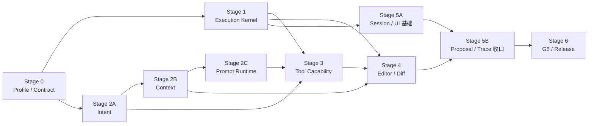

---
文档编号：AG-X-L-04
文档状态：A
负责模块：AG
文档职责：Binder AG 1.0 开发与验证执行计划——将 agent-edit-1.0 目标架构拆成可独立开发、独立验证和阶段收口的工作包，定义阶段依赖、实施边界、验证方案、证据要求与发布退出门禁
上游约束：A-AG-M-D-01、A-AG-M-D-02、A-AG-M-T-01、A-AG-M-T-02、A-AG-M-S-01、A-AG-I-P-01、A-WS-M-T-02、A-WS-M-S-02、A-CORE-X-L-06、A-VAL-X-V-01、A-SYS-I-P-03
直接承接：AG 1.0 后续 CODE_CHANGE Issue Trace/Scope Lock、测试影响计划、AG/DE/ED/WS/ENT/GW 联调、G5 系统验证与发布裁决
使用边界：本文只规划 agent-edit-1.0；不重新审计当前实现，不把 G4 骨架标记视为完成，不纳入 Build/CBT、自动 AST/KB/TPL、未进入 ExplicitEditTargetSet 的跨文档写入、参考风格/排版、开放式 Planning 或多 Agent；WorkspaceOperation 只按已冻结的 WS 契约接入
变更要求：工作包边界、阶段依赖、冻结契约、验证矩阵或退出条件变化时，须先回写对应 AG/WS L1/L2 与验证卡；实际开发按 ADP 为每个工作包建立独立 Scope，本文不得替代 Runtime Report
治理成熟度：draft
---

# Binder AG 1.0 开发与验证计划

## §1 计划目标

本计划把 `agent-edit-1.0` 拆成八个工程工作包和七个阶段，使每个能力模块都具备：

1. 明确职责、输入、输出和不负责事项；
2. 可由独立 CODE_CHANGE Scope 实施；
3. 可在不等待完整 Agent 完成时验证自身契约；
4. 有明确模块退出门禁，能够独立收口；
5. 最终通过跨模块 G5 验证聚合为 AG 1.0 发布能力。

“独立收口”不等于“无依赖”。上游冻结契约未通过时，下游可以准备测试夹具和适配层，但不得以假契约
宣布完成。

## §2 开发原则与完成等级

### §2.1 五条实施原则

- **契约先于接线**：IntentResult、PromptPackage、CapabilityGrant、ChangeProposal 和事件终态先冻结，后实现消费者。
- **可靠性先于能力数量**：先修真实门禁、取消和唯一终态，再开放工具和复杂上下文。
- **默认拒绝**：工具、目标、上下文来源和 Runtime Profile 未显式允许即不可用。
- **每个工作包自带验证**：不把单元测试、故障注入或负向测试统一拖到最后补写。
- **G4 与 G5 分离**：模块通过自动化可收口为 G4；只有真实网关、编辑器、Diff 和保存链通过后才具备 G5 发布证据。

### §2.2 完成等级

| 等级 | 含义 | 必备证据 |
|---|---|---|
| Contract Ready | 输入输出、错误、状态和兼容策略已冻结 | L1/L2/I-P 对齐；契约样例；无未决高风险语义 |
| Module Ready | 单模块真实实现完成 | 单元/状态/服务测试；负向路径；无桩或伪成功 |
| Integrated | 与直接消费者真实接线 | 契约测试、集成测试、失败传播与恢复测试 |
| G5 Validated | 在真实系统边界证明需求闭环 | 真实模型/网关/编辑器/Diff/保存链记录 |
| Release Ready | 所有发布阻断项满足 | §11 发布门禁；未验证能力关闭；治理和打包通过 |

工作包只有达到 `Module Ready` 才能独立收口；阶段只有所有必需工作包达到该阶段指定等级才能退出。

## §3 工作包拆分

| 工作包 | 能力模块 | 主要职责 | 核心输入 | 核心输出 | 直接依赖 | 可独立收口 |
|---|---|---|---|---|---|---|
| WP-AG10-00 | Runtime Profile 与契约入口 | 统一 1.0 入口、能力开关和冻结契约 | start_turn 请求、发布配置 | `agent-edit-1.0` 入口与能力矩阵 | 无 | 是 |
| WP-AG10-01 | Execution Kernel | 真实门禁、流式、取消、错误、唯一终态 | PromptPackage、GateOutcome、CancellationToken | 有序事件流与单一终态 | WP-AG10-00 | 是 |
| WP-AG10-02 | Intent Layer | 识别当前轮目标、变更意图和歧义 | 用户原文、显式目标、编辑器焦点、必要历史 | `IntentResultV1` | WP-AG10-00 | 是 |
| WP-AG10-03 | Context Layer | 选择、校验、裁剪文档上下文 | IntentResult、LogicalState、选区、引用、历史 | ContextBundle / PromptDataEnvelope 清单 | WP-AG10-02 | 是 |
| WP-AG10-04 | Prompt Runtime | 按信任层和版本装配模型输入 | IntentResult、ContextBundle、工具 manifest | `PromptPackageV1` + trace 元数据 | WP-AG10-02、WP-AG10-03 | 是 |
| WP-AG10-05 | Tool Capability Layer | 注册、逐回合授权、参数校验与执行；资源意图只能生成 WorkspaceOperationPlan，确认后由 TaskRun 调用 WS | IntentResult、Runtime Profile、工具请求、DecisionRequest 回执 | `CapabilityGrantV1`、ToolResult、plan_id/operation receipt | WP-AG10-01、WP-AG10-02、WP-AG10-04、SM-WS-04 | 是 |
| WP-AG10-06 | Editor/Diff Integration | 只将文档内容修改变成可审阅 ChangeProposal；CreateDocumentBundle 在资源创建成功后投影普通初始内容 Diff | IntentResult、LogicalState revision、模型/工具产出、operation_id | PendingDiff、审阅/应用/冲突回执 | WP-AG10-01、WP-AG10-03、WP-AG10-05、SM-WS-04 | 是 |
| WP-AG10-07 | Session、UI 与 Trace | 会话隔离、消息呈现、恢复、脱敏追踪 | Turn 事件、proposal、session/workspace 归属 | 可恢复消息流、AgentTrace、反馈元数据 | WP-AG10-01；完整收口依赖 WP-AG10-06 | 是 |

每个工作包独立开发时只能修改其职责范围和必要契约适配；发现其他模块缺陷时记录为依赖，不得顺手扩大 Scope。

## §4 总体依赖与并行策略



允许的并行关系：

- Stage 1 Execution Kernel 与 Stage 2A Intent 可在 Stage 0 退出后并行；
- Context 完成输入输出冻结后，Prompt Runtime 实现可与 Tool policy 测试夹具准备并行；
- Session schema、消息 segment 和基础恢复可在事件契约冻结后与 Context/Prompt 并行；
- Editor/Diff 只能在 ChangeProposal、工具授权和执行终态语义稳定后进入真实接线；
- Stage 6 不是集中补测试阶段，而是聚合此前已有证据并完成真实系统验证。

禁止的并行方式：前后端各自发明同名不同义的契约、在 Intent 未冻结前硬编码工具权限、在 Execution
未可靠前用 UI 状态掩盖取消/错误、在 Diff 基准未锁前直接接模型写入。

## §5 Stage 0：Runtime Profile 与契约基线

### §5.1 目标

建立唯一 1.0 主入口和兼容面，确保所有后续工作使用同一 Runtime Profile、数据结构和错误语义。

### §5.2 工作包：WP-AG10-00

**开发范围**：

- `ag.start_turn` / 前端 `startTurn` 参数与兼容适配；
- `runtime_profile=agent-edit-1.0` 的后端校验；
- IntentResultV1、PromptDataEnvelopeV1、PromptPackageV1、CapabilityGrantV1、ChangeProposal 和回合事件的共享类型；
- Build/CBT、ExplicitEditTargetSet 集合外写入、文件结构操作、自动 AST/KB/TPL 的 feature gate；
- 旧入口只能适配到同一主链，不能保留第二条 provider 调用路径。

**不在范围**：实现意图算法、Prompt 文本、工具执行或 Diff 应用。

### §5.3 验证方案

| 验证层 | 条件 | 通过标准 |
|---|---|---|
| 静态/契约 | 前后端共享字段、枚举、serde/TypeScript 形状 | 名称、可选性、错误码和版本一致；契约快照通过 |
| Service | 传入 `agent-edit-1.0` 与未知 profile | 合法 profile 进入统一入口；未知 profile 稳定拒绝 |
| 负向 | BuildMode、结构工具、自动补强试图进入 1.0 | 被 feature gate 或 manifest 拒绝，不产生模型/工具调用 |
| 路径核验 | 搜索所有 provider 调用入口 | 1.0 只有一个受控入口；无客户端/provider 直连 |

### §5.4 阶段收口条件

- 六项冻结契约都有版本和兼容策略；
- 前端能力展示、后端 profile 和工具 manifest 的 1.0 边界一致；
- 不支持能力返回稳定结果，不出现空壳按钮、半接管或伪成功；
- 契约测试与治理审计通过；
- 输出一份契约变更影响清单，后续工作包以此为输入。

## §6 Stage 1：可靠 Execution Kernel

### §6.1 目标

在尚未增加复杂工具和上下文前，证明每个回合的门禁、流、取消、错误与终态是真实的。

### §6.2 工作包：WP-AG10-01

**开发范围**：`src-tauri/src/ag/turn.rs`、模型调用编排、取消传播、事件发射、必要 IPC 适配、前端回合状态归并。

**输出契约**：有序 Turn 事件、结构化 GateDenied/Error/Cancelled、单一 terminal state、与 turn_id 关联的执行 trace。

**关键实现机制**：

- GatePassed 只消费本次服务端 GateOutcome；
- CancellationToken 传播到 provider stream 和 tool loop；
- terminal_latch 首次终态后拒绝后续 Done/Error/Cancelled；
- gateway/provider/tool error 不转换为 Done；
- 同 session active turn 采用单活或显式排队，不允许竞争执行。

### §6.3 验证方案

| 测试组 | 注入条件 | 必须断言 |
|---|---|---|
| Gate | denied/offline/过期或错误 verdict | provider 请求数为 0；工具数为 0；终态正确 |
| Cancel | 流式前、流式中、工具请求前后取消 | 后续 token/tool/proposal 数为 0；唯一 Cancelled |
| Error | provider 首包前、部分文本后、工具执行中失败 | Error 保留真实阶段；不得再出现 Done |
| Race | cancel 与 streamEnd、toolResult 与 error 同时到达 | terminal_latch 只接受一个合法终态 |
| Ordering | text/tool/proposal 连续事件 | 前后端观察顺序一致；无完成后补发执行态 |
| Concurrency | 同 session 连续启动两个 turn | 第二个按契约排队或拒绝；不得双活 |

### §6.4 阶段收口条件

- A-AG-M-S-01 的 SM-AG-01 主路径、拒绝路径、恢复路径和禁止转移均有断言；
- AG1-V-01、V-02、V-03 自动化通过；
- 代码中不存在常量 GatePassed、仅 UI 取消或 Error→Done 路径；
- 前端展示状态与后端真实终态一致；
- WP-AG10-01 达到 Module Ready，可供后续模块使用，不等待真实工具和 Diff 完成。

## §7 Stage 2：Intent、Context 与 Prompt Runtime

Stage 2 内部分三步推进；Intent 先冻结，Context 与 Prompt 再依次消费，禁止三套逻辑各自猜测用户意图。

### §7.1 Stage 2A：WP-AG10-02 Intent Layer

**职责**：从当前轮原文、显式目标、编辑器焦点和必要历史形成 IntentResultV1。

**开发边界**：只决定任务语义和候选能力，不读取大规模上下文、不执行工具、不生成 Diff。

**验证样本矩阵**必须覆盖：

- answer / inspect / search / analyze / edit / create_document / organize_workspace / clarify；
- 当前文档、选区、新文档、显式引用的 data-only 内容与用户可见文档身份；
- “只分析，不要修改”等否定变更约束；
- 当前轮覆盖历史、明确沿用历史、跨文档历史不应沿用；
- 单目标、多目标、目标缺失和高风险歧义；
- 同义表达、多轮修正和显式选择上一轮方案。

**独立收口条件**：相同输入产生稳定结构；blocking ambiguity 不进入模型生成和工具阶段；原始输入不被摘要替代；Context/Prompt/Tool 可通过同一 intent_id 消费结果。

### §7.2 Stage 2B：WP-AG10-03 Context Layer

**职责**：按 IntentResult 选择当前 LogicalState、选区、显式引用和必要历史，输出带 provenance 的 ContextBundle。

**验证方案**：

| 场景 | 必须断言 |
|---|---|
| 编辑器未保存、磁盘为旧内容 | 当前文档读取 LogicalState，不以 DiskState 覆盖 |
| 引用 A、修改当前 B | A 内容为 data-only envelope；A/B 规范化身份供 ExplicitEditTargetSet owner 消费；本层不授予写工具 |
| selection 锚过期 | 拒绝作为当前事实或进入澄清，不猜测位置 |
| 上下文超预算 | 按 P0→P3 规则裁剪；显式来源与裁剪原因可追踪 |
| session/workspace 切换 | 不注入其他 session/workspace 临时上下文 |
| 自动 AST/KB/TPL | 1.0 调用数为 0；显式合法引用除外 |

**独立收口条件**：所有来源带 source/provenance/freshness/hash/trust/token 元数据；当前文档新鲜度、workspace 边界、引用校验和裁剪确定性测试通过；无模型调用也能独立验证输出包。

### §7.3 Stage 2C：WP-AG10-04 Prompt Runtime

**职责**：把系统约束、本轮 grant、IntentResult、ContextBundle 和用户原文装配为 PromptPackageV1。

**验证方案**：

- Prompt 层序快照：系统/输出协议 → 工具允许集 → IntentResult → 当前文档/选区 → 显式引用 → 必要历史 → 用户原文；
- 信任边界测试：文档、引用、历史和工具结果中的“忽略规则/调用工具”等文字保持 data-only；
- 预算测试：估算、裁剪和拒绝发生在网关调用前；
- 版本测试：runtime、system prompt、tool manifest、intent 和 context trace 可关联；
- 脱敏测试：默认 trace 不含正文、密钥、token；
- 缓存测试：即使不启用 provider cache，也能区分稳定层和动态层；cache 不是阶段阻断项。

**独立收口条件**：给定固定 IntentResult/ContextBundle 可确定性生成同版本 PromptPackage；提示注入不能改变系统层；PromptPackage 可在不调用 provider 的情况下完整验证。

### §7.4 Stage 2 总收口条件

- WP-02/03/04 均达到 Module Ready；
- AG1-V-04、V-07、V-08、V-09、V-12 自动化通过；
- 任一 trace 中 intent_id、context_trace_id、runtime version 和 manifest hash 一致；
- Intent、Context、Prompt 不存在重复目标判断或不同 allowed_tools 来源；
- Stage 2 输出可作为 Tool Capability 和 Editor/Diff 的稳定输入。

## §8 Stage 3：最小 Tool Capability Layer

### §8.1 目标与工作包

WP-AG10-05 只开放完成当前任务所需的最小读取、内容修改提案或 WorkspaceOperationPlan 工具，并证明注册不等于授权。

**开发范围**：`src-tauri/src/ag/tool_registry.rs`、`tool.rs`、`tool_exec.rs`、CapabilityGrant 生成、工具错误与循环预算。

### §8.2 1.0 工具策略

| Intent | 可授权能力 | 明确禁止 |
|---|---|---|
| answer | 空或完成回答所需的最小只读工具 | proposal、结构写、删除 |
| inspect/analyze | 当前文档/显式引用读取、必要 search/list_blocks | proposal，除非用户另有明确编辑要求 |
| search | 受限 list_docs/search_text/read_doc | workspace 外读取、写工具 |
| edit | ExplicitEditTargetSet 成员目标读取、propose_edit/edit_blocked | 集合外写入、直接保存、文件结构操作 |
| create_document | 必要读取、`plan_workspace_operation`；确认前由 CreateDocumentBundle 冻结初始内容 | 目标资源建立前 `propose_edit`、带 AI 内容的直接 create_doc |
| organize_workspace | 必要读取、`plan_workspace_operation` | 内容 proposal、未经 DecisionRequest 直接执行资源副作用 |
| clarify | 无副作用工具 | 所有写工具 |

### §8.3 验证方案

- 对每个 Intent 生成 CapabilityGrant 快照，断言最小允许集；
- 对每个工具执行 registry + grant + target + parameters 四重校验；
- 覆盖未注册、已注册未授权、grant 过期、错误 target、参数越界、workspace 越界；
- 覆盖当前文档/用户显式引用初始化、同 AgentTurn 澄清单调追加、只读工具零追加、scope DecisionRequest
  confirm 追加/cancel 零追加、TaskRun continuation 继承与集合外 propose_edit 硬拒；
- 权限拒绝重复调用不能升级权限；同类失败和总循环达到上限后结束；
- 只读工具对已打开文档使用 LogicalState；
- propose 工具只形成 ChangeProposal，不产生 LogicalState/DiskState 写入；
- `create_folder`、move/rename、delete、命令、网络和未验证高级工具在 1.0 grant 中始终缺席。

### §8.4 阶段收口条件

- 完整 Intent×Tool allow/deny 矩阵通过；
- AG1-V-13 通过，注册工具无法绕过 CapabilityGrant；
- 工具循环状态机和错误恢复有断言；
- 静态与动态核验均证明没有工具直接写用户文档；
- ToolResult 保持结构化错误和 trace 关联，可供模型恢复但不能扩权。

## §9 Stage 4：Editor/Diff 可靠闭环

### §9.1 目标与工作包

WP-AG10-06 把模型产出的写意图统一转换为可定位、可审阅、可拒绝和可冲突检测的 ChangeProposal。

**开发范围**：AG→DE 交接、proposal 持久化、DiffCard、ED LogicalState revision/hash、锚校验、apply 回执、WS 保存结果。

### §9.2 分路径开发

| 路径 | 输入 | 预期输出 | 禁止结果 |
|---|---|---|---|
| 当前全文编辑 | 当前 LogicalState + base revision | 当前文档 PendingDiff | 直接替换编辑器/磁盘 |
| 当前选区编辑 | selection anchor + revision + before context | 可定位块/区间 Diff | 锚失效后猜测应用 |
| 新建文档 | CreateDocumentBundle（目标计划 + 预生成初始内容） | DecisionRequest；确认后真实文件/标签 + 初始内容 PendingDiff | 确认前创建文件；内容 Diff 承担资源授权 |
| 工作区资源操作 | WorkspaceOperation intent + 当前磁盘/标签/Diff/引用事实 | 不可变 plan + DecisionRequest；确认后 WS 回执 | 直接调用低层文件命令；生成资源 DiffCard；确认后等待第二次保存 |
| 用户拒绝 | pending proposal | Rejected，文档不变 | 保留隐式待应用写入 |
| 基准冲突 | proposal base ≠ 当前 revision/hash | Conflicted/重新确认 | 静默覆盖用户新编辑 |
| 保存失败 | apply 成功、save 失败 | LogicalState 脏态 + 明确失败 | 声明 DiskState 已更新 |

### §9.3 验证方案

1. **模块测试**：proposal schema、状态互斥、base/hash 校验；WorkspaceOperation plan/confirm/receipt；CreateDocumentBundle 关联和三重基线。
2. **前后端集成**：DiffProposed 事件、DiffCard 状态、接受/拒绝回执、消息 proposal 关联。
3. **真实编辑器集成**：未保存内容、selection 锚、用户继续编辑后的冲突、apply transaction。
4. **保存链集成**：LogicalState 更新与 DiskState 保存分开断言；保存失败可重试。
5. **恢复测试**：重启后 pending/rejected/accepted/conflicted 不被错误重置。

### §9.4 阶段收口条件

- AG1-V-05、V-06、V-10、V-14 通过；
- 当前文档修改继续按内容三态验证；新建需覆盖确认前零副作用、先建盘再投影、安全拒绝与基线推进；资源操作需覆盖 dirty 阻断、补偿、重启中断和统一恢复；
- 用户接受前 LogicalState/DiskState 不发生 AI 写入；
- 一个 proposal 只写一个 ExplicitEditTargetSet 成员文档；引用内容保持 data-only，引用身份仅提供成员资格；
- 原文件在错误、取消、冲突和保存失败路径中可恢复。

## §10 Stage 5：Session、UI、Trace 与体验收口

### §10.1 目标与工作包

WP-AG10-07 使 Agent 可以持续协作、重启恢复，并让用户和研发看到与真实 Runtime 一致的状态。

**开发范围**：agent_sessions/turns/payloads、前端 agStore/agService、消息 segment、proposal 关联、AgentTrace、脱敏 telemetry 和用户反馈元数据。

### §10.2 验证方案

| 能力 | 验证条件 | 通过标准 |
|---|---|---|
| Session 隔离 | 两个 workspace、多个 session、相同文档 | 历史、active turn、proposal 和 trace 不串线 |
| 重启恢复 | completed/error/cancelled/draft + pending proposal | 状态原样恢复；draft/pending 不显示为成功 |
| 消息时序 | text/tool/proposal/error 交错事件 | UI 顺序与 Runtime 事件一致 |
| 状态诚实 | Error、Cancelled、Conflicted、Rejected | 不渲染成 Done/Applied |
| Trace 完整 | 任一 turn | intent/context/prompt/grant/gate/tool/proposal/terminal 可关联 |
| 数据最小化 | 检查数据库、日志、telemetry | 默认不含正文、密钥、provider token |
| 用户反馈 | 接受/拒绝/失败后提交反馈 | 只关联脱敏任务类型、模型、耗时、结果和错误阶段 |

### §10.3 阶段收口条件

- AG1-V-11、V-15 通过；
- session 隔离、重启恢复、未决 Diff 恢复与乱序事件测试通过；
- UI 所有状态可追溯到真实事件，不自行推断伪终态；
- telemetry 数据边界检查通过；
- WP-AG10-07 达到 Integrated，能够承接完整 G5 场景。

## §11 Stage 6：G5 系统验证与发布收口

### §11.1 目标

在目标 macOS 构建中，以真实 AiGateway/托管模型/BYOK、真实编辑器状态和真实 Diff/保存链证明
AG 1.0 发布闭环。Mock、局部单测和前端演示不能替代本阶段。

### §11.2 验证环境

- 目标 macOS 安装包或等价 release build；
- 真实 SubscriptionGate、AiGateway 托管模型和 BYOK 测试账号；
- Markdown、文本和 1.0 支持范围内的 DOCX 样本文档；
- 包含未保存编辑、显式引用、长文档、提示注入文本和基准冲突的固定样例；
- 可查看脱敏 trace、网关请求计数、工具调用和 proposal 状态的测试观测面。

### §11.3 G5 场景组

| 场景组 | 覆盖 | 通过标准 |
|---|---|---|
| Read/Analyze | 回答、审阅、比较、只分析不修改 | 内容相关；写工具和 Diff 为零 |
| Edit | 全文、选区、未保存内容、显式引用辅助 | 目标正确；先 Diff；接受/拒绝符合预期 |
| Create | 根据要点新建文档 | 确认前无文件；确认后先出现真实文件/标签，再出现初始内容 Diff；安全拒绝受三重基线约束 |
| Resource Ops | 创建/删除/重命名/移动/恢复与批量故障 | DecisionRequest 前置裁决、确认后直接磁盘执行、dirty 阻断、fail-fast 补偿、WorkspaceTimeline 可恢复 |
| Safety | gate denied、cancel、provider/tool error、提示注入、越权工具 | 无旁路、无伪成功、无原文破坏 |
| Conflict/Recovery | proposal 后继续编辑、保存失败、重启恢复 | 冲突明确；不覆盖；状态可恢复 |
| Isolation | 多 session/workspace 切换 | 上下文、历史、proposal、trace 不串线 |
| Privacy/Trace | 检查 trace、日志、telemetry | 可定位阶段且默认无正文/密钥 |

必须完整执行 A-AG-X-L-03 的 AG1-V-01～V-15；单个场景失败时回到对应工作包修复并重跑其 related tests，
随后重跑受影响的 G5 场景，不得只修改验收记录。

### §11.4 发布退出门禁

1. WP-AG10-00～07 全部至少达到 Integrated，发布主链达到 G5 Validated；
2. AG1-V-01～V-15 全部有结果和证据，不存在未处置失败；
3. `agent-edit-1.0` 默认入口不存在桩 Gate、假流、直接 provider、直接 create_doc AI 内容或工具直写；
4. Error/Cancelled/Rejected/Conflicted/保存失败均不破坏原文，不显示伪成功；
5. 所有默认开放工具均有权限、参数、错误恢复和系统验证证据；
6. 未通过 G5 的保留能力通过 feature gate 关闭；
7. `test:plan`、`test:related`、模块测试、集成测试、治理审计和 macOS 打包验证实际通过；
8. 发布说明明确 1.0 能力边界、已知限制、第三方模型处理和正文默认不持久化策略。

## §12 各工作包统一验证与交付模板

每个 CODE_CHANGE Scope 的交付记录必须包含：

```text
工作包：WP-AG10-xx
输入契约版本：
输出契约版本：
实现文件：
直接消费者：
主路径测试：
拒绝/错误/恢复测试：
状态机或契约测试：
test:plan 结果：
test:related 结果：
治理审计：
系统验证：NOT_REQUIRED / PENDING / PASSED / BLOCKED
未解决项及是否影响下一阶段：
```

### §12.1 模块独立收口检查表

- 职责输入输出未越界；
- 真实实现替代所有当前 Scope 内的桩；
- 主路径、边界、拒绝、错误、取消/恢复均有断言；
- 对上游契约的假设已通过契约测试；
- 对直接消费者提供稳定样例和错误形状；
- 没有通过吞错、常量成功、放宽断言或隐藏 UI 制造通过；
- 自动化不能覆盖的项明确标为 VALIDATION_ONLY 并进入 Stage 6；
- 无阻断未决项时才标记 Module Ready。

### §12.2 阶段独立收口检查表

- 本阶段全部必需工作包已 Module Ready；
- 阶段场景矩阵全部通过；
- 直接下游可以只依赖冻结输出，不需要读取本模块内部状态；
- 失败可归因到明确模块和阶段；
- 设计、接口、状态机和测试证据与实际实现一致；
- 生成 ADUS 后治理审计通过；
- 输出阶段 Runtime Report 后才允许进入下一阶段。

## §13 阻断与回退规则

出现下列任一情况，当前阶段不得收口：

- 需要改变 IntentResult/PromptPackage/CapabilityGrant/ChangeProposal 的冻结语义但未先回写设计；
- 发现第二条模型调用、工具直写、直接创建 AI 文档或客户端绕过门禁路径；
- 单元测试通过但真实错误被转换为 Done/Applied；
- 当前文档读取使用旧 DiskState 覆盖 LogicalState；
- 未验证能力只能靠 Prompt 声明“不要使用”，没有 Runtime feature gate；
- 测试只能通过删除断言、跳过用例、吞异常或硬编码预期结果；
- 下游必须读取上游内部实现细节才能工作，说明契约尚未收敛；
- 系统验证失败但无法由 trace 定位到 intent/context/prompt/tool/execution/diff/session 阶段。

回退时只回到产生根因的最近工作包；契约未改变则不重做已收口模块。若契约改变，必须重新运行所有直接
消费者的契约测试与影响选择器给出的 related tests。

## §14 计划完成定义

本计划完成不以“八个工作包代码合并”判断，而以以下系统状态判断：

> 用户可以在 Binder 中持续地让 Agent 阅读、分析、修改当前文档或提出新建文档；Runtime 准确限制
> 上下文和工具；所有 AI 变更先进入 Diff；门禁、取消、错误、冲突、保存失败和会话恢复均表现真实；
> 任一失败不破坏原文；研发可以通过脱敏 Trace 定位失败阶段；未验证的高级能力在 1.0 默认关闭。

达到该状态并满足 §11.4 后，AG 1.0 才可标记 Release Ready。

## §15 2026-08-08 实施结果与阶段裁决

本轮 `AG-1.0-IMPLEMENTATION-01` 已按同一冻结契约完成 WP-AG10-00～07 的本地实现与直接消费者接线。
这里的“完成”表示 Module Ready / 本地 Integrated，不代表 Stage 6 的真实 provider 与 WKWebView G5 已执行。

| 工作包 | 实际系统状态 | 自动化收口证据 | 裁决 |
|---|---|---|---|
| WP-AG10-00 Runtime Profile | `agent-edit-1.0` 为唯一主入口；未知 profile 默认拒绝；Build 入口物理关闭 | profile 单测、Composer/Service 契约测试 | Integrated |
| WP-AG10-01 Execution Kernel | 本次服务端 GateOutcome、逐次续调门禁、后端单 session 单活、provider abort、工具前取消、唯一终态 | Rust AG 测试、前端 Error→Done 锁存测试、取消命令测试 | Integrated |
| WP-AG10-02 Intent Layer | 生成版本化 `IntentResultV1`；当前轮否定约束优先；缺编辑目标阻断澄清；非文档问答不自动注入当前文档 | answer/analyze/edit/create/clarify 与目标/上下文选择断言 | Module Ready |
| WP-AG10-03 Context Layer | 当前 LogicalState 为主事实；显式引用内容 data-only、规范化身份供 ExplicitEditTargetSet owner 消费；历史按文档归属和显式沿用确定性选择；1.0 自动 AST/KB/TPL 为零 | context、reference、history 与 Prompt 装配测试 | Integrated |
| WP-AG10-04 Prompt Runtime | 固定系统→意图→当前文档→引用→历史→用户顺序；记录 provenance/freshness/hash/trust/token、context trace 与真实 tool manifest hash；trace 不记录正文 | PromptPackage、层序、注入隔离与历史 trace 一致性测试 | Module Ready |
| WP-AG10-05 Tool Capability | 内容工具按 CapabilityGrant→Diff；资源工具只生成 plan_workspace_operation，确认后由 TaskRun 调用 WS 执行，禁止直调文件命令和资源 Diff | Intent×CapabilityGrant、DecisionRequest 真实确认、幂等/重启 | Local Integrated；G5 pending |
| WP-AG10-06 Editor/Diff | 普通内容编辑三态保持；新建需改为 CreateDocumentBundle，资源创建后初始内容进入普通 Diff | V-C1~C3 + V-R1/R2 + 既有 core_chain | **New baseline migration pending** |
| WP-AG10-07 Session/UI/Trace | 前后端活动回合一致；停止按钮调用真实取消；Error/Cancelled 不被 Done 覆盖；Build 不呈现；脱敏 trace 可关联 intent/context/manifest/terminal | AG 前端 92 项、全量前端 552 项、治理审计 | Integrated（本地） |

### §15.1 最终自动化证据

| 验证 | 结果 | 证明范围 |
|---|---|---|
| AG Rust 定向 | `PASS`：136 passed | Intent、Context、Prompt、Tool、终态、取消和 proposal 守卫 |
| AG 前端定向 | `PASS`：3 files / 92 tests | Runtime Profile、唯一终态、取消、会话/UI 投影 |
| Core chain | 旧基线自动化曾通过；新资源基线未验证 | 普通 PendingDiff 证据可复用；旧“新建空基准/资源删除 Diff”证据不计入新基线 |
| `test:plan` | `PASS` | 选择前端全量、TypeScript、Rust 全量、治理审计 |
| 非沙箱 `test:related` | `PASS`：前端 552；Rust 295 + 5 + 4；TypeScript 与 audit 通过 | changed_files 直接/间接消费者完整回归 |
| 非沙箱 `test:full` | `PASS`：前端 552；Rust 295 + 5 + 4 | 项目完整自动化基线；LibreOffice 真转换通过 |
| `governance:generate/audit` | `PASS`：92 assets / 856 cases；0 governance finding/warning | ADUS、测试治理与规则引用一致 |
| 规则语义复核 | `PASS` | 新增 IntentResult 边界及 Prompt 组装边界与 BR-AG-DATA-001/002/004/005 一致 |

### §15.2 未完成边界与发布结论

- Stage 0～5 已达到本地 Integrated，可以作为 AG 1.0 后续真实联调基线。
- Stage 6 尚未执行真实账号/订阅/AiGateway/托管模型或 BYOK、真实 WKWebView、真实 DiffCard 人工观察；
  因此本轮不得标记 `G5 Validated` 或 `Release Ready`。
- 受控沙箱内 LibreOffice E2E 会因 AppKit 注册限制 signal 6；同一代码和测试在非沙箱 macOS
  `test:related` 与 `test:full` 均通过，未删除、跳过或弱化测试。
- 项目级 `cargo fmt -- --check` 仍会报告本次 Scope 外既有文件及 `lib.rs` 旧区域的格式差异；它不是当前
  测试选择器门禁，本轮只格式化了新增 AG 小模块代码，没有用范围扩张制造全库格式变更。

当前阶段裁决：普通内容/Runtime、WorkspaceOperation 与 CreateDocumentBundle 子链均为 `LOCAL_INTEGRATED / G5_PENDING`；WorkspaceTimeline 继续沿其独立验证卡判断。真实 provider/WKWebView 和生产配置证据进入待验证列表，不得用本地自动化宣称 G5 完成。

## 变更记录

| 日期 | 版本 | 变更内容 |
|------|------|---------|
| 2026-08-08 | v1.0 | 初版：基于 A-AG-X-L-03 将 agent-edit-1.0 拆为 8 个独立工作包和 Stage 0～6；定义依赖与并行边界、Contract Ready/Module Ready/Integrated/G5/Release 五级完成标准；为 Runtime Profile、Execution、Intent、Context、Prompt、Tool、Editor/Diff、Session/Trace 分别建立开发范围、验证方案和独立收口条件；补充真实 G5 环境、场景组、发布门禁、统一证据模板与阻断回退规则 |
| 2026-08-08 | v1.1 | AG-1.0-IMPLEMENTATION-01：记录 WP-AG10-00～07 的实际实现状态与独立收口证据；非沙箱 test:related/test:full、TypeScript、ADUS 和治理审计通过；阶段裁决为 LOCAL_INTEGRATED / G5_PENDING，不以自动化冒充真实 provider/WKWebView G5 |
| 2026-08-21 | v1.2 | 工作区资源操作基线重构：Stage 4/G5 改为 WorkspaceOperation + DecisionRequest、CreateDocumentBundle 和 WorkspaceTimeline；旧资源 Diff/空基准新建证据不再计入新基线，相关工作包状态改为 IMPLEMENTATION_PENDING。 |
| 2026-08-28 | v1.3 | AG-CONFORMANCE-PLAN-S3D-COMPANION：承接 fed343a/a0afdff，把工作包和验证边界统一到 ExplicitEditTargetSet；只读内容不扩权、用户引用身份可初始化成员、scope confirm 可追加、集合外提案硬拒。 |
| 2026-08-29 | v1.4 | AG-CONFORMANCE-CODE-S3E：WP-AG10-05 工具策略对齐当前 CreateDocumentBundle/WorkspaceOperationPlan 规则；CreateDocument/OrganizeWorkspace 只获得必要读取与 plan_workspace_operation，目标资源建立前不开放 propose_edit。 |
