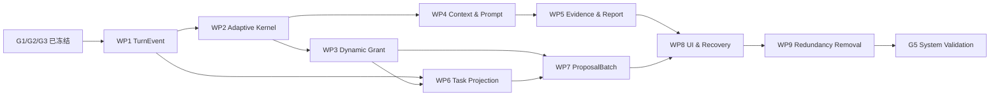

---
文档编号：AG-X-L-04
文档状态：A
负责模块：AG
文档职责：Binder Agent 1.0 唯一实施计划——把已冻结需求和设计拆为可独立治理、实现、删除旧逻辑和验证的工作包
上游约束：A-CORE-X-D-02、A-AG-M-D-01、A-AG-M-T-01、A-AG-M-T-02、A-AG-M-S-01、A-AG-I-P-01、A-SYS-I-P-01、A-DE-M-T-01/A-DE-M-S-01/A-DE-I-P-01、A-ED-M-T-01/A-ED-M-S-01/A-ED-I-P-01、A-WS-M-T-02/A-WS-M-S-02/A-WS-I-P-01、A-VAL-X-V-04
直接承接：WP-AG10-01～09 的 CODE_CHANGE Scope、A-VAL-X-V-04 验证卡、G5 系统验证与发布裁决
使用边界：本文只规定实施顺序、范围和证据门禁，不定义需求、运行时授权或完成事实；实际状态只来自对应 Scope 的 Runtime Report 和验证卡；旧实现存在不等于当前工作包已完成
变更要求：工作包边界、依赖或退出条件变化时，先核对上游需求/设计；不得用改计划掩盖实现偏差
治理成熟度：draft
---

# Binder Agent 1.0 开发与验证计划

## §1 目标与唯一事实来源

本计划只服务一个结果：将已冻结的 `agent-edit-1.0` 从当前“代码存在但语义分叉”的状态收敛为可靠、
可泛化、可审计的专业 Agent。唯一事实顺序为：

1. L1 需求决定做什么和不做什么；
2. Active L2 设计、协议和状态机决定运行契约；
3. 本文决定实施顺序与交付粒度；
4. A-VAL-X-V-04 决定验证场景和证据状态；
5. ADUS、测试治理注册表和实际 Runtime Report 证明映射与执行结果。

本文不得把历史提交、旧自动化数量、类名存在或 UI 展示推断为完成。所有工作包当前从 `PLANNED`
起步；只有新 Scope 按当前契约实施并产生证据后才能进入 `READY`。

## §2 冻结基线与非目标

### §2.1 必须保持的 1.0 基线

- 模型负责理解用户目标、选择当前动作，并根据真实 ToolResult 修订 IntentResult 与路线；关键词分类只能提供
  非权威提示，不能决定授权或完成。
- 运行时负责 RuntimeProfile、Gate、CapabilityGrant、目标范围、格式动态能力、预算、取消、终态锁存和
  副作用边界；每次 provider 调用重新 Gate，每次工具执行重新计算当前 grant。
- TurnEvent 是 append-only 回合事实源；UI 状态、TaskRun/TaskPlan/TaskStep、EvidenceLedger 和 ProjectReport
  都是可重建投影，不得反向驱动执行。
- 简单目标只使用 AgentTurn；复杂或跨执行片段目标才有 TaskRun。TaskPlan 只显示模型当前路线和已发生事实，
  不是调度器、后台队列、执行游标或未来授权。
- 文档内容修改只能形成 ChangeProposal；ProposalBatch 可包含一个或多个独立 DiffProjection。当前 1.0 的
  同文档多卡只支持 `current_editor` 下的 `block_ops` 与稳定 blockId `replace_block`。
- 同一 ProposalBatch 的多卡共享生成基线、目标互不重叠、一次受控预览、逐卡局部裁决；批内兄弟卡不得因
  整篇 revision 推进互相失效。后续批次仍以最新 LogicalState 为基准并可使旧批次失效。
- 项目报告只从实际读取结果形成 EvidenceLedger 后派生；不存在模型可调用的 `report_project` 完成工具。
- WorkspaceOperation 只由模型提出计划；DecisionRequest 裁决后由运行时在同一 AgentTurn 内重验并调用 WS，
  TaskRun/TaskPlan 不执行资源操作。

### §2.2 不进入本计划

- Build/CBT 接管或回落、多 Agent、后台任务队列、自动重试或重启后自动续跑。
- 自动 AST/KB/TPL 检索或写入、开放式长期记忆、未明确授权的外部网络读取。
- 未进入 ExplicitEditTargetSet 的跨文档写入、跨文档事务、批量接受/保存。
- 参考风格生成、通用排版代理，以及没有稳定目标局部逆操作的多卡 `replace_document/style_ops/table_ops/image_ops`。

## §3 完成等级与统一门禁

| 等级 | 含义 | 必须证据 |
|---|---|---|
| PLANNED | 工作包已在本文定义，尚未按当前设计实施 | 工作包范围、依赖、验证卡已明确 |
| IMPLEMENTED | 当前 Scope 内生产实现和必要迁移完成 | 代码审阅；旧路径删除清单；主/负/恢复测试 |
| INTEGRATED | 直接生产者与消费者使用同一契约 | 契约测试、前后端/跨模块测试、失败传播 |
| G5_VALIDATED | 真实 Tauri/WKWebView/provider/workspace 场景通过 | A-VAL-X-V-04 的可复核系统证据 |
| RELEASE_READY | 发布阻断场景全部闭合 | G5、治理、完整回归、打包和边界说明 |

每个工作包退出前必须同时满足：

1. 显式 ADP Scope 已确认，实际 changed_files 全部在范围内；
2. 当前实现与其承接的 REQ→RULE/STATE_MACHINE→@GOV→TEST 链逐项一致；
3. 旧语义的生产入口、类型字段、分支和测试期望已删除或被明确的只读迁移替代；
4. `test:plan` 与同输入 `test:related` 实际通过，不能手选更小测试集；
5. 自动化与系统验证结论分开，Runtime Report 无伪完成；
6. 无未处置 Stop Condition，工作包才可标记 READY 并形成独立提交。

## §4 工作包总表

| 顺序 | 工作包 | 唯一结果 | 主要验证卡 | 初始状态 |
|---|---|---|---|---|
| 1 | WP-AG10-01 · TurnEvent Foundation | append-only 事件、顺序、持久化与安全投影成为事实源 | V-S6、V-S9、V-S12 | PLANNED |
| 2 | WP-AG10-02 · Adaptive Turn Kernel | 模型—工具—证据自适应循环；逐次 Gate；真实等待/终态 | V-S6、V-S11、V-S12 | PLANNED |
| 3 | WP-AG10-03 · Dynamic Capability | 每次动作按硬事实计算 grant；移除语义授权和越权入口 | V-S10、V-S11、V-C1～C3、V-R1/R2 | PLANNED |
| 4 | WP-AG10-04 · Context & Prompt | 当前事实、data-only 内容和每次调用重装配 | V-S8～S12 | PLANNED |
| 5 | WP-AG10-05 · Evidence & Report | 成功读取生成 EvidenceLedger；最终报告由运行时派生 | V-S13 | PLANNED |
| 6 | WP-AG10-06 · Task Projection & Decisions | 简单回合零 TaskRun；复杂任务投影；同回合裁决恢复 | V-S7、V-C1～C3、V-R1/R2 | PLANNED |
| 7 | WP-AG10-07 · ProposalBatch & DiffCard | 同批连续块组拆卡、一次预览、逐卡独立裁决 | V-S1～S5、V-S14 | PLANNED |
| 8 | WP-AG10-08 · UI, Recovery & Migration | UI 只消费事件/业务事实；恢复与兼容读取不造第二真源 | V-S6、V-S7、V-S9、V-S14 | PLANNED |
| 9 | WP-AG10-09 · Redundancy Removal | 删除旧 resolver、report tool、静态 scheduler 和过期兼容写入 | 全部受影响卡 | PLANNED |

## §5 依赖与执行顺序



WP3 与 WP4 在契约上可并行，但当前仓库共享 `runtime/context/prompt/tool` 文件较多，默认串行执行以减少
混合 Scope。任何调整顺序都不能绕过上游退出条件。

## §6 工作包实施规格

### §6.1 WP-AG10-01 · TurnEvent Foundation

**目标**：唯一化回合事实；相同持久化事件序列必须重建相同安全投影。

**候选生产范围**：`src-tauri/src/ag/turn_events.rs`、`turn.rs`、`runtime.rs`、持久化迁移、
`src/services/agService.ts`、`src/store/agStore.ts` 及事件监听直接消费者。实际 Scope 以代码审计为准。

**必须实现**：

- `seq` 单调且 `(workspace_id, agent_session_id, turn_id, seq)` 唯一；事件只追加，不原位改历史；
- Intent revision、route observation、provider activity、ToolCall/ToolResult、等待、Proposal/Decision 和终态均有
  可恢复事件；正文、密钥和隐藏推理不进入安全投影；
- terminal_latch 后迟到 provider/tool/event 不产生业务副作用；
- 前端从事件 reducer 得到活动状态，不从 Promise 完成或卡片 pending 猜测执行中。

**必须删除/替代**：并列的可变回合状态真源、前后端各自发明的完成事件、终态后补发执行状态路径。

**退出证据**：顺序/重复/乱序/重放/终态后迟到/多 session 隔离测试；V-S6/S9/S12 自动化部分；完整影响回归。

### §6.2 WP-AG10-02 · Adaptive Turn Kernel

**目标**：建立模型选择动作、工具提供新事实、模型据此调整路线的单一回合循环。

**候选生产范围**：`turn_runtime.rs`、`turn_prompt.rs`、`turn_tool_loop.rs`、`prompts.rs`、provider 调用适配与取消传播。

**必须实现**：

- 首次 IntentResult 可为 unresolved；模型结构化输出产生 Intent revision、route observation、ToolCall、
  DecisionRequest、ProposalBatch 或 final answer；
- ToolResult 回注后重新组装 PromptPackage，并在每次 provider 调用前重新 Gate；
- AwaitingClarification/AwaitingDecision 暂停 provider 和工具；合法补充/裁决恢复原 AgentTurn；
- 循环预算、取消、provider/tool 错误和首终态真实生效，无自动重试或后台续跑。

**必须删除/替代**：关键词 resolver 作为最终语义、预先固定整轮工具路线、一次 Gate 覆盖后续调用、
`streamEnd`/handoff 伪装最终完成。

**退出证据**：模型输出结构解析、工具回注后改线、逐次 Gate、澄清/裁决恢复、取消竞态、循环上限与错误传播测试；V-S6/S11/S12。

### §6.3 WP-AG10-03 · Dynamic Capability

**目标**：工具注册与当前执行授权彻底分离，每次 ToolCall 都获得短生命周期 CapabilityGrant。

**候选生产范围**：`tool_registry.rs`、`tool.rs`、`tool_exec.rs`、`target_set.rs`、相关类型和 WorkspaceOperation 内部入口。

**必须实现**：

- grant 只由当前 profile、注册表、ExplicitEditTargetSet、允许副作用、格式/动态能力、确认事实、Gate、预算、
  取消和终态收窄；动作或事实变化即失效；
- IntentResult、TaskPlan、Prompt 文本、历史路径、工具发现和“注册存在”均不授权；
- `propose_edit` 在持久化前由 AG 与 DE 双重校验目标；WorkspaceOperation 仅允许 plan 工具，确认后的执行是
  运行时内部调用；
- tool manifest 只投影当前 grant，未知/过期/越界/参数不合法稳定失败关闭。

**必须删除/替代**：`IntentResult.allowed_tools` 写入与消费、静态 intent×tool 授权表作为最终真源、
模型可见 WS 执行工具和因重复失败而扩权的分支。

**退出证据**：硬事实组合表、grant 失效、AG/DE 双守、资源操作确认前后、格式动态能力、workspace 越界和参数边界测试；V-S10/S11 及 V-C/V-R 相关部分。

### §6.4 WP-AG10-04 · Context & Prompt

**目标**：每次模型调用只看到当前有效、带来源、受预算控制的事实，且内容层永远不能提升权限。

**候选生产范围**：`context.rs`、`history.rs`、`reference_runtime.rs`、`turn_reference.rs`、`prompt_runtime.rs`、
`turn_prompt.rs`、`prompts.rs` 及前端 AgentContextFacts 装配。

**必须实现**：

- 已打开文档读取 LogicalState，未打开文档读取带时点的新鲜 DiskState；Selection/DocRef/外部内容逐项校验；
- 工具结果、文档、引用、历史和显式记忆均为 data-only；来源、freshness、hash、trust 与裁剪原因可追踪；
- ToolResult 或用户补充后重新组装动态层；Prompt 当前工具层只来自本次 CapabilityGrant；
- 当前轮明确输入优先于历史，跨 workspace/session 不注入，1.0 自动 AST/KB/TPL 调用为零。

**必须删除/替代**：Context/Prompt/Intent 三处重复目标判断、全量注册表暴露、跨轮缓存动态 grant、旧 DiskState 覆盖 LogicalState。

**退出证据**：未保存内容、引用/选区失效、注入文本、预算裁剪、循环重装配、跨会话隔离测试；V-S8/S9/S10/S12。

### §6.5 WP-AG10-05 · Evidence & Report

**目标**：项目级结论只能由真实读取证据支持，报告范围和不确定性可复核。

**候选生产范围**：`tool_exec.rs`、`context.rs`、`turn_events.rs`、报告投影类型、前端报告展示直接消费者。

**必须实现**：

- 只有成功读取事件进入 EvidenceLedger；目录、搜索摘要、结构读取和全文读取保留不同 coverage；
- evidence 与 workspace/turn/source/version/hash/seq 绑定；失败或跨 workspace 结果不可伪装已读；
- final answer 到达时，运行时关联 evidence through seq 派生 ProjectReport；报告声明已读、未读、来源与不确定性；
- 新读取只扩展账本，不要求模型重提“报告完成”工具。

**必须删除/替代**：`report_project` 工具、强制报告完成门、自报 readItems 覆盖和报告失败导致本可完成回合伪失败的逻辑。

**退出证据**：证据类型/范围/顺序/跨 workspace/失败读取/最终派生测试；V-S13 自动化与真实环境前置证据。

### §6.6 WP-AG10-06 · Task Projection & Decisions

**目标**：复杂任务对用户可观察，但不建立第二个执行引擎。

**候选生产范围**：`task.rs`、`task_runtime.rs`、`turn_control.rs`、DecisionRequest/WorkspaceOperation 适配、`PlanCard.tsx`。

**必须实现**：

- 简单目标不创建 TaskRun/TaskPlan；复杂或跨执行片段目标才从 TurnEvent 派生 TaskRun；
- TaskPlan/TaskStep 只含当前路线 revision、已发生事实、候选动作、等待点和结果，不含执行游标、required_grant
  或“执行下一步”命令；
- DecisionRequest 与原 AgentTurn 绑定，confirm/cancel 后在同一回合恢复并重新校验；DiffCard 裁决不改变 TaskRun；
- 中断只投影 Interrupted，重试创建新 AgentTurn；删除 TaskRun 投影不影响 Proposal、Decision 或实际副作用事实。

**必须删除/替代**：静态 plan scheduler、TaskStep 自动执行、计划预授权、确认后由 TaskRun 调用 WS、
重启/定时后台续跑和简单请求空 TaskRun。

**退出证据**：简单/复杂判定、投影重建、路线修订、等待无活动、同回合裁决恢复、中断重试和删除投影无副作用测试；V-S7 与 A-VAL-X-V-05。

### §6.7 WP-AG10-07 · ProposalBatch & DiffCard

**目标**：将一次模型修改按人工可独立裁决的连续块组拆卡，同时保持编辑器事务一致。

**候选生产范围**：AG `edit_projection.rs/edit_runtime.rs/edit_types.rs/block_ops.rs`；DE `generate.rs/store.rs/lifecycle.rs/expiry.rs/routes.rs`；
前端 `agService.ts/deService.ts/deStore.ts/edStore.ts/edBlockOps.ts` 与 DiffCard 直接消费者。

**必须实现**：

- ProposalBatch 输出 `proposal_batch_id/group_index/group_count`；前端等齐完整批次、校验序号和目标不重叠；
- 同文档同批 `block_ops`/稳定 `replace_block` 聚合为一次 ED 前向事务；任一组预检失败时整批不预览；
- 每张卡持有自身目标 before/after fingerprint 与局部 inverse；接受只裁决，拒绝只反转该组，兄弟卡保持 pending；
- 批内预览/裁决不触发兄弟卡 `document_revision_advanced`；跨批后续修改仍按最新 LogicalState 和既有失效规则；
- 不具备目标局部逆操作的 proposal kind 保持单卡；不以文本行距或 UI 偶然分段伪造块边界。

**必须删除/替代**：单 Proposal 强制单 DiffProjection、逐卡前向预览、整篇 hash 守卫批内裁决、
`batch:{id,index,total}` 新写入和全局 accept/reject 作为批次裁决。

**退出证据**：单组、多组连续/不连续、重叠拒绝、缺组/乱序、原子预检失败、逐卡 accept/reject、兄弟卡保持、跨批失效、保存/恢复测试；V-S1～S5 与 V-S14。

### §6.8 WP-AG10-08 · UI, Recovery & Migration

**目标**：用户看到的消息、工具、等待、任务、报告和 Diff 状态完全来自当前事实，重启恢复不制造新语义。

**候选生产范围**：`agService.ts`、`agStore.ts`、AgentPanel/MessageFlow/PlanCard/ToolCallCard、DiffCard/deStore/edStore、
Rust/前端持久化迁移与事件补流。

**必须实现**：

- 信息流按 seq 消费安全事件；等待态无“工作中”动画；Error/Cancelled/Interrupted/Rejected/Conflicted 不显示完成；
- Intent/route 只显示用户可理解摘要，不显示隐藏推理；ProjectReport 展示已读/未读与不确定性；
- 同批卡可分别裁决并显示批内位置；批次缺失/损坏失败关闭；
- V1 兼容只读一次转换为 V2 当前投影，不继续写旧字段，不让历史恢复重启执行。

**必须删除/替代**：Promise/UI 本地猜终态、卡片 pending=Agent 执行中、旧 batch 嵌套字段新写入、恢复时自动续跑。

**退出证据**：事件乱序/补流、等待/终态、批内卡片、报告、重启/迁移和多 session/workspace UI 测试；V-S6/S7/S9/S14。

### §6.9 WP-AG10-09 · Redundancy Removal

**目标**：在所有当前消费者完成迁移后，删除会重新形成第二真源的旧实现与过期测试夹具。

**删除候选**：旧关键词授权 resolver、IntentResultV1 授权字段、`report_project` 注册/执行/Prompt、静态 TaskPlan
执行器、模型可见 WS 副作用工具、旧事件别名、旧 batch 写入、仅服务旧路径的适配器和测试 helper。

**执行约束**：

- 删除前用引用搜索和测试注册表证明无当前生产消费者；
- 测试只在其断言对象已被当前契约替代时更新或删除，必须同时存在新契约的等价或更强断言；
- 不借机重构无关模块、重命名公共 API 或升级依赖；
- 删除后做全库禁用标识扫描，兼容读取白名单必须逐项注明删除条件。

**退出证据**：零旧生产入口、零旧字段写入、零重复状态/授权真源；前端/Rust/TypeScript/治理完整回归；所有受影响验证卡仍满足。

## §7 每个工作包的 Scope 模板

每个 CODE_CHANGE Scope 必须在开始前填实以下内容，不能复制占位文本直接开工：

```text
scope_id:
work_package:
upstream_requirements:
upstream_rules_and_state_machines:
validation_cards:
production_owners_read:
direct_consumers_read:
allowed_files:
explicit_deletions:
migration_boundary:
test_plan_changed_files:
system_validation_required:
stop_conditions:
```

同一个文件跨多个工作包时，只修改当前工作包所需块；若无法切分且会同时改变两个冻结契约，应暂停并把两者
合并为一个经确认的新 Scope，不能隐式扩张。

## §8 进度自检与完整度自检

每次继续执行时先报告：当前工作包、阶段内完成比例、整体 10 阶段完成数；比例只辅助沟通，不替代证据。

每个工作包至少在“开始、关键实现完成、验证结束”三点执行以下自检：

| 维度 | 自检问题 | 完整标准 |
|---|---|---|
| 需求 | 是否只实现已注册 Active REQ，且没有新增能力？ | 目标 REQ 全列出，无范围外行为 |
| 设计 | 类型、事件、状态和副作用是否只有一个定义？ | 无相反生产路径或兼容写入 |
| 映射 | RULE/CHAIN/@GOV/测试 owner 是否闭合？ | governance:audit 无新增 finding |
| 实现 | 生产者、直接消费者、失败和恢复是否一起迁移？ | 无半接线、TODO、伪成功 |
| 删除 | 被替代实现和测试是否有证据地清理？ | 禁用标识扫描只剩文档历史/迁移读取 |
| 验证 | 自动化与系统行为是否分别有结论？ | Runtime Report 可复核，不用单测冒充 G5 |

若任一维度为 partial，工作包不得进入 READY；非阻断项写入 unresolved_items，影响正确性的进入 BLOCKED。

## §9 G5 系统验证

WP1～09 全部 READY 后，按 A-VAL-X-V-04 在目标 macOS release build 或等价真实 Tauri/WKWebView 环境执行：

1. 只读回答/检索/分析：能主动选择必要读取工具，零写工具、零 Diff；报告范围与真实读取一致；
2. 自适应编辑：模型读取→修改路线→再次读取/修正→Proposal，工具失败可解释调整且不扩权；
3. 同批多卡：跨两个以上不连续块，一次出现多张可独立裁决卡，分别接受/拒绝后内容正确；
4. 后续批次：以最新 LogicalState 生成，旧批按规则失效，不使用旧 payload 叠加；
5. 澄清与 Decision：均恢复原 AgentTurn，等待期间无模型/工具活动，确认后重新 Gate/授权；
6. WorkspaceOperation/CreateDocumentBundle：确认前零副作用，确认后运行时重验和真实执行；
7. 取消、错误、限额、网络中断和重启：唯一真实终态，无自动续跑、无旁路写入、无原文破坏；
8. 多 session/workspace：事件、目标、证据、TaskRun、卡片和未保存内容不串线。

真实 provider 输出有随机性时，契约/故障路径使用确定性 provider harness；另以至少一个真实 provider 验证模型实际
工具选择与交互体验。两类证据都必须保留，不能互相替代。

## §10 停止、回退与重新规划

出现以下任一条件立即停止当前工作包：

- 当前需求/设计不能唯一回答实现问题；
- 需要新增 RULE/CHAIN/TERM、产品功能或超出 1.0 的工具；
- changed_files 超出 Scope，或发现用户/其他任务未提交改动与本工作包重叠；
- 只能通过吞错、放宽授权、跳过/删除有效测试或保留双路径才能继续；
- 迁移无法保证历史数据安全，或删除候选仍有当前消费者；
- `test:plan` 无法映射修改、治理 audit 出现 error、真实系统结果与自动化结论冲突。

回退只回到产生根因的最近工作包。若冻结契约变化，先重新进入 REQUIREMENT/DESIGN/PLAN；不得修改文档去适配
错误代码。已验证且契约未受影响的工作包不重复改写，但须按选择器重跑受影响测试。

## §11 计划完成定义

只有以下事实同时成立，Agent 1.0 优化才算完成：

- WP1～09 各有 READY Runtime Report 和独立提交；
- IntentResult、CapabilityGrant、TurnEvent、EvidenceLedger、TaskRun 投影和 ProposalBatch 生产/消费只有一套；
- 旧 resolver、报告工具、静态 scheduler、批内整篇失效和旧字段新写入已从生产路径删除；
- 所有当前验证卡获得与当前提交对应的自动化证据，发布阻断卡获得真实系统证据；
- 完整前端、TypeScript、Rust、治理与产品能力审计通过；
- 用户可持续对话、主动读取、基于证据调整、提出安全编辑，并对不连续修改逐卡裁决；等待、失败、取消和恢复真实；
- 未验证能力关闭，发布说明如实列出边界。

## §12 当前阶段状态

| 阶段 | 状态 | 证据 |
|---|---|---|
| G1 需求唯一化 | READY | AG-ADAPTIVE-RUNTIME-REQ-01 Runtime Report |
| G2 设计/协议/状态机唯一化 | READY | AG-ADAPTIVE-RUNTIME-DESIGN-01 Runtime Report |
| G3 实施与验证计划 | READY | AG-ADAPTIVE-RUNTIME-PLAN-01 Runtime Report |
| WP1～09 | PLANNED | 不继承旧实现完成裁决，逐包重新验证 |
| G5 系统验证 | NOT_STARTED | WP1～09 READY 后进入 |

## 变更记录

| 日期 | 版本 | 变更内容 |
|---|---|---|
| 2026-08-08 | v1.0 | 初版，按当时架构建立 8 个工作包和 Stage 0～6。 |
| 2026-08-21 | v1.2 | 工作区资源操作改用 WorkspaceOperation、DecisionRequest 与 CreateDocumentBundle。 |
| 2026-08-28 | v1.3 | 对齐 ExplicitEditTargetSet。 |
| 2026-08-29 | v1.4 | 对齐 WorkspaceOperationPlan 工具边界。 |
| 2026-08-30 | v1.5 | 登记当时 AgentContextFacts 与 report_project 实现裁决。 |
| 2026-08-31 | v1.6 | 收敛为唯一 Active Agent 1.0 执行计划。 |
| 2026-09-03 | v2.0 | AG-ADAPTIVE-RUNTIME-PLAN-01：以 G1/G2 当前真源重建 WP1～09；IntentResult 去授权、TaskRun 投影化、ProjectReport 运行时派生、ProposalBatch 独立拆卡；旧实现证据不再赋予当前完成状态。 |
