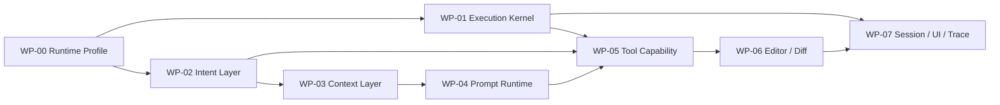

---
文档编号：AG-X-D-01
文档状态：R
负责模块：AG
文档职责：AG 1.0 历史模块治理会话索引
上游约束：A-AG-X-L-04、A-AG-M-T-01、A-AG-M-T-02、A-AG-M-S-01、A-AG-I-P-01
直接承接：无（仅供历史审计与问题定位参考）
使用边界：L4 reference-only；不定义需求、规则、协议、计划或实现真值，当前控制真源见 AG-M-D-01、AG-M-T-01/T-02、AG-M-S-01 与 AG-I-P-01
变更要求：不再随实现同步；发现差异时回到对应 Active 控制真源处理
---

# Binder AG 1.0 模块治理会话索引（历史快照）

> **Reference only**：本文及其 WP-AG10-00～07 情况说明保留 2026-08 阶段治理上下文，不再作为当前工作拆分、能力边界或实现状态的控制源。

> [!IMPORTANT]
> 本文下文整体是 2026-08 时点快照。其中“当前”“必须”“不得”“冻结”“验证基线”和“会话入口”等用语仅记录当时治理过程，不产生现行规范、Scope 或任务授权。
> 本文不含正式 `REQ` / `REQ_MAP` / `RULE` / `CHAIN` / `CONSTRAINT` / `TERM` 注册块。文中标识符和文档链接只是历史检索指针，代码、测试和计划不得映射到本文。
> 开展当前工作时，必须从 Active 需求、技术设计、状态机、协议和 `A-AG-X-L-04` 重新建立范围；不得直接复用本文的历史顺序、裁决、数字或任务描述。

## 1. 历史用途

本文当时把 `agent-edit-1.0` 的八个审计工作包映射成八份情况说明，用于保存模块化审计过程和当时的问题定位入口。
这些工作包现已关闭，不构成当前任务分解或 Scope。

快照时总裁决：`LOCAL_INTEGRATED / G5_PENDING`。它当时表示八个模块已完成本地实现与自动化接线，不表示
真实账号、AiGateway/provider、Tauri/WKWebView 与人工 Diff 审阅已经通过 G5。

## 2. 模块与说明文档

| 工作包 | 模块 | 当前等级 | 独立情况说明 | 主要输出契约 |
|---|---|---|---|---|
| WP-AG10-00 | Runtime Profile 与契约入口 | 历史快照 | [R-AG-X-D-02](R-AG-X-D-02_RuntimeProfile与契约入口情况说明.md) | `agent-edit-1.0`、能力开关 |
| WP-AG10-01 | Execution Kernel | 历史快照 | [R-AG-X-D-03](R-AG-X-D-03_ExecutionKernel情况说明.md) | 有序 `AgTurnEvent`、单一终态 |
| WP-AG10-02 | Intent Layer | 历史快照 | [R-AG-X-D-04](R-AG-X-D-04_IntentLayer情况说明.md) | `IntentResultV1` |
| WP-AG10-03 | Context Layer | 历史快照 | [R-AG-X-D-05](R-AG-X-D-05_ContextLayer情况说明.md) | `PromptDataEnvelopeV1` 来源集合 |
| WP-AG10-04 | Prompt Runtime | 历史快照 | [R-AG-X-D-06](R-AG-X-D-06_PromptRuntime情况说明.md) | `PromptPackageV1`、模型 messages、trace 元数据 |
| WP-AG10-05 | Tool Capability Layer | 历史快照 | [R-AG-X-D-07](R-AG-X-D-07_ToolCapabilityLayer情况说明.md) | `CapabilityGrantV1`、ToolResult |
| WP-AG10-06 | Editor/Diff Integration | 历史快照 | [R-AG-X-D-08](R-AG-X-D-08_EditorDiffIntegration情况说明.md) | `ChangeProposal`、PendingDiff、应用回执 |
| WP-AG10-07 | Session、UI 与 Trace | 历史快照 | [R-AG-X-D-09](R-AG-X-D-09_SessionUI与Trace情况说明.md) | 会话投影、消息片段、持久化回合、脱敏 trace |

## 3. 历史治理顺序（不再生效）

当时记录的顺序为 `WP-00 → WP-01 → WP-02 → WP-03 → WP-04 → WP-05 → WP-06 → WP-07`。
只读审计会话可并行，但代码修改会话存在以下物理冲突：

- `src-tauri/src/lib.rs` 同时承载 WP-01、03、04、05、06 的主编排，不应由多个会话并行编辑。
- `src/services/agService.ts` 同时承载 WP-00、01、07 的前端 Runtime 投影，不应并行编辑。
- 上游输出契约发生语义变化时，下游不再是“独立小改”，必须扩大影响分析并重跑选择器指定的消费者测试。

## 4. 历史跨会话冻结记录

| 契约 | 当前 owner | 消费者 | 变更传播要求 |
|---|---|---|---|
| Runtime Profile `agent-edit-1.0` | WP-00 | 全部工作包、前端 Composer | 先更新能力矩阵和入口契约，再检查全部工作包 |
| `AgTurnEvent` 与唯一终态 | WP-01 | WP-07、前端消息流、持久化 | 前后端同步，重跑错误/取消/乱序测试 |
| `IntentResultV1` | WP-02 | WP-03/04/05/06 | 字段或语义变化必须检查 Context、Prompt、Grant、Diff 目标 |
| `PromptDataEnvelopeV1` | WP-03 | WP-04、Trace | provenance/trust/freshness/hash 变化必须检查注入和隐私边界 |
| `PromptPackageV1` | WP-04 | WP-01、WP-05、Trace | 版本、manifest hash、预算或层序变化须重跑 provider 前置测试 |
| `CapabilityGrantV1` | WP-05 | WP-01、WP-06 | 授权语义变化必须重跑 Intent×Tool 与越权负向矩阵 |
| `ChangeProposal` / PendingDiff | WP-06（DE 协同） | DE/ED/WS、WP-07 | schema/状态变化属于跨模块变更，不能只改 AG |
| `AgentTurnPayload` / 消息片段 | WP-07 | 历史恢复、MessageFlow、DiffCard | 兼容旧 payload，禁止把 Diff 正文快照写入 AG 历史 |

## 5. 历史启动协议（已关闭）

> 以下步骤只保留当时的治理过程，不是当前会话入口。当前任务必须按 `AGENTS.md` / ADP 及 Active 真源重新建立。

每个新会话必须按以下顺序建立上下文：

1. 完整读取 `AGENTS.md`，再按其路由读取 ADU、APC、ADUS 相关规则/术语、测试治理注册表和 ADP。
2. 读取本文、目标模块情况说明、A-AG-X-L-04，以及该说明列出的直接上游需求/设计/协议。
3. 检查 `git status`、`.governance/active_scope.json` 和已有未提交变更；不得覆盖其他会话或人类改动。
4. 先核验“当前状态”与代码是否仍一致；情况说明是 2026-08-08 快照，不可替代代码阅读。
5. 只审计时不得修改；需要改代码时按 ADP 重新建立该模块的 Issue Trace 和 Scope Lock。
6. Scope 必须包含真实直接消费者和测试；不得因“模块独立”而忽略共享编排文件或跨模块协议。
7. 使用实际 changed_files 运行 `test:plan` / `test:related`；不能复制本轮历史命令作为新变更证据。
8. 自动化和 G5 分开裁决；未跑真实 provider/WKWebView 时只能标记本地 Module Ready/Integrated。

## 6. 快照时公共验证记录（不得作为当前证据）

- AG Rust 定向：136 passed。
- AG 前端定向：3 files / 92 tests。
- Core chain：5 passed。
- 非沙箱 `test:related`：前端 552；Rust 295 + 5 + 4；TypeScript、governance audit 通过。
- 非沙箱 `test:full`：前端 552；Rust 295 + 5 + 4。
- 测试治理：92 assets / 856 cases，AG 238 cases，0 warning。

这些数字只描述 2026-08-08 基线。任何新会话完成修改后必须以当时动态发现结果为准。

## 7. 历史边界记录

- 不把 Binder 扩成通用自动化 Agent，不在 1.0 引入多 Agent、开放式 Planner 或 Workflow DSL。
- 不把 Build/CBT、文件整理、删除、命令、开放网络、自动 AST/KB/TPL 放入 `agent-edit-1.0`。
- 不用 Prompt 文本代替 Runtime 权限、目标、状态机或 Diff 安全机制。
- 不允许内容写工具直写 LogicalState/DiskState；所有 AI 内容创建/修改先形成 ChangeProposal。
- 不以测试 mock、删除断言、跳过测试或隐藏 UI 制造“已完成”。

## 8. 快照时未完成项（需重新核验）

- 真实账号、订阅、AiGateway/provider/BYOK 的 G5 回合未执行。
- 真实 Tauri/WKWebView 中的流式、停止按钮、DiffCard、冲突与恢复尚未形成完整人工记录。
- 尚无单一确定性 harness 贯穿 `ag_start_turn → 网关流 → 工具 → DE → 前端 DiffCard`。
- `src-tauri/src/lib.rs` 仍是多模块共享编排点；这是治理会话需特别控制的变更冲突源。

## 变更记录

| 日期 | 版本 | 变更内容 |
|---|---|---|
| 2026-08-08 | v1.0 | 建立 AG 1.0 八个独立模块的会话路由、依赖顺序、冻结契约、共享代码冲突规则、统一启动协议、验证基线与公共未完成边界 |
| 2026-08-31 | v1.1 | 文档真源收敛：关闭历史工作包与会话入口，将顺序、冻结、验证与未完成项明确为时点快照；规则 ID 与文档链接仅作历史检索指针。 |
