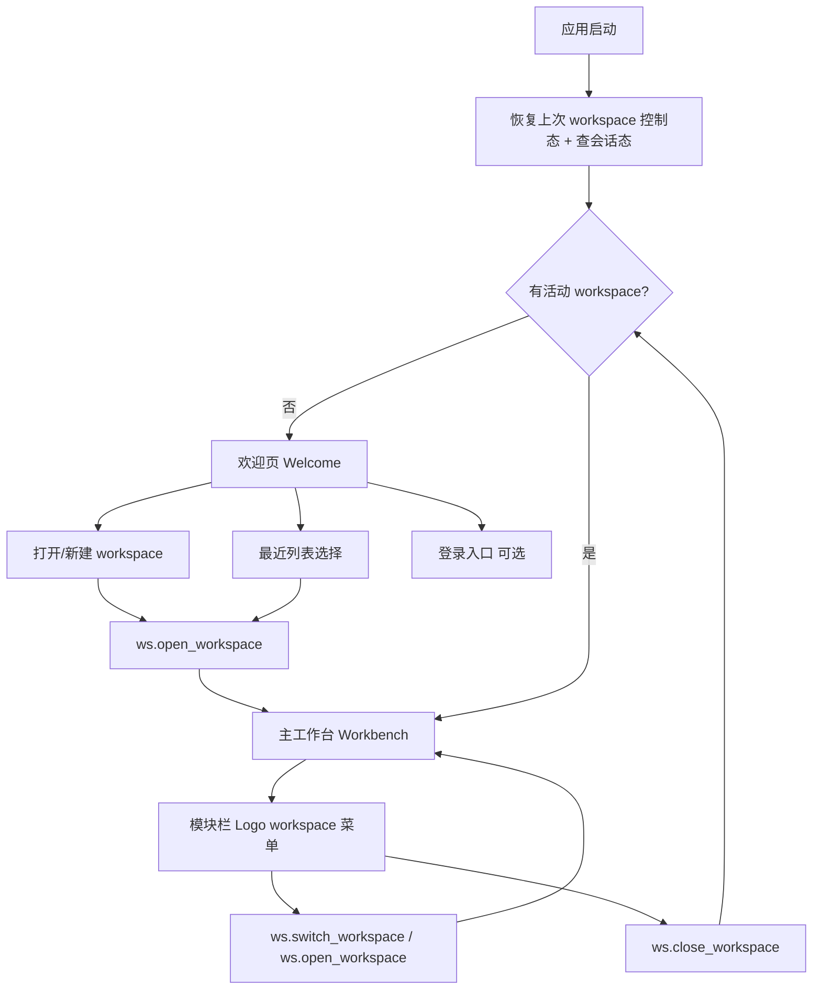
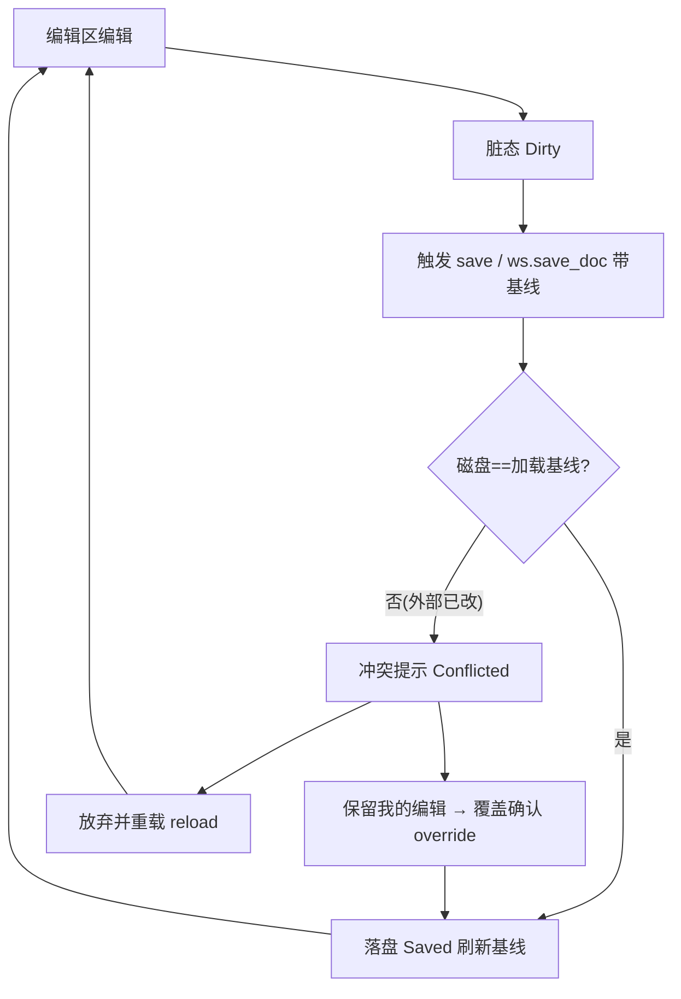
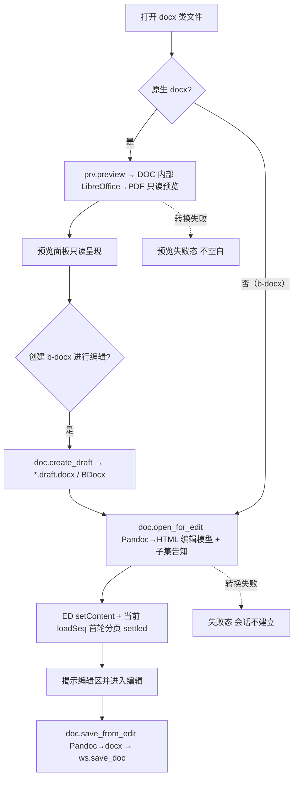
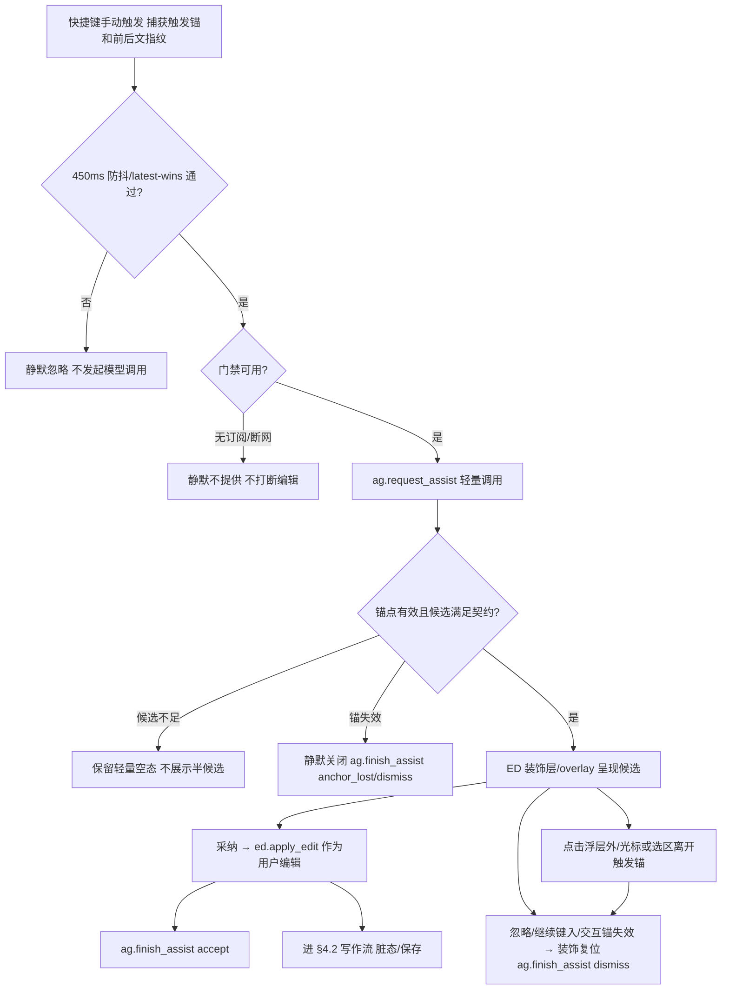
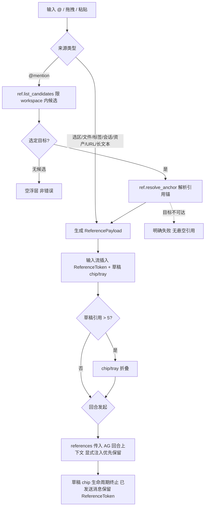
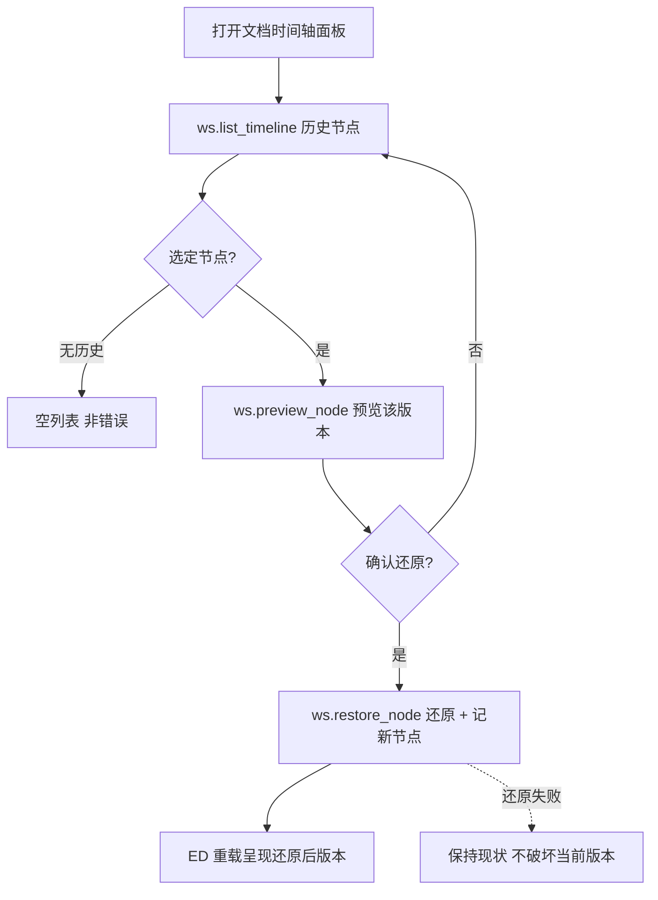
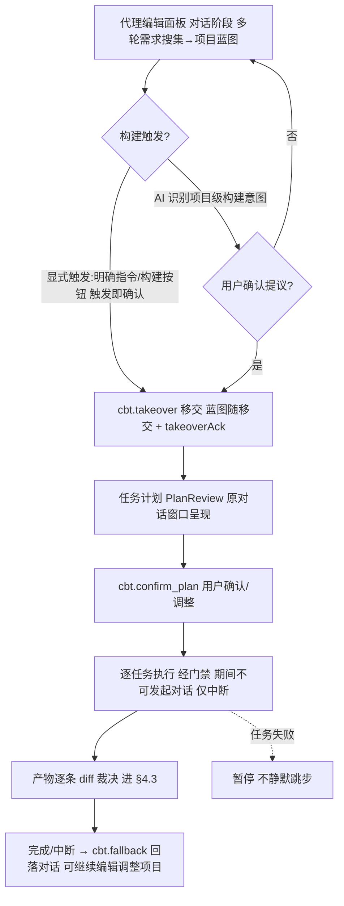
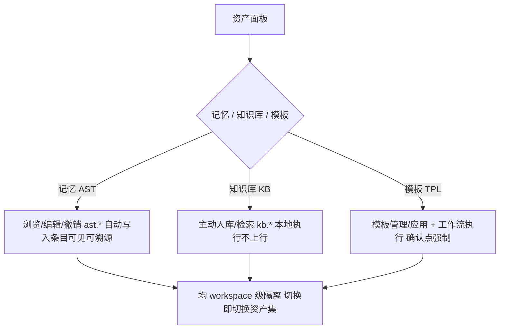
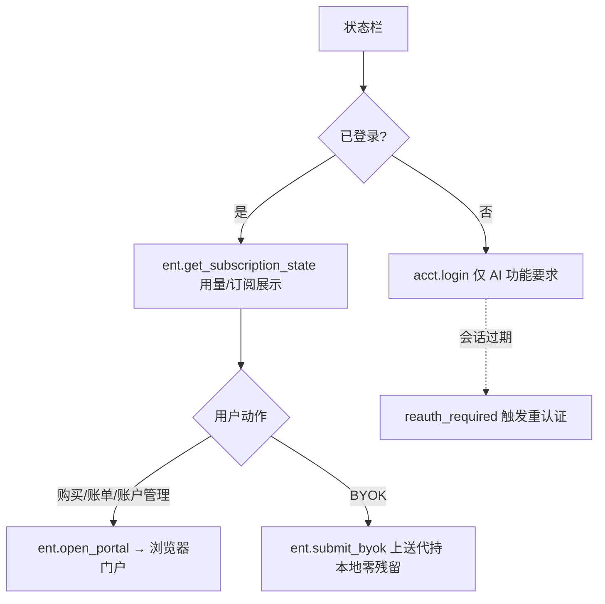

---
文档编号：SYS-C-T-02
文档状态：A
负责模块：SYS
文档职责：Binder 客户端前端交互架构与流程总图（视图层 SSOT）——应用外壳阶段（欢迎页/主工作台）、跨模块界面分区与协作点、核心交互端到端流程图、前端状态对后端状态机/控制态的投影一致性约束；承接 REQ-SYS-006
上游约束：A-SYS-M-D-01_系统底座功能需求描述.md（REQ-SYS-006）、A-CORE-C-P-01_APC.md（§4.1 模块职责、§7 代表性流程）、A-SYS-C-T-01_系统总体架构.md（§2 分层、X-SEQ-002）、A-SYS-M-S-01_状态机总图.md（12 台状态机，前端态投影来源）、各模块 I-P（command 面）、A-CORE-X-L-01_总体开发路线图.md（§9 UI 板块 just-in-time）
直接承接：前端开发按本文界面骨架与流程总图施工；前端 store 状态按本文投影规则映射后端状态机；UI 视觉/组件细节贴模块 G4 just-in-time（路线图 §9.2），不在本文
使用边界：本文是前端交互**视图层 SSOT**（架构与流程），**不定义视觉规范/像素/组件库**（路线图 §9 原料 just-in-time）、不重定义业务规则（归各模块 L2）、不定义 command 签名（归各 I-P）；流程图为交互骨架，细粒度交互随各模块 G4 细化
变更要求：界面分区或主干流程变更须复核相关模块状态机与 I-P；前端状态投影规则变更涉 X-FORBID-007 须架构评审
治理成熟度：draft
---

# Binder 前端交互架构与流程总图（SYS · L2 视图层）

## 0. Terminology Registry

> 前端视图层跨 session 高频漂移的核心概念首批注册，
> 供前端 G3/G4 实现阶段 @GOV 的 term_ref 使用。

<!-- TERM
term_id: TERM-SYS-001
chains: IPC-CALL
zh: 设计令牌
en: DesignToken
forbidden: CSS变量, 设计变量, 视觉令牌, token系统, 视觉常量, design token
-->
前端视觉一致性的最小单位：以 CSS 自定义属性（CSS Custom Properties）形式声明的颜色、字体、
间距、圆角、描边值集合，是所有 UI 组件的唯一颜色与尺寸来源；不得在组件内硬编码原始值。
参考稿权威来源：docs/binder_ui/app-styles.css §8 Design Tokens。

<!-- TERM
term_id: TERM-DE-003
chains: DE-DIFF
zh: 修改卡
en: DiffCard
forbidden: diff卡片, AI建议卡, 修改面板, 修改组件, 变更卡, 审阅卡
-->
PendingDiff（TERM-DE-001）在对话面板（Chat Panel）中的视图投影组件，具备互斥可辨状态
（pending / validating / applying / accepted / rejected / expired / conflict / error）；
当前编辑器草稿路径与编辑器绿色审阅层（GreenReview，TERM-ED-003）同步；已打开非激活文档自动应用路径
成功后显示为已应用且禁用接受/拒绝，不要求 GreenReview 一一对应。DiffCard
归属触发它的 AgentTurn 信息流，按回合内事件时序内嵌在对应 assistant 消息流中（消息片段
TERM-AG-011 / BR-AG-UI-001，AG 技术设计 §3.2），不整体沉到正文底部；批量裁决条是独立全局操作控件。
状态机来源：SM-DE-01；视觉规范：docs/binder_ui/binder-showcase.jsx §02。

<!-- TERM
term_id: TERM-ED-003
chains: ED-DECOR
zh: 绿色审阅层
en: GreenReview
forbidden: 绿色高亮, 编辑器diff层, diff装饰, 正文高亮层, 修改高亮, green review
-->
EditorDecoration（TERM-ED-002）的具体实例，基于 ProseMirror Decoration 叠加在正文之上，
以 4 状态（pending / applying / accepted / expired）呈现 PendingDiff（TERM-DE-001）的锚定位置
与裁决过程；不替换 DOM、不阻挡编辑，与 DiffCard（TERM-DE-003）双向同步。
视觉规范：docs/binder_ui/binder-showcase-2.jsx §05 Green Review。

## §1 文档定位

本文回答 Q3 暴露的体系空白——此前前端交互被隐式分散在各模块状态机与 command 表，缺一处统一收口。
本文是前端交互的**视图层 SSOT**：把已注册的 12 台状态机、16 份接口协议投影为用户可见的界面骨架
与端到端流程，约束前端"按图施工"。

```
REQ-SYS-006（L1）→ 本文（界面骨架 + 流程总图 + 投影约束）→ 前端实现(@GOV)
本文 ←投影← A-SYS-M-S-01（12 台状态机：前端态的权威来源）+ 各 I-P（command 面）
本文 不含 ← UI 视觉规范/组件（路线图 §9 原料，just-in-time）
```

## §2 前端分层（承 X-SEQ-002）

```
UI 组件（界面分区，§3）
  └─ Store（前端状态：投影后端状态机/控制态，X-FORBID-007）
       └─ Service（封装 command 调用）
            └─（统一 command 协议，A-SYS-I-P-02）→ 后端
```

**核心原则**：前端 Store 不持有权威业务状态——它是后端状态机（SM-*）与控制态（workspace.db）的
**投影**。界面流转由后端状态决定，前端只呈现与转达意图（§6 X-FORBID-007）。

## §3 界面骨架（区域 → 归属模块）

**应用外壳两阶段**（依活动 workspace 是否存在切换；该切换是 workspace 活动态的投影，非前端独立态）：

```
应用启动
  │
  ├─[无活动 workspace]─→ 欢迎页 Welcome
  │                        ├ 打开/新建 workspace（WS：ws.open_workspace）
  │                        ├ 最近 workspace 列表（WS：ws.list_workspaces）
  │                        ├ 登录入口（ACCT：acct.login，可选——AI 功能才需）
  │                        └ 设置入口（应用偏好）
  │
  └─[有活动 workspace]─→ 主工作台 Workbench
```

**主工作台分区**：

| 区域 | 归属模块 | 承载 |
|---|---|---|
| 窗口标题栏 | SYS | Tauri macOS overlay 标题栏；保留系统 traffic lights，只显示当前标题（当前标签名 / workspace 名 / Binder），通过 `data-tauri-drag-region="deep"` 承载窗口拖拽区，不承载 Logo、路径、账号或订阅入口 |
| 模块栏 | SYS（导航）+ WS/AST/KB/TPL | WS/OL/ME/KN/TM/TL 模块入口；顶部 Binder Logo 承载 workspace 菜单（切换最近 / 打开其他文件夹 / 返回欢迎页），具体动作仍走 WS command 与脏态守卫 |
| 侧边栏 | WS | 文件树 / 搜索（ws.list_docs/search）；只读预览文件保持正常可点击文件行，叠加轻量 `VIEW` 模式标记，不以灰禁用表达 |
| 编辑区 | ED | md / b-docx / .html 富文本编辑、分页、装饰层（diff/局部修改呈现挂载点）；原生 docx 只读预览 |
| 对话区（代理编辑面板） | AG | 代理编辑（AgentEdit）：编辑/构建双模式切换、回合输入与流式回显（ag.start_turn/turn_stream）；每轮产出的 DiffCard 插入对应 assistant 消息后；构建过程同窗口呈现 |
| diff 审阅 | DE（+ED 装饰层） | diff 高亮（编辑区内联）+ 裁决控件（接受/拒绝） |
| 时间轴面板 | WS | 文档历史节点浏览/预览/还原（ws.list_timeline/restore） |
| 预览面板 | PRV | docx/Excel/PPT 的 LO 语料实测只读预览、音视频（`prv.preview`，独立面板/标签，与编辑分离） |
| 构建视图 | CBT | 任务计划/进度/接管（cbt.start_build；构建移交 切换） |
| 资产面板 | AST/KB/TPL | 记忆/知识库/模板管理 |
| @mention 触发 | REF | 编辑/对话输入内的引用候选浮层（前端进程内，经 ED 扩展点） |
| 状态栏 | SYS/WS | 基础就绪态与当前 workspace 路径展示；不承载账户、订阅或 ACCT/ENT 入口 |

## §4 核心交互流程总图

### 4.1 应用启动与欢迎页（外壳阶段，投影 WS 活动态 + ACCT 会话态）



> 欢迎页↔工作台的切换 = `workspace.is_active` 的投影（X-FORBID-007 范例）；登录非进入工作台的
> 前置（本地编辑离线可用，REQ-CORE-009），仅 AI 功能要求会话+订阅。Workbench 内关闭/切换
> workspace 的入口统一在模块栏顶部 Logo，标题栏仅承担标题显示与窗口拖拽。

> 启动投影控制：React 开发态重复 effect 与正常入口必须复用同一 workspace 恢复任务；状态机事件监听也只允许
> 一组有效注册，卸载期间完成的旧注册必须自行注销。恢复中的文档读取采用路径 latest-wins：已切换标签的迟到
> 结果只能补全对应非活动会话，不能重新激活编辑器或触发当前文档的内容/布局重置。

### 4.2 写作与保存（投影 SM-ED-01 + SM-WS-01，含外部修改冲突）



### 4.3 对话→diff→LogicalState/保存或未打开后台落盘（投影 SM-AG-01 + SM-DE-01 + SM-ED-01 + SM-WS-01）

```mermaid
flowchart TD
  P[对话区发起 ag.start_turn + open_doc_snapshots] --> OS{已打开文档快照完整?}
  OS -- 否 --> SE[阻断回合 / error 卡 不读 DiskState]
  OS -- 是 --> G{订阅门禁 GatePassed?}
  G -- 否 --> DN[明确拒绝 + 订阅引导]
  G -- 是 --> ST[网关流式回显 turn_stream]
  ST --> PR{含修改建议?}
  PR -- 否 --> EN[回复完成]
  PR -- 是 --> PJ[propose_edit 读取 AgentReadContext + 返回 DiffProjection]
  PJ --> DM{draft_mode?}
  DM -- current_editor --> DR[ED applyEditOps/applyStyleOps 应用为草稿 + GreenReview]
  DM -- open_session --> OA{session 基线匹配?}
  DM -- background --> BG{目标文档未打开?}
  OA -- 是 --> OSAP[ed.apply_session_diff 修改 LogicalState + 置脏 + 持久化镜像]
  OA -- 否 --> EX[de.expire_diff / error 卡 禁用裁决]
  BG -- 是 --> DEC2[DiffCard 等待用户接受]
  BG -- 否 --> ER[error 卡 禁止后台写已打开文档]
  DR --> DEC[DiffCard 插入本轮 assistant 消息后]
  OSAP --> DONE[de.accept_draft_diff(open_session) + DiffCard 禁用裁决]
  EX --> DONE
  ER --> DONE
  DEC2 --> AC2[接受 de.accept_diff]
  DEC --> AC[接受 de.accept_draft_diff]
  DEC --> RJ[拒绝 de.reject_diff]
  AC --> SV[用户保存 / ws.save_doc]
  DONE --> SV2[用户稍后保存目标文档]
  AC2 --> APPLY[ws.apply_diff 未打开后台落盘]
  RJ --> RB[ED 回滚 before + GreenReview 复位]
  SV --> CL[保存成功 清脏态 + GreenReview 复位]
  SV2 --> CL2[保存成功 清脏态]
  APPLY --> CL3[Applied / ApplyError 归 WS]
  RB --> CL
```

> AgentEdit 的唯一链路是 `OpenDocSnapshot/AgentReadContext → DiffProjection → DiffCard/ED LogicalState`：
> 前端不得从 tool_request 或整篇当前内容推断 before/after。已打开文档必须读取 LogicalState，未打开文档才读取
> DiskState；后台文本/.html diff 仅适用于未打开文档。既有 BDocx 必须进入打开文档 LogicalState，
> 未应用时不得后台 raw apply 写入 `.docx`。当前编辑器命中的块级 diff 以草稿编辑为主路径，accept 不再直接写文件；
> 已打开非激活文档的 open_session diff 在模型回传后自动应用到 session LogicalState，DiffCard 禁用接受/拒绝。
> DiffCard 是 AgentTurn 信息流内容，不得沉底汇总为会话级全局列表；无历史锚点的 legacy diff 可显示
> 在“未归属修改建议”fallback 区。批量裁决条仍可作为全局操作控件显示在输入框上方。

> 局部修改/辅助续写（SM-AG-03）走旁路：编辑区触发→候选装饰呈现→**采纳=用户编辑**
> （ed.apply_edit 进 §4.2 写作流），不经 diff 裁决。

### 4.4 原生 docx 预览 / b-docx 编辑 / 存（投影 SM-DOC-01 + SM-ED-01）



> 编辑链（Pandoc，子集化可改）与预览链（LibreOffice→PDF，以 LO 语料实测为准的只读预览）**完全分离**
> （BR-DOC-DATA-001）；原生 docx 不直接进入编辑区，b-docx 才进入 ED 编辑态。b-docx 来源包括
> EditDraft、文件树新建和 Agent 创建。前端文件树不得只靠文件名猜测 docx 路由，必须消费
> `ws.list_docs.is_bdocx`：`true` 进入 ED/DOC 编辑链，`false` 进入 PRV 只读预览链；`*.draft.docx`
> 仅作为兼容识别来源。BDocx 的转换结果到达不等于编辑区可见就绪；当前 `loadSeq` 完成 `setContent`
> 与首轮分页 settled 前保持加载遮罩，同时保留隐藏的真实编辑 DOM 供布局测量，避免把中间回填帧揭示给用户。

## §4bis 次级交互流程（主干之外，贴各模块 G4 再细化）

### 4.5 局部修改 / 辅助续写（投影 SM-AG-03，编辑区旁路，区别于 diff 裁决）



> 关键区分：辅助采纳是**用户编辑操作**（经 ed.apply_edit 走写作流），不经 diff 裁决；失败一律
> 静默（不报错）。辅助续写严格呈现 3 个候选，候选不足 3 条不展示半候选、不允许采纳，但保留轻量空态；
> 空态不得吞没内部 failure_reason：service、assistStore 与 overlay 诊断点必须保留 gate/网关/解析/旧请求等原因，
> 普通用户界面仍可只显示轻量空态；
> 采纳位置固定为触发瞬间
> 捕获的字符锚，不跟随采纳时光标；局部修改无选区时为光标插入，多轮只传上一轮候选结果与新指令；
> 新请求覆盖旧请求，旧结果返回后不得展示或应用。这是 AI 编辑三层中「辅助续写/局部修改」（①②，轻量直改）与「代理编辑」
> （③，面板级、diff 裁决、会话持久化）在交互层的分界（TERM-AG-003/004/008，2026-07-04 正式定名；
> 「对话编辑」为已退役旧称）。

> 前端实现约束：快捷键监听不得只依赖编辑器内部冒泡事件，须在编辑器宿主焦点范围内捕获
> `Cmd/Ctrl+J` 与 `Cmd/Ctrl+K` 并读取当前 ED 文档上下文；候选 overlay 坐标须区分逻辑锚点与视觉锚点：
> 逻辑锚点用于采纳写入，视觉锚点用于浮层放置。辅助续写按光标矩形优先下方贴近展示，局部修改按
> 选区矩形优先上方居中展示（无选区按光标点），空间不足时上下翻转，横向只做内容区内最小偏移，
> 不得把浮层推到与插入点无关的编辑器窗口边缘；右侧边界必须以 editor-host/center 可见区为硬边界，
> 右侧 gutter 与代理编辑面板不得覆盖或裁掉浮层；
> 编辑器缩放只影响光标/选区视觉锚点，不影响浮层控件尺寸；浮层布局边界使用 editor-paper 可视区与
> editor-host 的交集，不得使用缩放后的 ProseMirror 正文矩形压缩浮层。滚动、缩放或窗口 resize 后，
> 前端应在逻辑锚仍有效时重算浮层位置，结构锚失效才关闭。浮层放置使用稳定静态尺寸模型，
> 不通过运行时 DOM 测量反向驱动状态；局部修改初始态避免过大高度预估，辅助续写触发后必须稳定显示生成中浮层。
> overlay 的 Tab/1/2/3 只在焦点仍处于编辑器宿主或 overlay 内时采纳，输入法 composition 中不得采纳。
> 局部修改弹窗已激活时再次触发 `Cmd/Ctrl+K`，视为放弃本次修改并关闭弹窗，不重开目标、不发起新请求。
> 辅助续写和局部修改浮层打开后，用户点击浮层外、移动光标或改变选区，均视为当前交互目标离开触发锚；
> 前端必须关闭浮层并丢弃已返回/后续返回内容，不展示、不应用、不入历史。该用户放弃路径回写
> `ag.finish_assist dismiss`；只有结构性定位失败才回写 `anchor_lost`。

### 4.6 输入引用注入（投影 REF-INJECT，编辑/对话输入内浮层）



> 候选/标记经 ED 扩展点呈现（X-FORBID-005）；注入是**只读参考**（ReferencePayload/RefInjection，
> 无写句柄），与「编辑对象」路径（diff 落盘）由数据结构区分（A-SYS-I-P-01）。短普通文本粘贴仍进
> 输入正文；外部纯文本超过阈值才生成 `long_text` ReferencePayload。

### 4.7 时间轴回溯与还原（投影 SM-WS-03）



### 4.8 构建移交/回落与多文件构建（投影 SM-CBT-01 + SM-AG-01；旧称 Chat↔Build 接管，2026-07-04 判据换轴）



> 移交触发=显式触发即确认或项目级意图提议经确认（**多文件修改意图不再是判据**——编辑模式本身
> 可跨文件，BR-AG-DATA-003）；双向回执无双活双死（BR-CBT-STATE-002）；构建在原对话窗口呈现、
> 执行期 composer 门控禁新回合（X-FORBID-007 投影）；构建产物落盘同走 diff 路径（X-FORBID-006，
> origin=CBT）；批量裁决形态待 DE-04 决策。

### 4.9 本地资产管理（投影 AST/KB/TPL，资产面板）



> 三类资产均 workspace 级隔离（2026-06-11 决策）；记忆自动写入但可见/可溯源/可撤销；知识库主动
> 入库（AI 不静默建库）；模板工作流执行委托 AG/CBT、产物走 diff 路径。

### 4.10 账号 / 订阅 / 门户（投影 SM-SYS-01 会话段，状态栏 + 浏览器）



> 购买/账单/设备会话/BYOK 管理/注销均在**个人账户门户**（浏览器）；桌面端仅展示 + 跳转，不内置
> 支付（BR-ENT-DATA-002）；模型调用前的门禁不在此图（属各 AI 回合内部，见 §4.3/§4.5）。

### 4.11 右键上下文菜单（统一 ContextMenu，CTX-MENU-01）

右键菜单收敛为 SYS 前端交互的统一轻量组件 `ContextMenu`（纯展示组件）：**不持有业务状态、不决定
启停/disabled**（X-FORBID-007——菜单项集与禁用态由各目标面调用方从既有投影 store 计算后传入）；
行为最小集为**视口钳制**（右/下溢出翻转）、**键盘可达**（Esc 关闭、↑/↓ 导航、Enter 触发）、
backdrop 点击关闭、`role="menu"/"menuitem"`。样式沿用 `.ftn-menu` token 基线提升为 `.ctx-menu`
（深色主题兼容）。WKWebView 无系统右键菜单，故右键入口均需本组件承载。

| 目标面 | 菜单项 | 动作复用（X-SEQ-002） |
|---|---|---|
| 文件树·文件节点 | 重命名 / 导出 X（按源类型）/ 复制路径 / 删除 | `ws.rename_doc` / `prv.export` / `ws.delete_doc` |
| 文件树·目录节点 | 在此新建文件 | `ws.create_doc`（子目录相对路径） |
| 编辑器·有选区 | 剪切 / 复制 / 局部修改（TERM-AG-003） | ProseMirror 剪贴板事件（execCommand）/ `ag.request_assist` |
| 编辑器·无选区 | 粘贴 / 辅助续写（TERM-AG-004） | `navigator.clipboard.readText`→`insertContent` / `ag.request_assist` |
| DiffCard（pending） | 接受 / 拒绝 | `de.accept_diff` / `de.reject_diff` |
| 表格选中态 | 删除表格 | TipTap `deleteTable`（ED 受控接口，X-FORBID-005） |
| 图片选中态 | 删除图片 | `deleteActiveImage`（ED 受控接口） |
| 已打开文档标签 | 关闭标签 | `tabsStore.close`（视图层导航态，X-FORBID-007 允许） |
| 预览面板 | 不提供 | 只读面；导出已覆盖于文件树 |

> 关键约束：编辑器 AI 项（局部修改/辅助续写）复用 `openInlineAssist`/`openAutocompleteAssist`
> 既有触发路径——门禁前置 + 静默语义与 ⌘K/⌘J 快捷键一致（BR-AG-STATE-003），不新增模型调用面；
> 剪切/复制经 ProseMirror 剪贴板处理，粘贴经 Web Clipboard API 读取（WKWebView 可用性为实现期
> 实测项，失败则菜单项静默、保留 ⌘V 快捷键）；目录节点 1.0 仅「在此新建文件」（目录重命名/删除
> 无命令面，明示后续增强）；右键目标面交互不再分散各模块局部实现，新增目标面统一挂入本组件。

## §5 跨模块界面协作点（一个界面多模块协作）

| 协作点 | 参与模块 | 协作语义 |
|---|---|---|
| diff 呈现 | DE（逻辑/裁决）+ ED（LogicalState/装饰层）+ 用户（仅可裁决允许路径） | DE 生成→current_editor 按 blockId 挂装饰并等待用户裁决；open_session 自动应用到 ED session 后禁用裁决；background 仅未打开文档可由用户接受后落盘（ED 不代裁，X-FORBID-005） |
| 局部修改呈现 | AG（候选）+ ED（装饰层）+ 用户（采纳） | AG 候选→ED 装饰呈现→采纳经 ed.apply_edit 进编辑模型 |
| @mention | REF（解析）+ ED（触发浮层）+ AG（消费注入） | ED 触发面→REF 候选/锚→注入 AG 回合上下文 |
| 时间轴还原 | WS（节点/还原）+ ED（重载呈现） | WS 列节点→预览→还原→ED 重载编辑模型 |
| 构建移交/回落 | AG（代理回合）+ CBT（构建回合）+ 用户（确认） | 识别构建意图→用户确认→takeover 移交（无双活）→构建/回落 fallback（无双死） |
| 资产注入 | AST/KB（供给）+ REF（@mention）+ AG（组装） | 三类供给（记忆/知识/引用）→AG 回合上下文组装，显式注入优先保留 |
| 外部变更冲突 | WS（感知/基线）+ ED（会话裁决）+ 用户（选择） | WS 发外部变更事件→无脏态自动重载/有脏态进 Conflicted→用户选保留或重载（双向损失均显式） |
| 账户/订阅 | ACCT（会话）+ ENT（用量/门禁）+ 门户（浏览器） | 状态栏展示→购买/管理跳转门户（桌面端不内置支付） |

## §6 前端状态投影约束（CONSTRAINT）

<!-- CONSTRAINT
constraint_id: X-FORBID-007
摘要: 前端 Store 不得另立权威业务状态，须投影后端状态机（SM-*）与控制态（workspace.db）；界面流转由后端状态决定，前端只呈现与转达意图，不得本地维护与后端可漂移的并行业务状态
涉及模块: SYS, WS, ED, DE, AG, CBT, DOC, AST, KB, TPL, REF, PRV, ACCT, ENT
链路影响: ED-EDIT, AG-TURN, DE-DIFF, WS-FS, WS-SAVE, CBT-BUILD
-->

> X-FORBID-007 是本文的核心约束：防止前端状态与后端状态机漂移（如前端自存"已保存"标志而非投影
> SM-WS-01 Saved、前端自判"已通过门禁"而非投影 SM-SYS-01——后者还撞 X-FORBID-002 硬边界）。
> 前端可缓存**展示数据**（如用量数字、文件列表）用于呈现，但不得用作业务决策依据（承 BR-ENT-DATA-002
> 同源原则）。纯前端视图态（面板开合、滚动位置、主题）不属业务状态，不受本约束。

## §7 需求到规则映射（REQ_MAP）

<!-- REQ_MAP
req_id: REQ-SYS-006
target_type: CONSTRAINT
target_id: X-FORBID-007
status: mapped
-->

## §8 测试与验收

- **流程可追溯**（REQ-SYS-006）：§4 四条主干流程（欢迎页/写作保存/对话裁决/docx 开存）端到端
  可追溯到对应状态机与 command；新前端功能须挂入本图或显式扩展本图。
- **投影一致**（X-FORBID-007，G4/G5）：静态审查前端 Store 无与后端可漂移的并行业务状态（如自存
  门禁通过/保存终态/diff 终态）；界面流转由后端事件驱动（状态机投影），核心交互在 G5 跨模块联调
  验证界面与后端态一致。
- **右键菜单**（CTX-MENU-01，G4）：ContextMenu 组件键盘可达（Esc/↑↓/Enter）与视口钳制有自动化
  断言；各目标面菜单项集与 disabled 态由投影 store 计算（无本地业务判断）；文件树迁移不回归既有
  重命名/导出/删除路径。
- UI 视觉/可用性验收 just-in-time 贴各模块 G4（路线图 §9.2），不在本文。

## §9 技术债务与盲区（诚实声明）

- 本文是**交互骨架**（含主干 §4.1~4.4 + 次级 §4.5~4.10），非穷举的细粒度交互稿；各模块 G4
  实现时细化区域内交互（控件级/微状态/动效）并回挂本图。
- 界面布局（分区的具体排布、面板停靠/标签策略）属 UI 设计，取材路线图 §9 原料（binder-vi/
  binder_ui），just-in-time 落地，本文只定区域归属与协作点。
- **center 编辑区/预览采用「单窗多 tab」**（PI-FE-26，2026-06-23 实现期决策落定）：center 顶部统一
  标签栏承载**文档（ED）+ 预览（PRV）同列共存**，多个预览（office/媒体/图片）可同时开为多标签；
  标签为**视图层导航态**（tabsStore，X-FORBID-007），不另立后端业务态——文档内容/脏态仍归 edStore。
  多文档各自保留未保存编辑（按路径会话）为后续增强。**跨窗口（多窗）并存**仍延后。
- 移动端/响应式不在 v1（桌面 macOS）。

## §10 后续动作

1. 落地后随 generate 注册 X-FORBID-007、REQ-SYS-006 的 REQ_MAP 进 ADUS。
2. 各模块 G4 实现前端时按本图施工，区域内细粒度交互回挂本文（扩展 §4/§5）。
3. UI 视觉规范贴模块推进（路线图 §9.2）；与 binder-vi/binder_ui 原料对齐时按 §9.3 架构对齐改写。

## 变更记录

| 日期 | 版本 | 变更内容 |
|------|------|---------|
| 2026-06-12 | v1.0 | 初版（视图层 SSOT，补 Q3 暴露的前端交互收口空白）：应用外壳两阶段（欢迎页/主工作台，投影 workspace 活动态）；主工作台界面分区→归属模块映射（含欢迎页/侧边栏/编辑/对话/diff/时间轴/预览/构建/资产/@mention/账户栏）；四条核心交互流程总图（启动欢迎页 / 写作保存含冲突 / 对话→diff→裁决→落盘 / docx 开编预览存，mermaid）；跨模块界面协作点 5 项；核心约束 X-FORBID-007（前端状态投影、不另立权威）；REQ_MAP（REQ-SYS-006，新增于 A-SYS-M-D-01）；债务（细粒度交互/布局/多窗形态贴 G4 与 §9 原料） |
| 2026-06-12 | v1.1 | 补次级交互流程（人类指示）：§4bis 新增 6 条——内联辅助/自动补全（4.5，旁路非 diff）、@mention 引用注入（4.6，只读参考）、时间轴回溯还原（4.7）、Chat↔Build 接管与多文件构建（4.8）、本地资产管理（4.9，workspace 隔离）、账号/订阅/门户（4.10，门户在浏览器）；§5 协作点表补 3 项（Chat↔Build 接管/资产注入/外部变更冲突）；§9 债务更新（骨架含主干+次级，控件级细化贴 G4）；无新增注册项，ADUS 计数不变 |
| 2026-07-08 | v1.2 | 修正对话→diff 主流程：当前编辑器命中的块级 diff 先应用为 ED 草稿并置脏态，accept 仅确认，reject 回滚，save 成功后复位 GreenReview；后台/整篇 diff 可保留旧 apply 路径 |
| 2026-07-04 | v1.2 | 术语沿革回写（人类三轮裁决）：§3 对话区更名「代理编辑面板」（AgentEdit，编辑/构建双模式）；4.5 分界句改用 AI 编辑三层正式名（辅助续写/局部修改/代理编辑，「对话编辑」退役）；4.8 更名「构建移交/回落」并按新判据重绘（对话阶段→蓝图→显式触发即确认/提议经确认→原窗口呈现→执行期禁对话→回落编辑） |
| 2026-07-09 | v1.3 | 修正 DiffCard 视图归属：每轮 DiffCard 渲染到对应 assistant 消息后，legacy 未归属卡进入 fallback 区；批量裁决条保留输入框上方全局操作定位 |
| 2026-07-08 | v1.3 | §4.6 从 @mention 单一路径扩为输入引用注入流程：覆盖 @mention、拖拽、粘贴；引入 ReferencePayload→ReferenceToken→AG references→发送后保留令牌的前端状态表现；补草稿 chip/tray 超过 5 条折叠与长文本阈值行为 |
| 2026-07-09 | v1.4 | 同步 TERM-DOC-003 b-docx/BDocx：§3 编辑区承载改为 md / b-docx / .html；§4.4 改为原生 docx 只读预览、创建 b-docx 后进入编辑链，并标明 b-docx 来源 |
| 2026-07-09 | v1.5 | 补充 BDocx 前端投影约定：文件树必须消费 `ws.list_docs.is_bdocx` 区分 b-docx 编辑链与原生 docx 预览链，禁止仅用扩展名或文件名推断普通 `.docx` 是否可编辑 |
| 2026-07-09 | v1.6 | 修正 AgentEdit 前端主链：对话修改经 `AgentEditableSnapshot → DiffProjection → DiffCard/ED 草稿`，前端禁止预测 before/after；既有 BDocx 未进当前编辑器 HTML 草稿时不得后台 raw apply |
| 2026-07-16 | v1.7 | 细化 §4.5 AG-ASSIST 交互：快捷键手动触发、防抖/latest-wins、辅助续写 3 候选、局部修改光标插入与 refine 上轮基底，采纳仍经 ed.apply_edit 进入写作流 |
| 2026-07-16 | v1.8 | 同步窗口壳 overlay 改造：§3 增加窗口标题栏与模块栏职责，标题栏只显示当前标题并作为拖拽区；workspace 切换/打开/关闭入口从标题栏路径迁移到模块栏顶部 Binder Logo；§4.1 更新欢迎页/工作台切换流程 |
| 2026-07-16 | v1.9 | 补充 §4.5 AG-ASSIST 前端触发与定位约束：编辑器宿主内 capture 快捷键兜底、读取当前 ED 上下文，候选 overlay 按编辑纸张可视区钳制 |
| 2026-07-16 | v1.10 | 修正 §4.5 局部修改弹窗激活态快捷键语义：再次触发 `Cmd/Ctrl+K` 为放弃并关闭，不重开目标、不发起新请求 |
| 2026-07-16 | v1.11 | 同步文件树只读预览视觉：只读预览文件不再作为灰禁用状态呈现，改为正常可点击文件行叠加轻量 `VIEW` 模式标记，open/dirty/pending 等会话状态仍保持互斥投影 |
| 2026-07-16 | v1.12 | 续修 §4.5 AG-ASSIST：补触发锚前后文指纹、严格 3 候选、终态回写 `ag.finish_assist`、overlay 键盘焦点与输入法保护 |
| 2026-07-16 | v1.13 | 修正 §4.5 AG-ASSIST 浮层定位：逻辑锚点用于写入，视觉锚点用于放置；辅助续写贴近光标、局部修改贴近选区/光标并支持上下翻转，避免边缘钳制脱离插入点 |
| 2026-07-16 | v1.14 | 修正 §4.5 右侧遮挡边界：AG-ASSIST 浮层放置必须叠加 center/editor-host 可见右边界，靠右时 end 对齐，避免被代理编辑面板遮挡或裁切 |
| 2026-07-16 | v1.15 | 补充 §4.5 AG-ASSIST 交互锚生命周期：点击浮层外、光标移动或选区变化即关闭辅助浮层并丢弃候选，用户放弃回写 dismiss，结构锚丢失回写 anchor_lost |
| 2026-07-16 | v1.16 | 补充 §4.5 AG-ASSIST 缩放定位：浮层尺寸不随正文缩放；边界改用 editor-paper/editor-host 可视区；滚动、缩放、窗口 resize 后重算位置 |
| 2026-07-16 | v1.17 | 修正 §4.5 AG-ASSIST 稳定定位：撤销运行时 DOM 测量反向驱动状态，改为静态尺寸模型，避免预估高度过大与测量链导致浮层消失 |
| 2026-07-16 | v1.18 | 修正 §4.5 AG-ASSIST 辅助续写失败态：候选不足 3 条时保留空态，不展示半候选、不允许采纳，避免浮层瞬间关闭 |
| 2026-07-17 | v1.19 | 收敛 §4.5 AG-ASSIST 空态诊断：普通 UI 保持轻量空态，但 service/store/overlay 必须保留内部 failure_reason |
| 2026-07-18 | v1.20 | 修正 §4.3 AgentEdit 主链：发起回合必须携 open_doc_snapshots；DiffProjection 按 current_editor/open_session/background 三路径分流，已打开非激活文档自动应用 LogicalState 并禁用 DiffCard 裁决，未打开文档才允许后台落盘 |
| 2026-07-21 | v1.21 | 审计修正：原生 docx 预览总图统一为 `prv.preview` 消费 DOC 内部转换能力；删除不存在的 `doc.render_preview`，并将“全保真”收敛为 LO 语料实测的只读预览目标。 |
| 2026-07-25 | v1.22 | 补齐启动恢复投影收敛：workspace 恢复与状态机监听单飞；路径 latest-wins 防止迟到文档结果重新激活编辑器或回填当前布局。 |
| 2026-07-26 | v1.23 | BDocx 打开流程增加当前 loadSeq 的首轮分页 settled 门禁；转换结果到达后保持加载遮罩，避免揭示 setContent 与分页收敛的中间回填帧。 |
| 2026-08-06 | v1.24 | 新增 §4.11 右键上下文菜单（统一 ContextMenu，CTX-MENU-01）：右键收敛为 SYS 纯展示组件（不持业务状态、X-FORBID-007），覆盖文件树文件/目录、编辑器选区/光标（剪切/复制/粘贴 + 局部修改/辅助续写）、DiffCard、表格/图片、标签栏；预览面板不提供；§8 补右键菜单验收条目；无新增 TERM/RULE 标注块 |
| 2026-08-07 | v1.25 | AG-MSG-RENDER-01：TERM-DE-003 DiffCard 归属语义由"对应 assistant 消息后方"细化为"按回合内事件时序内嵌于 assistant 消息流"（消息片段 TERM-AG-011 / BR-AG-UI-001） |
