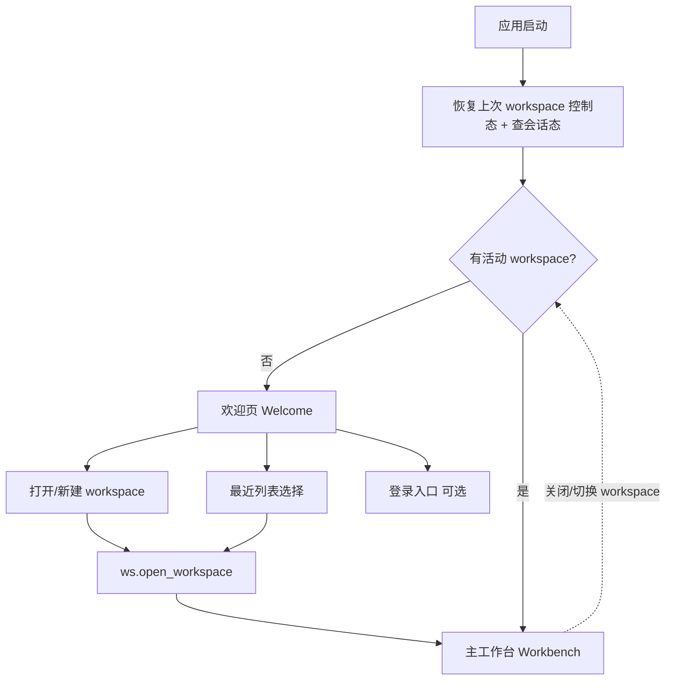
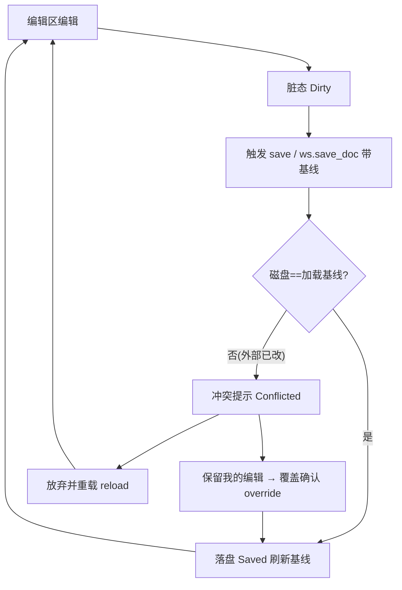
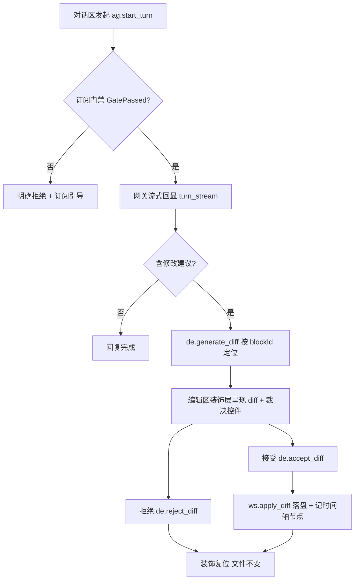
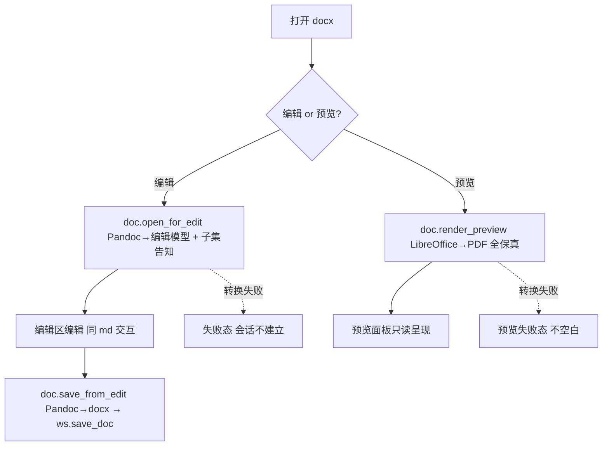
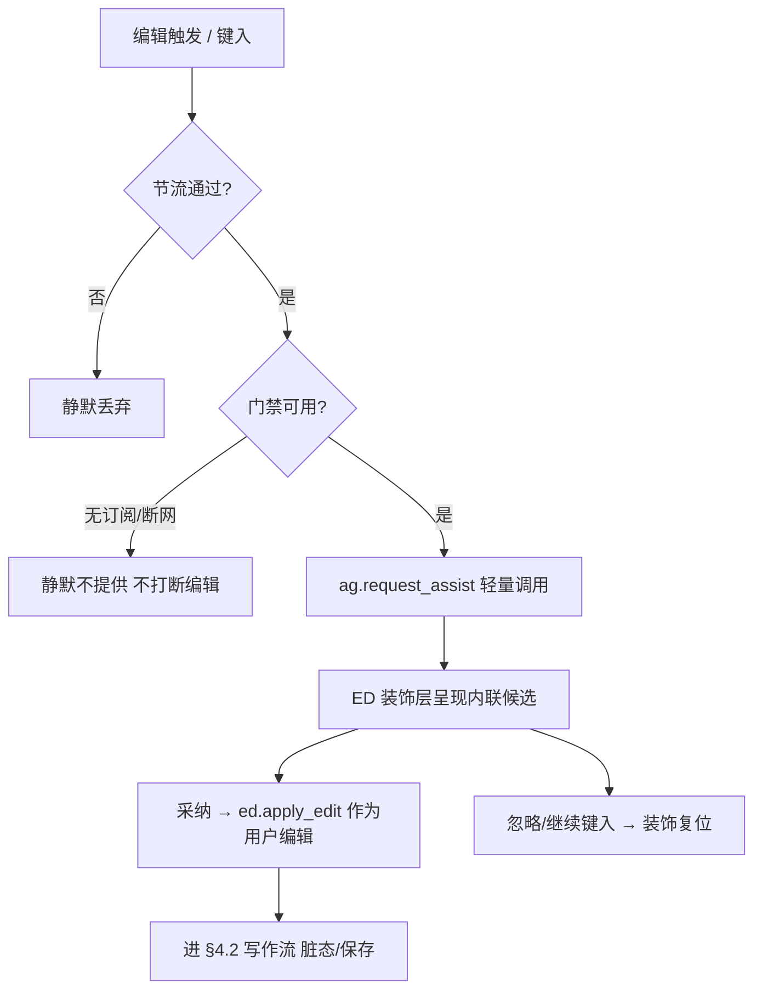
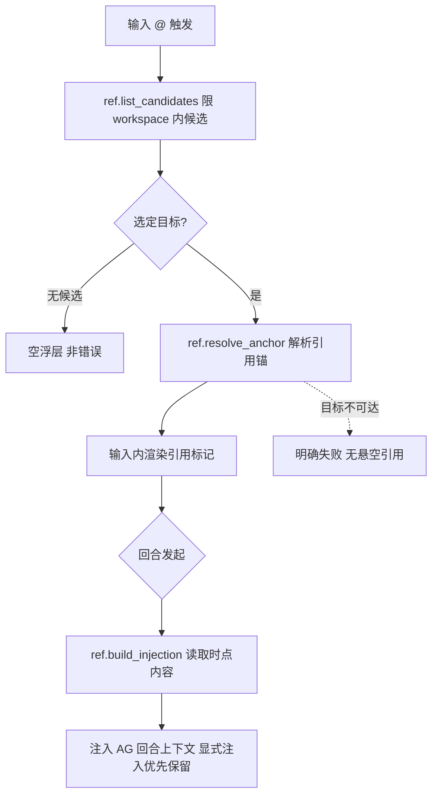
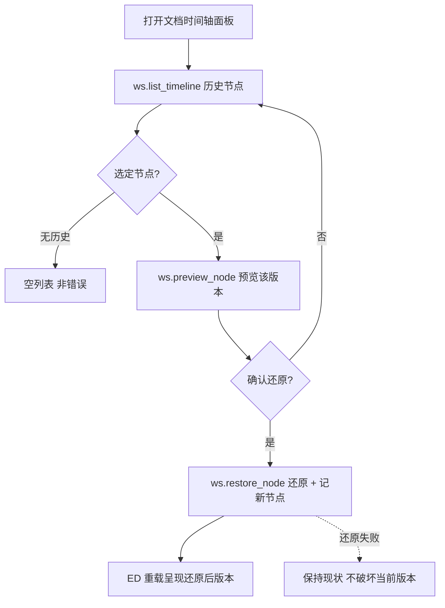
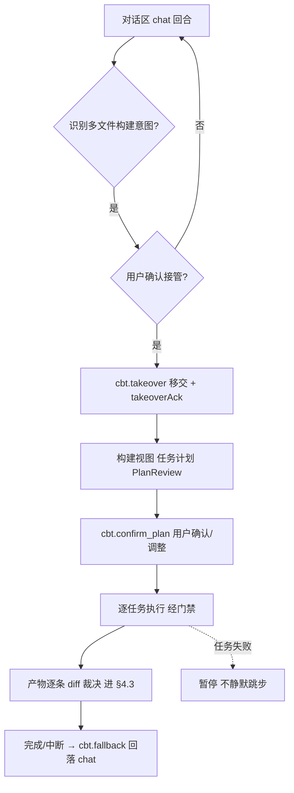
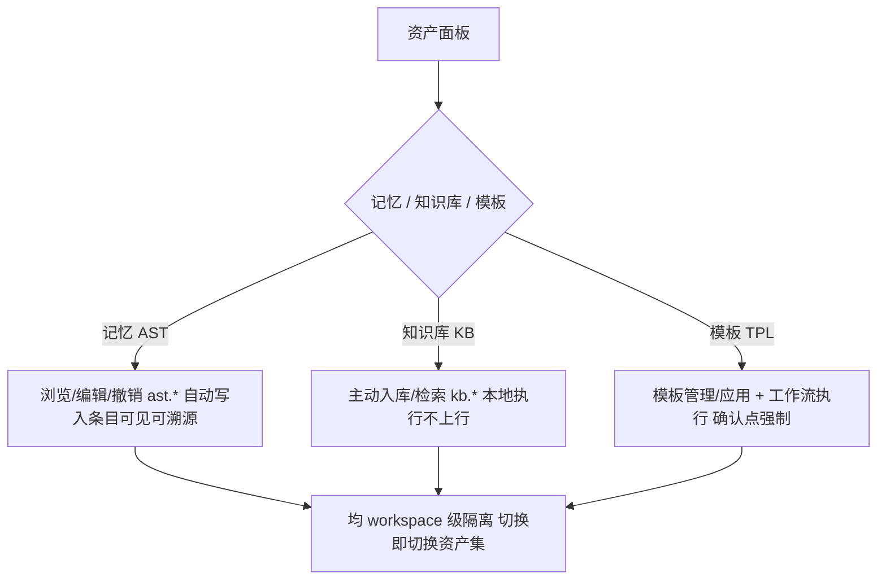
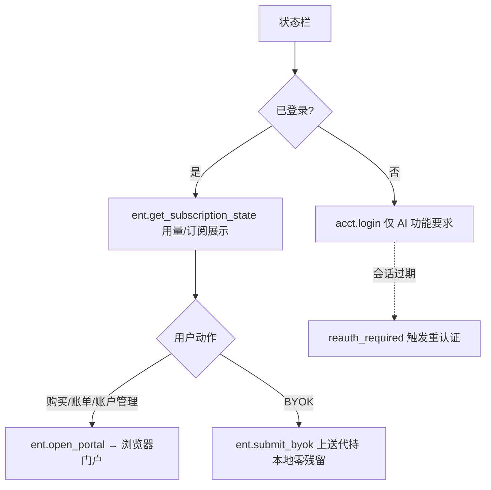

---
文档编号：SYS-C-T-02
文档状态：A
负责模块：SYS
文档职责：Binder 客户端前端交互架构与流程总图（视图层 SSOT）——应用外壳阶段（欢迎页/主工作台）、跨模块界面分区与协作点、核心交互端到端流程图、前端状态对后端状态机/控制态的投影一致性约束；承接 REQ-SYS-006
上游约束：A-SYS-M-D-01_系统底座功能需求描述.md（REQ-SYS-006）、A-CORE-C-P-01_APC.md（§4.1 模块职责、§7 代表性流程）、A-SYS-C-T-01_系统总体架构.md（§2 分层、X-SEQ-002）、A-SYS-M-S-01_状态机总图.md（12 台状态机，前端态投影来源）、各模块 I-P（command 面）、A-CORE-X-L-01_总体开发路线图.md（§9 UI 板块 just-in-time）
直接承接：前端开发按本文界面骨架与流程总图施工；前端 store 状态按本文投影规则映射后端状态机；UI 视觉/组件细节贴模块 G4 just-in-time（路线图 §9.2），不在本文
使用边界：本文是前端交互**视图层 SSOT**（架构与流程），**不定义视觉规范/像素/组件库**（路线图 §9 原料 just-in-time）、不重定义业务规则（归各模块 L2）、不定义 command 签名（归各 I-P）；流程图为交互骨架，细粒度交互随各模块 G4 细化
变更要求：界面分区或主干流程变更须复核相关模块状态机与 I-P；前端状态投影规则变更涉 X-FORBID-007 须架构评审
治理成熟度：draft
---

# Binder 前端交互架构与流程总图（SYS · L2 视图层）

## 0. Terminology Registry

> 前端视图层跨 session 高频漂移的核心概念首批注册，
> 供前端 G3/G4 实现阶段 @GOV 的 term_ref 使用。

<!-- TERM
term_id: TERM-SYS-001
chains: IPC-CALL
zh: 设计令牌
en: DesignToken
forbidden: CSS变量, 设计变量, 视觉令牌, token系统, 视觉常量, design token
-->
前端视觉一致性的最小单位：以 CSS 自定义属性（CSS Custom Properties）形式声明的颜色、字体、
间距、圆角、描边值集合，是所有 UI 组件的唯一颜色与尺寸来源；不得在组件内硬编码原始值。
参考稿权威来源：docs/binder_ui/app-styles.css §8 Design Tokens。

<!-- TERM
term_id: TERM-DE-003
chains: DE-DIFF
zh: 修改卡
en: DiffCard
forbidden: diff卡片, AI建议卡, 修改面板, 修改组件, 变更卡, 审阅卡
-->
PendingDiff（TERM-DE-001）在对话面板（Chat Panel）中的视图投影组件，具备 8 个互斥可辨状态
（pending / validating / applying / accepted / rejected / expired / conflict / error）；
与编辑器绿色审阅层（GreenReview，TERM-ED-003）一一对应，任意一侧裁决另一侧同步。
状态机来源：SM-DE-01；视觉规范：docs/binder_ui/binder-showcase.jsx §02。

<!-- TERM
term_id: TERM-ED-003
chains: ED-DECOR
zh: 绿色审阅层
en: GreenReview
forbidden: 绿色高亮, 编辑器diff层, diff装饰, 正文高亮层, 修改高亮, green review
-->
EditorDecoration（TERM-ED-002）的具体实例，基于 ProseMirror Decoration 叠加在正文之上，
以 4 状态（pending / applying / accepted / expired）呈现 PendingDiff（TERM-DE-001）的锚定位置
与裁决过程；不替换 DOM、不阻挡编辑，与 DiffCard（TERM-DE-003）双向同步。
视觉规范：docs/binder_ui/binder-showcase-2.jsx §05 Green Review。

## §1 文档定位

本文回答 Q3 暴露的体系空白——此前前端交互被隐式分散在各模块状态机与 command 表，缺一处统一收口。
本文是前端交互的**视图层 SSOT**：把已注册的 12 台状态机、16 份接口协议投影为用户可见的界面骨架
与端到端流程，约束前端"按图施工"。

```
REQ-SYS-006（L1）→ 本文（界面骨架 + 流程总图 + 投影约束）→ 前端实现(@GOV)
本文 ←投影← A-SYS-M-S-01（12 台状态机：前端态的权威来源）+ 各 I-P（command 面）
本文 不含 ← UI 视觉规范/组件（路线图 §9 原料，just-in-time）
```

## §2 前端分层（承 X-SEQ-002）

```
UI 组件（界面分区，§3）
  └─ Store（前端状态：投影后端状态机/控制态，X-FORBID-007）
       └─ Service（封装 command 调用）
            └─（统一 command 协议，A-SYS-I-P-02）→ 后端
```

**核心原则**：前端 Store 不持有权威业务状态——它是后端状态机（SM-*）与控制态（workspace.db）的
**投影**。界面流转由后端状态决定，前端只呈现与转达意图（§6 X-FORBID-007）。

## §3 界面骨架（区域 → 归属模块）

**应用外壳两阶段**（依活动 workspace 是否存在切换；该切换是 workspace 活动态的投影，非前端独立态）：

```
应用启动
  │
  ├─[无活动 workspace]─→ 欢迎页 Welcome
  │                        ├ 打开/新建 workspace（WS：ws.open_workspace）
  │                        ├ 最近 workspace 列表（WS：ws.list_workspaces）
  │                        ├ 登录入口（ACCT：acct.login，可选——AI 功能才需）
  │                        └ 设置入口（应用偏好）
  │
  └─[有活动 workspace]─→ 主工作台 Workbench
```

**主工作台分区**：

| 区域 | 归属模块 | 承载 |
|---|---|---|
| 侧边栏 | WS | 文件树 / 搜索 / workspace 切换（ws.list_docs/search/switch） |
| 编辑区 | ED | md/docx 富文本编辑、分页、装饰层（diff/内联辅助呈现挂载点） |
| 对话区 | AG | chat 回合输入与流式回显（ag.start_turn/turn_stream） |
| diff 审阅 | DE（+ED 装饰层） | diff 高亮（编辑区内联）+ 裁决控件（接受/拒绝） |
| 时间轴面板 | WS | 文档历史节点浏览/预览/还原（ws.list_timeline/restore） |
| 预览面板 | PRV | docx 全保真/Excel/PPT/音视频（prv.preview，独立面板/标签，与编辑分离） |
| 构建视图 | CBT | 任务计划/进度/接管（cbt.start_build；Chat↔Build 切换） |
| 资产面板 | AST/KB/TPL | 记忆/知识库/模板管理 |
| @mention 触发 | REF | 编辑/对话输入内的引用候选浮层（前端进程内，经 ED 扩展点） |
| 账户/订阅状态栏 | ACCT/ENT | 登录态 + 用量/订阅展示 + 门户跳转（ent.open_portal，购买在浏览器） |

## §4 核心交互流程总图

### 4.1 应用启动与欢迎页（外壳阶段，投影 WS 活动态 + ACCT 会话态）



> 欢迎页↔工作台的切换 = `workspace.is_active` 的投影（X-FORBID-007 范例）；登录非进入工作台的
> 前置（本地编辑离线可用，REQ-CORE-009），仅 AI 功能要求会话+订阅。

### 4.2 写作与保存（投影 SM-ED-01 + SM-WS-01，含外部修改冲突）



### 4.3 对话→diff→裁决→落盘（投影 SM-AG-01 + SM-DE-01 + SM-WS-02）



> 内联辅助/自动补全（SM-AG-03）走旁路：编辑区触发→候选装饰呈现→**采纳=用户编辑**
> （ed.apply_edit 进 §4.2 写作流），不经 diff 裁决。

### 4.4 docx 开 / 编 / 预览 / 存（投影 SM-DOC-01 + SM-ED-01）



> 编辑链（Pandoc，子集化可改）与预览链（LibreOffice→PDF，全保真只读）**完全分离**
> （BR-DOC-DATA-001）；用户可在同一 docx 间切换两种模式。

## §4bis 次级交互流程（主干之外，贴各模块 G4 再细化）

### 4.5 内联辅助 / 自动补全（投影 SM-AG-03，编辑区旁路，区别于 diff 裁决）



> 关键区分：辅助采纳是**用户编辑操作**（经 ed.apply_edit 走写作流），不经 diff 裁决；失败一律
> 静默（不报错、不弹窗）。这是「续写/局部修改」与「对话编辑」在交互层的分界。

### 4.6 @mention 引用注入（投影 REF-INJECT，编辑/对话输入内浮层）



> 候选/标记经 ED 扩展点呈现（X-FORBID-005）；注入是**只读参考**（RefInjection 内容副本，无写句柄），
> 与「编辑对象」路径（diff 落盘）由数据结构区分（A-SYS-I-P-01）。

### 4.7 时间轴回溯与还原（投影 SM-WS-03）



### 4.8 Chat ↔ Build 接管与多文件构建（投影 SM-CBT-01 + SM-AG-01）



> 接管经用户显式确认、双向回执，无双活双死（BR-CBT-STATE-002）；构建产物落盘同走 diff 路径
> （X-FORBID-006，origin=CBT）；批量裁决形态待 DE-04 决策。

### 4.9 本地资产管理（投影 AST/KB/TPL，资产面板）



> 三类资产均 workspace 级隔离（2026-06-11 决策）；记忆自动写入但可见/可溯源/可撤销；知识库主动
> 入库（AI 不静默建库）；模板工作流执行委托 AG/CBT、产物走 diff 路径。

### 4.10 账号 / 订阅 / 门户（投影 SM-SYS-01 会话段，状态栏 + 浏览器）



> 购买/账单/设备会话/BYOK 管理/注销均在**个人账户门户**（浏览器）；桌面端仅展示 + 跳转，不内置
> 支付（BR-ENT-DATA-002）；模型调用前的门禁不在此图（属各 AI 回合内部，见 §4.3/§4.5）。

## §5 跨模块界面协作点（一个界面多模块协作）

| 协作点 | 参与模块 | 协作语义 |
|---|---|---|
| diff 呈现 | DE（逻辑/裁决）+ ED（装饰层挂载）+ 用户（裁决） | DE 生成→ED 按 blockId 挂装饰→用户点接受/拒绝→ED 转达 DE 裁决（ED 不代裁，X-FORBID-005） |
| 内联辅助呈现 | AG（候选）+ ED（装饰层）+ 用户（采纳） | AG 候选→ED 装饰呈现→采纳经 ed.apply_edit 进编辑模型 |
| @mention | REF（解析）+ ED（触发浮层）+ AG（消费注入） | ED 触发面→REF 候选/锚→注入 AG 回合上下文 |
| 时间轴还原 | WS（节点/还原）+ ED（重载呈现） | WS 列节点→预览→还原→ED 重载编辑模型 |
| Chat↔Build 接管 | AG（chat 回合）+ CBT（构建回合）+ 用户（确认） | 识别构建意图→用户确认→takeover 移交（无双活）→构建/回落 fallback（无双死） |
| 资产注入 | AST/KB（供给）+ REF（@mention）+ AG（组装） | 三类供给（记忆/知识/引用）→AG 回合上下文组装，显式注入优先保留 |
| 外部变更冲突 | WS（感知/基线）+ ED（会话裁决）+ 用户（选择） | WS 发外部变更事件→无脏态自动重载/有脏态进 Conflicted→用户选保留或重载（双向损失均显式） |
| 账户/订阅 | ACCT（会话）+ ENT（用量/门禁）+ 门户（浏览器） | 状态栏展示→购买/管理跳转门户（桌面端不内置支付） |

## §6 前端状态投影约束（CONSTRAINT）

<!-- CONSTRAINT
constraint_id: X-FORBID-007
摘要: 前端 Store 不得另立权威业务状态，须投影后端状态机（SM-*）与控制态（workspace.db）；界面流转由后端状态决定，前端只呈现与转达意图，不得本地维护与后端可漂移的并行业务状态
涉及模块: SYS, WS, ED, DE, AG, CBT, DOC, AST, KB, TPL, REF, PRV, ACCT, ENT
链路影响: ED-EDIT, AG-TURN, DE-DIFF, WS-FS, WS-SAVE, CBT-BUILD
-->

> X-FORBID-007 是本文的核心约束：防止前端状态与后端状态机漂移（如前端自存"已保存"标志而非投影
> SM-WS-01 Saved、前端自判"已通过门禁"而非投影 SM-SYS-01——后者还撞 X-FORBID-002 硬边界）。
> 前端可缓存**展示数据**（如用量数字、文件列表）用于呈现，但不得用作业务决策依据（承 BR-ENT-DATA-002
> 同源原则）。纯前端视图态（面板开合、滚动位置、主题）不属业务状态，不受本约束。

## §7 需求到规则映射（REQ_MAP）

<!-- REQ_MAP
req_id: REQ-SYS-006
target_type: CONSTRAINT
target_id: X-FORBID-007
status: mapped
-->

## §8 测试与验收

- **流程可追溯**（REQ-SYS-006）：§4 四条主干流程（欢迎页/写作保存/对话裁决/docx 开存）端到端
  可追溯到对应状态机与 command；新前端功能须挂入本图或显式扩展本图。
- **投影一致**（X-FORBID-007，G4/G5）：静态审查前端 Store 无与后端可漂移的并行业务状态（如自存
  门禁通过/保存终态/diff 终态）；界面流转由后端事件驱动（状态机投影），核心交互在 G5 跨模块联调
  验证界面与后端态一致。
- UI 视觉/可用性验收 just-in-time 贴各模块 G4（路线图 §9.2），不在本文。

## §9 技术债务与盲区（诚实声明）

- 本文是**交互骨架**（含主干 §4.1~4.4 + 次级 §4.5~4.10），非穷举的细粒度交互稿；各模块 G4
  实现时细化区域内交互（控件级/微状态/动效）并回挂本图。
- 界面布局（分区的具体排布、面板停靠/标签策略）属 UI 设计，取材路线图 §9 原料（binder-vi/
  binder_ui），just-in-time 落地，本文只定区域归属与协作点。
- **center 编辑区/预览采用「单窗多 tab」**（PI-FE-26，2026-06-23 实现期决策落定）：center 顶部统一
  标签栏承载**文档（ED）+ 预览（PRV）同列共存**，多个预览（office/媒体/图片）可同时开为多标签；
  标签为**视图层导航态**（tabsStore，X-FORBID-007），不另立后端业务态——文档内容/脏态仍归 edStore。
  多文档各自保留未保存编辑（按路径会话）为后续增强。**跨窗口（多窗）并存**仍延后。
- 移动端/响应式不在 v1（桌面 macOS）。

## §10 后续动作

1. 落地后随 generate 注册 X-FORBID-007、REQ-SYS-006 的 REQ_MAP 进 ADUS。
2. 各模块 G4 实现前端时按本图施工，区域内细粒度交互回挂本文（扩展 §4/§5）。
3. UI 视觉规范贴模块推进（路线图 §9.2）；与 binder-vi/binder_ui 原料对齐时按 §9.3 架构对齐改写。

## 变更记录

| 日期 | 版本 | 变更内容 |
|------|------|---------|
| 2026-06-12 | v1.0 | 初版（视图层 SSOT，补 Q3 暴露的前端交互收口空白）：应用外壳两阶段（欢迎页/主工作台，投影 workspace 活动态）；主工作台界面分区→归属模块映射（含欢迎页/侧边栏/编辑/对话/diff/时间轴/预览/构建/资产/@mention/账户栏）；四条核心交互流程总图（启动欢迎页 / 写作保存含冲突 / 对话→diff→裁决→落盘 / docx 开编预览存，mermaid）；跨模块界面协作点 5 项；核心约束 X-FORBID-007（前端状态投影、不另立权威）；REQ_MAP（REQ-SYS-006，新增于 A-SYS-M-D-01）；债务（细粒度交互/布局/多窗形态贴 G4 与 §9 原料） |
| 2026-06-12 | v1.1 | 补次级交互流程（人类指示）：§4bis 新增 6 条——内联辅助/自动补全（4.5，旁路非 diff）、@mention 引用注入（4.6，只读参考）、时间轴回溯还原（4.7）、Chat↔Build 接管与多文件构建（4.8）、本地资产管理（4.9，workspace 隔离）、账号/订阅/门户（4.10，门户在浏览器）；§5 协作点表补 3 项（Chat↔Build 接管/资产注入/外部变更冲突）；§9 债务更新（骨架含主干+次级，控件级细化贴 G4）；无新增注册项，ADUS 计数不变 |
